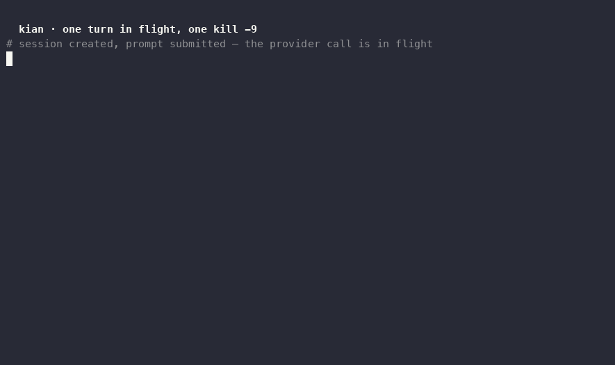
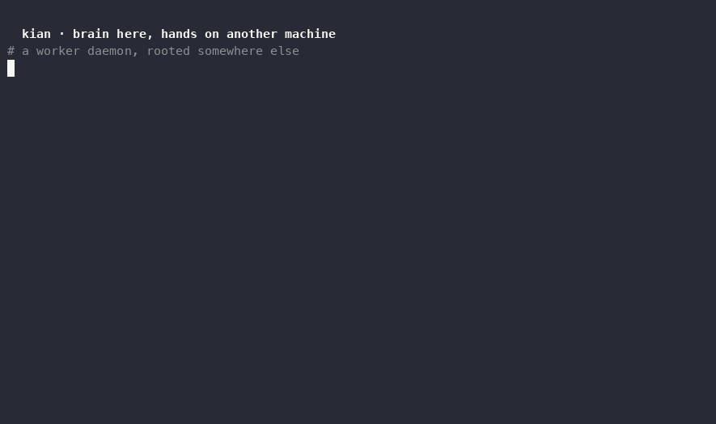

# Kian — the durable execution runtime for agents

[](LICENSE)
[](https://github.com/flyer103/kian/actions/workflows/gates.yml)
[](https://github.com/flyer103/kian/releases)
[](Cargo.toml)

> **An open-source, model-neutral, self-hostable durable execution runtime for agents.** A session
> survives the process, compute stays on machines you own, and the agent loop stays yours.

An agent implemented as one process running one conversation has a single point of failure that is
structural, not incidental: it dies with its process, it cannot be redirected at a safe boundary, it
cannot prove what it did, and it re-pays for its own context on every turn. Kian makes the
**Session** the durable entity, the **event stream** the only truth, and each execution interval (a
**drain**) disposable — so a crash, a deploy or a machine move costs a restart, not the work.



## Who this is for

- You run agent work that takes minutes to hours, and a restart or an OOM currently costs you the
  whole run.
- The code, data and credentials have to stay on your machine — a hosted sandbox is not an option.
- You already have a loop you like (the built-in ReAct, or Claude Code / Codex / dsh) and will not
  rewrite it for durability.

And what it explicitly does **not** promise, because that shape is wrong for some teams: no
cross-worker failover (a binding is immutable, moving machines means a new session), no
exactly-once commands (the queue is at-least-once and results dedupe on command id), no byte-level
replay for projection-only harnesses (if kian cannot see the request bytes, it will not claim it
can). Those boundaries are in [docs/SPEC.md](docs/SPEC.md) and the
[capability matrix](design/HARNESS-BRIDGE.md), not in a footnote.

## Features

Three properties separate a *runtime* from an agent framework: work that survives the process,
machines you choose, and the loop you already run.

- **Durable execution** — a crash, deploy or machine move costs a restart, not the work. Session
  state is a projection of an append-only stream, a new drain replays that stream and continues, and
  the exact model request bytes are persisted before the call flies (`step/request`) — so replay is
  byte-identical and the provider's prefix cache survives a takeover.
- **BYOM execution** — bring your own machine. A single-binary `kiand` daemon runs the session's
  commands on the box you pick, over a durable at-least-once queue, bound 1:1 to its worker session
  for that session's whole life; offline work parks and resumes honestly, and nothing migrates
  behind your back.
- **Harness integration** — bring your own loop. The built-in ReAct loop, or dsh / Claude Code /
  Codex behind the same `LoopDriver` seam and the same event kinds, selected **per worker agent**
  ([ADR-049](design/decisions/ADR-049-per-agent-harness-selection.md)). A harness-owned loop is a
  *projection-only* session, and the [capability matrix](design/HARNESS-BRIDGE.md) says exactly what
  each one supports instead of implying they are equivalent.

Everything else — the super-agent bundle, channels, scheduled turns, agent memory, hook plugins,
the read model, the operator CLI and the embedded SDK — is in
[docs/advanced.md](docs/advanced.md), one section and one runnable snippet per capability.

## How it works

- **Session** — the one first-class durable entity; turns, threads and endpoints derive from it.
- **Event stream** — append-only and never rewritten; session state is a projection of it, so the
  stream is also the audit record. The exact model request bytes are persisted before the call
  flies (`step/request`), which makes replay byte-identical.
- **Drain** — the execution hold interval: claim the session (epoch + lease), consume everything
  eligible, promote inputs only at provider-turn safe boundaries, then exit. A drain has no durable
  identity; after a crash a new drain replays the stream and continues.
- **BYOM endpoint** — the hands: a `kiand` daemon runs the session's commands on a machine you
  choose over a durable at-least-once queue; a worker session's 1:1 binding to its daemon is event
  bytes re-derived from the stream, so restarts and migrations keep it.
- **Admit before wake** — inputs are durable rows before any wake fires; wakes are advisory (they
  may fold or be lost), and the inbox rebuild at startup re-derives them.
- **Safety by fencing** — the end write is one atomic append; every drain write carries a monotonic
  epoch and the store rejects stale writes via `expectedSeq` CAS. Leases only detect recoverable
  sessions, never authorize writes.
- **Honesty** — `interrupted ≠ failed`; an empty model response is a soft failure; a completion must
  pass the evidence gate. Compression is the only deliberate prefix-invalidation point.
- **The loop is control flow** — the core holds and persists execution; the agent loop (built-in
  ReAct, or a harness behind the `LoopDriver` seam) decides what to do inside a drain.

Read more: [docs/overview.md](docs/overview.md) (the model in one page),
[docs/SPEC.md](docs/SPEC.md) (the contract), [design/DESIGN.md](design/DESIGN.md) (the blueprint),
[design/EVENT-MODEL.md](design/EVENT-MODEL.md) and [design/API-CONTRACT.md](design/API-CONTRACT.md)
(the normative event and wire contracts), [design/decisions/](design/decisions/) (the ADRs).

## Install

Three ways in, fastest first. Each one ends at the same `kian.yaml`.

```bash
# 1. container (no toolchain; state in a volume)
docker run --rm -p 7433:7433 -e DEEPSEEK_API_KEY \
  -v "$PWD/docker/kian.yaml:/etc/kian/kian.yaml:ro" -v kian-data:/data \
  ghcr.io/flyer103/kian

# 2. prebuilt binary (macOS arm64/x86_64 and Linux x86_64/aarch64, on the releases page)
curl -fsSL https://github.com/flyer103/kian/releases/latest/download/kian-aarch64-apple-darwin.tar.gz \
  | tar -xz -C /usr/local/bin kian kiand

# 3. from source (Rust stable 1.85+)
cargo build --release --workspace
```

The container image and the archives are produced by
[`.github/workflows/release.yml`](.github/workflows/release.yml) on every tag; the binary path swaps
the target triple for your platform.

## Quickstart

Prerequisites for the source path: Rust stable 1.85+ (`edition 2024`), plus `curl` and `jq`. Nothing
else — sqlite is embedded and a single `kian serve` process is the whole system.

The provider contract is `base_url` + OpenAI chat-completions + SSE. The config below points at
DeepSeek (`deepseek-flash`), and any OpenAI-compatible endpoint or gateway works unchanged.

### 1. Write `kian.yaml`

```yaml
listen: "127.0.0.1:7433"
storage:
  sqlite: "./kian.db"
agent:
  id: my-agent
  model_slots:
    main:
      provider: deepseek
      model: deepseek-flash                   # DeepSeek-V4.1-Flash
providers:
  deepseek:
    base_url: "https://api.deepseek.com"    # any OpenAI-compatible endpoint
    api_key_env: DEEPSEEK_API_KEY           # names the env var; the key never lives in the file
drain:
  max_iterations: 32
  lease_ttl_ms: 1500             # default 30000; shortened so a takeover is visible in seconds
  heartbeat_interval_ms: 300     # default 10000; must stay well under the lease TTL
recovery:                        # required: the policy table never defaults silently
  rules:
    - class: rate_limited
      action: {backoff_retry: {delay_ms: 500}}
    - class: unknown
      action: fail
```

Two rules are fail-closed: a missing `recovery:` section refuses to start (a policy table is never
implied), and a provider whose `api_key_env` variable is unset refuses to start (secrets never live
in the file). A malformed config never degrades into a running server.

### 2. Serve

```bash
export DEEPSEEK_API_KEY=sk-...      # the variable named by api_key_env above
kian serve --config kian.yaml       # or: cargo run -p kian-cli --bin kian -- serve --config kian.yaml
```

The process stays in the foreground on `127.0.0.1:7433`. Prefix local commands with
`NO_PROXY=127.0.0.1,localhost` on macOS — the system proxy otherwise intercepts localhost.

### 3. Run a session

```bash
SID=$(curl -s localhost:7433/rpc -H 'content-type: application/json' \
  -d '{"jsonrpc":"2.0","id":1,"method":"create_session"}' | jq -r .result.session)

curl -s localhost:7433/rpc -H 'content-type: application/json' \
  -d "{\"jsonrpc\":\"2.0\",\"id\":2,\"method\":\"submit\",\"params\":{\"session\":\"$SID\",\"content\":\"hello kian\"}}"
# {"id":2,"jsonrpc":"2.0","result":{"deduplicated":false}}

curl -sN localhost:7433/sessions/$SID/events      # live SSE stream; ends after session/ended
```

The stream *is* the audit record. Abridged — captured against a local OpenAI-compatible stub
(hence the reply text), ids shortened, and the full `step/request` body elided:

```
event: kian
data: {"seq":1,…,"kind":"session/created","bytes":{},"version":0}
data: {"seq":2,…,"epoch":1,"kind":"drain/claimed","bytes":{"epoch":1,"holder":"kian-serve"}}
data: {"seq":3,…,"kind":"input/admitted","bytes":{"content":"hello kian","role":"user"}}
data: {"seq":6,…,"kind":"step/request","bytes":{"body":{…,"messages":[{"content":"hello kian","role":"user"}]},"iteration":0,"model":"deepseek-flash"}}
data: {"seq":7,…,"kind":"assistant/message","bytes":{"content":{"text":"hello from a scripted provider"},"role":"assistant"}}
data: {"seq":9,…,"kind":"session/ended","reason":"completed","bytes":{}}
event: done
data: ended
```

Note `step/request`: the exact request bytes are persisted **before** the call flies, which is what
makes replay byte-identical. Read state back from the projection, never from a column:

```bash
curl -s localhost:7433/rpc -H 'content-type: application/json' \
  -d "{\"jsonrpc\":\"2.0\",\"id\":3,\"method\":\"projection\",\"params\":{\"session\":\"$SID\"}}"
# {"id":3,"jsonrpc":"2.0","result":{"state":"completed"}}

kian session inspect "$SID" --config kian.yaml
kian session replay "$SID" --config kian.yaml    # derives the same bytes
kian session export "$SID" --config kian.yaml --out audit.jsonl
kian cache-stats --config kian.yaml --json       # prefix-cache stability report
```

### 4. Prove durability: `kill -9` mid-turn, restart, no lost work

Submit an input, `kill -9` the server while the provider call is in flight, then restart on the same
sqlite file:

```bash
SID2=$(curl -s localhost:7433/rpc -H 'content-type: application/json' \
  -d '{"jsonrpc":"2.0","id":5,"method":"create_session"}' | jq -r .result.session)
curl -s localhost:7433/rpc -H 'content-type: application/json' \
  -d "{\"jsonrpc\":\"2.0\",\"id\":6,\"method\":\"submit\",\"params\":{\"session\":\"$SID2\",\"content\":\"run the long job\"}}"

sleep 1
kill -9 <pid-of-kian-serve>
kian session inspect "$SID2" --config kian.yaml
```

```
state               running
requests            1               <- the request bytes are durable; the turn is not finished
assistant messages  0
```

The session is still `running`: no end write happened, and the dead drain's lease has not expired —
leases are liveness only, their job is to make the session *detectable* as recoverable. Restart
`kian serve` on the same `kian.db`; the recovery sweep takes over and a new drain continues from the
stream:

```
state               completed
events              12 (next seq 13, epoch 2)
drain claims        2
```

The takeover rewrites no earlier event (the stream shows `drain/claimed` epoch 2), and the retried
request derived a byte-identical message prefix. The process died; the work did not. Safety came
from the **epoch**, not from the lease: a partitioned-but-alive old holder would be fenced out the
same way. The automated version of this run, with six kill points and repeated iterations, is
`crates/kian-cli/tests/chaos_recovery.rs`.

The GIF at the top of this file is exactly this run, recorded from a real process.
[`docs/assets/durable-execution.cast`](docs/assets/durable-execution.cast) replays it in a terminal
(`asciinema play`).

### 5. Test

```bash
cargo test --workspace
```

Everything — unit, wire-level e2e against a scripted mock provider, and the kill-and-restart
(chaos-style) suite — runs in the default workspace test invocation. Local e2e sets
`NO_PROXY=127.0.0.1,localhost` itself. Suites whose environment is absent skip with a log line and
never fail; see the [environment contract](#environment-contract).

## Examples

- [examples/issue-watch](examples/issue-watch/README.md) — a resident Router triaging the issues of
  one repository: poll intake → admission classes → `spawn_worker` under a mandate → a speak-rule →
  the outbox. ~15 minutes to a first drafted comment, `DRY_RUN` fail-closed.

The BYOM half has its own recording: a `kiand` daemon on another workspace, one event in, and the
command runs on the worker, not on the process that decided to run it.



## Environment contract

Default CI needs none of these — every gated suite **skips with a log line, never fails**:

| Env var | Used by | Absent behavior |
|---------|---------|-----------------|
| `KIAN_PG_URL` | postgres store/exec suites and the multi-replica e2e | skip with a log line |
| `KIAN_DSH_BIN` | the dsh live smoke; default command source for a configured dsh harness | smoke skips; a mounted harness without a command refuses to start |
| `KIAN_CLAUDE_BIN` | the Claude Code live smoke; default command source for a configured `harness.claude` | smoke skips; a mounted harness without a command refuses to start |
| `KIAN_CODEX_BIN` | the Codex live smoke; default command source for a configured `harness.codex` | smoke skips; a mounted harness without a command refuses to start |
| `KIAN_GITHUB_TOKEN` | github channel send and poll reads | `send: true` refuses to start; public polls run tokenless |
| `KIAN_GITHUB_WEBHOOK_SECRET` | webhook HMAC verification | a github webhook channel refuses to start |
| `KIAN_LARK_APP_ID` / `KIAN_LARK_APP_SECRET` / `KIAN_LARK_CHAT_ID` / `KIAN_LARK_POLL_CHAT` | lark channel and live smoke | skip |
| `KIAN_IMESSAGE_BRIDGE_TOKEN` | imessage channel (the same secret as the Mac bridge's `token_file`) | a configured `type: imessage` channel refuses to start |
| `KIAN_API_KEY` | live-provider smoke | skip |

Secrets and URLs are env-only, never config values — the WeChat bot token is the one documented
exception: it is issued by a QR scan and kept in a `0600` file
([ADR-018](design/decisions/ADR-018-wechat-ilink-channel.md)). Executed live records live in
[CHANGELOG.md](CHANGELOG.md).

## License

[Apache-2.0](LICENSE). Security reports: [SECURITY.md](SECURITY.md).
