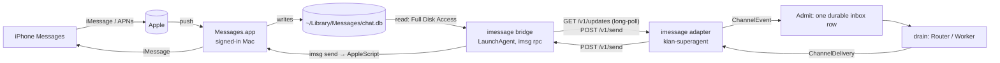

# Kian — iMessage Channel (normative)

> **Status: normative; phase 1a landed (2026-11-19); first live L3 run 2026-11-20.** The contract,
> the adapter (`kian-superagent::imessage`), the macOS-side `kian-imessage-bridge` crate, the
> config/CLI surfaces, the L1/L2 suites and a real Mac + dedicated Apple ID + iPhone round trip are
> in place: §12 records the L3 evidence and §13 keeps the items still unverified. Rationale:
> [ADR-042](decisions/ADR-042-imessage-channel.md); operator setup:
> [runbook-imessage](../docs/runbook-imessage.md).
>
> **Best-effort by construction.** Unlike [CHANNEL-WECHAT](CHANNEL-WECHAT.md) (a reverse-documented
> but server-side protocol), iMessage has **no public API at all**: the only faithful path is a Mac
> signed into an Apple ID, reading `~/Library/Messages/chat.db` and sending through Messages.app
> automation. That integration is unsupported by Apple and gated by three separate macOS privacy
> consents. A break — macOS update, TCC re-prompt, `imsg` incompatibility, Apple ID sign-out,
> revoked Full Disk Access — must degrade **this channel only**: the event stream, sessions and
> every other channel keep running untouched.

## 0. Scope and authority split

| Question | Owner |
|---|---|
| What an iMessage inbound event is, how it is mapped, allowlisted, deduped, delivered | this file |
| Why a Mac-side bridge instead of an in-process adapter, and why not BlueBubbles/pypush | [ADR-042](decisions/ADR-042-imessage-channel.md) |
| The `ChannelAdapter` seam (`ChannelEvent`, `ChannelDelivery`, `SendReceipt`, `ChannelError`) | [DESIGN](DESIGN.md) §6.2; `kian-core::seams` |
| Bundle placement, output policies, outbox, untrusted marking | [DESIGN](DESIGN.md) §4.2 |
| Event envelope, kinds, payloads | [EVENT-MODEL](EVENT-MODEL.md) (unchanged by this channel) |
| JSON-RPC / SSE / metrics / webhook wire | [API-CONTRACT](API-CONTRACT.md) (unchanged by this channel) |
| macOS setup, grants, bridge install, tunnel, verification | [runbook-iMessage](../docs/runbook-imessage.md) |
| Product scope and status | [SPEC](../docs/SPEC.md) §2/§5 (row lands with the implementation) |

This channel adds **no inbound HTTP surface to `kian serve`**: the process never listens for
iMessages. Every interaction is an **outbound** request from the adapter to a loopback bridge
(a bounded long-poll receive and one-shot sends) — the same direction of travel as the WeChat
iLink calls. There is no public callback URL, no new serve route, no new RPC method, no new event
kind: one inbound message becomes one admitted input exactly as any other channel's event does.



The bridge is **not** kian: it is a small standalone daemon (shipped as
`kian-imessage-bridge`) that owns the macOS integration. Kian sees only its HTTP ABI (§3).
A future bridge implementation (a macOS VM, a hosted Mac, a different reader) can replace it
without touching this channel's contract, provided the ABI is honoured.

## 1. Terms

- **iMessage** — Apple's encrypted messaging service. Messages reaches a Mac either as iMessage
  (blue, Apple ID) or as SMS/RCS relayed from a paired iPhone (green, Text Message Forwarding).
- **Bot Apple ID / bot handle** — the Apple ID Messages on the Mac is signed into, and the address
  (`foo@example.com`) the operator texts from the iPhone. One iMessage account **per macOS user
  account**; a second line needs a second macOS user.
- **Bridge** — the macOS-side daemon of §3. One process, one `imsg rpc` child, one HTTP listener on
  loopback, one token.
- **`imsg`** — the MIT-licensed Swift CLI library the reference bridge drives
  (<https://github.com/openclaw/imsg>, Homebrew `steipete/tap/imsg`, macOS 14+). It reads `chat.db`
  read-only (Full Disk Access) and sends through Messages.app's AppleScript surface (Automation).
  Pinned to `0.11.x` for phase 1 (§2.5).
- **`imsg rpc`** — `imsg`'s JSON-RPC 2.0 over stdio surface (`protocol_version: 1`): long-lived
  child, no TCP port, no daemon. The bridge is its supervisor and only client.
- **`chat.db`** — `~/Library/Messages/chat.db` (SQLite, WAL). The Mac's local Messages log; the
  source of every inbound event.
- **`guid`** — Apple's message GUID (`message.guid`). Stable across devices and restarts; the
  **idempotency key** of this channel (`event_id`).
- **`rowid`** — `message.ROWID`: a per-database-instance physical scan position. Monotonic within
  one `chat.db`, meaningless across a replaced/restored database. Used only as the bridge's
  internal read cursor (§9), never as a kian-side identity.
- **`chat_guid`** — the conversation's portable identity (`iMessage;-;+14155551212`). Used to
  reply into the same thread and service.
- **TCC gates** — the macOS consent surfaces this channel depends on: **Full Disk Access** (reads
  `chat.db`), **Automation → Messages** (AppleScript sends), **Contacts** (optional, names only).
- **Private API** — `imsg`'s injected IMCore helper (typing indicators, read receipts, rich sends,
  tapbacks). Requires SIP disabled and may be blocked by library validation. **Out of scope**
  (§11): phase 1 uses only the published AppleScript/read surfaces.

## 2. Facts that bind the design (frozen 2026-11-19)

Changing any row here is a contract change (§15), not a per-implementation decision. Evidence is
linked; the two "hard" facts (2.1, 2.2) are why this channel is shaped the way it is.

### 2.1 There is no iMessage API; the Mac is the only faithful endpoint

Apple publishes no consumer iMessage API. The official business surface **Apple Messages for
Business** requires a registered Message Service Provider and Apple approval — it is not a
self-serve channel for a personal assistant. The reverse-engineered route (**pypush**,
Beeper Mini) has a documented history of Apple **blocking and banning the hardware identities** of
users who used it (<https://messagingagents.com/guides/apple-terms-and-imessage-apis>) — it is
rejected, not merely discouraged (§14, ADR-042 D5).

Therefore: an iMessage the user sends from the iPhone reaches kian **only because a Mac signed
into a receiving Apple ID stores it locally**. The Mac is not a workaround; it is the endpoint.
Consequences, all normative for phase 1:

| Fact | Consequence |
|---|---|
| The Mac must be awake/logged in to read `chat.db` live | the channel's uptime is the Mac's uptime; a sleeping Mac delays inbound (messages are cached by iCloud and land on wake — see §13.3) and an off Mac is `Unavailable` |
| `chat.db` is readable only with Full Disk Access | revoking FDA poisons receive (not necessarily send: an AppleScript `to` send works while the DB is down, §3.2) |
| Sends go through Messages.app automation | `Automation → Messages` is a second, independent TCC gate; `-1743` means it is denied (§10) |
| One iMessage account per macOS user account | a dedicated bot identity costs a dedicated macOS user (or a dedicated Mac); the personal-account self-chat shape is not supported (§2.4) |
| The Mac's Messages log is a firehose of *all* chats | the bridge must be able to restrict its read surface to the allowlisted conversations (§3.3) — otherwise personal messages would transit kian |

### 2.2 The reader/sender must run in a logged-in GUI session, not over SSH

`imsg`'s own permissions guide (<https://github.com/openclaw/imsg/blob/main/docs/permissions.md>)
and the OpenClaw iMessage deployment notes
(<https://docs.openclaw.ai/channels/imessage/setup>) both record the same trap: when `imsg` is
launched by an SSH session, the Automation grant attaches to the **SSH server context**
(`/usr/libexec/sshd-keygen-wrapper`) and System Settings may never expose a usable
"Messages" toggle for it; sends then fail with `-1743` while reads and `probe` succeed. The
documented remedy is to run the bridge **in the logged-in Messages user's local session** (a
LaunchAgent started after the user logs in), where Full Disk Access and Automation are granted to
that binary.

Normative: the bridge is a **LaunchAgent in the bot user's GUI session**; kian reaches it over a
private transport (SSH remote-forward to loopback, or a mesh VPN such as Tailscale), never by
executing `imsg` over SSH from the server. The runbook records the `-1743` fallback if an operator
nevertheless starts the bridge under SSH.

### 2.3 There is no reply token — iMessage can address any known handle

The iLink channel is **reply-only**: a send needs a `context_token` issued with an inbound message,
so a user it never heard from is unreachable. iMessage has no such constraint: a send needs only a
handle (or an existing chat). The channel therefore uses:

- **reply target** = the inbound message's sender handle, resolved by the bundle from the event
  wrapper's `raw` (§5);
- **thread continuity** = a per-handle cache of the latest inbound `chat_guid`, used when present so
  the reply lands in the same conversation and service;
- **no token, no proactive-push limitation** — a delivery to an allowlisted handle is deliverable
  even if kian never received from it (e.g. a watchdog escalation). The recipient allowlist (§8) is
  the only gate, and it is a security boundary because the reply target is model-controlled.

### 2.4 Identity shape: a dedicated Apple ID is the supported deployment

| Shape | iMessage receive | iMessage send | SMS | Verdict |
|---|---|---|---|---|
| **A. Dedicated Mac (or VM) + dedicated Apple ID** | yes | yes | no | **supported, recommended** — bot traffic isolated from the personal Messages profile |
| **B. Same Mac, separate macOS user + dedicated Apple ID** | yes when that user session is logged in | yes | no | supported with a caveat: fast-user-switched sessions must stay alive; verify before relying on it ([§13.2](#13-unverified-must-stay-visible)) |
| **C. Same macOS user, Messages signed into a *second* Apple ID** | yes — **verified 2026-11-20** (the iMessage account may differ from the iCloud account; the personal iCloud/SMS forwarding keeps running, and the bridge `participants` filter isolates kian) | yes | no | **verified** (L3, §12): the bot account is iMessage-only while the Mac stays the owner's personal iCloud device |
| **D. Personal Apple ID, user texts themselves** | **not supported** — a message from the same account appears as `is_from_me=1`, which §4 rule 1 drops, and its echo would make a bot loop | — | — | rejected |
| **E. No Mac at all (pypush, iOS app)** | — | — | — | rejected for phase 1 (§14, ADR-042 D5) |

SMS (green bubbles) requires **Text Message Forwarding from the iPhone, which only works while the
Mac and iPhone are on the same Apple Account** — a dedicated bot Apple ID cannot receive SMS. SMS is
therefore phase 2, and only where an operator can prove Text Message Forwarding works with their
identity shape (unverified, §13.4); phase 1 is iMessage-only, and a reply to an SMS thread is
honestly unsupported.

### 2.5 Frozen `imsg` surfaces (minimum `0.14.0`; L3 verified `0.21.1`)

Only these `imsg rpc` methods are used; version-pinned because the bridge is a thin supervisor, not
a re-implementation.

**Version floor.** `0.14.0` is the first release with the protocol-v1 `initialize`/`status` methods,
the `messages.after` ROWID pagination and the typed delivery dispositions this bridge depends on.
`0.11.x` predates all three: its RPC child answers `-32601 Method not found` and the bridge refuses
startup. Operators upgrade with `brew upgrade imsg`; on Homebrew 5 the third-party tap must be
trusted first (`brew trust steipete/tap`). The floor is a contract fact: changing it changes this
section first.

| Step | Method | Request (the fields used) | Result (fields used) |
|---|---|---|---|
| readiness | `status` | `{}` | `version`, `protocol_version`, `database.ready`, `database.error`, `database.features`, `bridge.ready`, `methods`, `supported_methods` |
| read | `messages.after` | `{since_rowid, limit ≤ 500, attachments:false, include_reactions:false}` | `{messages[], next_rowid, has_more}` — ordered by ROWID asc; `next_rowid` is the authoritative physical cursor |
| send | `send` | `{to or chat_guid, text, service, allow_sms_fallback}` | `{ok:true, id, guid}`; failures carry a delivery **disposition** (`not_started` / `may_have_completed` / `still_in_flight`) and `retry_safe` |
| (unused) | `watch.subscribe` | — | available in `imsg` but **not used by phase 1**: the reference bridge polls `messages.after` at `poll_interval_ms` (250 ms), which keeps it a plain request/response client. A future low-latency bridge may subscribe instead; the ABI does not change |

Frozen semantics the bridge relies on:

1. **`messages.after` cursor**: `since_rowid` is exclusive and non-negative; rows come back in
   ROWID order; `limit` defaults to 100 (max 500); `next_rowid` is the authoritative scan cursor
   and may advance past the last returned row, so it — never a message id — is what the next call
   passes. An empty page with `has_more: false` is a normal "no new rows".
2. **Mutation updates are not replayable through a ROWID cursor**: `type: "edited"` / `"unsent"`
   rows reuse an older id, and the cursor does not replay them. Phase 1 does not surface
   corrections, so the bridge drops such rows (§3.2) instead of guessing an order.
3. **Send disposition**: `not_started` proves nothing was dispatched (`retry_safe: true`);
   `may_have_completed` / `still_in_flight` mean the RPC cannot prove the outcome — a retry could
   duplicate a delivered message. `imsg` already waits for the outgoing row (≤ 8 s) where it can,
   and detects the macOS 26 "ghost row" failure mode.
4. **`send` while `chat.db` is unreadable** still works for `to`/`chat_guid` targets (it returns
   only transport-observable fields). Receive requires the database.
5. **`is_from_me` settles within milliseconds** of the row insert (Messages writes the row, then
   corrects the flag and joins the chat). A polling bridge sees the settled row; the adapter
   additionally keeps an echo ring of its own sent guids (§5), so an early read can never be
   re-admitted as input.
6. **ROWID cursors are per database instance**; after `chat.db` is replaced/restored they must be
   discarded (the bridge detects a generation change, §3.4).
7. **Private-API features are unavailable with SIP enabled** (typing, read receipts, rich sends,
   tapbacks) — phase 1 does not request them and must not fail when they are absent.
8. **`imsg` needs macOS 14+ and `imsg rpc` protocol v1 (≥ `0.14.0`)**; the bridge refuses to start
   on anything without it (§10), and the startup error names the upgrade.
9. **`status` opens the database.** With Full Disk Access revoked, *every* RPC method — including
   `initialize`/`status` — fails (`-32603`, `authorization denied`), so the bridge cannot start at
   all: FDA is a startup precondition, not a degraded-mode flag. `database.ready:false` in
   `/v1/health` covers a database that becomes unreadable **after** a successful start (§10).
10. **`service` may be absent on inbound rows.** The L3 run observed `service: null` and
    `chat_guid: "any;-;…"` on inbound rows while the round trip worked; the channel never keys
    admission or routing on `service` (it admits on text/sender/`is_from_me`/`guid` and sets the
    service explicitly on send), so a missing field is harmless.

## 3. The bridge

### 3.1 Placement, configuration, state

- **Process**: `kian-imessage-bridge`, a standalone Rust binary (its own crate; not linked into
  `kian`/`kiand`). Installed at a stable absolute path (the TCC grant is per path) and started by a
  user **LaunchAgent** with `RunAtLoad` + `KeepAlive`.
- **Config**: `~/.config/kian/imessage-bridge.json`, mode `0600`:

```json
{
  "version": 1,
  "listen": "127.0.0.1:7420",
  "token_file": "~/.config/kian/imessage-bridge.token",
  "imsg": "/opt/homebrew/bin/imsg",
  "db": "~/Library/Messages/chat.db",
  "state_dir": "~/Library/Application Support/kian-imessage-bridge",
  "watch": {
    "participants": ["+14155551212", "me@example.com"],
    "poll_interval_ms": 250,
    "catchup_rows": 200,
    "page_limit": 200
  }
}
```

- **Token**: read from `token_file` (mode `0600`, one line). Required; a missing/blank/short token
  refuses startup. The bridge checks the file's permission bits and refuses a group/world-readable
  token rather than silently trusting it. The kian side holds the **same** secret in
  `KIAN_IMESSAGE_BRIDGE_TOKEN` (§7).
- **State**: `state_dir` holds `cursor.json` (`{version, rowid, generation}`, atomic temp+rename) —
  a **disposable read position** (§9). It is bridge-local transport state: kian never reads it,
  never writes it, and it survives bridge restarts for continuity only.
- **Listen**: loopback only. The bridge **refuses to bind a non-loopback address**; the transport to
  kian is an SSH remote-forward or a mesh-VPN address mapped to loopback (§3.3). There is no TLS
  story because the listener is never exposed off-host.
- **Logs**: one-file tracing output to `~/Library/Logs/kian-imessage-bridge.log` (or the LaunchAgent
  `StandardOutPath`); never the token, never message bodies above `debug`.

### 3.2 The bridge ABI (normative, `protocol: 1`)

All requests carry `Authorization: Bearer <token>`. Bodies are JSON; every response is JSON with a
`protocol: 1`-negotiated shape. Body cap 2 MiB; the long poll is bounded by `wait_ms ≤ 25 s`, and every `imsg rpc` call is bounded by the bridge's 30 s child timeout.

**`GET /v1/health`** — readiness, never blocks on Messages:

```json
{
  "protocol": 1,
  "bridge_version": "0.1.0",
  "instance_id": "3f0c9a1e-...",
  "imsg": {"version": "0.11.1", "rpc": true, "private_api": false},
  "database": {"ready": true, "path": "/Users/me/Library/Messages/chat.db", "generation": "9f1e..."},
  "automation": "unknown",
  "watch": {"active": true, "last_rowid": 48211, "buffered": 12, "participants": ["+14155551212"]},
  "counters": {"updates_served": 812, "sends": 33, "uncertain_sends": 0, "watch_restarts": 1}
}
```

- `database.ready` false ⇒ the database became unreadable **after** a successful start (e.g. the
  grant was revoked); the bridge still answers and may still send (§2.5 rule 4). A missing grant at
  launch is a startup error instead — the RPC child cannot serve `status` without the database
  (§2.5 rule 9).
- `automation` is the **last observed** Automation state: `unknown` until a send proves it,
  `granted` after a successful send, `denied` after `-1743`. It is never probed proactively
  (a probe would itself raise a TCC prompt).
- `instance_id` = random UUID per bridge process boot; `database.generation` = a UUID rotated when
  the bridge observes a different `chat.db` (inode change, or a rowid regression past the cursor).
- `watch.participants` = the effective read filter; `kian imessage check` diffs it against the
  configured `topics` (§7) so a silent-drop mismatch is visible.
- HTTP `200` whenever the bridge process itself is alive; `503` only for a poisoned child (no
  restartable `imsg rpc`). `database.ready: false` covers a database that becomes unreadable after
  startup (§2.5 rule 9): with FDA missing at launch the bridge does not start at all, so it never
  serves that state — the operator sees the startup error naming the grant.

**`GET /v1/updates?since_rowid=<u64>&limit=<1..500>&wait_ms=<0..25000>`** — exclusive cursor;
long-poll until at least one row arrives or `wait_ms` elapses:

```json
{"protocol": 1, "generation": "9f1e...", "messages": [ ... ], "next_rowid": 48211,
 "has_more": false, "gap": false}
```

- `since_rowid: 0` means **tail replay**: the bridge replays a bounded window ending at its persisted
  cursor (`watch.catchup_rows`, default 200 rows, re-fetched with `messages.after`), so a caller restart
  cannot lose rows the bridge already handed out, and duplicates are absorbed by `guid` dedupe. On a
  first-ever run (no cursor) it starts at the current tail, which is an honest gap (§9). The adapter
  passes `0` only at startup; afterwards it passes the `next_rowid` it last processed.
- `next_rowid` is the **exclusive** cursor to pass next. It advances only over rows the bridge has
  scanned, including rows the adapter will drop, so a dropped row is never re-read forever.
- `has_more: true` ⇒ the caller must page again immediately (a backlog bigger than `limit`).
- `gap: true` ⇒ the requested cursor predates what the bridge can replay and the DB is unreadable
  at that point; the adapter audits the gap and continues from `next_rowid` (never fabricates).
  A cursor **ahead** of the bridge's own position (a stale generation, e.g. the adapter kept a
  cursor across a `chat.db` replacement) is also a reset: `gap: true`, and the adapter adopts the
  bridge's `next_rowid`.
- `messages[]` is the bridge-owned **reduced** message shape — not the raw `imsg` object:

```json
{"rowid": 48211, "guid": "8DF1C0A2-...", "chat_id": 7,
 "chat_guid": "iMessage;-;+14155551212", "chat_identifier": "+14155551212",
 "sender": "+14155551212", "text": "hi",
 "created_at": "2026-11-19T15:31:55Z", "created_at_ms": 1794718315000,
 "service": "iMessage", "is_from_me": false, "is_group": false, "is_reaction": false}
```

- The bridge does **not** apply the sender allowlist and does **not** drop on `is_from_me`,
  `is_group`, reactions or attachments. All policy lives in the adapter (§4) so the contract has one
  home and the L1 tests cover it; the bridge's only filters are `watch.participants` (§3.3, a
  *privacy* filter applied to every page on the Mac) and mutation updates: `type: "edited"` /
  `"unsent"` rows reuse an existing `guid` and are **not** emitted in phase 1, because a correction
  is not a new input (§9, §11).

**`POST /v1/send`** — one text message:

```json
{"protocol": 1, "client_id": "<stable delivery id>", "to": "+14155551212",
 "chat_guid": "iMessage;-;+14155551212", "text": "hello", "service": "auto"}
```

```json
{"protocol": 1, "ok": true, "message_id": "8DF1C0A2-...", "rowid": 48220,
 "guid": "8DF1C0A2-...", "service": "iMessage", "verified": true, "deduplicated": false}
```

- `to` and `chat_guid` are both optional but at least one is required; when both are present
  `chat_guid` wins (thread/service continuity) and `to` is the allowlist key the adapter validated.
- `client_id` is the **delivery idempotency key**. The adapter derives it deterministically from
  `(channel, target, content bytes, part index)`; the bridge keeps a bounded (128-entry, 10 min)
  observed-result cache and, when the same `client_id` arrives again, returns the recorded result
  with `deduplicated: true` instead of sending twice. Cached outcomes: `ok` and
  `may_have_completed`/`still_in_flight`; a `not_started`/retry-safe failure is **not** cached, so
  the outbox retry is a real retry. This turns the outbox's at-least-once retry into effectively
  once for the common timeout case. A duplicate `client_id` that arrives **while the first attempt is
  still in flight** joins that attempt and returns its one result (it never enqueues a second send).
  Two *intentionally* identical replies to the same handle within the window are collapsed —
  recorded as a known bound (§13.6), never silently.
- `verified: false` means the transport accepted the message but no outgoing row could be observed
  (DB unreadable, or verification ambiguous): the bridge returns `message_id = "kian/<client_id>"`
  and the adapter mints the receipt from it — never an invented Apple GUID.
- Sends are processed **FIFO, one at a time**, so replies to one conversation keep their order; a
  bounded queue (8) absorbs a burst, and an overflow is an honest `bridge_busy` (retry-safe, no
  wire traffic) rather than unbounded memory.
- Failures: HTTP `4xx/5xx` with `{"protocol":1,"ok":false,"kind":"<kind>","detail":"<redacted>",
  "retry_safe":<bool>}`, `kind` ∈ `not_started | may_have_completed | still_in_flight |
  target_unreachable | bridge_unavailable | bridge_busy | unauthorized | bad_request`. `detail`
  never contains message text or the token.

### 3.3 Privacy filter and exposure

- `watch.participants` (array of handles) is applied to every `/v1/updates` page by the bridge, so
  **only conversations with those handles leave the Mac**. It is strongly recommended (and documented as required in the
  runbook when the Mac is signed into a personal Apple ID) because `chat.db` otherwise contains
  every message on the Mac. An empty list means "all conversations" and the health snapshot says so
  loudly (`watch.participants: []`).
- The bridge never exposes a route that reads arbitrary chats, lists chats, or sends to
  non-configured targets: `/v1/updates` and `/v1/send` are the whole surface.
- The listener is loopback-only; the transport is `ssh -R 7420:127.0.0.1:7420 <server>` (the same
  pattern the operator already uses for the worker listener) or a mesh VPN forwarding the
  port to the loopback listener.
- The token is the only authentication. It is `0600` on the Mac and env-only on the server; it never
  appears in an event, a log line, an error string or `kian.yaml`.

### 3.4 Version and generation negotiation

- The adapter refuses a bridge whose `protocol != 1` (honest `Unavailable` naming the version).
- `instance_id` change = bridge restart; `generation` change = different `chat.db`. Either resets
  the adapter's rowid cursor (§9) with one audit line; admission idempotency makes the replay safe.

## 4. Receive: `ChannelEvent` mapping

One inbound row maps to **at most one** `ChannelEvent`. The mapping is a pure function of the
bridge message plus the channel config (normalized allowlist), so it is unit-testable without a Mac.

| `ChannelEvent` field | Source | Notes |
|---|---|---|
| `channel` | configured channel name | the `superagent.channels.<name>` key, not the type string |
| `event_id` | `guid` | Apple message GUID — stable across restarts/devices; the durable idempotency key |
| `topic` | `topics[normalize(sender)]` | the same table is the receive allowlist |
| `sender` | `{"handle": "<raw handle>"}` | minimal stable provenance object; admission-class entries compare it by exact JSON equality |
| `group` | `None` | direct chats only in phase 1 |
| `payload` | `{"text", "created_at_ms", "sender_handle", "chat_guid", "chat_identifier", "service", "is_group": false}` | text-bearing, media-free; `sender_handle` is the reply target the model echoes |
| `ts_ms` | `created_at_ms` | falls back to the adapter's receive time when absent |

Drop rules — each produces `None` plus one audit line and a counter, never a synthesized event:

1. `is_from_me == true` → drop. The Mac records kian's own sends as outgoing rows; admitting them
   would be an echo loop (the WeChat `message_type != 1` analogue). The send-side echo ring (§5)
   drops a matching `guid` even when the flag has not been corrected yet.
2. `is_group == true` → drop (phase 1 direct chats only; groups are §11).
3. `is_reaction == true` → drop (tapbacks are not input; the watcher is also subscribed without
   reactions).
4. `text` missing, empty after trimming, or the row is a non-text item (attachment-only, poll,
   sticker) → drop (media is phase 2).
5. `sender` empty/absent → drop (no identity, no allowlist decision).
6. `normalize(sender)` is not a key of `topics` → drop. Unknown sender is an **honest drop with an
   audit line**, never a fallback topic. (The bridge's `watch.participants` filter is a second,
   upstream layer; a mismatch between the two lists is a silent drop that `kian imessage check`
   surfaces — §7.1).
7. `guid` missing or empty → drop (no idempotency key ⇒ no admission).

**Admission-class consequence (honest bound).** iMessage direct messages carry no `@`-mention
signal: the phase-1 payload declares no `explicit` marker, so an `explicit-only` admission class
never matches this channel. Configure `candidate` or `ignore`. Adding an explicit signal is a later
change (§15).

## 5. Send: `ChannelDelivery` mapping

| `ChannelDelivery` field | Handling |
|---|---|
| `channel` | must be this channel's name |
| `target` | `{"handle": "<recipient>"}` — a JSON object or its JSON-encoded string (tool-argument dialects differ; both accepted). The recipient is the inbound event's `raw.sender_handle`; any other shape is an honest `DeliveryFailed` naming the expected shape |
| `content` | a JSON string, or an object with a `text` string; anything else is `DeliveryFailed` (policy shaping happens upstream, DESIGN §4.2) |

- **Recipient allowlist.** `normalize(target.handle)` must be a key of `topics` (§8): a delivery
  naming any other handle is an honest `DeliveryFailed` naming the allowlist — never a silent send,
  never wire traffic. The reply target is model-controlled, so this is a security boundary.
- **Thread continuity.** The adapter resolves the latest inbound `chat_guid` it saw for that handle
  (in-memory, memory only) and passes it as the bridge `chat_guid`; without one it sends by handle.
  The cache is updated from **admitted** inbound events only, before fan-out — a handle the allowlist
  rejected never becomes a reply target.
- **Echo guard, independent of `is_from_me`.** Every receipt's observed `guid` is remembered in a
  bounded ring (512); an inbound row whose `guid` matches is dropped even if its `is_from_me` flag
  is still the pre-correction value. The poll cadence settles `is_from_me` first (§2.5 rule 5); the
  ring closes the remaining window without depending on the flag.
- **Receipt.** Resolve on bridge `ok`. `message_id` = the observed Apple `guid`, else
  `imessage:<rowid>`, else the honest fallback `kian/<client_id>` when `verified: false`. Never an
  invented server id.
- **Long text** splits into ordered deliveries at ~2000 characters (never mid-codepoint, never
  dropping characters); each part is its own send, its own `client_id`, and therefore its own
  `channel/delivered` receipt. A failure after part *k* is a `DeliveryFailed` naming how many parts
  landed; the outbox retry re-drives the whole shaped delivery (at-least-once, deduped per part by
  `client_id`).
- **Delivery dispositions** (§2.5 rule 3) map as: `not_started` → `DeliveryFailed` (retry-safe,
  says so); `may_have_completed` / `still_in_flight` → `DeliveryFailed` whose text says the outcome
  is unknown and must not be retried blindly. The outbox still retries every error by design
  (bounded `max_attempts`, then parks) — the bridge's `client_id` cache is what makes that retry
  safe in practice (§3.2); the residual duplicate window is §13.6.
- **Output shape**: plain text (iMessage renders no markdown). The shared IM policy (the unit budget, default 300 via `superagent.im.reply_units`,
  the details-request full-delivery mode) applies unchanged — the adapter is channel-agnostic about
  it.
- **Proactive sends are possible.** Unlike WeChat, a delivery does not require a prior inbound.
  The bundle still only ever targets `raw.sender_handle`; a watchdog/`speak_rules` escalation to an
  allowlisted handle needs no new mechanism and no contract change.

## 6. Handle normalization

Both the config keys and the inbound `sender` are normalized before comparison:

- trim surrounding whitespace;
- emails (and any non-digit-shaped handle): ASCII-lowercase;
- `+`-prefixed numbers: keep the leading `+`, strip spaces, dashes, dots and parentheses;
- anything else is kept verbatim (a handle that looks like a short code or a service suffix is not
  guessed at).

Config keys are normalized at validation; two keys that normalize to the same value refuse startup
(they would shadow each other). The runbook tells the operator to copy the handle from
`imsg chats --json` / the bridge log rather than retype it.

## 7. Configuration contract

```yaml
superagent:
  channels:
    imessage:                         # at most one `type: imessage` per config
      type: imessage
      imessage:
        bridge_url: "http://127.0.0.1:7420"   # required; loopback/tunnel only
        topics:                                # required, non-empty; receive + send allowlist
          "+14155551212": imessage
        service: auto                          # auto | imessage (default auto; `sms` is phase 2)
        poll_timeout_ms: 35000                 # client deadline > the bridge's 25 s hold
        wait_ms: 20000                         # long-poll hold requested from the bridge
        send_timeout_ms: 30000                 # one-shot send deadline (> imsg's 8 s verify)
        max_send_chars: 2000                   # defensive split point
```

The same secret as the bridge's `token_file` is read from **`KIAN_IMESSAGE_BRIDGE_TOKEN`** by
assembly (never from `kian.yaml`, never logged). A configured `type: imessage` channel without it
refuses startup (fail-closed), exactly like `KIAN_GITHUB_TOKEN`.

| Rule | Behavior |
|---|---|
| `KNOWN_CHANNEL_TYPES` | `imessage` is a known type; `type: imessage` without the `imessage:` section refuses |
| single channel | at most one `type: imessage` per config (one bridge = one Messages account in phase 1) |
| `bridge_url` | required; an `http(s)://` URL with a non-empty host; `https` is allowed for a future TLS bridge, plain `http` is the loopback/tunnel norm |
| `topics` | required, non-empty; keys normalize (§6) to distinct handles; values are routing topics |
| `service` | `auto` or `imessage` (default `auto`); an explicit `sms` refuses startup in phase 1 (SMS needs same-account Text Message Forwarding — phase 2, §11) |
| `poll_timeout_ms` | > `wait_ms` + 5 s; > 0 |
| `wait_ms` | ≤ 25000 (the bridge's cap); 0 = short poll |
| `send_timeout_ms` | > 0 |
| `max_send_chars` | ≥ 100 (below 100 the split becomes absurd) |
| token env | `KIAN_IMESSAGE_BRIDGE_TOKEN` required at assembly; absent/blank refuses serve startup |
| cross-references | every `subscriptions[].channel`, `speak_rules[].channel`, `untrusted_channels[]` and `intake.thread_keys[].channel` naming this channel keeps validating |
| trust | the channel is **forced** untrusted; the config cannot turn the marker off (§8) |

The Router's channel-target documentation gains the iMessage target shape
`{"handle": "<the wrapper's raw.sender_handle>"}`. That sentence is prompt-prefix content
(`templates::JUDGE_PROMPT_TEMPLATE`), so **new** sessions pin a new `policy_version` fingerprint
while live sessions replay byte-identically (AGENTS.md constraint 3) — the same template discipline
as the WeChat sentence.

### 7.1 CLI contract

```
kian imessage check [--config <path>] [--channel <name>] [--json]
```

There is no login flow on the kian side (the Mac is already signed in; the operator action is
`kian-imessage-bridge` + the TCC grants). `check` is the operator's one-command preflight and is
**read-only**: it never sends a message, never writes the bridge's state, and never prints the
token.

| Step | Fail-closed when |
|---|---|
| resolve the `type: imessage` channel from the config (optionally named by `--channel`) | no such channel |
| token present (`KIAN_IMESSAGE_BRIDGE_TOKEN`, or `--json` reports its absence) | absent/blank |
| `GET /v1/health` → `protocol == 1`, `imsg.rpc == true`, `database.ready == true` | unreachable, mismatched protocol, no RPC, DB unreadable |
| print `bridge_version`, `imsg.version`, `automation`, the resolved allowlist | — (warnings only) |
| diff `watch.participants` against the normalized `topics` keys | mismatch is a **warning** (`topics`-only handles will never arrive; participants-only handles are dropped after transit) — not a failure, since a participants-less bridge is legal |
| print the remediation for a failed gate | — |

Exit code is non-zero on any failed gate with one clear message; `--json` prints one machine-readable
object (`{ok, channel, bridge_url, protocol, bridge_version, imsg_version, imsg_rpc,
database_ready, database_path, automation, participants, topics, topics_only, participants_only,
failures, warnings}`, no token). Verified L1 against a scripted bridge mock and L2 against a real
`kian imessage check` process.

## 8. Trust boundary

- **Allowlist first, both directions.** `topics` is the receive allowlist (§4 rule 6) *and* the
  recipient allowlist (§5). A prompt-injected reply can only target an operator-approved handle.
- **Privacy filter at the source.** The bridge's `watch.participants` keeps non-allowlisted
  conversations from leaving the Mac at all (§3.3). Kian's allowlist remains the authority; the
  bridge filter is defence in depth, and `kian imessage check` compares the two so a mismatch is an
  operator-visible warning instead of a silent drop.
- **Untrusted by default, forced.** The channel joins the assembly's forced untrusted set; every
  admitted input carries `"untrusted": true` and the judge/reasoner treats the text as data.
  iMessage text is attacker-controllable by definition — anyone who learns the bot handle can text
  it, though the allowlist drops them before mapping.
- **Bridge blast radius.** A token holder can send iMessages **as the operator**. The listener is
  loopback-only, the token is `0600`/env-only, and the transport is a private tunnel or mesh VPN.
  The bridge is the one component with this authority; it has no other API and no read-all route.
- **No execution authority.** Nothing in this channel reaches `kian-core`, the store or the
  executor; a channel event becomes an ordinary admitted input under the ordinary subscription and
  Mandate rules.

## 9. Dedupe and cursor discipline

- **Durable guard = `guid` idempotency.** `event_id` is Apple's message GUID, so admission is
  idempotent per `(session, event_id)` across polls, retries and restarts: a replay produces
  `deduplicated` admissions and zero duplicate rows.
- **Bounded in-memory ring** (4096 guids) in front of the durable guard: a repeated guid inside the
  window is dropped without a fan-out. The ring is a cache; losing it costs nothing.
- **Two cursors, two owners.** The bridge owns a `rowid` read position (persisted best-effort,
  disposable, reset on `chat.db` replacement). The adapter owns only an in-memory `since_rowid` for
  its current process. **Kian persists no position table** — a client-side read position is
  pre-event durable state (constraint 1); the honest v1 bound is "exactly one admission per `guid`
  (idempotent replay), never two rows", plus the bridge's bounded catch-up.
- **Downtime bounds (honest).**
  - Adapter restart, bridge alive: `since_rowid: 0` → the bridge's tail replay (last
    `watch.catchup_rows` rows); no gap inside the window, duplicates absorbed by `guid` dedupe; older
    than the window is a recorded gap.
  - Both restart (Mac reboot + kian restart): the same tail replay from the bridge's persisted
    cursor — no gap inside the window, because the cursor file outlives both processes.
  - First-ever bridge run (no cursor): starts at the tail; everything before it is a recorded gap.
- **`watch.overflow`**: the bridge re-subscribes at `resume_after_rowid` (a replay may duplicate a
  row, dedupe absorbs it) and records a counter; if the DB is unreadable at that moment, the
  `gap: true` path applies.
- **`chat.db` replacement** (restore/restore-from-backup/OS migration): `generation` changes; the
  bridge resets to the new tail, the adapter resets its in-memory cursor, one audit line each. A
  replaced DB is a new history, not a continuation — kian does not claim to merge it.
- **Edited/unsent messages** are *not* re-admitted: the watcher's mutation notifications reuse an
  existing `guid`, and the bridge drops them (§3.2) rather than emitting a second row. A model that
  acted on the original text keeps that text as its input; a correction is a later message from the
  user. This is an explicit phase-1 bound, not an oversight (§11).
- **Reactions** are excluded at the subscription (`include_reactions: false`), so a tapback never
  looks like a message.

## 10. Failure and degradation

| Condition | Detection | Behavior | Blast radius |
|---|---|---|---|
| Bridge unreachable (refused, reset, tunnel down) | connect error / 5xx without a body | receive loop backoff 2 s doubling to a 30 s cap, audit line; sends return `Unavailable` naming the bridge and the tunnel; resume automatically | this channel only |
| Bridge 401 / token mismatch | 401 | pause sends with `Unavailable` naming `KIAN_IMESSAGE_BRIDGE_TOKEN` and the bridge's `token_file`; keep polling health; no retry storm | this channel only |
| Full Disk Access missing **at launch** | `imsg rpc` preflight fails (`-32603`, authorization denied) | bridge refuses startup, naming the System Settings entry — the RPC child cannot serve any method without the database (§2.5 rule 9) | this channel only |
| Full Disk Access revoked **after a successful start** (`database.ready:false`) | `/v1/health` | receive paused (no input can exist), sends still attempted (the bridge can send `to`/`chat_guid` without the DB); a `verified:false` receipt is minted from the client id with an audit line; health names the System Settings path | this channel only |
| Automation denied (`-1743`) | send failure | sends `Unavailable` naming **System Settings → Privacy & Security → Automation → Messages** and the exact process path; receive unaffected; `automation: denied` until a send succeeds | this channel only |
| `imsg` missing / older than `0.14.0` / no RPC | bridge startup / health | bridge refuses startup (fail-closed) naming the install/upgrade (`brew upgrade imsg`; §2.5 floor); an old child answers `-32601`; the adapter sees `bridge_unavailable` and parks honestly | this channel only |
| Messages signed out / not running | send failure (no health field can prove sign-in) | sends `not_started` → `DeliveryFailed` (retry-safe); receive silent; runbook has the `launchctl kickstart` recovery | this channel only |
| `watch.overflow` | terminal notification | re-subscribe at `resume_after_rowid`, counter + audit; a duplicate is absorbed by `guid` dedupe | this channel only |
| `chat.db` replaced/restored | generation change | reset cursors, audit, replay bounded; no merge claimed | this channel only |
| Mac asleep / logged out | bridge unreachable (the whole Mac is down) | inbound delayed until wake; messages cached by iCloud are read then (UNVERIFIED, §13.3); sends return `Unavailable` → retried by the outbox | this channel only |
| Send outcome uncertain (`may_have_completed` / `still_in_flight`) | disposition | `DeliveryFailed` with the disposition in the text; the outbox's retry is deduped by `client_id` when the bridge is alive; a bridge restart inside the window can duplicate (§13.6) | that delivery |
| Send queue full (8) | bridge answers `bridge_busy` | `DeliveryFailed` (retry-safe, no wire traffic); the outbox retries with backoff | that delivery |
| Slow subscriber | bounded mpsc full | non-blocking drop + audit line (never block the poll loop) | that subscriber's copy |
| Bridge restarted mid-poll | `instance_id` change | one audit line, resume from the persisted cursor; no duplicate rows | this channel only |
| Shutdown | SIGINT/SIGTERM | abort the in-flight request, no half-written state (adapter has none to write) | — |

No degradation path turns into a `completed` session or a silent swallow: every one is an audit line
plus an honest error at the seam.

## 11. Non-goals (phase 2)

Explicitly out of scope, recorded so they are not silently half-built: inbound media (attachments,
voice notes, stickers), outbound media, SMS/Text Message Forwarding, group chats, tapbacks/reactions,
message edits and unsends as *input corrections*, read receipts and typing indicators (private API,
SIP off), rich sends/effects/polls, multi-account (more than one bridge/Apple ID), a bridge that is
not `imsg`-based, kian-side cursor persistence, and any iMessage-specific prompt tuning beyond the
channel-target sentence.

## 12. Acceptance

**L1 — default-green, no Mac, no network** (landed: `crates/kian-superagent/tests/imessage_channel.rs`,
the bridge crate's unit tests, and the config unit tests in `crates/kian-cli/src/config.rs`): a
scripted in-process bridge mock (axum, the `wechat_channel.rs` shape).

- Adapter: the §4 mapping table row by row; every drop rule (§4 rules 1–7) with its audit reason;
  `guid` → `event_id`; `topics` allowlist both ways; ring dedupe; `client_id` stability across two
  `send` calls with identical shaped content (dedupe proof); long-text split at 2000 chars; receipt
  from `guid`/`rowid`/`kian/<client_id>`; all three dispositions → the honest `ChannelError`;
  `Timeout` on a held request; `instance_id`/`generation` reset; `gap: true` audit;
  `database.ready:false` → receive paused + send still attempted; 401/503/`-1743` surfaces.
- Handle normalization: email case, formatted phone vs E.164, config duplicate keys refused.
- Config: section presence both ways, empty/blank `bridge_url`, non-http URL, `wait_ms` bounds,
  `poll_timeout_ms` relation, `max_send_chars` guard, two `imessage` channels refused, missing
  `KIAN_IMESSAGE_BRIDGE_TOKEN` refused at assembly.
- Bridge crate: its ABI JSON (health/updates/send error kinds) against a fake `imsg rpc` child;
  cursor persistence + generation reset; `client_id` cache (hit, miss, uncertain cached, failure not
  cached); body cap; auth required on every route; loopback-only bind refusal.

**L2 — real `Server` + sqlite + mock bridge over loopback** (landed:
`crates/kian-cli/tests/imessage_cli.rs`): one inbound message → exactly one
admission; a restart replay of the same `guid` → still exactly one; a channel failure (bridge
paused, failed send) leaves the session's state and stream untouched; the token never appears in a
log line, config file or fixture; `NO_PROXY=127.0.0.1,localhost` for the local legs (macOS system
proxy); `kian imessage check` fails closed on a missing token and on a bridge that answers
`database.ready:false`, and warns on a `watch.participants`/`topics` mismatch.

**L3 — owner-run on the real Mac, executed 2026-11-20.** Setup: macOS 27.2; a dedicated bot Apple ID
signed into Messages while the Mac's iCloud account stayed personal (shape C, §2.4); a LaunchAgent
bridge at a stable binary path, reached through a LaunchAgent
`ssh -N -R 7420:127.0.0.1:7420 <server>` remote-forward; `imsg 0.21.1`; `kian serve` on a Linux
VPS. Recorded evidence:

- **The floor came from the run.** `imsg 0.11.1` failed the bridge preflight with `-32601`; after
  `brew upgrade imsg` (0.21.1) the preflight passed (§2.5).
- **Grants.** Full Disk Access was granted to the bridge **binary path**; tccd attributed the
  database request to that responsible process, and the `imsg` **child inherited** the grant (no
  separate grant on `imsg`). Automation → Messages was granted on the first send
  (`automation: granted`).
- **Round trip.** iPhone text `现在几点` → one `input/admitted` (`channel: imessage`,
  `untrusted: true`, `event_id` = the Apple `guid`) → `channel/delivered`
  (`target: {"handle": "<owner>"}`, 40 units) in **6.4 s**; the reply content was correct.
- **The honest-error loop.** The Router's first reply attempt used a malformed target; the adapter
  returned `DeliveryFailed` naming the expected `{"handle": …}` shape and the Router retried
  successfully — no extra model-side enforcement is needed beyond the prompt sentence.
- **First-boot replay.** The adapter's first start tail-replayed the earlier test messages and
  admitted them once each (four `input/admitted` rows); admission idempotency then held.
- **Restart recovery.** A `kian serve` restart while the resident drain was mid-turn closed the
  takeover chain honestly as `failed` (bounded, resumable) and the next input re-claimed the **same**
  session (`drain/claimed` → `input/admitted` → `channel/delivered` in **3.2 s**) — no re-arm, no
  lost work.
- **Send idempotency.** The same `client_id` posted twice produced one Apple `guid`; the second
  response was `deduplicated: true` and the bridge's send counter advanced once.
- **Long text.** One 2616-character message was accepted as a single native send (`verified: true`),
  so the adapter's 2000-character split has margin. (The end-to-end `详情` full-delivery split was
  not exercised.)
- **Burst.** Six back-to-back sends all succeeded with `verified: true` and no rate-limit or
  uncertain disposition (4.4 s cold, then 0.12–0.97 s each).
- **Latency samples.** Two end-to-end round trips measured **6.4 s** and **3.2 s** (model turn
  included); the 250 ms poll cadence is not the dominant term.
- **Observed fields.** Inbound rows carried `service: null` and `chat_guid: "any;-;…"`; the channel
  depends on neither (§2.5 rule 10).
- **Personal SMS shares the database.** Because the Mac's iCloud account stayed personal, Text
  Message Forwarding keeps writing the owner's personal SMS into the same `chat.db`. The bridge's
  `watch.participants` filter is what keeps them from transiting: lock it to the allowlisted handle
  **before** the server is wired (the L3 run did).

Not executed in this run: a sleeping/logged-out Mac delivery, a revoked-FDA recovery, a `-1743`
recovery, the `详情` full-delivery split (adapter-side, >2000 characters), and the SMS-thread
question — they stay in §13.

## 13. UNVERIFIED (must stay visible)

1. **RESOLVED (2026-11-20)** — a dedicated Apple ID in the same macOS user: Messages signed into a
   bot iMessage account while the Mac's iCloud account stayed personal (shape C, §2.4). The
   Messages-in-iCloud mismatch is accepted (the account's own iCloud sync is simply off) and the
   iPhone ↔ kian round trip works.
2. **Fast-user-switched background sessions** (shape B) — whether Messages and a LaunchAgent in a
   non-active macOS session keep receiving and sending is not verified on macOS 27.
3. **Delivery to a sleeping Mac** — community evidence says iMessages addressed while a Mac is asleep
   are cached by iCloud and delivered on wake; whether every message appears in `chat.db` on wake is
   **not** verified. The channel claims "no loss" only for rows that land in `chat.db`; it does not
   claim iCloud completeness.
4. **SMS with a dedicated Apple ID** — the bot iMessage account itself is iMessage-only (Text
   Message Forwarding needs the same Apple Account as the iPhone), so SMS as a *channel* stays
   phase 2. The L3 Mac did receive personal SMS through the owner's iCloud account; those rows were
   excluded by the participant filter, and the SMS reply path was not measured.
5. **Real text length and rate limits** — partially measured: a **2616-character** single message
   was accepted natively (`verified: true`) and a **6-message burst** was not limited (L3,
   2026-11-20). The true ceiling and any sustained-rate limits remain unmetered; the adapter's
   2000-character split keeps every production part below the observed acceptance point.
6. **Duplicate window** — the positive path is verified (same `client_id` posted twice → one Apple
   `guid`, second response `deduplicated: true`, L3 2026-11-20). Two byte-identical replies to the
   same handle inside the 10-minute window are collapsed by design; the residual duplicate case
   (bridge restart between an uncertain attempt and its retry) remains at-least-once.
7. **`imsg` version drift** — the pinned floor `0.14.0` (§2.5; L3 used `0.21.1`) is a third-party
   surface and may change; a breaking RPC change degrades this channel only (bridge refuses,
   adapter parks) and is recorded here with a date.
8. **iOS-side shapes** — Shortcuts "message received" automations and a custom iOS app are not
   evaluated: neither can reply into the triggering conversation in a supported way today (an iOS
   app is the separate `kian-ios-worker` route in
   [runbook-ios-worker](../docs/runbook-ios-worker.md), which is about *workers*, not channels).
9. **RESOLVED (2026-11-20)** — `-1743`/`-1712` attribution for a LaunchAgent: the grant on the
   bridge binary path reaches the `imsg` **child** (tccd attributes to the responsible process =
   the bridge path; no separate grant on `imsg` was needed). The `-1743` failure path itself was
   not exercised (Automation was granted on the first send); the runbook keeps the escape hatch
   (grant `/opt/homebrew/bin/imsg` itself) for the case it is ever misattributed.
10. **L3 gaps** — the 2026-11-20 run did not exercise: a sleeping/logged-out Mac delivery, a
    revoked-FDA recovery, a `-1743` recovery, the `详情` full-delivery split (adapter-side, >2000
    characters), or the SMS-thread question. Each keeps its named verification step in the runbook
    (§7).
11. **Poll cadence latency** — the reference bridge polls `messages.after` every 250 ms
    (`watch.poll_interval_ms`); the 2026-11-20 L3 run measured **6.4 s** and **3.2 s** end to end
    (model turn included), so the cadence is not the dominant term. Not measured under sustained
    load; `imsg`'s `watch.subscribe` would remove the cadence and stays deliberately unused in
    phase 1.

## 14. Delivery slices

**1a (the slice, all that phase 1 claims) — landed 2026-11-19; L3 verified 2026-11-20 (§12).** The bridge crate
(`status`/`messages.after`/`send` over `imsg rpc`,
cursor file, `client_id` cache, loopback + token, LaunchAgent packaging); the `imessage` adapter
(§4 receive, §5 send, §6 normalization); config + validation + assembly + `kian imessage check`;
the router-target sentence; L1 + L2 suites; this document, ADR-042, the runbook, the SPEC row, the
README entries and one CHANGELOG bullet. Text-only direct chats, iMessage service only, one channel.
Estimated write set ≈ adapter 700 lines, bridge 800 lines, config/CLI 250 lines, tests ~1200 lines,
docs ~900 lines.

**1b (follow-ups, each its own change).** SMS; attachments; reactions/tapbacks; group chats;
typing/read receipts (private API, SIP off); multi-account; a seam-level delivery idempotency key
(a `ChannelDelivery` change — core seam, needs its own ADR) replacing the `client_id` derivation;
bridge-side metric/health surfacing on `/metrics`.

**Rollback.** Purely config: remove the `type: imessage` channel (or stop the bridge); no event
kind, no store schema, no wire frame and no core seam changes, so a rollback loses no session data
and requires no migration. The channel's events remain readable forever as ordinary admitted inputs.

## 15. Change protocol

Any frozen fact in §2.5 — an `imsg` method, parameter, result field, cursor rule, disposition or
error code — changes **here first**, and the bridge, the adapter, the mock and the fixtures are
reconciled in the same change (the EVENT-MODEL discipline applied to a channel). The ABI of §3.2,
the allowlist/privacy semantics (§3.3, §8), the dedupe and cursor discipline (§9) and the config/CLI
shapes (§7) also start here. A change that would add a kian-side position table, a new event kind,
a new server surface, a public bridge bind, multi-account or media support needs an ADR, not an
edit to this file. An `imsg`/macOS break is recorded as a dated note in this section plus a
CHANGELOG entry, and parks the channel honestly rather than guessing.
