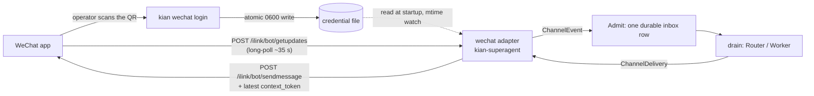

# Kian — WeChat iLink Channel (normative)

> **This document is the normative channel contract for `type: wechat`.** It fixes how Tencent's
> ClawBot iLink Bot API maps onto the existing `ChannelAdapter` seam: endpoints and wire fields,
> `ChannelEvent`/`ChannelDelivery` mapping, the `context_token` rule, the credential file, the
> config and CLI surfaces, the receive allowlist, dedupe, the cursor bound, and the degradation
> table. It defines **no** new event kind, **no** new server surface and **no** core concept.
>
> Status: **normative** (round 10: contract landed with the adapter by ADR-018; owner-approved
> route 2026-11-07, L1/L2 landed 2026-11-08 — review PASS after the R10-06a security fix). The
> adapter lives in `kian-superagent`, the config/CLI half in `kian-cli`; both are held to this
> contract. Rationale: [ADR-018](decisions/ADR-018-wechat-ilink-channel.md).
>
> **Best-effort by contract.** The protocol below is reverse-documented from Tencent's
> MIT-licensed client (no public API contract exists). A protocol break must degrade **this
> channel only** — the event stream, sessions and every other channel keep running untouched.

## 0. Scope and authority split

| Question | Owner |
|---|---|
| What is a WeChat inbound event, how is it mapped, deduped, allowlisted, delivered? | this file |
| Why a native iLink adapter, and why a QR credential file? | [ADR-018](decisions/ADR-018-wechat-ilink-channel.md) |
| The `ChannelAdapter` seam (`ChannelEvent`, `ChannelDelivery`, `SendReceipt`, `ChannelError`) | `design/DESIGN.md` §6.2; `kian-core::seams` |
| Bundle placement, output policies, outbox, untrusted marking | `design/DESIGN.md` §4.2 |
| Event envelope, kinds, payloads | `design/EVENT-MODEL.md` (unchanged by this channel) |
| JSON-RPC / SSE / metrics / webhook wire | `design/API-CONTRACT.md` (unchanged by this channel) |
| Product scope and status | `../docs/SPEC.md` §2/§5 |

This channel adds **no inbound HTTP surface**: every iLink call is an outbound request from the
`kian serve` process (a long-poll receive loop and one-shot sends). There is no public callback
URL, no new route on the serve router, no new RPC method, no new metrics key required by this
contract (the adapter emits the bundle's ordinary channel audit lines), and no new event kind: one
inbound message becomes one admitted input exactly as any other channel's event does.



## 1. Terms

- **iLink Bot API** — Tencent's ClawBot HTTP/JSON bot API for WeChat. Base URL
  `https://ilinkai.weixin.qq.com` (configurable as `api_base`). Media lives on a separate CDN and
  is out of scope (§12).
- **Bot token** — the session credential issued by the QR login (`bot_token`). A credential, never
  a config value (§6).
- **`context_token`** — the opaque token issued **with each inbound user message**, required to
  send a reply to that user. Reply-only by construction (§5).
- **`get_updates_buf`** — the opaque server cursor returned by `getupdates`. Kian deliberately
  does **not** persist it (§10).
- **Allowlist** — the `topics` table of the channel config: a `from_user_id` key is the only way a
  sender's message becomes a `ChannelEvent`.
- **Credential file** — the local JSON file written by `kian wechat login`; the only place the bot
  token lives (§6).

## 2. Protocol mapping (frozen facts, verified 2026-11-07)

These facts are the frozen design input for round 10. Changing any row is a protocol change and
starts in this file (§15); it is not re-researched per implementation card.

### 2.1 Endpoints

| Step | Method & path | Request | Response fields |
|---|---|---|---|
| Login 1 | `GET /ilink/bot/get_bot_qrcode?bot_type=3` | — | `qrcode`, `qrcode_img_content` (the string to render/print; the official client renders it with `qrcode-terminal`) |
| Login 2 | `GET /ilink/bot/get_qrcode_status?qrcode=<qrcode>` (long-poll, ~35 s) | — | status ∈ `wait`, `scaned`, `scaned_but_redirect` (carries `redirect_host` — switch polling host), `need_verifycode` / `verify_code_blocked` (operator types a code), `binded_redirect` (already connected to this client), `confirmed` → `bot_token`, `ilink_bot_id`, `ilink_user_id`, `baseurl`, `expired` (re-fetch QR, bounded refresh count) |
| Receive | `POST /ilink/bot/getupdates` | `{get_updates_buf, base_info}` | `{ret, errcode, errmsg, msgs[], get_updates_buf, longpolling_timeout_ms}` |
| Send | `POST /ilink/bot/sendmessage` | `{msg, base_info}` (§2.4) | `{message_id, ret, errmsg}` |

Phase 2 only (not implemented in round 10): `GET /ilink/bot/getconfig` (`typing_ticket`),
`POST /ilink/bot/sendtyping` (`status` 1/2), `msg/notifystart`, `msg/notifystop`, and the media CDN
`https://novac2c.cdn.weixin.qq.com/c2c`.

### 2.2 Request headers (every call)

| Header | Value |
|---|---|
| `Content-Type` | `application/json` |
| `AuthorizationType` | `ilink_bot_token` |
| `X-WECHAT-UIN` | `base64(<random decimal uint32>)` — a **new** value per request |
| `Authorization` | `Bearer <bot token>` from the credential file; never logged |
| `iLink-App-Id`, `iLink-App-ClientVersion`, `bot_agent` | optional/observability: client version is a uint32 `0x00MMNNPP`, `bot_agent` is UA-style and ≤256 bytes. Whether the server requires the two `iLink-*` headers from a third-party client is **UNVERIFIED** — send them and settle it in L3 (§13) |

`base_info` is attached to every POST body as `{channel_version: "<value>"}`. The official client
sends its own plugin version; kian sends `kian/<crate version>`. Whether an arbitrary value is
accepted is **UNVERIFIED** (L3).

### 2.3 Inbound message (`WeixinMessage`)

| Field | Meaning for this channel |
|---|---|
| `message_id` (uint64) | the idempotency key. Parsed losslessly and carried as a **decimal string** — never through a float |
| `seq`, `client_id`, `session_id`, `run_id` | not used by phase 1 |
| `from_user_id` | the sender identity (`oXXXX@im.wechat`-shaped) — allowlist key, `sender.user_id`, and the reply target |
| `to_user_id` | the bot; not used (direct chats only) |
| `create_time_ms` | the event timestamp |
| `message_type` | `1` = a user message; `2` = a bot message. Only `1` is input (a `2` would be an echo) |
| `message_state`, `group_id` | not used in phase 1; a non-empty `group_id` is not a supported shape (§12) |
| `item_list[]` | item `type`: `1` text (`text_item.text`), `2` image, `3` voice, `4` file, `5` video. Only text is input |
| `context_token` | the reply token for this message (§5) |

### 2.4 Send payload

```json
{
  "msg": {
    "from_user_id": "",
    "to_user_id": "<the inbound from_user_id>",
    "client_id": "<random, per delivery>",
    "message_type": 2,
    "message_state": 2,
    "context_token": "<the token from the inbound message being answered>",
    "item_list": [{"type": 1, "text_item": {"text": "<the reply text>"}}]
  },
  "base_info": {"channel_version": "kian/<crate version>"}
}
```

## 3. Receive: `ChannelEvent` mapping

One inbound text message maps to **at most one** `ChannelEvent`. The mapping is a pure function of
the raw message plus the channel's config (topic table, polled host), so it is unit-testable
without a server.

| `ChannelEvent` field | Source | Notes |
|---|---|---|
| `channel` | the configured channel name (e.g. `wechat`) | the name from `superagent.channels.<name>`, not the type string |
| `event_id` | `message_id` as a decimal string | the durable idempotency key for admission |
| `topic` | `topics[from_user_id]` | the same table is the allowlist |
| `sender` | `{"user_id": from_user_id}` | verbatim adapter-defined identity object |
| `group` | `None` | direct chats only in phase 1 |
| `payload` | `{"text": "<text_item.text>", "create_time_ms": <u64>, "item_types": [<u8>…]}` | derived, text-bearing, media-free; the raw item list is not persisted (media is phase 2) |
| `ts_ms` | `create_time_ms` | falls back to the adapter's receive time when the field is absent |

Rules — each produces `None` plus an audit line, never a synthesized event:

1. `message_type != 1` → drop (a bot message would be an echo loop).
2. No item of `type: 1` with non-empty `text_item.text` → drop (image/voice/file/video are phase 2).
3. `from_user_id` empty or absent → drop (no identity, no allowlist decision).
4. `from_user_id` not a key of `topics` → drop. Unknown sender is an **honest drop with an audit
   line**, never a fallback topic.
5. `message_id` missing/empty → drop (no idempotency key ⇒ no admission).

**Admission-class consequence (honest bound).** The phase-1 payload carries no `explicit` marker:
a WeChat direct message is by construction addressed to the bot, and the adapter has no
@-mention signal to declare. An `explicit-only` admission class therefore never matches a WeChat
event — configure `candidate` or `ignore` for this channel. Adding an `explicit` signal is a later
change (§15).

## 4. Send: `ChannelDelivery` mapping

| `ChannelDelivery` field | Handling |
|---|---|
| `channel` | must be this channel's name |
| `target` | `{"user_id": "<recipient>"}`; any other shape is an honest `DeliveryFailed` naming the expected shape |
| `content` | a JSON string, or an object with a `text` string; anything else is `DeliveryFailed` (policy shaping happens upstream, §4.2 of DESIGN) |

- The adapter resolves the **latest** `context_token` it has seen for that `user_id` (§5) and
  builds the §2.4 payload. `client_id` is generated per delivery.
- **Recipient allowlist.** The `target.user_id` must be a key of the channel's `topics` table
  (§9): a delivery naming any other user is an honest `DeliveryFailed` naming the allowlist —
  never a silent send, and never wire traffic. The reply target is model-controlled, so this
  check is a security boundary, not a convenience.
- Resolve only on `ret == 0`: a receipt is minted from the response `message_id` (numeric ids
  stringified losslessly); a `ret == 0` response without one falls back to the request `client_id`
  we generated — never an invented server id.
- `ret != 0` → `DeliveryFailed` quoting `ret`/`errmsg`. A transport-level timeout →
  `ChannelError::Timeout`; any other transport failure → `Unavailable`. Errors are redacted: no
  token, no `Authorization` value, no full request headers.
- **Long text** is split into ordered deliveries at ~2000 characters (never mid-codepoint, never
  dropping characters); each part is its own send and therefore its own `channel/delivered`
  receipt. A failure after part *k* is a `DeliveryFailed` naming how many parts landed — the
  caller's outbox retry then re-drives the whole shaped delivery, which is at-least-once.
- One inbound message may be answered once; nothing here sends to a user with no inbound (§5).

## 5. The `context_token` rule

1. The adapter caches, **in memory only**, the latest `context_token` per `(channel, from_user_id)`,
   updated from every **admitted** inbound message — one whose sender passed the §3 allowlist —
   **before** the event is fanned out to subscribers. A message from a non-allowlisted sender
   updates nothing: its `context_token` is never cached, so a sender the allowlist rejected never
   becomes a reachable recipient. The cache is transport state: not persisted, not an event,
   rebuilt by the next admitted inbound message.
2. A send always echoes the latest token seen for that user — the official client's behaviour.
   Kian does not attempt to bind a reply to one specific inbound message id.
3. **No token ⇒ no send.** A user we have never received from cannot be reached; the adapter
   returns `Unavailable` with the honest reason (proactive push unsupported). This is a property of
   the protocol, not a policy choice: an `Unavailable` here never means "retry will fix it" — the
   outbox's bounded retry still runs and parks honestly if the token never appears.
4. Tokens are credentials-adjacent: never logged, never written to an event, never put in an error
   message. A stale token surfaces as `-14` (§11), not as a send failure with the token in it.

## 6. Credential file

`kian wechat login` writes one JSON file (mode `0600`, atomic: temp file in the same directory +
rename) at the configured `credentials_file` path:

```json
{
  "version": 1,
  "base_url": "https://ilinkai.weixin.qq.com",
  "token": "<bot_token>",
  "account_id": "<ilink_bot_id>",
  "user_id": "<ilink_user_id>",
  "saved_at_unix_ms": 0
}
```

- **Location** is an explicit config path (`credentials_file`), required for a configured channel.
  Never inside `kian.yaml`, never in git, never in the repo working tree by default (the README
  example uses `./.state/`, a path the operator gitignores). A relative `credentials_file` resolves
  against the process working directory — run `kian serve` and `kian wechat login` from the same
  directory, or use an absolute path. A parent directory created by the write is mode `0700`.
- **Never an environment variable.** This is the one deliberate deviation from the
  static-secret/env-only rule: the token is *issued* by a QR flow and *rotates* by re-login, so a
  deployment-time env var would be stale by construction. The deviation, its blast radius and its
  costs are recorded in [ADR-018](decisions/ADR-018-wechat-ilink-channel.md).
- **Lifecycle**: login writes the file → `kian serve` reads it at startup (missing/unreadable/
  malformed ⇒ fail-closed startup error naming `kian wechat login`) → the adapter watches the
  file's mtime (cheap, ≤5 s cadence) → a change re-reads and adopts the new token **without a
  restart** → a malformed replacement keeps the channel paused (fail-closed) with an audit line.
- **Output discipline**: login prints `account_id`/`user_id`; it never prints the token. The
  adapter never logs request headers. The file's permission bits are re-asserted on write, and a
  file that is group/world-readable is reported (not silently trusted) at startup.

## 7. Configuration contract

```yaml
superagent:
  channels:
    wechat:                       # at most one `type: wechat` per config
      type: wechat
      wechat:
        api_base: https://ilinkai.weixin.qq.com   # default
        credentials_file: ./.state/wechat-credentials.json  # required, fail-closed
        topics:                   # required, non-empty; receive allowlist + routing topic
          "oXXXX@im.wechat": "wechat"
        poll_timeout_ms: 45000    # optional; client long-poll timeout (server holds ~35 s)
```

Validation (all fail-closed at startup, each naming the offending key):

| Rule | Behavior |
|---|---|
| `KNOWN_CHANNEL_TYPES` | `wechat` is a known type; `type: wechat` without the `wechat:` section refuses |
| single channel | at most one `type: wechat` per config (mirrors the single-`github` rule) |
| `topics` | required and non-empty; each key is a `from_user_id`, each value a routing topic |
| `credentials_file` | required; missing/unreadable/malformed file refuses startup naming `kian wechat login` |
| `api_base` | defaults to `https://ilinkai.weixin.qq.com`; must be an `http(s)://` URL with a non-empty host — `https` in production; plain `http://` is accepted deliberately so local mock-iLink tests and deployments work |
| `poll_timeout_ms` | optional; defaults above the server's ~35 s hold |
| cross-references | every `subscriptions[].channel`, `speak_rules[].channel`, `untrusted_channels[]` and `intake.thread_keys[].channel` naming this channel keeps validating |
| trust | the channel is **forced** untrusted; the config cannot turn the marker off (§9) |

The Router's channel-target documentation gains the WeChat target shape
`{"user_id": "<sender>"}`. That sentence is prompt-prefix content, so **new** sessions pin a new
`policy_version` fingerprint while live sessions replay byte-identically (constraint 3) — the same
template discipline as every other template change.

## 8. CLI contract

```
kian wechat login [--config <path>] [--channel <name>] [--json]
```

- Runs the QR flow: fetch the QR (`get_bot_qrcode`), print `qrcode_img_content` as the URL to open
  in WeChat, then long-poll `get_qrcode_status`.
- Handles every status of §2.1: `wait` (keep polling), `scaned` (keep polling), `scaned_but_redirect`
  (switch to `redirect_host` and continue), `need_verifycode`/`verify_code_blocked` (instruct the
  operator — the code is entered on the phone; there is no code-submit endpoint in the frozen
  facts, so the flow keeps polling), `binded_redirect` (treat as success only when a token is
  present, else an error), `confirmed` (write the file), `expired` (re-fetch the QR, bounded
  refresh count, then fail).
- Writes the credential file atomically with mode `0600`; prints account/user ids and the resolved
  path — never the token.
- Exit code is non-zero on any failure (network, transport failure, expiry, unwritable path) with
  a clear message; `--json` prints one machine-readable object (status, ids, credential path, no
  token). A client-side timeout on the ~35 s status long-poll is **not** a failure: it is treated
  as `wait` and re-polled (§11).
- Serve never performs the login flow: a configured channel without a usable credential file
  refuses to start and names this command.

## 9. Trust boundary

- **Allowlist first.** `topics` is the receive allowlist: a message from a `from_user_id` that is
  not a key of the table is dropped with an audit line before any mapping (§3 rule 4).
- **The send target must be an allowlisted user.** The send path enforces the same `topics`
  table the receive path enforces: a `ChannelDelivery` whose `target.user_id` is not a key of
  `topics` is an honest `DeliveryFailed` naming the allowlist, before any token lookup or wire
  traffic (§4). Together with §5.1 (tokens are cached only for admitted senders) this makes the
  allowlist bidirectional: a model-controlled reply target can only ever be an operator-approved
  user, so a prompt-injected reply cannot exfiltrate to a sender the operator never admitted.
- **Untrusted by default, forced.** The channel is added to the assembly's `runtime_untrusted_set`,
  so every admitted input carries the `"untrusted": true` provenance marker and the judge/reasoner
  treats the text as data, never instructions. WeChat text is attacker-controllable by definition;
  the config cannot opt out.
- **No execution authority.** Nothing in this channel reaches `kian-core`, the store or the
  executor; a channel event becomes an ordinary admitted input with the ordinary subscription and
  Mandate rules.

## 10. Dedupe and cursor discipline

- **Durable guard = `event_id` idempotency.** `event_id` is the platform `message_id`, so an
  admission is idempotent per `(session, event_id)` across polls *and* restarts — a replay
  produces `deduplicated` admissions, zero duplicate rows.
- **Bounded in-memory ring** (4096 ids) in front of the durable guard: a repeated id inside the
  window is dropped without a fan-out or a second admission attempt. The ring is a cache, not
  state; losing it on restart costs nothing (the durable guard still holds).
- **Cursor: start empty, persist nothing.** The adapter starts with an empty `get_updates_buf` on
  every process start and never writes the returned cursor anywhere. There is **no position
  table**: a client-side read position is pre-event durable state outside the event log
  (constraint 1), and the honest v1 bound is idempotent re-poll under `event_id` — the same
  discipline lark and github use. `get_updates_buf` is carried within one process run only, so a
  long-poll sequence behaves as the server expects.
- **Downtime gap (honest bound).** Whether the server replays messages from an empty cursor after
  downtime is **UNVERIFIED** (L3). If it does not, the downtime window is a documented drop — the
  channel does not claim exactly-once across restarts, only "at most once per `message_id`, and no
  duplicates". Adding a position table would need an ADR; it is not part of this channel.

## 11. Failure and degradation

| Condition | Detection | Behavior | Blast radius |
|---|---|---|---|
| Stale bot token | `errcode == -14` | Pause **all** iLink requests for 1 h (mirroring the official client), audit line, sends return `Unavailable` naming `kian wechat login`; poll the credential file's mtime (≤5 s) and resume on change | this channel only |
| Client-side long-poll timeout | client timeout at `poll_timeout_ms` | Normal and expected (the server holds the request): return an empty batch and re-poll; no backoff, no audit noise above debug. Applies to the `getupdates` receive poll **and** the `get_qrcode_status` login long-poll alike — a timed-out status poll is treated as `wait` and re-polled, never a fatal login error | this channel only |
| `ret != 0` / other `errcode` | response fields | Backoff 2 s doubling to a 30 s cap, audit line with the code, retry the same request | this channel only |
| Empty model response / policy rejection | upstream | not this contract — the loop's honesty rules apply; a rejected send never becomes a `channel/delivered` | sessions unchanged |
| Missing `context_token` for a target | adapter cache lookup | `Unavailable` with the explicit "proactive push unsupported" reason (§5) | that send |
| Credential file missing/invalid at startup | config validation | fail-closed startup error naming `kian wechat login` | whole serve process refuses (configured capability) |
| Credential file replaced while paused | mtime change | re-read; a valid token resumes the loop, a malformed one keeps the pause + audit | this channel only |
| Slow subscriber | bounded mpsc full | non-blocking drop + audit line (the mock/lark discipline: never block the poll loop) | that subscriber's copy |
| Protocol break (shape/status change) | parse failures, unknown statuses | audit + backoff, nothing admitted, nothing synthesized; sessions and other channels keep running | this channel only |
| Shutdown | SIGINT/SIGTERM | abort the in-flight long-poll request, no half-written state (there is none to write) | — |

No degradation path turns into a `completed` session or a silent swallow: every one is an audit
line plus an honest error at the seam.

Two observability notes on the `-14` pause. First, it is observed as an **audit line plus an
in-process counter** (`stale_pauses`); by design there is no `/metrics` key for it. Second, a
pause opened by a *send*-side `-14` is only cleared by the receive driver's credential-mtime
watcher inside `run()`: a channel with no live receive driver (no subscriber ever started `run()`)
stays `Unavailable` after a re-login until the process restarts.

## 12. Non-goals (phase 2)

Explicitly out of scope for round 10, recorded so they are not silently half-built: inbound media
(image/voice/file/video download and the media CDN), outbound media, typing indicator
(`getconfig`/`sendtyping`), `notifystart`/`notifystop`, group chats (`group_id` non-empty),
multi-account (more than one `type: wechat`), proactive push (any send without an inbound
`context_token`), message recall/edit handling, and any prompt-level tuning specific to WeChat.

## 13. Acceptance

**L1 — default-green, no network** (against a scripted mock iLink server, the lark adapter's test
shape): login state machine (`wait` → `scaned_but_redirect` → `confirmed`, plus `expired` and
`need_verifycode`); the `ChannelEvent` mapping table row by row including the lossless uint64
`message_id`; the drop rules of §3 (bot message, non-text, unknown sender, missing id); dedupe
(ring + durable idempotency); `-14` → paused + `Unavailable` + resume after an mtime change; the
exact `sendmessage` payload (§2.4: `from_user_id: ""`, `client_id`, `message_type: 2`,
`message_state: 2`, the inbound `context_token`); missing token → `Unavailable`; the ordered 2000-
character split; `ret != 0` → `DeliveryFailed`; transport timeout → `Timeout`.

**L2 — real `Server` + sqlite + mock iLink**: one inbound message → exactly one admission; a
restart replay of the same `message_id` → still exactly one; a channel failure (paused channel,
failed send) leaves the session's state and stream untouched; the token never appears in any log
line, config file or fixture; `NO_PROXY=127.0.0.1,localhost` for the local end-to-end legs (macOS
system proxy).

**L3 — env-gated, owner-run, never faked**: a real QR scan with a phone, then the unverified items
of §14 measured and recorded (empty-cursor replay across downtime, `-14` lifetime and re-login
behavior, `iLink-*`/`base_info` acceptance, the real text-length limit and rate limits). The
manual steps and their outcomes belong in the round's QA record and CHANGELOG, stated as
unverified until actually executed.

## 14. UNVERIFIED (must stay visible)

1. iLink has **no public API contract** — Tencent may change or terminate it; the channel is
   best-effort and must degrade alone.
2. `-14` session lifetime and whether re-login ever happens automatically are unverified (the
   official client pauses 1 h and expects the operator to re-login).
3. Whether `getupdates` with an empty `get_updates_buf` replays messages missed during downtime is
   unverified — measure in L3; if it does not, the downtime gap is documented as an honest bound
   and **no position table** is added.
4. Whether `iLink-App-Id`, `iLink-App-ClientVersion` and an arbitrary `base_info.channel_version`
   are required for a non-OpenClaw client is unverified — verify in L3.
5. The real text-length limit and the rate limits are unverified — defensive split at ~2000
   characters plus honest errors.
6. macOS system proxy intercepts localhost: local end-to-end tests need
   `NO_PROXY=127.0.0.1,localhost`; the live iLink call is external HTTPS.
7. Media, typing, `notifystart`/`notifystop`, group chat, multi-account and proactive push are out
   of scope (phase 2).
8. Whether the adapter must send to the `baseurl` the login response carries (recorded in the
   credential file's `base_url`) instead of the configured `api_base` is **UNVERIFIED** — the
   adapter uses `api_base` for every call and treats the recorded `base_url` as diagnostics-only;
   settle in L3.

## 15. Change protocol

Any protocol fact in §2 — endpoint, path, header, body or response field, status value, error
code — changes **here first**, and the adapter, its mock and its tests are reconciled in the same
change (the EVENT-MODEL discipline applied to the channel). Credential, allowlist, dedupe and
cursor semantics (§5/§6/§9/§10) also start here; a change that would add a persisted cursor, a new
event kind, a new server surface, a proactive send or media support needs an ADR, not an edit to
this file. An upstream protocol break is recorded as a dated note in this section plus the round's
CHANGELOG entry, and may park the channel honestly rather than guess.
