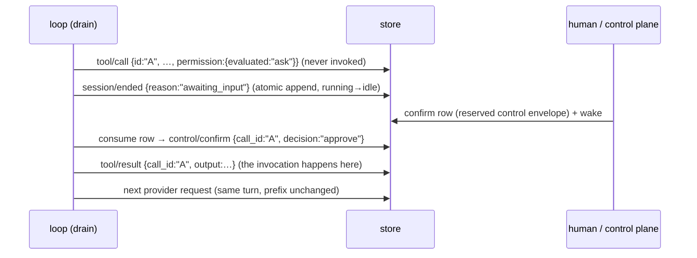

# Kian — Confirmation Model (normative design, phase 1)

> **Status: phase 1 landed (owner gate 2026-11-15).** This file owns the confirmation-plane
> semantics: what an `ask` is, how a pending tool call is derived, how the answer is admitted, and
> when a session ends into a resumable wait. Rationale:
> [ADR-036](decisions/ADR-036-durable-confirmation-plane.md). The catalog deltas — the new kind
> `control/confirm` and the two widened closed value sets (`tool/call.permission.evaluated`,
> `session/ended.reason`) — are applied in [EVENT-MODEL.md](EVENT-MODEL.md); the wire is applied in
> [API-CONTRACT.md](API-CONTRACT.md) §3.1/§3.2 (the source of truth for shapes). §9/§10 restate the
> deltas for review; if they ever disagree with those two files, those files win.
>
> Input: Anthropic, "Building always-on agents" (2026-11-13), §Permissions "deferred tool calls".

## 0. Authority split (single truth, no restatement)

| Question | Owned by |
|---|---|
| What is a pending call, when does a session wait, how does it resume | **this file** |
| Exact kind bytes, context classification, state triggers | [EVENT-MODEL.md](EVENT-MODEL.md) (delta in §10 lands with code) |
| Exact RPC params/results/errors, reserved row envelopes, SSE behavior | [API-CONTRACT.md](API-CONTRACT.md) (delta in §9 lands with code) |
| Placement in the execution model (admit/wake/drain/promote, recovery, control plane) | [DESIGN.md](DESIGN.md) §2.3, §5 |
| Why this shape and what was rejected | [ADR-036](decisions/ADR-036-durable-confirmation-plane.md) |
| Scope, phases, acceptance record | [docs/SPEC.md](../docs/SPEC.md) §5 |
| Permission provenance as it exists today (the `allow|deny` arms) | [ADR-015](decisions/ADR-015-tool-permission-provenance.md) |

This file never restates the kind catalog or the wire tables; it states the deltas and points.

## 1. Scope and positioning

An **ask** is a deferred tool call: a call the agent is allowed to *request* but whose execution
requires a person's decision. It is one of the three ways a run can end (send something, decide
nothing needs sending, or wait for an answer).

Phase 1 covers the **plain-session** path end to end: config → deferral → durable wait → answer →
resume, over the existing event stream, with no hold on the drain and no second write path. It
answers a *decision* (approve/reject on a frozen call), not a free-text clarification; a
clarification tool would reuse the same wait with a text result instead of a decision, and is a
phase-2 candidate rather than the permission arm. It
exists because kian's three resumable-end ingredients were explicitly recorded as missing:
ADR-015 §7 names them ("a durable pending-confirmation state, a human/control-plane response path
into the inbox, and hold semantics for a drain paused mid-turn — each its own design question"), and
ADR-028 D13 keeps the hook verdict vocabulary closed at `deny` for the same reason.

**Positioning against the input.** The input's mechanism is right (the run *ends*, the session is
saved mid-call, the answer is an inbox event, a new run resumes); its storage advice (a pending
state, an interactive card, an outbox row for the request) is what kian replaces: the pending set is
a projection, the request is the stream, and the answer is an admitted control row.

**Not a pause, not a denial, not a new state.** The session is `idle` while it waits — it holds no
lease, no drain and no worker slot — and the pending call is derived from the stream, not stored.
A denial is final (ADR-015); an ask is deferred.

## 2. Terms

| Term | Meaning |
|---|---|
| **ask** | A `tool/call` whose permission decision is `evaluated:"ask"`. The tool is never invoked by the ask arm. |
| **pending call** | An ask call with no `tool/result` answering it (`call_id`). The unit the human decides. |
| **pending set** | All pending calls of one session, in stream order. Derived, never persisted. |
| **answer** | A person's decision on one pending call: `approve` or `reject` (+ optional reason, optional `requested_by` label). |
| **expired** | A pending call older than `confirmation.ttl_ms`. A liveness overlay computed at read/answer time, like `recoverable`; never a state, never persisted. |
| **awaiting_input** | The end reason of a drain that stopped with a non-empty pending set. `running → idle` (resumable); not terminal. |

## 3. Lifecycle



| Point in time | Projection state | Last end reason | Pending | Model-visible tail |
|---|---|---|---|---|
| ask appended | `running` | — | `{A}` | assistant(text + tool_calls), `tool/call` A |
| drain settled | `idle` | `awaiting_input` | `{A}` | unchanged |
| answer consumed, approved | `running` | — | `{}` | … , `tool/result` A |
| answer consumed, rejected | `running` | — | `{}` | … , `tool/result` A (`is_error:true`) |
| turn resumed / finished | `running` → `completed` | `completed` | `{}` | … , next request |

A pending call is never reported `completed`: the end reason is the durable statement that the
drain stopped waiting, and the pending set is recoverable from the stream alone.

## 4. The pending projection

```rust
// kian-core::confirmation (pure; no store, no clock)
pub struct PendingCall {
    pub call_id: String,
    pub tool: String,
    pub arguments: serde_json::Value, // verbatim from the tool/call payload
    pub call_seq: u64,                // the tool/call event's seq
    pub requested_at_ms: u64,         // that event's ts (recorded fact, no new field)
}

pub fn pending_calls(events: &[Event]) -> Vec<PendingCall>;
```

**F1 — Definition.** `pending_calls` folds the durable stream in `seq` order and keeps every
`tool/call` whose `permission.evaluated == "ask"` and whose `content.id` has no answering
`tool/result` (`content.call_id` equal). Calls are returned in append order. It reads `Event`s, not
`Message`s: `permission` is a non-context provenance key, so `derive_model_context` cannot see it.
The core invariant already treats an open call as a legal stream state
(`durable_before_execute`: "resolution (a call with no result yet) is not a violation"), so an ask
does not widen the stream's legality; it names the reason a stream may rest in that shape.

**F2 — One definition, no gate.** `pending_calls` is a full fold of the durable stream and is
called exactly where a decision needs it: the loop's turn start (which already reads the stream for
`derive_model_context`), the engine's settle (one extra read on the would-be `completed` arm), and
the `pending`/`confirm` reads. There is deliberately **no** "only if the last end is
`awaiting_input`" gate: a drain that died after appending the `tool/call` but before its end write
leaves a pending call with no `awaiting_input` end, so such a gate would miss precisely the crash
window the projection exists for. Cost is the same order as the reads those callers already do.

**F3 — Batching, in call order.** Several calls of one assistant batch may be pending at once.
Non-ask calls in the same batch still execute (they were allowed; their results are independent).
Answers may *arrive* in any order, but effects follow the **call order**: a decided call executes
(and its `tool/result` is appended) only when every earlier pending call of the batch already has
its result. A later call's approval is therefore durable immediately (`control/confirm`) while its
execution may wait for an earlier sibling — the human's decision is never lost, the provider's tool
block stays in call order, and the turn resumes only when the set is empty. A provider request never
sees a partial set.

**F4 — Compact safety.** A `compact` range must not contain an unpaired ask call (an ask whose
`tool/result` would land outside the range). The compact appender refuses such a range; this keeps
`pending_calls` correct across compression without reading into a summarized prefix.

**F5 — Resume cost.** The built-in loop already reads the durable events once per turn
(`LoopDriver::Ctx::events`), so the loop's fold adds no new read path; the engine's settle fold is
one extra read, taken only when the end reason would otherwise be `completed`. Carrying the pending
set on the read-model snapshot is a phase-2 optimization (open question §15), not a correctness
prerequisite: the stream is the truth and the projection is rebuildable.

**F6 — No persistence, no table.** There is no pending-state table, no inbox status column and no
in-memory wait: a process restart loses nothing because a new drain re-derives the set from the
stream.

## 5. The answer path

**A1 — Admission, not an event write.** The control plane admits one durable inbox row in the
reserved control envelope (the ADR-014 pattern, new `action:"confirm"`) and wakes. It never appends
an event, never inspects a drain and never invokes a tool.

An answer admitted while the session happens to be `running` (a crash-replay window) is consumed at
the next safe boundary like any input; no special rule is needed.

**A2 — Consumption binds row → audit event.** The owning drain consumes the row into one
`control/confirm` event (non-context, `DrainActivity`) in one fenced write, exactly as a message row
consumes into `input/admitted`. A crash before that write leaves the row eligible for re-consumption;
a crash after it leaves a durable decision to re-drive from.

**A3 — Execution at answer time, on the frozen call.** On `approve` the consuming drain invokes the
tool named by `tool/call.content` with the arguments recorded there (the call is frozen at ask
time; the answer does not re-serialize it), then appends `tool/result` with the real output. On
`reject` it appends the honest-error result
`{"call_id", "output":{"error":"permission denied by user","policy":"ask","reason"?},
"is_error":true}` — the ADR-015 deny shape with `policy:"ask"`, because a person denied it, not a
table. No invocation happens either way before the answer is durable.

*Ordering.* A decision is applied in call order (F3): a drain that holds an approval for a later
call but not for an earlier one appends the later `control/confirm` and settles `awaiting_input`
again; the earlier answer's arrival releases both effects in order. No effect precedes its call's
decision.

*Hook interop.* At ask time the `tool/pre` port is not consulted (the call will not execute). On
approve, the invocation goes through the normal pre-tool path, so a hook veto after approval is a
normal hook denial on that result; the hook's own `ask` verdict is phase 3, not this plane.

**A4 — Idempotency.** `(session, call_id)` has at most one answer **admitted**: the control plane
derives the row's idempotency key from that pair, so retries and racing duplicates dedupe onto one
durable row at the store, and a call with a durable decision on the stream is `not_pending` even
before its result lands. The drain then appends a `tool/result` only if none exists for that
`call_id`, under the drain's expectedSeq CAS. A duplicate or conflicting answer that arrives after
the first is `not_pending`; two answers racing for one call resolve at the store (one row, one
append), never by in-process timing.

**A5 — Audit keys, outside `content`.** The decision provenance rides the payload, never the message:

- `control/confirm`: `{"action":"confirm","call_id","decision":"approve"|"reject","reason":<str|null>,
  "requested_by":<str|null>,"answered_at_ms":<u64>,"expired"?:true}`.
- `tool/result` additive `"confirmation":{"call_id","decision","requested_by":<str|null>,
  "answered_at_ms":<u64>,"expired"?:true}`.

Both are omitted for ordinary results (legacy bytes unchanged) and never enter a model request.

**A6 — Expiry is a lazy, durable decision.** With `confirmation.ttl_ms > 0`, an answer for a call
older than the TTL is transformed: the row is admitted as a `reject` with `"expired":true`
(server-set), the RPC result is `expired` (the caller's decision was **not** applied), the session
resumes and the model sees the honest error. A read of the pending set reports `expired:true` at or
after the TTL (a liveness overlay). No timer exists in phase 1: expiry only materializes when
someone answers. An abandoned wait is therefore a visible idle session, never a busy one, and never
a lease held forever.

**A7 — Terminal races.** An answer for a session that is terminal (`completed`/`cancelled`) is
refused with `not_pending` at admission time; an archived session is refused with the established
explicit `-32007` (the same refusal every control read gives), never a silent `not_pending`. A row
that loses a race to a terminal end stays unconsumed and visible; the session is frozen and no
result is fabricated. Recorded bound: phase 1 does not sweep such rows (a later ops sweep).

## 6. End-reason derivation

**D1 — One rule.** At settle the engine writes `awaiting_input` instead of `completed` **iff** the
episode's pending set is non-empty. Every other settle reason is untouched: a user interrupt stays
`interrupted`, a soft failure stays `failed`, a cancel end stays `cancelled` (terminal; a pending
call dies with the session, and a later answer is `not_pending`).

**D2 — Why a fifth reason and not `interrupted`.** `interrupted` means "an owner stopped this
drain"; reusing it for "waiting for a person" would launder the wait into the interrupt metric and
break the honesty rule that interrupted ≠ failed ≠ completed. `awaiting_input` is the honest
statement, and the widening is one closed value (`completed|cancelled|interrupted|failed` →
`+awaiting_input`), not an envelope shape change.

**D3 — No new session state.** `awaiting_input` projects `running → idle`, exactly like
`interrupted`/`failed`: the session is resumable and holds no lease. `projection.state` stays the
closed set `idle|running|completed|cancelled`.

**D4 — Derivation is a projection, not a driver signal.** The engine derives the reason from the
stream (the settle-time windowed fold, F2); the `LoopDriver`/`LoopOutcome` seam is unchanged. This
keeps the phase-1 kernel from touching the loop seam; a driver-level "deferred" signal is only
needed if a hook must defer *before* the call is appended (phase 3, ADR-028 integration).

## 7. The resume rule

**R1 — No provider request with an unanswered call.** A drain may issue `step/request` only when the
pending set is empty. A turn whose context ends with an unanswered tool call is never sent to a
provider (it would be rejected, and it would be a lie).

**R1b — No context-bearing promote inside an open call.** The same rule applies one level down:
while the pending set is non-empty, an ordinary message row may **not** be promoted (the drain's
`consume_inputs` skips message plans; control and confirm rows still consume). Promoting there
would interleave a user message between the assistant `tool_calls` and the answered `tool/result`;
the tool block would be broken and the resumed request rejected — the message ordering is the
invariant, not only the request timing. The gate has a wake consequence: a settle whose only
eligible rows are decision-blocked does **not** re-register the wake (otherwise claim → deferred
settle → claim spins), and the startup inbox rebuild skips such sessions unless it also sees a
control row. The confirm row's own admission is the wake that releases the wait; the blocked rows
stay durable and are promoted, in order, after the answer's result.

**R2 — Claim → consume answers → decide.**

1. On claim of an `awaiting_input` session, consume every eligible confirm row first, appending
   `control/confirm` + its `tool/result` per §5. A wake that carried only a decision is still real
   work: the drain drives the loop even though the consumed row yields no message (the engine's
   "empty inbox" settle must not win over an applied answer).
2. If the pending set is now empty: continue the turn normally. The new request carries the same
   prefix plus the appended results — **byte-identical prefix, cache preserved** (constraint 3).
3. If not empty: settle `awaiting_input` again (a normal claim→end episode; the wait is re-asserted,
   the audit shows the answer that arrived).

**R3 — Prefix invariance.** The answer appends only at the tail; no prior context is rewritten, and
the resume is a normal promotion at a safe boundary. The prefix-cache golden asserts the request
bytes before and after an answer differ only by the appended result.

**R4 — Fencing and crash windows are inherited, not re-invented.** Answers are ordinary admitted
rows; the drain write carries the claim epoch; a stale drain cannot apply an answer
(NoSplitBrainWrite). The only new exposure is the existing tool-invocation window (invoke → append
result): a crash there re-invokes on takeover — the same at-least-once class as any built-in tool
call, not a new guarantee. An approved-but-unresolved call is therefore left to this approval
path; the open-call recovery (§15.6) never synthesizes a result for an `ask`.

## 8. Configuration

```yaml
agents:
  ops-agent:
    tools: [send_email, read_issue, write_issue]
    permissions:
      send_email: ask            # closed enum widened: allow | deny | ask
confirmation:
  ttl_ms: 86400000               # absent or 0 = no expiry (answer whenever)
```

**C1 — Fail-closed parse.** An unknown permission value refuses boot (existing discipline); `ask`
outside a permission table is invalid; `ttl_ms` is a non-negative integer.

**C2 — Agent boundary.** Phase 1 refused `ask` at boot for any agent driven by the superagent
worker loop or a resident loop, because those drivers had no waiting path. **Phase 2 removed the
worker half**: the worker loop now ends `awaiting_input` without writing `thread/completed` (or its
parent report), the worker stays **live** in the passthrough/liveness projection (so follow-ups
keep routing to the same session), and the ticket stage reports `awaiting-confirmation`. The
**resident** half stays refused: a Router/watchdog that waits would freeze the judge that is
supposed to answer it, so a config carrying `ask` on a resident agent still refuses boot.

## 9. Wire delta (normative — owned by API-CONTRACT)

**W1 — Two control-plane methods.** The exact params/results are normative in
[API-CONTRACT.md](API-CONTRACT.md) §3.1/§3.2 (`confirm`, `pending`); this file owns only the outcome
semantics:

- `accepted` — the row is durable; the decision takes effect on the stream (observe `control/confirm`
  then `tool/result`).
- `not_pending` — no unanswered ask with that `call_id`, or the ask already carries a durable
  decision (applied or in flight), or the session is terminal. No row is written.
- `expired` — the call lapsed (§5 A6); a reject-with-expired row was admitted so the session
  resumes; the caller's decision was not applied.
- An archived session is `-32007` (the established explicit refusal); unknown session `-32001`;
  malformed params `-32602`. No new error code exists.

**W2 — One reserved inbox-row envelope** (the §4.5 family; refused by the public
`submit`/`steer`/`queue` wire with `-32602`):

```json
{"kian":{"type":"control","action":"confirm","call_id":"<str>",
         "decision":"approve"|"reject","reason":"<str>|null",
         "requested_by":"<str>|null","answered_at_ms":<u64>}}
```

`answered_at_ms` is server-stamped at admission (never client-supplied), and the row's
idempotency key is derived from `(session, call_id)` — a caller cannot widen it.

**W3 — SSE.** Holding a connection is not part of the answer path: the stream closes on the first
`session/ended` whatever its reason (existing rule), so a watcher of an `awaiting_input` session
reconnects for the resume; `pending` is the cheap read for a fresh client. No new frame.

**W4 — No new metrics keys in phase 1**; counts ride existing audit lines and the stream. Metrics
keys, if any, are added to the contract with the implementation.

## 10. Event-model delta (landed)

Three additions, no schema version bump (no existing byte shape changes; the widened sets are
additive values, the precedent being the `permission.policy` widening):

**E1 — `tool/call` (widened value).** `permission.evaluated` becomes
`"allow" | "deny" | "ask"`; `policy` stays `"default" | "configured"` (hook widening is ADR-028's,
separate). `ask` never invokes; the ask arm appends no `tool/result`. Provenance stays outside
`content` → model context unchanged. Regression: the four existing arms' bytes frozen; a new golden
for `ask`; non-context byte-identical context test.

**E2 — `session/ended` (widened value).** `reason` becomes
`"completed"|"cancelled"|"interrupted"|"failed"|"awaiting_input"`; `awaiting_input` is
`running → idle` (resumable) and the state-trigger table gains the row. Golden for the new value;
frozen goldens for the four existing ones; the illegal-transition table updated (an
`awaiting_input` end followed by another end without a claim is still an error; a claim re-opens).
Compatibility note (recorded in the ADR): an out-of-date binary cannot read a stream carrying the
new value — the same forward-compatibility posture the additions-only kind discipline already
accepts, and the reason this is a widening rather than a schema version bump.

**E3 — New kind `control/confirm` (the 23rd kind).** Non-context, `DrainActivity`, emitted only by
the drain's row consumption; payload §5 A5; never enters `derive_model_context` (golden); the
catalog count and the drift test move together.

**E4 — `tool/result` (additive key).** `"confirmation"` provenance (§5 A5), omitted when unset.

## 11. Invariants

1. **Sole truth**: the pending set is a projection of the stream; no table, column or in-memory wait
   carries it.
2. **Persist first, execute after**: the answer row is durable before any wake; the tool runs only
   after the answer is durable; the `tool/call` was logged before any effect.
3. **No provider request with an unanswered call** (R1).
4. **Exactly one applied answer per `call_id`** (A4), by stream guard + CAS, not by timing.
5. **Honest end**: a non-empty pending set is never reported `completed`; `awaiting_input` is never
   reported `interrupted` or `failed`; a rejection is a tool error the model sees, never a loop abort.
6. **Cache-byte stability**: the answer appends at the tail only (R3).
7. **Bounded wait**: the session holds no lease while waiting; a wait is visible (`pending`, the end
   reason) and answerable forever when no TTL is configured; with a TTL an answer degrades honestly
   to `expired`.
8. **Call-ordered effects**: a decided call's effect never precedes an earlier pending sibling's
   result (F3); decisions are durable immediately, effects are ordered.
9. **Fail-closed boundary**: `ask` is refused by config where no waiting path exists (C2).

## 12. Adversarial walk (crash, race, boundary)

| Scenario | Expected |
|---|---|
| Drain dies after `tool/call(ask)`, before the end write | Takeover claim re-drives; the pending set is non-empty → `awaiting_input` exactly once (never a second ask). |
| Drain dies after `control/confirm`, before `tool/result` | Takeover re-consumes from the durable decision and appends the result; the tool may run twice (existing at-least-once class), never two results. |
| Answer row admitted; server restarts before the drain consumes it | The row is durable; the restart's inbox scan re-derives the wake; the first claim consumes it. |
| Two `confirm` calls race (same call, opposite decisions) | One result wins at the store; the loser is `not_pending`; the stream shows one decision. |
| Duplicate `confirm` (same decision, replayed request) | `idempotency_key` dedupes the row; if it slipped through, the "result exists" guard appends nothing. |
| Late `approve` after TTL | `expired` outcome; durable reject-expired result; the model reacts; the caller knows its decision was not applied. |
| `confirm` for an unknown / already-answered `call_id` | `not_pending`; no row, no event, no side effect. |
| `confirm` for a session that went terminal | `not_pending` at admission; a row losing the race stays unconsumed and visible; no fabricated result. |
| Batch: one `ask`, one `allow` in the same iteration | The allowed call executes, the ask defers; the turn resumes only after the answer; the allowed result is not re-executed. |
| Batch: two asks, the second is answered first | The second decision is durable (`control/confirm`); its effect waits; when the first is answered both effects land in call order; no provider request in between. |
| User `interrupt` while awaiting | No drain is active (idle) → `not_draining` (existing contract); the pending call is untouched. |
| A terminal `cancelled` end lands while a call is pending (an ops/bundle path, e.g. the watchdog's terminal cancel) | Terminal `cancelled`; later `confirm` → `not_pending`; the pending call is dead and audited as such. |
| `compact` over an unpaired ask | Refused (F4); the ask stays visible until answered. |
| `ask` configured on a worker-template agent | Boot refuses with the phase-1 message (C2). |
| Crash after the result append, before the next request | The result is durable; the next claim continues the turn from it. |

## 13. Acceptance criteria (levels: L1 unit/contract, L2 integration on a real process, L3 UI)

State → behavior; each row names its expected level.

| # | Given | When | Then | Level |
|---|---|---|---|---|
| 1 | a stream with `tool/call(ask)` and no result | fold | one pending call, in order, arguments verbatim | L1 |
| 2 | mixed allow/ask/deny batch | fold | only the ask calls are pending | L1 |
| 3 | settle with a non-empty pending set | engine settles | end reason `awaiting_input`, state `idle`, one atomic append | L1 |
| 4 | settle with empty pending | engine settles | end reason `completed` (unchanged) | L1 |
| 5 | user interrupt with a pending set | settle | end reason `interrupted` (not `awaiting_input`) | L1 |
| 6 | `ask` decision on a call | loop runs | no invocation, no `tool/result`, model context byte-identical to `allow` up to the result | L1 |
| 7 | `control/confirm` approve | drain consumes | tool invoked once with the frozen arguments; one result with `confirmation` provenance | L1 |
| 8 | `control/confirm` reject | drain consumes | honest-error result, `policy:"ask"`, no invocation | L1 |
| 9 | two `control/confirm` for one call | drain consumes both | one result; the second row consumed as a no-op | L1 |
| 9b | two pending calls, the second answered first | drain consumes the second answer | its `control/confirm` lands, no result yet; after the first answer both results are appended in call order | L1 |
| 10 | unknown permission value / `ttl_ms` negative | boot | refused, fail-closed | L1 |
| 11 | `ask` on a worker-template agent | boot | refused, phase-1 message | L1 |
| 12 | real server, ask then approve | `pending` then `confirm` then resume | idle+awaiting_input observed; result appended; next request's prefix bytes unchanged; `completed` | L2 |
| 13 | real server, `kill -9` between ask and end | restart | takeover settles `awaiting_input` once; `pending` still lists the call | L2 |
| 14 | real server, `kill -9` after `control/confirm` | restart | takeover appends exactly one result and resumes | L2 |
| 15 | real server, duplicate `confirm` | two RPCs | one result; second `not_pending` | L2 |
| 16 | real server, TTL expired | late `confirm` | `expired`; reject-expired result; session resumes; model sees the error | L2 |
| 17 | real server, a terminal end while awaiting | `confirm` | `not_pending`; frozen stream unchanged | L2 |
| 17b | real server, a durable decision exists but its result has not landed | a second `confirm` | `not_pending` (already answered); the first effect still applies | L2 |
| 17c | real server, archived session | `confirm` / `pending` | `-32007` (explicit refusal), never a silent `not_pending` | L2 |
| 18 | CLI `kian confirm` / `kian pending` | operator use | same outcomes as the RPC; no client-side state | L2 |

L3 (a UI card) is out of phase 1; the `pending` read is its seam.

## 14. Phases and non-goals

| Phase | Content | Status |
|---|---|---|
| 1 | This document's core: config `ask`, deferral, `awaiting_input`, `control/confirm`, `confirm`/`pending`, CLI, plain sessions, the R1b promote gate, the §15.6 crash repair | landed |
| 2 | Superagent integration: the worker ends `awaiting_input` without `thread/completed`; the completion gate gains a waiting path; follow-ups resume the same session (removes the `stage.rs` "fresh Eval only" deviation); the ticket stage gains `awaiting-confirmation`; `ask` allowed on worker agents | **landed** (the waiting end writes no completion pair; the liveness projection keeps the worker live; the ticket stage arm is `awaiting-confirmation`; `ask` parses on a worker agent. The completed/failed ticket "fresh Eval only" deviation is unchanged — it applies to ended tickets, not waiting ones) |
| 3a | Channel-side answers: a closed-vocabulary IM reply mapped to a `confirm` by the adapter, never by the model (§14d) | **proposed — owner gate pending, not implemented** |
| 3b | Hook `ask` verdict (`tool/pre` defers) + the ordering with the declarative gate, a PLUGIN-SPEC widening | not started |
| 4 | Automatic expiry without a control-plane touch (a timer-channel row per pending call or one bounded sweeper), and a read-model snapshot carrying the pending set | not started |

**Phase-1 non-goals, explicit.** No hook `ask`; no free-text clarification path (a decision only);
no IM/channel answering (free text is not a decision — the mapping needs semantic judgment; §14d
keeps this: only a closed grammar is a decision, free text never is); no automatic expiry; no `ask` on worker/resident
agents; no UI card; no new session state; no change to `LoopDriver`/`LoopOutcome`; no outbox row for
the request (the request is the stream; a delivery row is the bundle's business).

## 14c. Harness bridges (ADR-050, experimental)

A bridge may opt in to `durable_ask` ([HARNESS-BRIDGE](HARNESS-BRIDGE.md) §4.4.1): the pending
call is recorded exactly like a ReAct `ask` (one `tool/call` with `permission.evaluated:"ask"`,
no result), so §4/§6/§7 apply unchanged — the settle ends `awaiting_input`, the answer is a
durable `control/confirm` row, and the pending call must eventually be closed by a result. The
only difference is the resume side: the harness resumes its conversation (ADR-047) and the
decision covers an **identical re-issue** (tool + arguments digest), not the in-flight call; a
turn that never re-issues closes the call with an honest error result. A live experiment (2026-11-21)
observed the honest close-out rather than an identical re-issue — see ADR-050's live findings.

## 14b. Phase-2 semantics (worker integration, landed)

- **No completion pair while waiting.** The worker driver reads its own stream at the terminal
  outcome: when `LoopOutcome::Settled` coincides with a non-empty pending set, it yields the
  outcome unchanged and writes **neither** `thread/completed` nor the parent inbox report. The
  engine still derives `awaiting_input` (the existing §6 rule), so the session is idle and
  resumable. A later turn that finishes with an empty pending set writes the pair as today.
- **A waiting worker is live.** The passthrough registry's liveness projection no longer treats a
  `session/ended{awaiting_input}` as ended: follow-up fan-out keeps routing the topic to the same
  worker session (the release-to-fresh-Eval rule still applies to genuinely ended tickets).
- **Ticket stage.** `project_stage` gains arm 1b: a non-empty pending set on the worker stream →
  `awaiting-confirmation` (ranked above the structured `waiting` report). The answer is a control
  row on the same session; the stage returns to the ordinary arms when the result lands.
- **Resident agents stay refused.** A Router/watchdog waiting on itself cannot answer itself; the
  C2 boundary above keeps that a boot error.

## 14d. Phase-3a — channel answers, closed vocabulary (proposed)

> **Status: proposed, owner gate pending, nothing implemented.** This is the channel half of phase 3
> only; the hook `ask` verdict stays 3b. The three things the gate reviews: **X0** (the sender handle
> is the authenticator, so the code is a correlation token and not a secret), **X2/X5** (the boundary
> between "a line of text is a decision" and "a line of text is a task"), and **X3** (which sessions a
> code is allowed to resolve against).

### X0. The claim this slice rests on

The authority behind a decision is the **sender handle**, already enforced before the event exists:
the bridge restricts its read surface, `topics` is the receive allowlist, and an unmapped sender is a
drop ([CHANNEL-IMESSAGE](CHANNEL-IMESSAGE.md) §4, §8 `allowlist first, both directions`). Therefore a
message that survives the allowlist came from the owner's own Apple ID.

The six-character code is **not** a secret and **not** an authenticator: it is a correlation token
that binds one line of text to one frozen `tool/call`. It is derived from public stream data (§X6),
it travels through the model's context because the Router relays it, and it may leak. Leakage
approves nothing — a sender outside the allowlist never reaches the intercept at all. This is why
this slice needs no secret store, no rotation, no attempt counter and no rate limit; adding one would
be defending the wrong boundary.

### X1. Kernel (what 3a lands)

1. `superagent.confirm_answers` — one closed config key, absent = off (§X7);
2. the intercept in the bundle's admission path, before the class fast path
   (`crates/kian-superagent/src/subscriptions.rs:331` `handle_event`) — the event is either an answer
   or an ordinary intake event, never both;
3. the resolver: topic → open threads → pending set → code match (§X3), over the existing read port;
4. the write through the **existing** answer path — the same `Engine::confirm` call the `confirm` RPC
   makes (`crates/kian-cli/src/server.rs:1940`), so §5 A1–A7 and W1's outcomes apply verbatim;
5. one read-only Router tool `pending_decisions`, so the code can reach the human at all (§X7).

**Non-goals (explicit).** Free-text clarification (a decision only, as in phase 1); attachments and
images; a bare `approve` with no code; one message answering N calls; any authority to rewrite,
retry, extend or expire an ask (the channel is a transport for a decision, never its judge); expiry
notifications (phase 4); WeChat (reply-only, ADR-018); any new event kind, wire method or metric key.

### X2. The grammar (closed, normative in this section until it lands)

Normalize first: trim, NFKC (an IME emits full-width `ａｐｐｒｏｖｅ`), collapse runs of whitespace to one
space, lowercase ASCII.

```
command := verb SP code [SP reason]
verb    := "approve" | "ok" | "yes" | "同意" | "批准"
         | "reject"  | "no" | "拒绝" | "驳回"
code    := 6 characters of [0-9a-z]                       (case-insensitive)
reason  := any text with no newline, ≤ 280 chars          (reject only; approve ignores it)
```

Strict shape, no fuzzy parsing: the first token must be a verb from the closed table and the second
must be **code-shaped** (`[0-9a-z]` × 6). Anything else is not a command (§X5). A reject reason is
free text but is only ever an audit field (§5 A5) — it never enters a model request.

### X3. Resolution (deterministic, ordered, bounded)

- **R1 Gate.** `event.channel ∈ confirm_answers.channels`, the sender passed the channel allowlist,
  and `event.topic` is present. No topic ⇒ not a command (§X5), because a code with no conversation
  has no candidate set.
- **R2 Candidates.** The conversation's sessions: (a) open threads of the Router stream whose topic
  equals `event.topic`, folded from `thread/started` … `thread/completed` through the bundle's read
  port (`crates/kian-superagent/src/recall.rs:50` `read_events`, the port the recall tools already
  use); (b) the passthrough registry's live subscribers for that topic, which covers `route:
  passthrough` configs. Union, deduplicated by session id. A conversation that routes `router` (the
  mobile shape) has no registry entry, which is why (a) exists.
- **R3 Pending set.** For each candidate,
  `kian_core::confirmation::pending_calls(&events)` (`crates/kian-core/src/confirmation.rs:49`, the §4
  fold — no table, no inbox status, no in-memory wait).
- **R4 Match.** Compute the code for every pending call (§X6) and compare it to the presented one,
  visiting **every** candidate (no early exit), so response timing never reveals which candidate
  matched.
- **R5 Outcomes.** Exactly one match ⇒ answer (§X4). Zero ⇒ `no_match`; two or more ⇒ `ambiguous`. A
  non-match writes **no inbox row and no wake** — one audit line each, the `DroppedNoRule`
  discipline: an honest no-op, never a silent swallow, never a fallback to "the model will figure it
  out".
- **R6 No pre-filtering on expiry.** A pending call past `confirmation.ttl_ms` is still a candidate;
  the answer is admitted and comes back `expired` (§5 A6 owns the rewrite). Filtering it here would
  report a different truth than the control plane's.

### X4. The write (no new semantics)

The bundle calls one port, `AnswerPort::answer(session, call_id, decision, reason, requested_by)`;
`crates/kian-cli` implements it over `Engine::confirm(session, &call_id, decision, reason,
Some(principal), confirmation_ttl_ms)` — byte-for-byte the call the RPC makes. Consequences: §5 A1
(the bundle never appends an event), A3 (the frozen call is executed, never a re-serialized one), A4
(`(session, call_id)` is the idempotency key the seam already derives), and W1's `accepted` /
`not_pending` / `expired` / `-32007` map one-to-one onto the audit lines here.

`principal` = `"{channel}:{sender}:{event_id}"` — the channel name, the opaque sender identity the
adapter reports (`ChannelEvent.sender`), and the adapter's own event id
(`ChannelEvent.event_id`, the bridge message guid). §5 A5's `requested_by` then carries the transport
identity into the durable record with no schema change.

An archived session returns `UnknownSession`: audit `archived`, no row, no wake.

**Persisted bytes, stated honestly.** The inbound text is not persisted: the durable record is the
decision, its principal, its timestamp and its reason (plus the message id inside the principal). The
transport's own log is the record of the message body. This is a deliberate limit, not an oversight —
persisting the command as an input event would make it model-visible and re-open the question this
slice exists to close.

### X5. The near-miss rule

A message that **starts** with a verb but does not carry a code-shaped second token
(`同意`, `同意，但先把 X 改一下`) is admitted as ordinary input: the person is talking, not answering,
and dropping it would lose real work. To keep that from producing a false "it is approved", two
sentences are normative on the Router side:

- the Router **never states that a confirmation happened or did not happen**. The only authority is
  `pending_decisions` (a read) and the worker proceeding (an effect);
- a received "approval" in free text is a **request to check**, never a decision.

(`examples/mobile-dispatch/charter.md` and the bundle's default Router template gain the sentence in
the same change.)

A message that *is* code-shaped (`approve zz9zz9`) but matches nothing is a command attempt: dropped
and audited, never forwarded. Mistyping a code therefore cannot become a task that the model
interprets.

### X6. Code derivation (pure, no storage)

```
code(call) = BASE32_LOWER( SHA-256("kian-confirm-v1|" + session_uuid + "|" + call_seq + "|" + call_id) )[0..6]
BASE32_LOWER = "abcdefghijklmnopqrstuvwxyz234567"
```

Pure ⇒ restart-stable, replay-stable, derivation-free storage; 30 bits ⇒ a collision inside one
conversation is unlikely but *defined*: it resolves to `ambiguous`, never to a guess. `call_seq`
separates two calls that reuse an id across turns; `session` separates two workers holding the same
tool call.

### X7. Configuration

```yaml
superagent:
  confirm_answers:
    channels: [phone]        # absent or empty = off (the default)
```

- **Fail-closed boot.** A channel name that no mounted adapter provides, or a non-empty list naming a
  channel whose config is not an IM channel, refuses boot. Absent is off, never "all channels".
- **The tool is mounted iff the list is non-empty.** Adding it changes the Router's tool block, and
  tool schemas are prompt prefix (constraint 3): the invalidation happens once, at boot, by config —
  which is the only place this codebase allows a prefix-invalidating decision to come from.

### X8. Adversarial walk

| Failure point | Answer | Why it holds |
|---|---|---|
| crash after the answer is admitted, before the outcome line | replay re-consumes the row: A4's key makes the second application `not_pending` | the row is durable before the audit line |
| two devices answer the same call | first wins, second `not_pending` | §5 A4 |
| the same code arrives twice | second is `not_pending` | same key |
| the call resolves (`tool/result` lands) between R3 and X4 | `not_pending`; audit records it; no lie | the seam re-checks at admission |
| the worker is mid-drain | the row waits in the inbox, the wake is advisory | constraint 6 |
| a code leaks to a group chat / a public issue | nothing: the reply comes from a non-allowlisted handle and never reaches R1 | X0 |
| a code typed wrong | `no_match`, no row, no wake | X2/X3 R5 |
| two codes collide in one conversation | `ambiguous`, no row | X6 |
| the answer arrives after the TTL | `expired`, session resumes honestly | §5 A6 |
| the conversation has 30 open threads | bounded: one read per open thread, only on a code-shaped message | X3 R2 |
| the channel is down | unaffected: answers are inbound-only; no new outbound path exists | §X1 non-goals |
| a replay of the whole stream | identical: codes are pure functions of committed bytes; the intercept adds no state | constraint 13 |

### X9. Acceptance (levels per the workspace convention)

| # | Check | Level |
|---|---|---|
| 1 | Grammar table: every verb and alias, full-width input, case, whitespace, reason cap, code shape, near-miss classification | L1 |
| 2 | Code derivation goldens; two calls in one session differ; restart-stable | L1 |
| 3 | Resolver over fixture streams: 0 / 1 / 2 matches, expired call still a candidate, `ambiguous` | L1 |
| 4 | Config: unknown channel, empty list, unmounted adapter → boot error; absent → off | L1 |
| 5 | Real server + `mock-im`: a fixture worker parks on an `ask`, `approve <code>` arrives, the worker stream gains `control/confirm` then `tool/result`, the Router stream gains **no** `input/admitted`, and its request prefix is byte-identical to the pre-interception turn | L2 |
| 6 | Same run, replay: the replayed stream is byte-identical; the answer re-delivered twice stays `accepted` once | L2 |
| 7 | `no_match` / `ambiguous` / archived paths write no row and no wake; the audit lines carry their codes | L2 |
| 8 | A real phone: send `approve <code>`, watch the worker resume | L3 (manual, the local bridge) |

### X10. Rollback

Config off ⇒ the intercept is inert and the tool is unmounted. No migration, no stream change, no
phase-1/2 behavior touched. A revert of the two crates suffices.

### X11. Open at the gate

1. **Bare `approve` with no code** when exactly one pending call is reachable: convenient, but it makes
   every "同意" a decision. Deferred out of 3a; if wanted, it needs the extra condition that the last
   outbound delivery to the conversation named that call.
2. **Who renders the code.** 3a has the Router relay it (model-mediated, may forget or mangle). A
   system-rendered notification is 3b — it needs a new outbound trigger, which is a bigger authority
   change than this slice.
3. **Where the grammar lives once landed.** It is channel syntax; [CHANNEL-IMESSAGE](CHANNEL-IMESSAGE.md)
   owns it then, and this section keeps only the answer semantics.

## 15. Open questions

1. **Snapshot carriage.** Phase 1 folds the whole stream (no gate; F2). Is that enough
   for very long sessions, or does the snapshot need a `pending` field first (a READ-MODEL delta)?
2. **`pending` shape.** A separate method keeps `projection` tiny; would folding it into
   `projection` be better for clients that already poll it? (Phase 1: separate, additive.)
3. **Rejection provenance.** Keep the call's `evaluated:"ask"` and mark the result, or add a
   second provenance value? Phase 1 keeps one decision per call (the call was asked, the answer
   denied) — the result carries the decision.
4. **Multi-pending UX.** N simultaneous requests for one session is well-defined but noisy; should a
   batch ever be collapsed into one decision (all-or-none)? (Phase 1: per call, no collapse.)
5. **Effect ordering vs. out-of-order answers.** F3 chooses call-ordered effects at the cost of a
   delayed execution for an approved-but-not-yet-releasable call. Is that the right product
   behavior, or should the UI warn "waiting for an earlier decision"? (Phase 1: the rule only.)
6. **Tool-batch crash window — closed (landed).** The loop appends the assistant message
   (carrying `tool_calls`) and then one `tool/call` per call; a drain that dies in between left a
   context ending in assistant `tool_calls` with no resolution, and the next resume sent a
   malformed request. The drain now repairs the batch at claim time, before any promotion: the
   `kian-core::repair` projection names every unpaired call that is not a logged `ask`
   (`not_dispatched` when no `tool/call` was logged, `in_flight` when one was), and the engine
   reconstructs the missing call (additive `recovered` marker, no fabricated permission) plus one
   honest-error `tool/result`. Logged approvals stay on R4's re-invoke path. The chaos suite's
   mid-tool kill point now asserts that no provider request carries an unanswered call; with the
   repair disabled that assertion fails, which is the red test for this rule.
7. **Worker waiting path.** Does the completion gate's `waiting` report become the durable marker,
   or does the stage derive it from the end reason directly? (Phase 2.)
