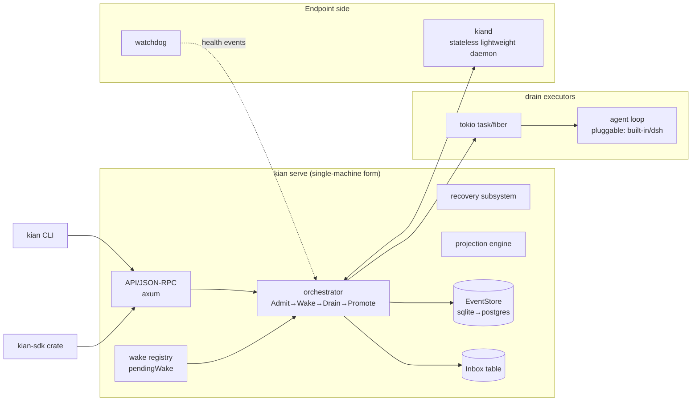
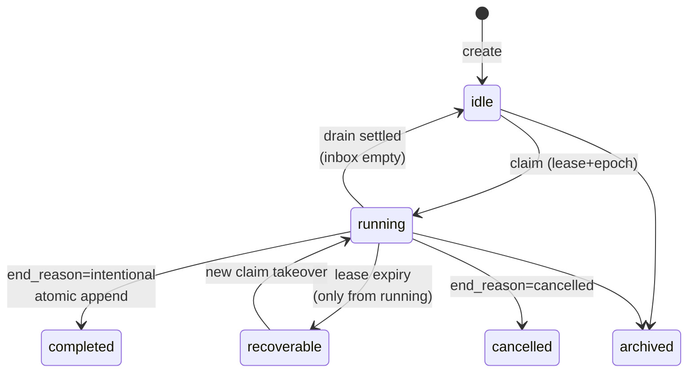
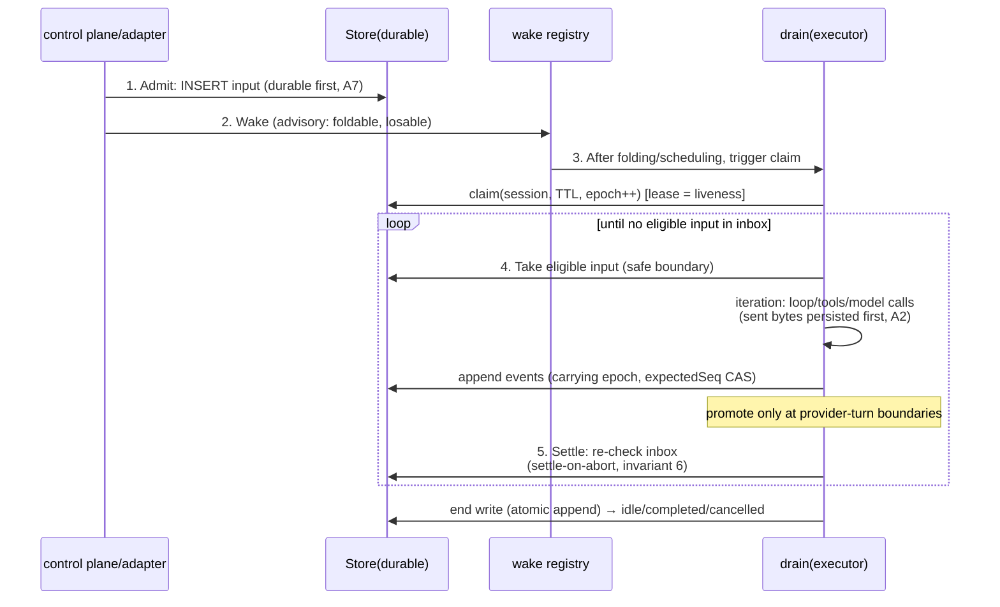
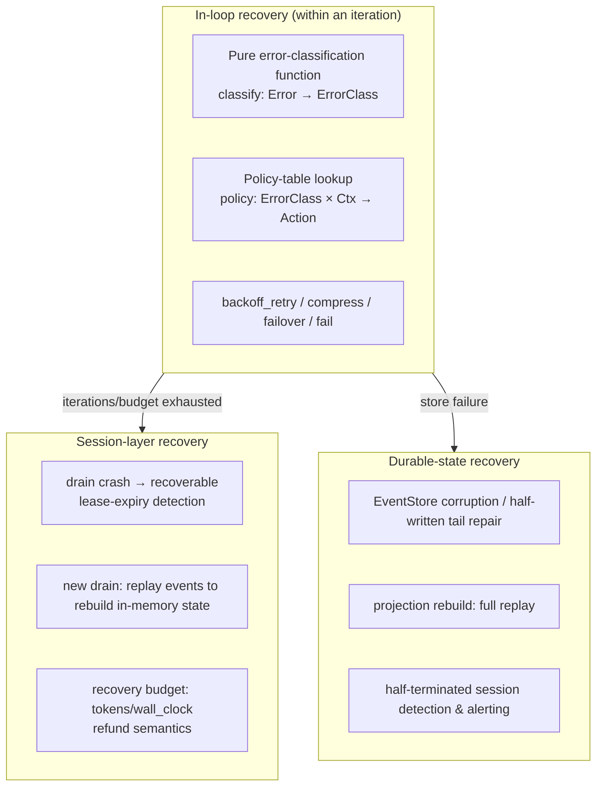
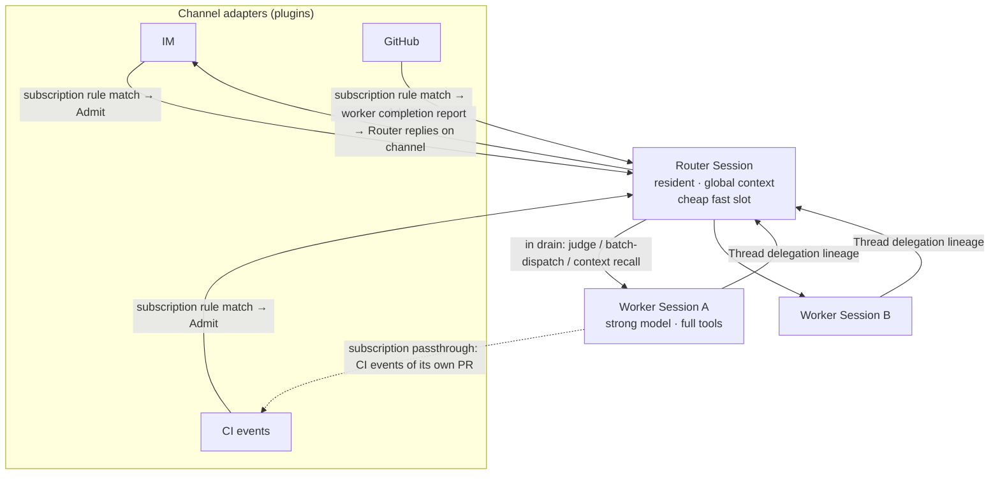
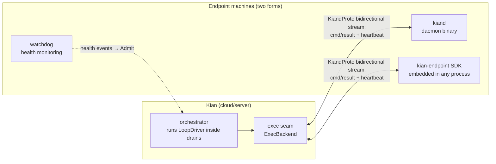
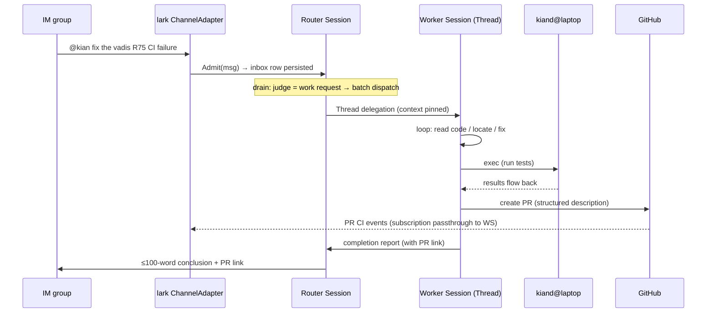

# Kian — Design v0.1

> Design = HOW. Spec lives in [docs/SPEC.md](../docs/SPEC.md); decisions live in [decisions/](decisions/).
> Language: **Rust**, async runtime tokio. This design follows axioms A1–A10 (Feishu design doc).

## 0. Goals and boundaries

### 0.1 Goals

- G1: Full Admit→Wake→Drain→Promote semantics on single-machine (sqlite) mode; S1 (kill -9
  recovery) with zero lost work.
- G2: NoSplitBrainWrite — when two processes contend for one session, stale-epoch writes are
  always rejected by the EventStore (expectedSeq CAS + epoch comparison).
- G3: The exact bytes of every model request are persisted (A2); replaying the same event stream
  is byte-identical.
- G4: Cache hit rate and invalidation causes become first-class observability metrics (A3);
  compression is the only deliberate invalidation point.
- G5: The super-agent reference architecture (Router/Worker/event subscriptions/BYOM) runs as a
  bundle on top of the core without modifying core crates.
- G6: Minimal core surface (A10): core crates import no provider-, channel- or daemon-specific
  code.

### 0.2 Non-goals

- No Web UI (CLI/API first).
- No multi-region / multi-Router horizontal sharding (article experiments show no throughput
  bottleneck at team scale).
- No credential-less credential mechanism (standalone Phase 3+ topic).
- No built-in LLM gateway (access resilience lives in an external gateway; Kian owns only slot
  determinism).
- No Temporal-style deterministic workflow constraints (LLMs are inherently non-deterministic;
  we replay bytes and events, not control-flow re-execution).

### 0.3 Decision quick reference

| ADR | Decision | Alternatives | Rejected because | Scope |
|-----|----------|--------------|------------------|-------|
| [001](decisions/ADR-001-rust-foundation.md) | Rust + tokio + sqlite-first | Go, TS | No-GC tail latency, type safety, single-binary deployment | Everything |
| [002](decisions/ADR-002-event-sourced-core.md) | Event-sourced core: append-only events + rebuildable projections | Direct state tables | A1 auditability; crash recovery = replay | core, storage |
| [003](decisions/ADR-003-super-agent-as-profile.md) | Super-agent is a profile/bundle composition pattern, not core capability | Router/Worker built into core | A10 narrow waist; the article: many variants, not an invariant structure | Everything |
| [004](decisions/ADR-004-cordis-inspired-plugin.md) | Plugin mechanism borrowed from Cordis (service keys/injection/reversible registration); Rust uses traits + registries | dylib dynamic loading | Stability first; compile-time plugin set | plugins |
| [005](decisions/ADR-005-fencing-via-expectedseq.md) | Safety = fencing (epoch + expectedSeq CAS); lease is only liveness | Lease TTL only | NoSplitBrainWrite must not depend on detection timeliness | core, storage |
| [006](decisions/ADR-006-model-slots.md) | Declarative model slots (slot→provider/model/fallback), immutable at runtime | Free runtime model switching | A3 cache-byte stability; P6 determinism | llm seam |

## 1. Architecture overview

### 1.1 System context (C4 L1)


### 1.2 Containers (C4 L2)



**The layered iron rule** (inherited from Feishu §4.1): the control plane only writes the inbox
and reads projections — it never touches execution; execution only appends events — it never
mutates projections directly; after a crash, replaying events rebuilds all in-memory state.

### 1.3 Relationship to the three references (synthesis map)

| Reference | What we borrow | Where it lands in Kian |
|-----------|---------------|------------------------|
| Super-agent article | Router/Worker two-layer, event-driven subscriptions, async ReAct / safe-boundary promote, channel bandwidth matching (IM ≤100 words), BYOM brain-hand separation, watchdog | **super-agent bundle** (not core): Router session template + Worker session template + subscription rules + channel adapters + kiand + watchdog |
| deepseek-harness | everything-is-a-plugin, session log as model-context truth, deriveMessages projection, capability seams (Service Definition/Provider/Consumer three roles), schema versioned migrations | Plugin system design (§6), event schema versioning (§3), model-context projection |
| Cordis | stable service keys, inject dependency declaration, typed event dispatch five modes, reversible registration side effects, narrow waist | Plugin system (§6): `Ctx` service registry, event dispatch modes, Footprint Ladder |
| Kian Feishu doc | All core semantics (P1–P8, A1–A10, concept model, state machine, six invariants, fencing) | **all of kian-core** |

## 2. Core execution model

### 2.1 Concept model and Rust type skeletons

| Concept | Persistence | Rust skeleton (illustrative) |
|---------|-------------|------------------------------|
| Agent | Versioned config (library table) | `struct AgentDef { id, version, model_slots: Map<SlotName, SlotSpec>, tools, budgets }` |
| Environment | Config (unversioned) | `struct EnvSpec { sandbox, network_allowlist, deps }` |
| Session | The one first-class durable entity | `struct SessionId(Uuid)`; state = projection |
| Input | Durable table rows | `struct InputRow { id, session, payload, admitted_at, eligible_at }` |
| Drain | No durable identity | `struct Drain { session, epoch: u64, claim: LeaseRecord }` |
| Turn | Event slice | Interval derivation over `enum TurnEvent` |
| Event | Append-only, never modified | `struct Event { seq, session, epoch, ts, kind: EventKind, bytes }` |
| Thread | Independent event stream + version pin | `struct Thread { id, parent_session, pinned_version }` |

### 2.2 Session state machine (projection-derived)



Rules:
1. **End write + state transition = one atomic append** (NoHalfTerminated). On sqlite = one
   transaction; on postgres = one INSERT..RETURNING. Corollary: session state is read only from
   the event projection.
2. **Safety by fencing**: claim issues a monotonically increasing epoch; every drain write carries
   it; the EventStore rejects stale epochs (expectedSeq CAS is the fence) → NoSplitBrainWrite.
   Lease (claim TTL + heartbeat) is only liveness.
3. recoverable is entered only from running; idle holds no lease and safely waits for the next
   wake.

### 2.3 Admit → Wake → Drain → Promote



The six semantic invariants (inherited in full; resident as debug_assert + test assertions):
1. **Durable before execute**: an input is never woken before it is durable; side-effecting tool
   calls are logged first.
2. **Wake is advisory**: pendingWake is foldable, losable, concurrency-safe; at startup
   kiand/kian fully rebuilds the wake registry from the inbox → NoLostWork.
3. **Promote only at safe boundaries**: no event insertion into an in-flight provider-turn; steer
   resets the provider-turn allowance once per steer batch.
4. **Drain has no durable identity**: after a crash, no in-process continuation is assumed;
   recovery = a new drain replaying events + continuing to consume the inbox.
5. **Interrupt targets only the active ownership chain**: idle/missing → no-op; interrupted work is
   honestly labeled interrupted ≠ failed.
6. **Settle on abort**: before releasing ownership, an interrupting drain re-evaluates the inbox;
   if pending work exists it keeps pendingWake registered.

### 2.4 Three-layer recovery (A4/A5)



- Error classification is a **pure function** (unit-testable, table-drivable); recovery policy is
  a **declarative table** (config-driven, disposition owned by the caller, A4).
- Every recovery kind has a one-shot guard (the recovery loop itself cannot run away); recovery
  consumption counts against a budget with refund semantics = unused remainder returned on task
  completion (A5).

## 3. Event model and schema evolution

### 3.1 Event classification (borrowing dsh's durable/live split)

| Class | Examples | Persisted | Purpose |
|-------|----------|-----------|---------|
| Durable events | turn/start, step/request, assistant/message (sent bytes), tool/call, tool/result, input/admitted, drain/claimed, session/ended | ✅ append-only | Truth and replay |
| Live events | streaming chunks, heartbeats, progress notifications | ❌ not persisted | UI/observability (derived from durable events or via a side channel) |

### 3.2 Model-context projection (the implementation core of A2/A3)

`derive_model_context(session) -> Vec<Message>`: projects the next model request's messages from
the event stream. Rules:
- **History is immutable**: the bytes field of an assistant/message event *is* what was sent;
  replay is byte-identical.
- **Compression is the only deliberate invalidation point**: a `compact` event carries the
  pre-compression range [a,b) and the post-compression summary; the projection function skips the
  compressed range when it encounters the event. Compression must emit an event (observable, A3).
- **Synthetic messages are strippable** (A6): steer-injected synthetic user messages carry a
  `synthetic=true` marker; replay/export can strip them to restore the "real" context.

### 3.3 Schema versioning

- Event envelope carries a version field; JSON encoding (v0).
- Adjacent migration chain (vN→vN+1 = one migration crate module), borrowing dsh's generation
  mechanism: committed generations are never renamed, replaced or deleted; a new generation is
  published exclusively.

## 4. Super-agent reference architecture (bundle, not core)

**Key stance (ADR-003)**: the four super-agent traits (continuous/efficient/proactive/persistent)
are **composition patterns** over Kian primitives. The article itself says "similar design
constraints derive similar architectural choices", but deployment variants abound — so it goes
into a bundle, not the core. The core only guarantees: Thread (cross-session delegation), the
event-subscription Admit entry, the BYOM execution seam, and the watchdog event source.

### 4.1 Router/Worker two-layer (expressed via Thread)



- **Router session**: a resident session (idle long-lived); event judging uses the `router` slot
  (cheap fast model); it emits dispatch-decision events.
- **Worker session**: derived via `Thread { parent_session: router, pinned_version }` delegation;
  context-isolated, full tools, `main` slot strong model. Workers never reply on the channel
  directly — completion events report back to the Router, which aggregates and replies (avoiding
  the chaos of multiple sessions replying independently).
- **Subscription passthrough**: subscription rules may carry a passthrough flag (e.g. CI events of
  a PR created by a Worker flow straight into that Worker's inbox without Router judgment) — the
  load-reduction device validated by the article.
- **Batching**: the Router drain batches naturally (a drain has "drain the queue" semantics —
  eligible inputs are consumed in one sweep) — matching the article §7.2 batch-merge experimental
  conclusion.

### 4.2 Channel bandwidth matching (output policy)

| Channel | Output policy (bundle built-in templates) |
|---------|-------------------------------------------|
| IM | ≤100-word hard rule; only direct questions / short conclusions; notify only when a decision or acceptance is needed |
| GitHub PR/Issue | Structured delivery: problem background / change notes / verification results |
| Email/docs | Structured summary drafting |

### 4.3 BYOM endpoint (kiand daemon / endpoint SDK)



**Endpoint access forms (same protocol, either or both)**:

| Form | Carrier | Fits |
|------|---------|------|
| daemon | `kiand` (= kian-endpoint library + thin main) | Resident on personal dev machines/servers (primary BYOM form) |
| SDK | `kian-endpoint` crate embedded in any process | Harnesses (the dsh process itself is an execution endpoint), user applications |

- The endpoint **keeps no session state** (brain-hand separation): it only executes commands and
  returns results; session logs live in Kian's EventStore.
- The watchdog emits health events (endpoint offline / anomaly self-healing) → they flow through
  Admit into the related session inbox (event-driven self-healing).
- Intermittent endpoint presence is the norm: commands queue in durable state and are consumed
  after the endpoint reconnects (BYOM's offline-tolerant semantics).
- **The two axes of separation**: where execution runs (ExecBackend provider: local /
  remote-endpoint / sandbox / cloud machine) and who the loop is (LoopDriver seam, see §6.2) —
  independently pluggable.

### 4.4 Security boundary (Phase 3+, stake planted)

Risks from article §8.4 are accepted as-is: a compromised cloud-side agent loop controls every
endpoint; endpoint credentials entering the model context leak. Kian's response roadmap: the exec
seam's data-egress tiering (A8) + credential-less use (future) + endpoint execution approval
policy (policy plugin).

## 5. Control-plane protocol (P5 protocolized)

Unified semantics (portable across harnesses/channels):

| Primitive | Semantics |
|-----------|-----------|
| `steer(text, scope)` | Inject a direction change; advisory; takes effect only at provider-turn safe boundaries; resets the allowance |
| `interrupt(reason)` | Abort the active drain; settle on abort (re-evaluate inbox); partial completion labeled interrupted |
| `queue(msg)` | Queue an input without interrupting the current drain |
| `confirm(token, decision)` | Confirmation gate: approve/reject/escalate; fail-closed (P8) |

Implementation: JSON-RPC over HTTP (axum) + SSE event stream. All control-plane operations **only
write the inbox / read projections** (the layered iron rule), never touching execution directly.

## 6. Plugin system (Cordis-inspired, Rust-ized)

### 6.1 Design mapping

| Cordis concept | Kian Rust implementation |
|----------------|---------------------------|
| Plugin = Service | `trait Plugin { fn apply(self, ctx: &mut Ctx) -> Result<Disposer> }` (returning a Disposer = reversible registration) |
| ctx container / service keys | `Ctx` = a typed service registry: `ctx.get::<dyn ModelProvider>()`, `ctx.get::<dyn ExecBackend>()` |
| inject dependency declaration | Construction-time dependency resolution (topologically-ordered activation, equivalent to inject semantics; Rust has no runtime declaration merging) |
| Typed event dispatch | `dispatch` enum: `emit` (observe) / `waterfall` (middleware, may short-circuit) / `parallel` / `serial` / `bail` (stops at the first bail value) |
| Reversible side effects | `Disposer` (teardown in reverse order); registration and disposal are paired |

**Static (compile-time) plugins first** (ADR-004): a plugin = a crate implementing the trait,
registered into the server binary via the `kian_plugins![...]` macro; HMR/dynamic loading
(dylib/wasm) is left to Phase 3. Rationale: the Rust dynamic-loading ecosystem is unstable, and
compile-time plugins already satisfy the narrow-waist goal of "capabilities are replaceable";
dsh-style total plugin-ification is its product choice — Kian's narrow waist is smaller.

### 6.2 Seam three roles (borrowing dsh capability seams)

Every seam names three roles: **Service Definition** (the trait) / **Provider** (the impl) /
**Consumer** (usually a model-visible tool).

| Seam | trait (illustrative) | Built-in Provider | Third-party swappable |
|------|----------------------|-------------------|-----------------------|
| `ModelProvider` | `complete(req: ModelRequest) -> Stream<ModelChunk>` | openai-compat (covers OR/kimi/ds) | any |
| `ExecBackend` | `exec(cmd, env) -> ExecResult` | local / remote-endpoint (kiand, endpoint SDK) | sandbox/cloud machines |
| `LoopDriver` | `drive(drain_ctx) -> Stream<LoopOutcome>` | built-in ReAct loop | dsh loop (being-integrated), custom loops |
| `ChannelAdapter` | `subscribe() -> Stream<ChannelEvent>`; `send(out)` | — | lark/im/github |
| `ToolProvider` | `schemas() -> Vec<ToolSchema>`; `invoke(call)` | built-in fs/exec/kiand | any |
| `RecoveryPolicySource` | `table() -> Vec<PolicyRule>` | config file | any |
| `WatchdogSource` | `health() -> Stream<HealthEvent>` | kiand heartbeat | any |

### 6.3 Footprint Ladder (capability growth ladder)

A new capability is attempted in order of core footprint, smallest first:
1. **Configuration** (zero footprint): recovery policy tables, subscription rules.
2. **Plugin** (edge): ChannelAdapter / ToolProvider / a new ModelProvider.
3. **Seam** (wider waist, requires an ADR): a new trait + three roles + built-in default.
4. **Core primitive** (last resort): entering kian-core requires proof it cannot be expressed at
   the edge.

## 7. Module layout (crate structure)

```mermaid
graph TB
    subgraph crates
        KC[kian-core<br/>concept model / state machine / invariants]
        KS[kian-store<br/>EventStore / Inbox / projection engine]
        KO[kian-orchestrator<br/>Admit→Wake→Drain→Promote<br/>+ recovery subsystem]
        KL[kian-llm<br/>ModelProvider seam + openai-compat]
        KE[kian-exec<br/>ExecBackend seam + local<br/>+ KiandProto]
        KP[kian-plugin<br/>Ctx/Plugin/Disposer/dispatch]
        KLD[kian-loop<br/>LoopDriver seam + built-in ReAct]
        KEP[kian-endpoint<br/>endpoint SDK library (KiandProto endpoint side)]
        KSA[kian-superagent<br/>Router/Worker bundle + channel templates]
        KCL[kian-cli<br/>serve/run/inspect/replay/export]
        KSDK[kian-sdk<br/>embedded SDK]
        KDD[kiand<br/>endpoint daemon = kian-endpoint + main]
    end
    KC --> KS
    KO --> KC & KS
    KL & KE & KP & KLD --> KO
    KSA --> KP & KO
    KCL & KSDK --> KO
    KDD --> KEP --> KE
```

| crate | Responsibility | Key interfaces |
|-------|----------------|----------------|
| kian-core | Concept model, session state machine, six-invariant assertions | `SessionId`, `EventKind`, `Projection` |
| kian-store | EventStore (sqlite v0 → postgres), Inbox, expectedSeq CAS, epoch fencing, projection rebuild | `append(carrying epoch, expected_seq)`, `scan`, `project` |
| kian-orchestrator | Execution model, recovery subsystem (classification + policy + budget), control-plane implementation | `admit`, `wake`, `claim`, `drain_loop` |
| kian-llm | ModelProvider seam, slot resolution, sent-bytes persistence hooks | `ModelProvider`, `SlotResolver` |
| kian-exec | ExecBackend seam, KiandProto (bidirectional stream + heartbeat), offline queueing | `ExecBackend`, `KiandProto` |
| kian-loop | LoopDriver seam, built-in ReAct loop | `LoopDriver` |
| kian-endpoint | Endpoint SDK library: KiandProto's endpoint-side implementation, embeddable in any process | `Endpoint::serve`, `Endpoint::embed` |
| kian-plugin | Ctx registry, Plugin trait, five-mode dispatch, Disposer | `Ctx`, `Plugin`, `Disposer` |
| kian-superagent | super-agent bundle: Router/Worker templates, subscription rules, channel output policies | profile assembly |
| kian-cli / kian-sdk | CLI and embedded SDK | `create_session`, `submit`, `steer`, `interrupt`, `events` |
| kiand | Endpoint stateless daemon (kian-endpoint + thin main) + watchdog | command execution + health events |

Dependency direction (the crate form of the layered iron rule): `kian-orchestrator` depends only
on core + store + seam traits; every provider/channel implementation is assembled through
`kian-plugin` and never enters the orchestrator dependency tree.

## 8. Data flow (example: IM message → PR delivery)



## 9. Concurrency model

- **Per-session serial drain, cross-session concurrency** (invariant 2): a
  `DashMap<SessionId, DrainHandle>`; strictly serial within one session.
- The drain executor is a tokio task; model streaming responses use `Stream` + bounded-channel
  backpressure.
- Epoch/lease safety comes from store CAS; no cross-session global lock in-process.
- A kiand connection = one bidirectional stream (quinn/quic or websocket over TLS) with pipelined
  commands; the endpoint-side execution concurrency cap is configurable.

## 10. Error-handling strategy

- Pure classification function `classify(error, ctx) -> ErrorClass`: provider_down / rate_limited /
  context_overflow / tool_failed / store_failure / budget_exhausted / validation_failed …
- Policy table (declarative): `match → action`, action ∈ {backoff_retry, compress_then_retry,
  failover, interrupt_ask, fail}; disposition owned by the caller (A4).
- Every recovery has a one-shot guard; budget refund semantics (A5).
- end_reason state machine: completed / cancelled / interrupted / failed / recoverable
  (distinguishing intentional ends from crashes, A9).

## 11. Testing strategy

| Layer | Strategy | Tooling |
|-------|----------|---------|
| Invariants | Six invariants + NoHalfTerminated + NoSplitBrainWrite resident debug_asserts; table-driven exhaustive checks | built-in assertion macros |
| Classification function | Pure-function table-driven tests | cargo test |
| Chaos | kill -9 injection (at every drain stage), half-written store, lease-expiry races, two-process contention | scripted fault injection |
| Replay | A2 byte-consistency: same event stream → derive_model_context byte-identical | golden-bytes tests |
| e2e | S1–S7 acceptance scenarios | driven by kian-cli |
| Fuzz | EventStore append/scan, projection rebuild | cargo-fuzz |

## 12. Deployment architecture

- v0 single machine: `kian serve` (one binary + sqlite). Docker optional.
- v1 multi-replica: postgres EventStore + lease/fencing (claim row + epoch CAS); executor scale-out
  = a stateless worker pool claiming sessions.
- Endpoint side: kiand single binary (systemd/launchd managed) + watchdog.
- Hosted control plane (commercial layer, not in the open-source core): multi-replica hosting,
  audit console, evidence-gate reports — see the BP.

## 13. SLA and availability

| Dependency | Assumed SLA | Failure impact | Degradation |
|------------|-------------|----------------|-------------|
| LLM provider | 99% (no SLA guarantee) | iteration failure → L1 recovery (failover slot) | fallback model chain |
| sqlite | local file | single-machine store failure → L3 repair | postgres migration path |
| kiand endpoint | intermittently online (the norm) | exec queueing | durable queue + reconnect consumption |
| LLM gateway | externally governed | same as provider failure | slot fallback |

Kian's own availability target (single machine): after a drain crash, recoverable detection ≤
lease TTL + heartbeat interval; NoLostWork is guaranteed by inbox rebuild.

## 14. Security and privacy

- Control-plane/execution-plane separation + data-egress tiering (A8): orchestration authority
  never flows out.
- Endpoint credentials never leave the endpoint (kiand executes locally; returned results carry no
  credentials).
- Confirmation gates fail-closed (P8); audit = event-stream export.
- Credential-less credential use = Phase 3+ topic (same-source risk as article §8.4).

## 15. Cost model

- Runtime side: single-machine sqlite ≈ zero infrastructure cost; tokens dominate.
- The commercial translation of A3: higher cache hit rate → lower token cost (DS cache hits are
  ~30× cheaper) — cache hit rate is Kian's first-class metric.
- Compression is the only deliberate invalidation point: compression policy = a cost/context-
  quality tradeoff, configurable.

## 16. Migration and compatibility

- v0 event schema JSON + envelope version; adjacent migration chain.
- dsh being-integrated: the dsh loop as a Worker (Phase 3): a mapping protocol between harness
  session-log semantics and the Kian EventStore (harness events → a Kian durable-event subset).
- Sync with the Feishu design doc: this document is its Rust implementation design; the upstream
  doc's "why the agent loop is not enough" TODO section is argued by this document's §1/§2
  (write-back to upstream is the owner's call).
