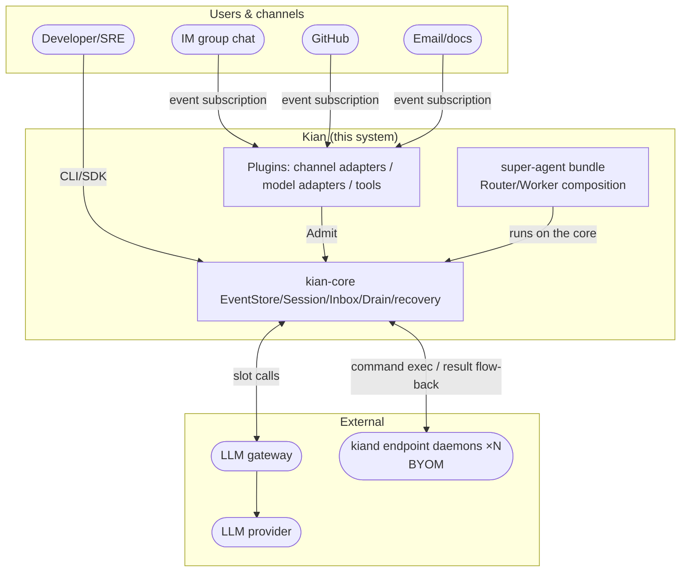
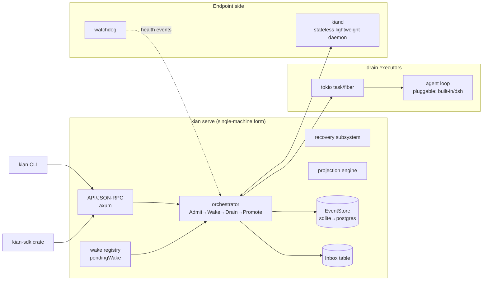
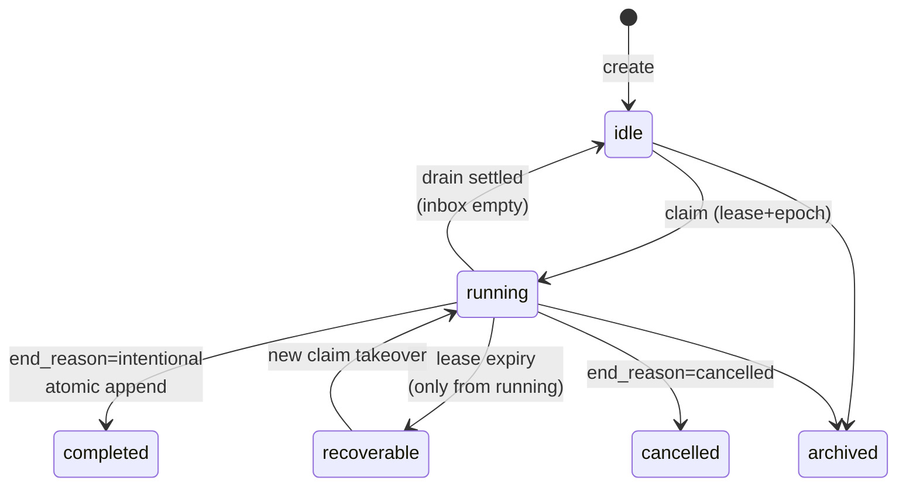
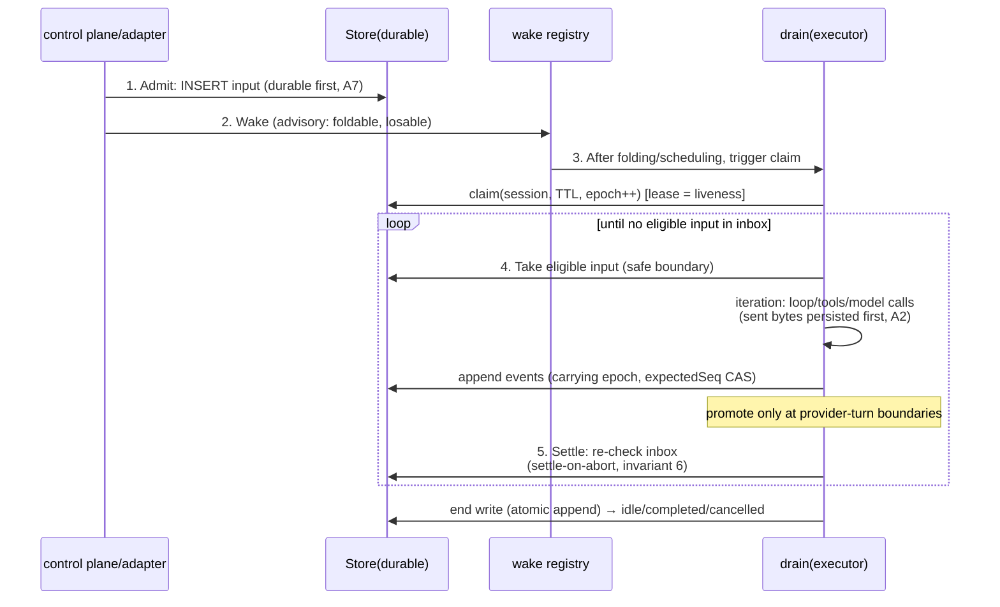
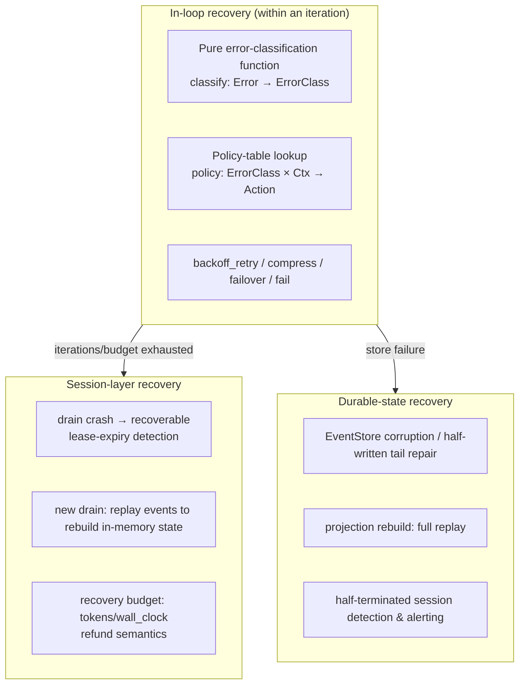
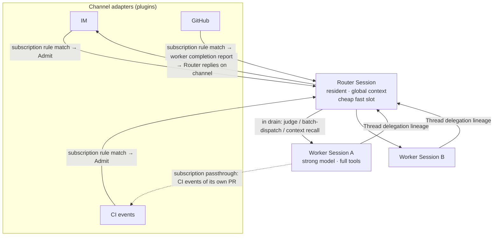
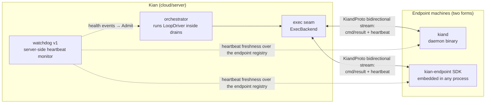
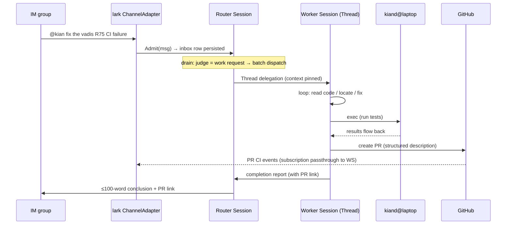

# Kian — Design v0.1

> Design = HOW. Spec lives in [docs/SPEC.md](../docs/SPEC.md); decisions live in [decisions/](decisions/).
> Language: **Rust**, async runtime tokio. This design follows axioms A1–A10 (Feishu design doc).

## 0. Goals and boundaries

### 0.1 Goals

- : Full Admit→Wake→Drain→Promote semantics on single-machine (sqlite) mode; (kill -9
 recovery) with zero lost work.
- : NoSplitBrainWrite — when two processes contend for one session, stale-epoch writes are
 always rejected by the EventStore (expectedSeq CAS + epoch comparison).
- : The exact bytes of every model request are persisted (A2); replaying the same event stream
 is byte-identical.
- : Cache hit rate and invalidation causes become first-class observability metrics (A3);
 compression is the only deliberate invalidation point.
- G5: The super-agent reference architecture (Router/Worker/event subscriptions/BYOM) runs as a
 bundle on top of the core without modifying core crates.
- G6: Minimal core surface (A10): core crates import no provider-, channel- or daemon-specific
 code.

### 0.2 Non-goals

- No Web UI (CLI/API first).
- No multi-region / multi-Router horizontal sharding (article experiments show no throughput
 bottleneck at team scale).
- No credential-less credential mechanism (standalone topic).
- No built-in LLM gateway (access resilience lives in an external gateway; Kian owns only slot
 determinism).
- No Temporal-style deterministic workflow constraints (LLMs are inherently non-deterministic;
 we replay bytes and events, not control-flow re-execution).

### 0.3 Decision quick reference

| ADR | Decision | Alternatives | Rejected because | Scope |
|-----|----------|--------------|------------------|-------|
| [001](decisions/ADR-001-rust-foundation.md) | Rust + tokio + sqlite-first | Go, TS | No-GC tail latency, type safety, single-binary deployment | Everything |
| [002](decisions/ADR-002-event-sourced-core.md) | Event-sourced core: append-only events + rebuildable projections | Direct state tables | A1 auditability; crash recovery = replay | core, storage |
| [003](decisions/ADR-003-super-agent-as-profile.md) | Super-agent is a profile/bundle composition pattern, not core capability | Router/Worker built into core | A10 narrow waist; the article: many variants, not an invariant structure | Everything |
| [004](decisions/ADR-004-cordis-inspired-plugin.md) | Plugin mechanism borrowed from Cordis (service keys/injection/reversible registration); Rust uses traits + registries | dylib dynamic loading | Stability first; compile-time plugin set | plugins |
| [005](decisions/ADR-005-fencing-via-expectedseq.md) | Safety = fencing (epoch + expectedSeq CAS); lease is only liveness | Lease TTL only | NoSplitBrainWrite must not depend on detection timeliness | core, storage |
| [006](decisions/ADR-006-model-slots.md) | Declarative model slots (slot→provider/model/fallback), immutable at runtime | Free runtime model switching | A3 cache-byte stability; P6 determinism | llm seam |
| [007](decisions/ADR-007-kiand-delivery-semantics.md) | kiand delivery: server-side durable queue, at-least-once, command-id correlation | Exactly-once via endpoint state; fail-fast offline; queue-as-events | Endpoint stays stateless (brain–hand separation); offline park is core semantic; queue rows are pre-event state, not session facts | exec seam |
| [008](decisions/ADR-008-async-tool-completion-admitted-input.md) | Async `start`/`stop`: completion is an admitted input; job rows are pre-event durable state; `stop` is honest cancellation | Completion-as-event; second dispatch queue; blocking drain | Full-duplex without loop changes; invariant-1 ordering; default-off tool pair | exec seam |
| [009](decisions/ADR-009-multi-replica-claim-admission.md) | Conditional claim admission (no row / expired / same holder); unique holders under postgres; wake transport advisory | Unconditional claim + fencing only; distributed lock | No multi-replica epoch ping-pong livelock; single-replica behavior byte-identical; lease never grants write permission (ADR-005 intact) | core, storage |

## 1. Architecture overview

### 1.1 System context



### 1.2 Containers



**The layered iron rule** (inherited from Feishu §4.1): the control plane only writes the inbox
and reads projections — it never touches execution; execution only appends events — it never
mutates projections directly; after a crash, replaying events rebuilds all in-memory state.

### 1.3 Relationship to the three references (synthesis map)

| Reference | What we borrow | Where it lands in Kian |
|-----------|---------------|------------------------|
| Super-agent article | Router/Worker two-layer, event-driven subscriptions, async ReAct / safe-boundary promote, channel bandwidth matching (IM ≤100 words), BYOM brain-hand separation, watchdog | **super-agent bundle** (not core): Router session template + Worker session template + subscription rules + channel adapters + kiand + watchdog |
| deepseek-harness | everything-is-a-plugin, session log as model-context truth, deriveMessages projection, capability seams (Service Definition/Provider/Consumer three roles), schema versioned migrations | Plugin system design (§6), event schema versioning (§3), model-context projection |
| Cordis | stable service keys, inject dependency declaration, typed event dispatch five modes, reversible registration side effects, narrow waist | Plugin system (§6): `Ctx` service registry, event dispatch modes, Footprint Ladder |
| Kian Feishu doc | All core semantics (P1–P8, A1–A10, concept model, state machine, six invariants, fencing) | **all of kian-core** |

## 2. Core execution model

### 2.1 Concept model and Rust type skeletons

| Concept | Persistence | Rust skeleton (illustrative) |
|---------|-------------|------------------------------|
| Agent | Versioned config (library table) | `struct AgentDef { id, version, model_slots: Map<SlotName, SlotSpec>, tools, budgets }` |
| Environment | Config (unversioned) | `struct EnvSpec { sandbox, network_allowlist, deps }` |
| Session | The one first-class durable entity | `struct SessionId(Uuid)`; state = projection |
| Input | Durable table rows | `struct InputRow { id, session, payload, admitted_at, eligible_at }` |
| Drain | No durable identity | `struct Drain { session, epoch: u64, claim: LeaseRecord }` |
| Turn | Event slice | Interval derivation over `enum TurnEvent` |
| Event | Append-only, never modified | `struct Event { seq, session, epoch, ts, kind: EventKind, bytes }` |
| Thread | Independent event stream + version pin | `struct Thread { id, parent_session, pinned_version }` |

### 2.2 Session state machine (projection-derived)



Rules:
1. **End write + state transition = one atomic append** (NoHalfTerminated). On sqlite = one
 transaction; on postgres = one INSERT..RETURNING. Corollary: session state is read only from
 the event projection.
2. **Safety by fencing**: claim issues a monotonically increasing epoch; every drain write carries
 it; the EventStore rejects stale epochs (expectedSeq CAS is the fence) → NoSplitBrainWrite.
 Lease (claim TTL + heartbeat) is only liveness.
3. recoverable is entered only from running; idle holds no lease and safely waits for the next
 wake.

 Refinement (event→trigger mapping; the projection's contract): the projection folds events
through an explicit transition table. `session/created`→create; `drain/claimed`→claim — initial,
resume, or takeover: a second claim with no end write in between is the crash-recovery stream
shape and projects `running→running` (safety against true double-claims is the store's epoch
fence, not the projection); `session/ended{reason}`→end write, where `completed`/`cancelled` are
terminal and freeze the stream, while `interrupted`/`failed` release ownership cleanly and return
the session to `idle` (honest labeling lives in the events; resume = new claim; the final end
write records the final outcome); `input/admitted` and `thread/started` 
preserve `idle`/`running`/`recoverable` — `thread/started` is appended to the worker's
stream after `session/created` but before the first `drain/claimed`, and to the Router's
stream mid-drain; every other kind is drain activity, legal only while `running`. EndReason
first-write-wins holds
within one drain episode: a second `session/ended` before the next claim is a named projection
error (the projection-side mirror of the store's end-write CAS race). `recoverable` (lease
expiry — a liveness observation overlaid from the expired-lease query) and `archived` (ops
action) are table edges with no v0 event trigger; later event kinds may drive them
(additions-only).

 Note (read-side only, no state-machine change): the **Ticket stage** (`delivery-retry →
awaiting-answer → awaiting-review → blocked-failed → queued → idle → working`, first match
wins) is a *disposable projection over worker streams* (§4.7) — like `recoverable`, it is an
overlay computed at read time, never a session state and never persisted; the one durable fact
it reads beyond existing events is the additive `"state"` key on completion-report content
(§4.7, additions-only).

### 2.3 Admit → Wake → Drain → Promote



The six semantic invariants (inherited in full; resident as debug_assert + test assertions):
1. **Durable before execute**: an input is never woken before it is durable; side-effecting tool
 calls are logged first.
2. **Wake is advisory**: pendingWake is foldable, losable, concurrency-safe; at startup
 kiand/kian fully rebuilds the wake registry from the inbox → NoLostWork.
3. **Promote only at safe boundaries**: no event insertion into an in-flight provider-turn; steer
 resets the provider-turn allowance once per steer batch.
4. **Drain has no durable identity**: after a crash, no in-process continuation is assumed;
 recovery = a new drain replaying events + continuing to consume the inbox.
5. **Interrupt targets only the active ownership chain**: idle/missing → no-op; interrupted work is
 honestly labeled interrupted ≠ failed.
6. **Settle on abort**: before releasing ownership, an interrupting drain re-evaluates the inbox;
 if pending work exists it keeps pendingWake registered.

 Refinement (the drain's consumption and promote-boundary mechanics, as implemented by
`kian-orchestrator`): the drain is the *sole* writer of `input/admitted` **events** — the
control plane (`admit`/`steer`) only writes inbox rows. When the drain takes a row at a safe
boundary it appends one `input/admitted` event carrying the §3.2 message payload
(`{"role","content","synthetic"?}`) and binds the row to that event's seq via the 
event-driven consumption guard. The input-payload convention: a plain row's payload *is* the
message content; a steer row wraps it as `{"synthetic": true, "content": X}` (exactly those two
keys — kian-96, review N-1: a superset key set stays ordinary content, so the public wire cannot
mint the strippable marker) so the marker survives the inbox work-trip. The spill envelope extends
this row-level convention: a
row payload of exactly `{"content": X, "spill": Y}` consumes as **two events in one fenced write
batch** — `input/admitted` carrying `{"role": "user", "content": X}` exactly as the bare content
would have produced, followed immediately by `input/spilled` carrying the opaque sidecar verbatim —
while rows without the envelope consume byte-identically to before. Promote-boundary enforcement lives in the drain-context
surface handed to the `LoopDriver` seam (`LoopDriver::Ctx`): input-taking is refused while a
provider turn is in flight, and every drain write carries the claim's epoch under expectedSeq
CAS (seq-mismatch from a fenced-out concurrent writer is repaired by re-reading the head; a
stale-epoch rejection abandons the drain — it never fights the fence). The "steer resets the
allowance once per steer batch" invariant reads: a newly eligible batch observed at a settle
point grants exactly one more driver episode. An end write with reason
`interrupted`/`failed` returns the session to `idle` with pendingWake deliberately kept
registered for the resumer (invariants 5/6); a drain that finds the projection terminal
releases without appending anything (terminal streams freeze).

### 2.4 Three-layer recovery (A4/A5)



- Error classification is a **pure function** (unit-testable, table-drivable); recovery policy is a
 **declarative table** (config-driven, disposition owned by the caller, A4).
- Every recovery kind has a one-shot guard (the recovery loop itself cannot run away); recovery
 consumption counts against a budget with refund semantics = unused remainder returned on task
 completion (A5).

 Refinement (the implementation contract, `kian-orchestrator::recovery`):
- The class vocabulary is closed and string-keyed for the policy table: `provider_down`,
 `rate_limited`, `context_overflow`, `tool_failed`, `store_failure`, `budget_exhausted`,
 `validation_failed`, `empty_response` (the constraint-7 soft failure), `unknown`. Wrapping the
 typed seam/store errors (`ProviderError`, `ToolError`, `StoreError`, `InboxError`) means
 classification never parses error strings.
- Policy resolution is **first-match-wins** in declaration order (deterministic); a class no rule
 covers fails honestly — the runner never invents a default action. `kian.yaml` parsing is
 fail-closed (unknown class or action names refuse to load). The config-default table is the only
 hardcoded policy set.
- Disposition is caller-owned (A4): the bounded runner (`run_with_recovery`) only classifies,
 resolves, guards, budgets and sequences; side-effecting actions run through caller-supplied
 `RecoveryReactor` hooks (`compact`/`failover`/`ask`). `compress_then_retry` requires the reactor
 to append the observable `compact` event **before** invalidating the prefix (constraint 3).
- Ordering inside the runner: one-shot guard *before* budget — a repeated kind escalates
 regardless of remaining tokens. Retry-class actions consume `retry_cost_tokens` first; denial
 escalates with a distinguishable token/wall-clock cause.
- Escalation (L1 → L2) is an outcome, not an internal state change: the caller responds to
 `EscalatedToSession` by releasing the claim *without* an end write, so the session lands in
 `recoverable` via lease-expiry detection (ADR-005 liveness) and a fresh drain replays and
 continues. The loop is bounded by construction: ≤ one fire per class (≤ `ALL.len + 1`
 operation invocations) and ≤ `tokens / retry_cost` retry actions.
- Budget counters (`consumed`/`refunded`/`returned`) are observable snapshots; `settle` (task
 completion, A5) returns the unused remainder exactly once — the data source for the 
 `recovery budget reset` command.

 Refinement (session-layer recovery as implemented by `kian-orchestrator` + `kian serve`,
proven by the chaos suite): the engine exposes `Engine::recovery_sweep` — the §2.4-R4
liveness loop over the expired-lease query — which wakes every session whose lease is past its
TTL *and* whose stream projects `running`; `kian serve` runs it on a ticker whose period equals
`drain.heartbeat_interval_ms`, so detection is bounded by `last_heartbeat + lease_ttl_ms +
heartbeat_interval_ms` (the §13 target plus at most one heartbeat of kill-to-last-heartbeat skew;
safety never depends on the timing — the takeover claim's epoch fences any lingering old owner,
ADR-005). The drain episode recognizes a *takeover*: a stream that already projects `running`
under a fresh claim belongs to a drain that died mid-episode, so the taker re-drives the loop to
an honest settle **even when the inbox is empty** (the killed episode consumed its inputs; the
startup inbox scan cannot see those sessions — without the takeover re-drive they would sit in
`running` forever while the sweep churned). Honesty is preserved end to end: the killed session
never projects `completed`/`failed` across the kill window (only `running`, overlaid
`recoverable` by the lease query), and the final end write lands exactly once, after the re-drive
actually settles.

 Refinement (multi-replica claim admission, ADR-009): claiming is *conditional* — the claim lands only when no
claims row exists, the row's lease is expired, or the claiming holder already owns the row; a fresh lease held by a
different holder is refused with the typed `InboxError::ClaimRejected` (nothing written, epoch floor unchanged) and the
engine treats it as an honest no-op drain exit — the live holder's sweep or the advisory wake transport services
the input, never a retry loop. Same-holder claims still bump the epoch, so single-replica behavior (back-to-back
drains) is byte-identical; write acceptance never consults lease state (ADR-005 unchanged — this conditions claiming
only). Postgres mode requires an explicit unique `drain.holder` (fail-closed at startup): two replicas sharing a
holder string would defeat the same-holder condition.

 Refinement (durable interrupt intent, ADR-014): an `interrupt` RPC is durable *in addition to* the in-memory
flag — whenever work may still be in flight (a local drain handle, or a `running`/`recoverable` projection whose
owner is another replica or dead), the control plane admits a reserved control-envelope inbox row targeting the
last event's epoch; the owning drain consumes it at a safe boundary into a `control/interrupt` event and settles
`interrupted`. Idle/terminal sessions keep the exact `NotDraining`/`UnknownSession` behavior and admit nothing.
Two races are settled explicitly:

- **Completed-interrupt race.** A current-epoch intent that becomes eligible while the loop is finishing its work
 is honored, not completed past: the boundary take after the settle (and, as the last line of defense, one final
 control-only take immediately before the end write) consumes the row and flips the end write from `completed`
 (or `failed`) to `interrupted` — the honest stop-before-done. The final take consumes *only* control rows;
 regular pending inputs stay eligible for the resumer's registered wake.
- **Stale-epoch rule.** A row whose target episode already settled (the stream carries a `session/ended` at the
 row's `target_epoch`) is consumed for audit with `"stale": true` and ends nothing — a later episode the intent
 never aimed at must survive. A row targeting an *un-settled* episode always interrupts, including one whose
 owner died and a takeover claim resumed: the resumed work is the work the interrupt intended to stop, so the
 takeover settles `interrupted` (the crash-safe path — the durable row outlives the dead owner and the startup
 inbox scan hands it to the takeover).

## 3. Event model and schema evolution

### 3.1 Event classification (borrowing dsh's durable/live split)

> **Normative event contract**: [EVENT-MODEL.md](EVENT-MODEL.md) is the source of truth for the
> envelope, the complete kind catalog, payload schemas and the change protocol. This section
> records the design rationale; if they disagree, EVENT-MODEL.md wins and both are corrected in
> the same change.

| Class | Examples | Persisted | Purpose |
|-------|----------|-----------|---------|
| Durable events | turn/start, step/request, assistant/message (sent bytes), tool/call, tool/result, input/admitted, drain/claimed, session/ended | ✅ append-only | Truth and replay |
| Live events | streaming chunks, heartbeats, progress notifications | ❌ not persisted | UI/observability (derived from durable events or via a side channel) |

The durable kind set is exactly twenty-two: the fifteen kinds frozen through 
(fourteen by + the additive `recovery/budget-reset`) plus the four additions —
`thread/started`, `thread/completed`, `evidence/verdict`, `channel/delivered` — and the 
addition `input/spilled`, all additions-only (no renames, no reformats of existing kinds) and all
non-context-bearing: thread lineage, evidence verdicts and delivery receipts are audit data that
never enter the model context. `thread/started` is state-preserving in `idle`/`running`/`recoverable`
(§2.2); the other kinds and `input/spilled` are drain activity. The spilled raw is the
verbatim channel payload kept in-stream but out of context — the Inline form of the same input
(the excerpt carried by its sibling `input/admitted`) is what the model sees, while the full raw
stays in the stream as the audit/recall copy (constraint 1: the event log remains the sole truth;
any spill index is a disposable projection over it). The pair is produced by the consumption
write: the `{"content", "spill"}` envelope is a **row-level convention** riding in the existing
inbox row `payload` — not an event-payload change; the frozen event payload contracts are
untouched, and the envelope never appears in any committed event.

 Addition (`control/interrupt`, ADR-014): the twenty-first kind is the **durable interrupt
intent** — drain-activity, non-context-bearing (never a message, never in a model request,
constraint 3), carrying `{"action":"interrupt","reason","requested_by","requested_at_ms",
"target_epoch","stale"?}`. Like the spill envelope, the control envelope
`{"kian":{"type":"control","action":"interrupt",…}}` is a row-level convention in the inbox row
payload; the control plane admits the row (idempotent per `(session, target_epoch)`) and only the
owning drain appends the event — the layered iron rule (constraint 9) is untouched: the control
plane still writes nothing but the inbox.

Addition (`memory/note`, MEMORY-MODEL Phase 1 — landed): the twenty-second kind is a **memory
note** — a note is a claim: non-context-bearing, append-only, latest-per-subject; the fail-closed
fold (`parse_note`/`project_notes`/`verify_note`) lives in `kian-core::memory` as a disposable
projection, never as state outside the event stream. The kind is emitted only by a dreaming drain
of the memory session (`kian-memory`, §7): the dream request is a **marked** inbox row — the
ops-plane envelope `{content, dream}` (the rendered prompt plus the trusted, server-set `dream`
marker) under the idempotency key `dream:<source>:<from>:<to>` — consumed through the normal
`input/admitted` path as one event carrying the additive, non-context `dream` key. The row shape
is a reserved envelope in the spill/steer sense, and the public wire (`submit`/`steer`/`queue`)
refuses all three reserved envelope key sets with `-32602` — only the ops plane admits them, so
the marker cannot be forged from client content (kian-94, review B-2′); routing and provenance
read the marker, never message text — no new execution mode (the layered iron rule holds
unchanged).

### 3.2 Model-context projection (the implementation core of A2/A3)

`derive_model_context(session) -> Vec<Message>`: projects the next model request's messages from
the event stream. Rules:
- **History is immutable**: the bytes field of an assistant/message event *is* what was sent;
 replay is byte-identical.
- **Compression is the only deliberate invalidation point**: a `compact` event carries the
 pre-compression range [a,b) and the post-compression summary; the projection function skips the
 compressed range when it encounters the event. Compression must emit an event (observable, A3).
- **Synthetic messages are strippable** (A6): steer-injected synthetic user messages carry a
 `synthetic=true` marker; replay/export can strip them to restore the "real" context.
- **Request serialization is frozen **: model request bodies are serialized with `serde_json`
 compact output — object keys in lexicographic order (the workspace does **not** enable
 `preserve_order`; enabling it would silently change every request's bytes), while arrays keep
 caller-supplied order (the built-in loop passes tools in a deterministic order). The golden body
 hash is pinned by `kian-llm::provider::FROZEN_CHAT_BODY_SHA256`; changing the serialization
 contract is a constraint-3 event (prefix-cache invalidation for every session) and must update
 the hash and this section in the same change.
- **Wire dialect v2 (constraint-3 event)**: strict OpenAI-compatible endpoints (real
 DeepSeek verified live; OpenAI documents the same shapes) rejected the v1 dialect after any tool
 work trip — HTTP 400 for tool names outside `^[a-zA-Z0-9_-]+$` (the built-ins were
 `fs.list`/`fs.read`/`fs.write`) and HTTP 422 for `role:"tool"` results with no wire-level
 `tool_call_id`. Dialect v2, in one deliberate invalidation: (1) built-in tool names are dotless
 (`fs_list`/`fs_read`/`fs_write`; the dotted spellings remain *invocable* — never advertised — so
 pre-rename history replays); (2) `to_chat_message` emits the strict wire shape: assistant
 tool-call turns carry `tool_calls` (string `function.arguments`, `content: null` when textless)
 and tool results carry `tool_call_id` with the serialized output as content; (3) the per-call
 `tool/call` transcript duplicates are dropped from request bodies (the enclosing assistant
 turn's `tool_calls` already carries the call id). Plain `{content, role}` messages are
 byte-identical to v1, and the event-stream payload contracts are untouched — only the
 request dialect changed. Consequences, accepted: every session crossing the upgrade counts one
 `unexpected_prefix_change` invalidation (the observable cause record; pre-v2 sessions with tool
 work trips no longer replay byte-identical), and the golden hash moved to
 `b743584d…7708` (from `4a1dad31…d7ce`). Alongside, `AgentDef.tools` became the enforced mounted
 surface (`FilteredTools`, fail-closed at assembly: a listed-but-unmounted name refuses boot).

**The payload contracts (frozen after merge, additions-only)**: the context-bearing kinds —
`input/admitted`, `assistant/message`, `tool/call`, `tool/result` — carry a message payload in
`bytes`: `{"role": <non-empty string>, "content": <any JSON>, "synthetic"?: true}`; `content`
passes through verbatim and is never reformatted. A `compact` event carries
`{"from_seq": a, "to_seq": b, "summary": <message payload>}` with `a < b <= seq(compact)` and
pairwise-disjoint ranges; the projection emits the summary at the position of `from_seq` and skips
context-bearing events with seq in `[a,b)` exactly (skipped payloads are never parsed). The
canonical projection byte form (`context_to_bytes`: serde_json compact output, message fields in
declaration order `role`, `content`, `synthetic` only when true, object keys lexicographic —
`preserve_order` must stay disabled) is frozen stable content, as is the tool-schema serialization
owned by the provider ( `build_chat_body` above): both are prompt-prefix bytes, and changing
either is a constraint-3 event (observable invalidation + golden-hash update).

**Reasoning replay (ADR-022):** an assistant message's `content` may carry
`"reasoning_content": <str>` — the provider's thinking-mode reasoning. The ReAct stream assembler
concatenates `delta.reasoning_content` fragments exactly as it concatenates `text`; the message →
chat conversion re-emits the field as the top-level `reasoning_content` on that assistant message.
It is **context** (it enters the next request), not an additive provenance key: a legacy assistant
message without the key produces byte-identical request bytes (the field is skipped when absent,
so `FROZEN_CHAT_BODY_SHA256` is unchanged), and a non-thinking provider never emits it. The cost
of replaying reasoning is input tokens and is observable through the existing usage events; no
trimming or synthesis is performed (constraint 2/3).

**Memory injection (MEMORY-MODEL §6, P2 — landed):** the only sanctioned extension of this
section. At session creation (the server's create handler, after `engine.create_session` and
before the RPC returns), the source memory session's stream is rebuilt, folded and rendered by
the pure frozen `render_memory_index` (`kian-memory`), then admitted **quietly** —
`Engine::admit_quiet` writes a durable inbox row (the reserved exact-two-key
`{content,memory}` envelope, idempotency key `memory-inject:<session>`) without waking a drain.
The next drain's consumption plan turns it into one `input/admitted` (`role:"system"`,
`synthetic:true`, additive non-context `memory` provenance) that joins the context **before the
first user message**. This is constraint-3 safe by construction: the index enters the prefix as
the session's *first* content — no prior bytes exist to rewrite, reorder or reformat; the row is
consumed exactly once and no code path re-injects on resume, takeover or migration (kill/resume
probes show one injection event and `unexpected_prefix_change == 0`); the renderer is frozen
stable content like the serialization contracts above; and with `memory.session` absent the
create path admits nothing, leaving streams and request bytes byte-identical to a memory-off
server. Cost bound (updated P3b-1; originally kian-104 review I1): the fresh session's
rebuild is one `session/created` event, and the source memory session is no longer read in
full — since P3b-1 the fold input is the index-accelerated kind scan (`scan_kind` over the
per-session `idx_events_session_kind_seq` index), so the read is O(memory/note events), not
O(memory-session history); the `memory.inject` caps bound the rendered bytes, not the read
(a recorded bound, not a perf claim). Serving the fold from a snapshot/projection remains P3b
work (READ-MODEL). Normative contract: [MEMORY-MODEL.md](MEMORY-MODEL.md) §6.

**Serving-form acceleration (READ-MODEL, landed)**: projection reads, event streams and the
model context MAY be served from versioned caches, snapshots and materialized views. They are
disposable, verified against the stream, and never an alternative truth; `compact` remains the
only deliberate cache-invalidation point (constraint 3). Contract: `design/READ-MODEL.md`.
Landed in P0: `projection` versioned/unchanged reads, SSE `id:` + `Last-Event-ID` resume with
tail-only polls, and the per-drain committed-event cache in `DrainCtx` — one event Vec per drain
episode, tail-extended per iteration, fully re-derived only on a `compact` event (the single
invalidation point; the returned Vec is byte-identical to a fresh rebuild, so model request bytes
are untouched).

**The loop conventions (built-in ReAct loop, frozen after merge, additions-only)**: the built-in
loop (kian-loop) is a passenger inside the drain — it interacts with the engine only through the
`DrainCtx` surface (append, begin/end turn with payload, take eligible inputs at safe boundaries,
read the committed stream). Its event payloads extend the contracts: `turn/start`/`turn/end`
carry `{"iteration": n}` where the counter is *derived from the stream* (count of prior
`turn/start` events — no resident loop state); `step/request` carries
`{"slot", "provider", "model", "iteration", "body"}` as the A2 audit copy appended before the
provider is called (the provider-level `PersistSink` additionally covers fallback-request bytes
at the HTTP edge); `tool/call` content is `{"id", "name", "arguments"}` (role `assistant`, logged
before execution) and `tool/result` content is `{"call_id", "output", "is_error"}` (role `tool`).
An empty model response (or a `ProviderError::EmptyResponse`) is a soft failure: the loop consults
the declarative recovery table for class `empty_response` and reports `SoftFailed` — the engine
settles `failed`, never `completed`; the loop itself never retries (disposition is one-shot-guarded
and caller-owned, §2.4). Local tool execution (fs + exec) runs entirely inside `spawn_blocking`,
so a sleeping tool cannot stall concurrent drains; the built-in exec tool kills the child on
timeout and reports `timed_out` as an honest error result. Wiring: kian-loop depends on
kian-orchestrator (for `LoopDriver::Ctx = DrainCtx`) and on kian-llm (slot resolution +
`complete_turn`), matching the §7 crate map edge `KLD → KO`.

**The audit enrichment (additive, additions-only)**: `turn/end` payloads may carry two further
keys — both drain-activity, never context-bearing, both omitted when not applicable so legacy
payloads replay byte-identically: `"usage": <provider usage JSON verbatim>` when the provider
reported usage for the turn (the openai-compat provider parses the SSE `usage` object verbatim,
last frame wins, and a usage-only frame never flips the constraint-7 empty-response liveness
flag), and `"error": {"class": <pure classifier class>, "action": <policy disposition or
"none">}` on `soft_failure` / `error` outcomes (class from the pure classifier; action from
the declarative table's disposition names; context-projection and slot errors classify as
`unknown`, engine/store errors as `store_failure`). The `ModelChunk` seam gained the additive
`usage: Option<Value>` for transport. The `kian usage-stats` command, the `GET /metrics`
`"usage"` aggregate and the `session inspect` usage lines are pure projections over these
payloads (`kian-cli::usage_metrics`, pattern of ): per-session and per-store totals for
`input_tokens`, `output_tokens`, `cache_read_input_tokens`, `cache_creation_input_tokens` plus
`requests_with_usage` / `unknown_usage_requests` counts. Usage is never normalized or priced in
core (§15).

 Payload additions on the frozen contracts (same discipline as —
additive top-level keys **outside `content`**, omitted when unset, never in
`derive_model_context` or request bytes): `tool/result` payloads may carry the `redactions`
provenance report (§6.2) and `tool/call` payloads may carry the `permission` provenance
object (§6.2, [ADR-015](decisions/ADR-015-tool-permission-provenance.md)). The message
shape inside `bytes.content` and the key set (`iteration`, `outcome`, `tool_calls`, …) are
unchanged; both keys are drain-activity audit surface only.

### 3.3 Schema versioning

- Event envelope carries a version field; JSON encoding (v0).
- Adjacent migration chain (vN→vN+1 = one migration crate module), borrowing dsh's generation
 mechanism: committed generations are never renamed, replaced or deleted; a new generation is
 published exclusively.
- (dual-backend store): one chain per backend with the *same versions and names* — sqlite
 (`?N` dialect, frozen v0/v1) and postgres (`$N` dialect, TEXT/BIGINT, same partial index, same
 `_kian_migrations` runner dispatched per backend). Envelope columns stay verbatim TEXT on both,
 so the same stream exports byte-identically from either backend (the export-parity golden).
 pg dialect notes: the claim floor max is `GREATEST(...)` (pg `MAX` is aggregate-only); the
 batch append is one CTE statement (all rows land or none); a concurrent same-session append
 that passes the fence snapshot and loses the primary-key race is turned into zero rows
 (`ON CONFLICT DO NOTHING`) or a caught 23505 and classified through the same HEAD re-read as
 every other CAS refusal (`StaleEpoch` vs `SeqMismatch`).
- (`v2_inbox_admit_order`, both backends): the inbox take order is `(eligible_at,
 admitted_seq)` — a database-assigned admission ordinal (sqlite: `max+1` inside the single
 INSERT; pg: identity column), never the random uuid. Same-millisecond admits consume in
 admission order: the worker-template classification reads a stream's *first* input, and
 cross-replica replay must be deterministic.
- (derived event id): every `(session, seq)` pair has a deterministic external id — `"evt_" +
 RFC 4122 v5(namespace = session uuid, name = "kian:event:<seq>")` — defined by the pure function
 `kian_core::events::event_id` and mirrored dependency-free in the SDK (`KianClient::event_id`,
 golden-pinned to the same literals, generated by an independent implementation). It is never an
 envelope field and never stored: envelope bytes stay frozen v0, and `(session, seq)` remains the
 only identity — the id is a naming convention over that pair, never a second source of truth.
 Surfaces: `kian session export --with-event-ids` adds the id to each JSONL line as a presentation
 key (opt-in; default export bytes unchanged; `import_jsonl` ignores the extra key, so the
 augmented lines work-trip — verified by test, not export-only).

## 4. Super-agent reference architecture (bundle, not core)

**Key stance (ADR-003)**: the four super-agent traits (continuous/efficient/proactive/persistent)
are **composition patterns** over Kian primitives. The article itself says "similar design
constraints derive similar architectural choices", but deployment variants abound — so it goes
into a bundle, not the core. The core only guarantees: Thread (cross-session delegation), the
event-subscription Admit entry, the BYOM execution seam, and the watchdog event source.

### 4.1 Router/Worker two-layer (expressed via Thread)



- **Router session**: a resident session (idle long-lived); event judging uses the `router` slot
 (cheap fast model); it emits dispatch-decision events. Residency is mechanical: the
 Router's loop driver parks between provider turns — while delegated threads are outstanding
 and while the inbox is empty — instead of settling, so the session never freezes after an idle
 final answer; completion reports and new channel events re-drive it in place.
- **Worker session**: derived via `Thread { parent_session: router, pinned_version }` delegation;
 context-isolated, full tools, `main` slot strong model. Workers never reply on the channel
 directly — completion events report back to the Router, which aggregates and replies (avoiding
 the chaos of multiple sessions replying independently).
- **Subscription passthrough**: subscription rules may carry a passthrough flag (e.g. CI events of
 a PR created by a Worker flow straight into that Worker's inbox without Router judgment) — the
 load-reduction device validated by the article. The registry is many-to-many: a topic maps
 to the *set* of worker sessions that served it, and one event admits one durable row per
 subscriber (idempotent per `(session, event_id)`; a mid-set write failure is retried per
 subscriber), so workers sharing a topic observe each other's events and self-resolve conflicts
 without peer links — the Router stays the cross-task rendezvous, and only an empty set falls
 back to it.
- **Follow-up ownership** (reference 002): a person's follow-up belongs to the
 **live** Ticket's Executor. The registry ('s `topic → subscriber set`) gains a **liveness
 projection**: every worker is `live` or `ended`, derived from `thread/completed` /
 `session/ended` on the *worker's own* stream (a Router-side end marks nothing) — a disposable
 projection exactly like the topic sets, so a rebuild from streams equals the runtime
 `register`/`mark_ended` map. Fan-out admits to **live subscribers only** (the historical set is
 kept — a worker that served a topic stays bound to it in the record); an **all-ended** topic is
 the *release to fresh evaluation* (002's Ticket-end rule): the event falls back to the Router
 with the closed `released_to_eval` reason code, the release audit line naming the topic. The
 tool-surface half of the rule: while a live Executor owns a topic the Router may only **stop**
 it (the control-plane interrupt — untouched), never requeue — `spawn_worker` whose task is the
 channel-event wrapper of an owned topic (the same derivation the registry rebuild uses), or
 whose correlation carries `{"topic": …}`, is refused with an honest tool error naming the owner
 session ("follow-up owned by live executor"); a successful channel spawn registers the new
 worker as the topic's live owner (durable lineage first — `thread/started` — then the
 projection). Config: `superagent.followup_ownership` (default **on**); `false` restores the
 legacy behavior on both surfaces. Runtime ended-transitions are honest-v1 bounded: the boot
 rebuild re-derives them from streams, and `mark_worker_ended` is the runtime seam.
- **Execution-worker binding** (ADR-020; contract in `design/EVENT-MODEL.md` §3/§4.2): a delegated
  worker session is bound to exactly one **execution worker** — a configured `endpoints[].id` (a
  `kiand` daemon; the loop itself stays on the `kian serve` side). The catalog is config
  (`endpoints[].id` + an optional human `description`); zero endpoints means the feature is off.
  The binding is **durable and derived, never resident**: the delegation wrapper (the worker's first
  message) carries the additive `"exec_worker"` key and the `thread/started` payload carries the
  same additive top-level key on both sides, so the assignment is a projection of the session's own
  stream and a restart reconstructs it by replay. `worker` in that payload keeps meaning the worker
  *session* uuid; `exec_worker` is the worker *id* and the two names are never conflated. Routing is
  a **per-drive selection** in this section's driver: assembly builds one worker side per
  configured worker (`WorkerLoopDriver` over that worker's `exec` (`RemoteExecTool`) and its v2
  filesystem tools (`RemoteFsTool`, ADR-023) for its endpoint id — plus that worker's async pair,
  recall and local tools), and `SuperAgentDriver::drive` picks the side from the stream's binding
  before the first provider turn. That fixes today's multi-endpoint limitation (`CombinedTools`
  first-wins left only the first endpoint reachable) with the worker tool surface unchanged from
  the model's point of view: `exec` plus `fs_list`/`fs_read`/`fs_write`, schemas byte-identical to
  the local built-ins, and no `kian-core` seam change beyond the shared `FsCommand`/`FsResult`
  types. **1:1 exclusivity** is checked at `spawn_worker` before any side effect: candidates are the
  Router stream's `thread/started` events grouped by `exec_worker`, liveness is the existing worker
  vocabulary (`thread/completed` + `session/ended` on the *worker's* stream — `completed`/`cancelled`
  release, `failed`/`interrupted` are resumable and stay live until released), read through a bundle-owned
  read-only port (the `RecallPort` precedent; no store symbol enters the bundle). To make the check
  honest across a crash, the Router-side `thread/started` is written **before** the task row is
  admitted: a spawn that dies in between leaves a reserved-but-never-started thread (refused to
  others, audited, released after the configured `queue_timeout_ms`) instead of a live session the
  scan cannot see. A refusal names the owning worker session and thread and creates no inbox row, no
  thread and no provider call. **Legacy** (`superagent.followup_ownership`-style discipline): a
  pre-change worker session with no binding, on a server that now has workers, keeps the first
  endpoint plus a `legacy unbound` audit line — never rewritten, never rebound, never counted as
  bound. Worker lifecycle is "same id, new incarnation": a daemon crash/restart/migration keeps the
  binding and the durable queue re-drives on reconnect (ADR-007); a worker that never returns
  produces the honest queue timeout, never a failover to another worker id, and **rebinding a live
  session is deferred** (ADR-020 "Deferred"). **Release** (ADR-035) is the other way out of a held
  slot and the only one: a thread whose last end is `interrupted`/`failed` is closed by one atomic
  `drain/claimed` + `session/ended{cancelled}` batch under a fresh claim epoch, which the existing
  liveness table reads as `Released` and which, being terminal, can never be resumed. The
  engine owns the claim and the append (`Engine::release_idle`, the `recovery_budget_reset`
  append precedent); the `release_worker` ops method and the `kian workers release <id>` verb are
  the explicit trigger, and a `kian serve` maintenance tick (`workers.release_after_ms`, default
  `300_000`, `0` disables) reclaims stale idle-ended threads through the same primitive. Gates:
  idle projection, non-terminal last end, no eligible inbox row, no live drain, no live
  `pending`/`inflight` queue row for the worker. The bundle is untouched (no tool, no prompt byte);
  a spawn-time fast path is deferred.
  Tests: L1 byte-identical legacy wrapper/payload/schema/
  prompt, the spawn matrix (unknown/busy/missing/defaulted/feature-off) with no side effects on
  refusal, routing as a pure function of (stream, catalog), and the release table; L2 two real
  `kiand` daemons route independently, `kill -9` re-drives, a server restart re-derives the binding,
  and the async pair's `async_jobs.endpoint_id` follows the bound worker.
- **Two-level filtering** (article §3.1): the *Fast Path* is an admission taxonomy over
 provenance — a config-level `classes:` table keys `(channel, topic?, sender?)` to
 `candidate | explicit-only | ignore` with most-specific-wins resolution, evaluated in code
 **before** the rule set and before any model call (`ignore` and `explicit-only`-without-signal
 drops are audit lines + counters, no row, no wake; absent classes = today's behavior). The
 *Slow Path* is the Router's judge prompt: it is the natural-language policy extension
 point — admission semantics that would need semantic judgment are edited as prompt text, not
 code.
- **Admission Inline/Spill shaping**: the additive `superagent.shaping:` config carries
 `inline_cap_bytes` (absent = infinity, hence byte-identical legacy behavior), `first_chars`
 (default 50), and `neighbor_fields`. The subscription service applies it exactly once, after
 routing and immediately before the inbox row exists. At or below the serialized-raw byte cap,
 the existing `channel_event` wrapper is unchanged. Over the cap, `content` instead carries an
 Inline view (a strictly shorter excerpt, canonical `topic`/`event_id`, and any configured
 top-level scalar association ids), `"spill": true`, and `continuation: {event_id}`; the row
 envelope carries the verbatim raw as its sidecar, producing the atomic admitted/spilled pair at
 the ordinary consumption write. Idempotent `(session, event_id)` admission still dedupes the
 whole pair. There is no retroactive re-shaper: committed context remains immutable and
 `derive_model_context` stays verbatim. Neighbor inlining v1 reads only fields on this payload;
 it never fetches cross-event IM history (that is a recall hop).
- **Batching**: the Router drain batches naturally (a drain has "drain the queue" semantics —
 eligible inputs are consumed in one sweep) — matching the article §7.2 batch-merge experimental
 conclusion. The §7.2 observability shape is bundle-owned counters, recorded by the
 resident Router's driver around each judge turn and snapshotted on the merged `/metrics` route
 as `superagent.router_batching`: `judge_turns`, `inputs_consumed` (batch size),
 `turn_duration_ms_total` / `mean_turn_duration_ms` (per-request wall duration),
 `amortized_ms_per_input` (duration/inputs — per-decision amortized latency), the bounded
 `batch_histogram` (buckets 1…128 plus overflow) and `last_turn`.
- **Speculation** (article §3.4, as a policy pattern over existing primitives): the Router may
 dispatch a worker on a *weak* signal by calling `spawn_worker` with `speculative: true`. The
 delegation wrapper gains one additive, model-visible field — `"speculative": true` inside the
 task `content` — so the worker's first message honestly says it was spawned on a weak signal,
 and the marker is audit-visible forever (the wrapper bytes live in both streams; legacy wrappers
 parse and replay byte-identically). The Router profile's `speculation: {max_outstanding: n,
 label: …}` config bounds concurrent speculative threads: the spawner enforces the cap with an
 honest tool error the Router model sees and reacts to (never a silent refusal), and the
 outstanding count is *derived from the Router's event stream* (`thread/started` without a
 consumed completion report — a pure projection, so the budget survives Router restarts).
 The article's silent-repro delivery policy ships as a **prompt template** on the Router profile
 (deliver only after the bug is confirmed *and* a simple fix found; otherwise stay quiet) — a
 config artifact, not code. Deliver-or-discard is the existing channel-policy gate: a discarded
 speculation simply never calls `reply` (no `channel/delivered`), while the speculative worker's
 own stream still audits every token spent — honest by construction. Per-session budgets (A5)
 are untouched; the cap is the Router-profile speculation budget.
- **Thread/Correlation intake projection** (ADR-013 draft): the additive
 `superagent.intake.thread_keys: [{channel, key: [group?, <payload-field>…]}]` config derives the
 canonical thread key `<channel>:<group>#<key>` at adapter mapping time — deterministic and
 collision-free by construction (reserved characters percent-encoded per component), and
 **config-owned**: a config change is a new key, old streams keep their topics (cache-stable, no
 rewrite). After derivation the key *is* a routing topic — the subscription rule matcher gains no
 correlation concept and is unchanged. The **source read position** (a restart must not replay)
 is derived from the last admitted event's payload cursor fields per source kind (lark
 `message_id` offsets; GitHub REST `since` timestamps, `updated_at`); where a source exposes no
 derivable cursor the honest v1 bound is idempotent re-poll under the existing `event_id`
 idempotency — `deduplicated` admissions, zero duplicate rows, **no position table** (rejected as
 pre-event durable state outside the event log). **Correlation adds context, never routes**: the
 derived key surfaces in the Inline `neighbors` block (`thread_key`, an association id for
 recall hops through the toolpack). Normative, with ADR-012: **fan-out grants no authority**
 — a fanned-out message reaches live subscribed tickets as context bounded by their Mandates, and
 no admission check runs on it (001's rejected-concepts rows, kept); one trigger fanning out to
 many tickets is the fan-out mechanics restated under the authority rule.
- **Closed decision-reason vocabulary** (reference 005): every intake decision — the three
 drop shapes, the empty-set fallback, every admitted row — stamps a machine-stable
 `reason=<code>` into its audit line, and the assembly's subscription-metrics snapshot counts
 per code (`by_reason`, every code of the closed set materialized). The closed
 `IntakeReason` set is `no_rule | class_ignored | not_explicit | admitted_router |
 admitted_passthrough | deduplicated | released_to_eval` (the last is produced only by the
 follow-up-ownership release rule, — see the "Follow-up ownership" bullet); a
 deduplicated admission reports `deduplicated` (the
 row already existed — no new decision was spent), a `Route::Session` fixed target reports
 `admitted_passthrough` (the shared "no judge turn spent" code — the closed set has no
 per-route variant). The codes ride **audit lines + counters only**: `RoutingOutcome`'s shape
 is frozen (no ripple), consumers match the enum (never a string parse upstream), and zero new
 event kinds exist — the durable trace of a Router decision stays the existing
 `tool/call`/`thread/started`/`channel/delivered` triple. The *judge-side* convention is a
 template sentence (the soft half): the Router is instructed to tag each batch decision in its
 reply text as exactly one of `decision:accept`, `decision:stop`, `decision:ignore`,
 `decision:unavailable` (the closed `DecisionKind` set) — model-visible convention, not a
 parsed contract; template discipline per the note pattern (new sessions render the new
 default, persisted prompts replay byte-identically; the template constant lives in
 `templates.rs` beside the other template artifacts, re-exported under its historical path).

### 4.2 Channel bandwidth matching (output policy)

Policies shape the reply **before the send** (`ChannelDelivery` carries already
policy-shaped content); the adapter delivers what it is given. Policy code lives in the
bundle (`kian-superagent`), never in a channel adapter and never in the core. Every
successful send is followed by a `channel/delivered` event; a policy rejection (e.g. a
structured payload missing a section) is an honest error to the loop — never a silent
send. Composing **before** the shaping policies is the output-side speak-gate (
`superagent.speak_rules`): a *whether-to-send* decision over the closed condition
vocabulary `always | ack-first-only | decision-needed | result-ready | never` — a
suppressed send is an honest tool error naming the rule and condition (the model sees it
and reacts), an audit line + counter, and no send ⇒ no `channel/delivered` (the 
deliver-or-discard discipline). `ack-first-only` keys its confirm-once memory in
`SpeakTracker`, a **disposable projection** over the Router's own `channel/delivered`
events rebuilt from the stream at boot, so "first ack only" survives restarts; absent
table = every send passes, byte-identical.

Composed after the gate (and after the shaping policies), the **outbox bounded retry**
(`superagent.outbox` — absent = one attempt, the honest adapter error,
byte-identical) wraps the send itself: `OutboxDriver::deliver_with_retry` re-executes the
same policy-shaped `ChannelDelivery` bytes with backoff `2s·2^(n-1)` cap 60s, at most
`max_attempts` (default 6) total, serialized per `(ticket, conversation)` — a later message
of the same key waits for the earlier one (its ack precedes its result); other tickets and
other conversations never wait (003's channel-failure rules). The ticket is the optional
`correlation` tool argument (the `spawn_worker` vocabulary — thread id or topic; absent ⇒
the Router session itself), the conversation is `(channel, speak_key(target))` — the 
canonicalization reused. An exhausted delivery **parks honestly**: an `outbox park:`
tool error (a stable-text prefix, the vocabulary discipline — the rebuild's
disambiguator between parked and speak-suppressed), an audit line, an `OutboxMetrics`
counter, the `delivery-retry` stage arm (the outbox view is real), and the parked
conversation named on `kian tickets` — never a silent swallow, never an unbounded loop.
New receipts carry additive `attempt`/`first_attempt_ms` keys (legacy receipts parse
unchanged). The outbox itself is a **disposable projection** over `tool/call` (intent,
log-before-execute) + `tool/result` (call_id pairing) + `channel/delivered` (receipt):
rebuild classifies each intent — no result ⇒ pending (a kill -9 mid-retry; the boot
re-drive re-sends it, at-least-once), park-prefixed error ⇒ parked (visible, terminal for
the driver — a person releases), other error ⇒ suppressed/invalid/legacy (never re-driven),
receipt/ok ⇒ delivered. No durable outbox state exists anywhere.

**Details requests (no truncation).** The IM shaping has a second mode for the one case where the
budget would hide what a person explicitly asked for: a reply answering a details request. The
request is derived by the bundle from the Router's own committed stream — the latest admitted
channel input on the reply's channel, bounded by the reply's own `tool/call` seq — and matched
**exactly** against the closed `DETAIL_REQUEST_TEXTS` vocabulary (`详情`, `详细`, `完整结果`,
`details`, …) after trimming surrounding punctuation/whitespace; a passing mention (`详情页打不开`)
never qualifies. The full mode delivers the complete text with `truncated: false` and the additive
`detail: true` receipt bit (legacy summary receipts are byte-identical); the channel's own long-text
split is the only boundary, so nothing is cut. The mode is never model-declared and never a tool
argument (a cached tool schema cannot flip it); a pinned resident prompt therefore still behaves
correctly. The derivation is a pure function over events, so the boot outbox re-drive derives the
same answer at the intent's `tool/call` seq and re-sends the intent's exact bytes.

| Channel | Output policy (bundle built-in templates) |
|---------|-------------------------------------------|
| Any channel | speak-rules: the *whether-to-send* gate (`superagent.speak_rules: [{channel, when, per_topic_ack}]`, first match per channel) evaluated before the shaping policies below; `decision-needed` admits the two-way `reply` surface, `result-ready` admits `deliver_structured`, `ack-first-only` confirms once per topic (or channel), `never` mutes — suppression is honest (tool error + audit + counter), never a silent swallow |
| IM | ≤100-unit hard rule on normal replies (a CJK character counts one unit; CJK has no inter-word spaces); only direct questions / short conclusions; notify only when a decision or acceptance is needed. A reply answering a details request (`详情` and the closed vocabulary, derived from the stream) takes the full-delivery mode: the complete text, `truncated: false`, additive `detail: true` receipt |
| GitHub PR/Issue | Structured delivery: problem background / change notes / verification results |
| GitHub (adapter) | the second *real* adapter beside lark, the "group-chat message + CI events" family (`issues`/`issue_comment`/`pull_request`/`push`/`check_run`/`status`): receive is webhook-shaped deliveries verified by the receiver surface (HMAC precedes parsing) and handed to the adapter, which maps each delivery to one provenance-carrying `ChannelEvent` (delivery id → `event_id` idempotency, repo → `group`, `owner/repo` or an exact `owner/repo#N` key → `topic` from the config table — the table is the receive allowlist —, verbatim sender, adapter-declared `explicit` on @-mentions in human text); send is PR review comment / issue comment / PR description via the REST API, resolving only on 2xx + id acceptance, structured content rendered as markdown sections; token env-only (`KIAN_GITHUB_TOKEN`, fail-closed when send is configured; receive needs none); the channel is untrusted by default |
| Email/docs | Structured summary drafting |
| Mock (in-memory) | built-in first-class bundle adapter (production code, not a test stub): the IM stand-in, same ImPolicy/StructuredPolicy enforcement through the Router's dispatch tools |
| Lark/Feishu | the first *real* adapter: IM row — same ImPolicy (≤100-unit normal replies, details-request full mode) through the Router's dispatch tools; receive is an adapter-side chat-history poll mapped to provenance-carrying `ChannelEvent`s (chat id → group, sender → sender), send resolves only on API acceptance; credentials env-only (`KIAN_LARK_APP_ID`/`KIAN_LARK_APP_SECRET`, fail-closed at startup); the channel is untrusted by default |
| WeChat (iLink) | the third *real* adapter, **best-effort by contract** (ADR-018; [CHANNEL-WECHAT.md](CHANNEL-WECHAT.md)): receive is one long-poll loop per channel over Tencent's reverse-documented ClawBot iLink Bot API (`POST /ilink/bot/getupdates`, server-held ~35 s) mapping each text message to one provenance-carrying `ChannelEvent` (`message_id` → `event_id` as a lossless decimal string, `from_user_id` → `sender.user_id`, `group` always `None`, text only); the config `topics` table doubles as the receive allowlist (unknown sender → honest drop + audit); send is `POST /ilink/bot/sendmessage` echoing the **latest inbound `context_token`** for that user — reply-only, since with no token there is no deliverable send, so no proactive push — resolving only on `ret == 0`; the credential is a QR-issued session token in a local 0600 file written by `kian wechat login` (explicit config path, never in `kian.yaml`, never logged — the one deliberate deviation from the env-only static-secret rule), and `errcode -14` pauses the channel for an hour and resumes on a credentials-file change; no position table (empty cursor, honest idempotent re-poll), no new surface, no new event kind; a protocol break degrades this channel only |

### 4.3 BYOM endpoint (kiand daemon / endpoint SDK)



**Endpoint access forms (same protocol, either or both)**:

| Form | Carrier | Fits |
|------|---------|------|
| daemon | `kiand` (= kian-endpoint library + thin main) | Resident on personal dev machines/servers (primary BYOM form) |
| SDK | `kian-endpoint` crate embedded in any process | Harnesses (the dsh process itself is an execution endpoint), user applications |

- The endpoint **keeps no session state** (brain-hand separation): it only executes commands and
 returns results; session logs live in Kian's EventStore.
- **The v1 watchdog is the server-side heartbeat monitor** (kian-exec): a dead daemon cannot
 report its own death, so the authoritative health view is the server's heartbeat-absence
 observation over the endpoint registry — offline when `now - last_heartbeat > offline_after_ms`,
 online again on a fresh heartbeat; edge-triggered (one event per state change, no flapping), and
 freshness-based even when the transport is still up (a silent-but-connected endpoint is offline).
 Endpoint-side self-checks / anomaly self-healing remain ****.
- The watchdog emits health events (endpoint offline) → they flow through
 Admit into the related session inbox (event-driven self-healing); the watchdog itself never
 writes session streams.
- Intermittent endpoint presence is the norm: commands queue in durable state and are consumed
 after the endpoint reconnects (BYOM's offline-tolerant semantics).
- **Endpoint identity vs address** (ADR-020): an execution worker is its configured `endpoints[].id`
  — never its `addr`. A session's worker binding is by id, so a daemon that dies, restarts or moves
  (same id, reachable at its configured address — a stable tunnel, or an edited `addr` plus a server
  restart) is the same worker to the binding, and the durable queue re-drives its outstanding rows on
  reconnect (§4.1). The **static** catalog is the `endpoints:` list itself (`id` + optional human
  `description`); duplicate ids keep refusing to boot, and no endpoints plus no `workers:` section
  means the binding feature is off. Since ADR-021 the live catalog additionally contains workers that
  registered themselves over the registration listener (see "Runtime membership" below).
  Consequences recorded here: the async `start`/`stop` pair is mounted **per worker side**, bound to
  that worker's endpoint (`AsyncJobs` already persists `endpoint_id` per job row), so an async
  execution cannot escape a bound session's worker — refusing `superagent.async_tools` outright would
  break existing deployments to prevent a violation a per-side pair removes; and
  `superagent.harness.dsh` **plus** a non-empty `endpoints:` list now refuses to boot, because the
  dsh harness runs the loop inside the dsh child and never mounts the kian `exec` tool, so a recorded
  binding could not route anything (a claimed-but-unenforceable binding is the exact dishonesty this
  section's audit exists to prevent).
- **Runtime membership — the directory, the routes and the runtime catalog** (ADR-021, ADR-031;
  semantics in [`design/WORKER-MODEL.md`](WORKER-MODEL.md), wire in
  [`design/API-CONTRACT.md`](API-CONTRACT.md) §8). Membership is **runtime, not configuration**: with a
  `workers:` section (`listen`, `offline_after_ms`, `allow_public`, `queue_timeout_ms`,
  `queue_max_redrives`, and either a shared `token_env` or per-worker `tokens`) `kian serve` opens a **worker-dialed** KiandProto v3
  registration listener on a private address, outside
  `/rpc`/`/ops/rpc`/`/metrics` and gated by env-only tokens. A worker (`kiand --register-to …`)
  registers, and kian **reuses that connection as the command channel** for its id — the route.
  Joining or leaving never touches `kian.yaml` and never restarts the server. Enrollment
  (`workers.tokens` / `workers.enrolled_only`) is the exception: admitting a **new** enrolled id is a
  config edit, because per-device credentials are a security boundary (ADR-031 D1); a non-strict
  deployment keeps the shared-token runtime join/leave behavior.
  - **The directory is runtime state** (`kian-exec`: id → description, protocol version, connection
    generation, last-seen, observed peer address) and its state is *computed*, never stored: `online`
    means a live connection **and** a heartbeat inside `offline_after_ms`; `draining` is the teardown
    window; everything else is `offline`. The durable projection is the **existing**
    `endpoint_registry` row — no migration, no new table, no new event kind: dynamic members write
    ordinary registry rows, so the existing heartbeat watchdog and its `endpoint_health` health-input
    bridge cover them with no new code path. Membership is liveness, never truth (constraint 1); the
    binding stays stream-derived (ADR-020 D3).
  - **Replace, never split.** A newer authenticated registration for a live id replaces the incumbent
    (serialized per id, old connection closed, route swapped, generation incremented, audited); a
    dynamic id that collides with a static pin is refused, because the static entry owns its identity.
    Stale ids are never pruned: they stay visible and offline, which is what makes an offline-known
    binding honest.
  - **Queue-first dispatch.** `exec` (and each v2 filesystem command) enqueues durably by the
    session's bound worker id with **no** requirement that a route exists; with no route the row
    parks `pending` and either drains when the worker registers or ends in the honest
    `queue_timeout`. A route's driver is the only component that dispatches, it only ever reads its
    own id's rows, and there is no fallback route, no failover and no local-exec substitution for a
    bound session (§4.3's exec layer, ADR-007). The queue row carries its command family (`kind`,
    migration v3): an exec row keeps its v1 bytes and result shape, an fs row carries the v2
    command/result, and a restart re-drives each through its own frame family. Re-drive is
    **bounded** (ADR-033, migration v6): `dispatch_attempts` counts dispatches, an `inflight` row
    re-drives only below `1 + workers.queue_max_redrives`, and a spent bound converges the row to
    `abandoned` once no live lease is held — one audit line, no fabricated result. That is what
    keeps at-least-once terminating for a command whose own side effect destroys its ack path
    (restarting the server or killing its worker).
  - **Per-worker sides become runtime-provided.** Instead of one prebuilt `WorkerLoopDriver` per
    configured worker, the assembly keeps a **lazy per-id side cache** built from a factory and never
    evicts it (an offline worker's side still enqueues by id); the per-drive selection rule from the
    stream is unchanged, and the known-id input is config ids ∪ the directory's ids, read through a
    bundle-owned read-only port (the `RecallPort` precedent; no `kian-core` seam).
  - **The catalog is queried, not rendered.** The Router gets a read-only `list_workers` tool
    (id, description, `online|offline|draining`, the worker-declared `capabilities`, live bound
    session/thread) and `spawn_worker` takes a plain worker id; nothing about membership enters a
    prompt or a tool schema (§4.7). A spawn may
    bind a **known but offline** worker — the result and audit say `offline — commands will queue` —
    and an unknown id is refused naming the known ids. `kian workers [--json]` is the read-only
    operator view over the durable projection (id, state, bound session/thread; the worker's
    last-declared description/protocol version come from the ADR-025 registry cache — labeled
    `declaration_stale` in `list_workers` — and the live directory wins once it reconnects).
  - **One kian instance.** A worker registers to exactly one `kian serve`. Multi-replica membership,
    worker-to-all-replicas, relays and cross-instance dispatch are out of scope (owner decision,
    ADR-021 §Deferred); a second server is a different deployment with a different membership. The
    shared token also does **not** prove per-worker identity (any holder may claim any id) — an
    accepted single-operator limitation with mTLS recorded as the R13 fix.
- **The two axes of separation**: where execution runs (ExecBackend provider: local /
 remote-endpoint / sandbox / cloud machine) and who the loop is (LoopDriver seam, see §6.2) —
 independently pluggable.
- **Async `start`/`stop` tool pattern (ADR-008)**: the article's §4.1 per-session
 full-duplex in kian-native shape. `start` enqueues through the same durable queue and returns
 immediately with `{"status":"started","job_id":…}` (the drain is never blocked; the loop is
 untouched); an `async_jobs` row — pre-event durable state per ADR-007's pattern, committed
 before dispatch, job id = command id derived from the tool-call id — records *who to notify*.
 On settle, the kian-cli completion bridge admits a provenance-wrapped
 `{"kian":{"type":"async_result",…}}` envelope to the originating session's inbox and wakes it
 (invariant 1); the completion is promoted at the next safe boundary as a normal message.
 `stop` marks the job `cancelled` and kills best-effort (the v0 wire has no kill frame); the
 cancelled completion still lands, labeled `cancelled`. Completions to terminal sessions drop
 with an audit line. The pair mounts on the Router/Worker profiles config-gated
 (`superagent.async_tools`, default off).
- **Watchdog Session v2 **: the article's §6 progress judge — a *model-in-the-loop* resident
 session, not a health poll. It is a worker-template agent (own strong `main` slot) whose tools
 are exactly the read/intervene surface: `list_threads` / `read_progress` over `RecallPort`
 (thread status, last assistant message, age of outstanding threads), `intervene(thread_id,
 text)` — which admits a steer-marked `{"synthetic":true,"content":…}` row to the stuck worker
 through `InboxWriter` (control-plane-legal, no engine API; durable before the wake, consumed
 at the worker's next provider-turn safe boundary) — and `escalate(channel, text)`, a normal
 reply under the IM policy (≤100 words, `channel/delivered`). Each input is a timer tick; the
 drain is one judge turn, and every outcome — no-op (the default), nudge, escalate — is honestly
 in the watchdog session's own stream. **The timer input source is a channel** (`TimerChannel`,
 a production `ChannelAdapter` beside `MockChannel`, emitting
 `ChannelEvent{channel:"timer", topic:"watchdog", event_id:"tick-<n>", payload:{"tick":n}}` on a
 configurable, clock-injected cadence) routed to the fixed session by an ordinary subscription
 rule through the additive `Route::Session(SessionId)` variant (config-addressed, generic —
 nothing in the vocabulary names a watchdog). Rejected alternatives: an in-process interval
 admitting rows directly (ticks would leave no durable audit, bypass the pipeline's `event_id`
 idempotency, and fork the admission path) and a `TimerSource` core seam (constraint 10 —
 nothing generic justifies a seam). Ticks are idempotent by `event_id`, so a restart that
 re-emits `tick-3` dedupes against the committed row; ticks missed while the server was down
 simply never happened (the stream honestly shows no check ran); `emit_on_start: true` fires one
 immediate first check after restart. The v1 heartbeat watchdog (above) is untouched —
 endpoint health and worker progress are orthogonal loops.

### 4.4 Security boundary (stake planted)

Risks from article §8.4 are accepted as-is: a compromised cloud-side agent loop controls every
endpoint; endpoint credentials entering the model context leak. Kian's response roadmap: the exec
seam's data-egress tiering (A8) + credential-less use (future) + endpoint execution approval
policy (policy plugin).

### 4.5 The recall toolpack (Chain of Recall)

The super-agent's working set is a **reference graph**: Trigger (a channel event), Thread (a
delegation) and Worker (a session) are objects that carry ids — the event id on the admitted
wrapper's Inline view, the thread id on `thread/started`, the worker session on both. Nothing
copies another object's content into a session's own context: recall *walks the graph on demand*
through three read-only `ToolProvider` tools mounted on the Router profile (config-gated,
default on) and per worker template (opt-in, `superagent.recall`):

- `recall_event(event_id)` — surfaces a spilled channel raw: the Inline/Spill-shaped view plus
 next-hop ids (the locality tool, the topic);
- `recall_neighbors(event_id)` — the locality view: channel events on the same topic within a seq
 window around the anchor, each entry Inline-shaped with its event id as the next hop;
- `recall_thread(thread_id)` — the thread's task, its status (from the worker's
 `thread/completed`, else `outstanding`) and the final summary, with the worker session as the
 next hop.

Every result is itself Inline/Spill-shaped — summaries + ids, reusing the shaping vocabulary
(`first_chars` excerpts, `neighbor_fields` association ids) — so **multi-hop recall composes**:
each hop returns bounded views and the ids of the next hops, never a full context transfer. The
verbatim-in-one-output bound is the toolpack's own `output_cap_bytes` (default 8 KiB): above it a
surfaced value becomes the Inline view (excerpt + continuation handle) — no unbounded raw
re-injection, and the cap applies to tool outputs exactly as it applies to admission. Untrusted
hygiene survives every hop: a surfaced raw re-wraps through the `raw_view` marker keyed off
its sibling admitted content.

Results land as ordinary `tool/result` events appended at the tail by the unmodified built-in
loop — persisted before use, byte-stable thereafter, never reordering prior context (constraint
3; the log-before-execute `tool/call` discipline already holds). Reads go exclusively through the
`RecallPort`: the spill index is the fast path, and a raw spilled after the startup rebuild
is found by scanning the Router stream and the workers it names — the stream stays the sole truth
and the index stays a disposable cache (constraint 1).

**Router global observability rides the event stream via recall, not Router context.** The
Router's own context stays the cheap Inline views + ids of what arrived; anything more (a spilled
raw, a sibling event, a worker's summary) is one recall hop away, audited as a `tool/result` on
the Router's stream. No capability may push global state into Router context — that is the
cache-byte-stability and cost discipline of §3.2/§4.1 applied to the super-agent layer.

Memory notes are ordinary durable events, so the same `RecallPort` reaches one by its derived event
id with no separate index; a representation (index/map over notes) is a disposable projection,
never a second truth. Contract: [MEMORY-MODEL.md](MEMORY-MODEL.md) §7.

### 4.6 Resident re-arm

A resident session (the Router, the watchdog) can end **terminally** — `session/ended{completed}`
(freeze) — from an explicit cancel or a fatal error. Routine budget exhaustion no longer ends a
resident: resident loops are budgeted **per episode** ([ADR-024](decisions/ADR-024-resident-per-episode-budget.md)):
the lifetime `turn/start` counter remains the audit number, but the budget decision uses an
episode-scoped count, and the `RouterDriver` parks on exhaustion instead of propagating a
`Stopped` to the engine. Once terminal (from an explicit cause), the engine's drain projects
`Terminal` forever: later inputs stay pending, and the (already consumed) idempotent bootstrap
row cannot re-wake the session. A **soft failure** (`session/ended{failed}`) is the other story:
it projects back to `idle` (§2.2) and the *next admitted input* re-opens the same session — no
re-arm needed and none happens.

Re-arm semantics (zero new event kinds; the chain is derivable from persisted state):

- **Successor chain.** `successor(s) = uuid5(s, "kian:resident:re-arm")` — the name string is
 frozen contract (constraint-3 spirit: changing it orphans every existing chain). At boot,
 assembly walks from the config-pinned session down the chain: every link whose stream projects
 terminal is recorded (session + end reason) and skipped; the first empty-or-live link is the
 **live** session and is bound everywhere the pinned id used to go (bootstrap target, inbox
 residency counter, worker completion reports, subscription fallback, driver routing, and the
 timer rule's `Route::Session` target for the watchdog). The walk refuses to boot (fail-closed)
 past 64 ended links — at that point the chain is growing faster than any honest watch.
- **Observable cause.** Generation 0 bootstraps byte-identically to the pre- behavior
 (legacy key `router:bootstrap` / `watchdog:bootstrap`, plain judge prompt). A successor
 generation bootstraps under the per-generation key `"<prefix>:re-arm:<successor uuid>"`
 (deterministic successor ids ⇒ every reboot dedupes onto the same row) with the judge prompt
 prefixed by `[re-arm] … predecessor session(s) ended and are frozen: <uuid> (<reason>), …` —
 the cause is on the stream as the successor's first `input/admitted`, derivable, replay-stable.
- **Rebuilds span the chain.** The passthrough-registry and spill-index rebuilds scan every
 frozen predecessor stream plus the live session (predecessors still carry `thread/started`
 lineage and spill envelopes).
- **Honesty unchanged.** No fake completions, no catch-up ticks: inputs that arrived while the
 predecessor was terminal were never consumed and stay honestly pending on the frozen stream.
 The successor starts with a fresh in-context view (one possible re-draft across the succession
 boundary — observable, not hidden). **Resident budget scope (ADR-024):** a resident loop's
 iteration budget is per episode, so a long-lived Router no longer chains successors at every
 budget exhaustion and no longer freezes on one. An empty episode — no eligible input and a
 context ending on an assistant message — settles without a provider call (ADR-027), so a resident
 never spends a judge turn (or trips a thinking-mode `reasoning_content` 400) on "nothing pending";
 a tool-result continuation and every newly taken input still proceed. Explicit terminal ends
 (cancel/fatal) still re-arm at boot. Runtime re-arm for those explicit ends remains a recorded follow-up — it needs a
 runtime-rebindable Router binding shared by subscriptions, driver routing, tools and worker
 completion reports, which is a separate semantic change.

### 4.7 Bundle domain-policy layer

This layer lands the *domain-policy* design of the
dsh-superagent-prototype onto the bundle substrate: ticket semantics, mandate, attention
economics and dogfood validation — additions-only, zero new event kinds, everything a
disposable projection, a persisted-bytes marker, or a template/config artifact. Each capability landed incrementally; this is the reconciled section record, including the
gap fixes recorded in the closing bullets.

- **Closed decision-reason vocabularies** — the panel's "Decision reasons from a
 closed vocabulary" (reference 005) in kian's shape: the closed `IntakeReason` code set
 stamped as `reason=<code>` on every drop/admit audit line of the subscription service and
 counted per code in the assembly metrics snapshot (`by_reason`, stable series shape), plus
 the judge-side `DecisionKind` decision-tag convention (`decision:<accept|stop|ignore|
 unavailable>`) rendered into the default judge-prompt template. Codes ride audit + metrics,
 never the `RoutingOutcome` enum; the durable trace of a Router decision stays the existing
 `tool/call`/`thread/started`/`channel/delivered` triple; `released_to_eval` is defined now
 and produced only by the follow-up-ownership release rule. Full placement note: §4.1
 bullet "Closed decision-reason vocabulary".
- **Ticket stage projection** — "what is it waiting for" (reference 003's
 first-match stage table) as a **pure derived projection** (`kian-superagent` `stage.rs`):
 a kian Ticket v1 = one delegated worker session (one `thread/started`), and its stage is
 `project_stage(worker_stream, pending_inbox, outbox_view)` — first match wins over
 `delivery-retry` (outbox view pending/parked; the stub was empty only until /
 wired the real `ThreadOutboxView`, and made a parked intent survive reboot and
 surface per-ticket), `awaiting-answer`
 (latest structured report `waiting`, thread outstanding, no input since), `awaiting-review`
 (latest `ready`), `blocked-failed` (failed thread/session end, no input since — a message
 releases it), `queued` (input admitted, no claim since), `idle` (success/terminal-completed),
 `working` (else). Structured facts only (001: "waiting on a person" is a structured field,
 never prose inference): the report state rides the **additive** `"state"` key on
 completion-report content (`thread_report_content_stated`; legacy reports parse with
 `state: None`, byte-identical). Persisting a stage would make a disposable projection
 authoritative — rejected. Read surface: `kian tickets [--db] [--json]` (read-only embedded,
 uuid-ascending board). Known v1 deviation, recorded honestly: **Ticket v1 = one worker
 session; an ended ticket resumes only via fresh Eval, not same-Mandate resume** (the release path is the follow-up).
- **Output-side speak-rules** — attention economics on the send path
 (reference 000: "speak only when a person must act or can use a result; confirm once,
 stay quiet while working"): the output-policy table (§4.2) gains the
 **whether-to-send gate**, `superagent.speak_rules: [{channel, when, per_topic_ack}]`
 over the closed condition vocabulary `always | ack-first-only | decision-needed |
 result-ready | never` (`policy.rs`: `SpeakRule`/`SpeakCondition`/`SpeakPolicy::check`,
 pure). The gate composes **before** `ImPolicy`/`StructuredPolicy` shaping on the
 Router's `reply`/`deliver_structured` tool paths; the send kind is derived from the
 tool (reply = decision, deliver_structured = result), never model-declared. A
 suppressed send is an **honest tool error** naming the rule and condition (the model
 sees it and reacts), an audit line + per-condition counter (`SpeakMetrics`), and no
 send ⇒ no `channel/delivered` (the deliver-or-discard discipline — there is no
 event kind for "did not happen"). The `ack-first-only` confirm-once memory is
 `SpeakTracker`: a **disposable projection** over the Router's own `channel/delivered`
 events keyed `(channel, target)`, rebuilt from the stream at boot, so first-ack-only
 survives restarts (constraint 1). Absent table = every send passes, byte-identical
 (zero sanctioned test edits). Full placement note: §4.2 speak-gate paragraph + table
 row.
- **Follow-up ownership routing ** — reference 002's rule ("a person's
 follow-up belongs to the live Ticket's Executor; the Router may only stop") landed as
 policy over the existing fan-out, zero new event kinds: (1) `registry.rs` gains the
 worker-status projection (`WorkerStatus::Live | Ended`, from `thread/completed` +
 `session/ended` on worker streams — never a Router-side end) with
 `resolve_live(topic)` / `live_owner(topic)` beside the historical `resolve`; a rebuild
 from a mixed live/ended stream equals the runtime `register`/`mark_ended` map (the
 projection is disposable, constraint 1); (2) `subscriptions.rs` admits fan-out rows to
 **live subscribers only** — an all-ended topic falls back to the Router as the
 **release to fresh evaluation** (002's Ticket-end rule), audited with
 `reason=released_to_eval` (the reserved code's producing path — audit lines name
 the released topic; the `by_reason` counter of the release stays a known v1 bound, the
 assembly counts the resulting Router admit through the shared `routed_reason`
 mapping); (3) `router.rs` enforces the rule at the tool surface: `spawn_worker` with a
 topic correlation (task-as-channel-wrapper, the registry rebuild's own derivation, or
 an explicit `{"topic": …}` correlation) that a **live** worker already owns is refused
 before any side effect with an honest error naming the owner session — no thread id,
 no row, no `thread/started`; a successful channel spawn then registers the new worker
 as the topic's live owner (lineage first, projection second); stopping stays available
 (control-plane interrupt — untouched, that *is* the Router-may-only-stop rule in
 kian's vocabulary). Config `superagent.followup_ownership` default **on**; `false`
 restores the legacy behavior on both surfaces (every existing suite stays green
 unmodified — the sanctioned `tests/fanout_audit.rs` edit set resolved to zero: all its
 fixtures register live subscribers). Full placement note: §4.1 bullet
 "Follow-up ownership".
- **Thread/Correlation intake projection ** — reference 001's Source/Thread/
 Correlation rows as **derived projections** (`kian-superagent` `intake.rs`, bundle-only —
 pure functions over `ChannelEvent`s and admitted stream events, no store type named): the
 config-owned canonical thread key `<channel>:<group>#<key>` (deterministic, collision-free by
 construction via per-component percent-encoding of the reserved characters; a config change is
 a new key, old streams keep their topics — cache-stable), the stream-derived source read
 position (lark `message_id` offsets; GitHub REST `since` timestamps via the pure adapter
 cursor helpers `github::payload_since_cursor` / `lark::payload_message_cursor`), and the
 honest v1 bound where no cursor derives: idempotent re-poll under `event_id` dedupe —
 `deduplicated` admissions, zero duplicate rows, **no position table and no
 `intake/positioned` kind** (both rejected, ADR-013). Correlation is context only: the key
 surfaces in the Inline `neighbors` block for recall hops and never routes (the
 subscription rule matcher is unchanged). Normative companion recorded in the same ADR and
 §4.1: **fan-out grants no authority; bounded by Mandate (ADR-012)** — no admission check runs
 on a fanned-out message. Full placement note: §4.1 bullet "Thread/Correlation intake
 projection".
- **Policy/prompt versioning + drift marking ** — the prototype's versioned
 Policy (rules + accept mode + source parts, references 001/007) in kian's shape, zero new
 event kinds (`kian-superagent` `policy_version.rs`, pure): the configured revision
 (`superagent.policy.version: <label>`, absent = today's bytes, byte-identical) rides the
 **rendered** bootstrap prompt of the resident Router and watchdog as a `[policy <label>]`
 header — added at render, so the template text (the `JUDGE_PROMPT_TEMPLATE` goldens) is
 untouched and legacy persisted prompts replay byte-identically (constraint 3); the
 `PolicyVersion` also carries sha256 display fingerprints of the prompt templates the label
 was pinned against, so a label always names template bytes. Boot-time drift marking
 (assembly `start_services`) compares the **live** resident sessions' persisted bootstrap
 headers against the configured version: an audit line + the `superagent.policy_drift`
 counter — and **live sessions are never rewritten** (cache-byte stability: a drifted
 session keeps its persisted prompt; only the next bootstrap renders the new header; the
 idempotent bootstrap key guarantees it). Config-gated `superagent.policy.notify_live`
 (default **false**): when true, a drift delivers **one ordinary admitted input** to each
 affected live session — the marker text `[policy <old>→<new>] defaults updated; …`,
 synthetic-marked and strippable (the watchdog steer-row vocabulary, constraint 2),
 idempotent by the stable event id `policy:drift:<old>-><new>` (a `(session, key)` admit;
 each upgrade notifies exactly once), admitted through the resident's **mounted inbox**
 (the residency counter a parked resident polls — a raw-engine admit would strand behind
 the park). The version is replayable: it lives in persisted bootstrap prompts and marker
 inputs — derivable from the stream, no `policy/version` kind (rejected: the persisted
 prompt is the record). ADR-020 initially made the worker catalog prompt-prefix content of the same
 kind: the `spawn_worker` schema carried an `exec_worker` argument with a config-derived enum and the
 render path appended the catalog block (id + description + the choice rule) to the judge prompt.
 **ADR-021 superseded exactly that** (ADR-020 D5/D6/D7): with runtime membership the catalog is a
 moving set, so nothing about it may live in the prefix. `exec_worker` is now a plain non-empty string
 (required whenever membership is on), the render path appends **one frozen instruction line** ("call
 `list_workers`; never invent an id") and no ids, counts or state, and membership data reaches the
 model only through `list_workers` **tool results** (post-prefix). No configured workers renders
 today's exact bytes. New sessions pin a new label; persisted prompts are never rewritten and the
 drift machinery only reports the mismatch — while a resident Router's first request after the
 upgrade pays one prefix invalidation (the same recorded cost as the earlier `speculative` argument
 on that schema).
- **Prompt-prefix stability across membership changes** (ADR-021; semantics in
  [`design/WORKER-MODEL.md`](WORKER-MODEL.md) §5). A join, a leave, a replace, a kian restart or a
  worker upgrade changes **no** prompt byte and **no** tool-schema byte. The schema is a function of
  configuration only (membership off / on), the instruction line is a constant, and every volatile
  fact — which ids exist, which are online, who is bound to what — travels in `list_workers` results,
  which sit after the prefix in the conversation. This is the cache-byte axiom (constraint 3) applied
  to a live set: a dynamic catalog in the prefix would invalidate a resident Router's cached prefix
  every time a worker joined or left, i.e. exactly when the deployment is churning. The one deliberate
  invalidation point in this feature is the **upgrade** itself: R12's policy version renders the new
  instruction line for new sessions, live sessions keep their persisted prompts, and the drift
  machinery reports the mismatch instead of rewriting anything. Residual cost recorded honestly:
  `list_workers` results are ordinary context and grow with the catalog, so a large catalog costs
  tokens on every result — bounded by the small number of real workers, and the reason the row shape
  stays minimal (id, optional description, state, bound session/thread).
- **Delegation mandate (ADR-012)** — the authority object separating *what to
 do* (task) from *with what authority* (Mandate; references 001/002) lands as an
 **additive `"mandate"` object on the -frozen delegation wrapper** (the 
 `speculative`-marker mechanism applied to an object — zero new event kinds, `Delegation`
 stays its frozen shape, a companion parser `delegation_mandate` reads the key, legacy
 wrappers parse with `None`): `{strength: explicit|inferred, scope, granted_by, source
 {channel, topic}, policy_version, matched_rules?}`. **Immutable** — carried verbatim
 inside `thread/started`'s task payload (durable + audit-visible forever on both sides of
 the delegation pair) and model-visible as the worker's first message (the wrapper *is*
 that message); a wider scope is a new Ticket, never a mutation. **Issuance**:
 `spawn_worker` is the single issuance point (`router.rs` `build_mandate` over
 `superagent.mandate` config — per-worker-template scope texts `scopes`/`default_scope`,
 fail-closed non-blank), built from the triggering input's provenance wrapper under the
 untrusted discipline: `strength` is `explicit` **only** for the adapter-declared
 `explicit: true` payload field (never text-derived consent), `granted_by` is the sender
 provenance verbatim (honestly `null` for sender-less machine events; the Router session
 for non-channel spawns), `source` is the wrapper's channel/topic, and `policy_version`
 stamps the current pointer. Config absent = no mandate, byte-identical wrappers.
 Speculative delegations carry mandates too (the markers compose — weak signal,
 bounded authority). **Revalidation** (composed with the live routing, additive to
 its frozen semantics): before a follow-up admits to a live subscriber, the registry's
 mandate projection (`register_mandate` at spawn, strictly after the lineage write;
 re-derived by `rebuild` from `thread/started` task payloads — disposable, restart-safe)
 is revalidated (`worker.rs` `revalidate_mandate`, pure): `explicit` passes;
 `inferred` passes while its `policy_version` equals the current pointer (the same
 configured label the bootstrap renders — assembly wires one pointer to both surfaces);
 a stale `inferred` mandate drops the worker from the admission set with an honest
 per-worker audit line, and a set emptied by releases falls back to the Router — the
 same `released_to_eval` release-to-fresh-eval as the all-ended path. Legacy workers (no
 mandate object) always pass — legacy authority is never retroactively narrowed. The
 worker template doc restates the mandate as prompt text (`templates.rs`
 `WORKER_PROMPT_TEMPLATE`/`worker_mandate_line`) — restatement is documentation, never
 widening. Normative record: **ADR-012**. follow-up (the gap report): live, the
 model serializes the wrapper as a JSON *string* in `task` plus a bare-string `correlation`,
 and the issuance path only read the strict object forms — live spawns degraded to
 `inferred` with `source: {channel: "router"}` despite the adapter-declared `explicit: true`.
 `provenance.rs` now feeds `spawn_topic` and the mandate builder the same lenient reading
 (`parse_channel_marker_lenient` + `correlation_topic`, the one derivation in
 `registry.rs`), so the explicit signal and the wrapper's channel/topic survive the live
 spellings.
- **Outbox bounded retry ** — stored work for the **write side** (reference
 003: "outgoing messages are stored and sent as stored work, retried with backoff …
 a message waits while an earlier one of the same Ticket to the same conversation has not
 gone out, until that one … shows as a problem") landed after the Step-1
 **delivery-kind reuse audit** — none of the three existing retry surfaces is reusable
 (lark's adapter-internal auth refresh-and-retry is transport-bound; the loop's model
 backoff retries provider turns, not sends; `subscriptions.rs` leaves a failed admit to
 the *adapter's* idempotent re-delivery — the read side has a re-sender, the write side
 had none), and the stream already carries intent + receipt, so the outbox is a
 **disposable projection plus a bounded driver** — no new durable state, no new kinds,
 no ADR (`kian-superagent` `outbox.rs`). Identity: ticket = the optional `correlation`
 argument on `reply`/`deliver_structured` (the only ticket identity that survives a
 restart rebuild without new durable state; absent ⇒ the Router session), conversation =
 `(channel, speak_key(target))` (the key reused). Ordering per `(ticket,
 conversation)` via a fair per-key mutex held across one `deliver_with_retry` — a later
 message of the same key waits, everything else never waits. Backoff `2s·2^(n-1)` cap
 60s, `max_attempts` 6 (clock-injected; `ManualRetryClock` records the sleep schedule —
 the `ManualTurnClock` discipline). **Parked honestly**: `outbox park:` tool error (a
 stable-text prefix — the rebuild's disambiguator between parked and speak-suppressed,
 which leave identical `tool/call` + error-`tool/result` shapes), audit line,
 `OutboxMetrics` counter, the `delivery-retry` stage arm ( wires the real
 `ThreadOutboxView` — stub exemption), the parked conversation named on
 `kian tickets`. Restart: `outbox_pending(router_stream)` classifies each intent —
 result-less ⇒ pending (kill -9 mid-retry; the boot re-drive re-sends, at-least-once,
 and the receipt it writes satisfies the intent on the *next* rebuild — the receipt pass
 exists exactly so a re-driven intent never re-drives forever), park-prefixed ⇒ parked
 (never re-driven — a person releases, 003), other error ⇒ suppressed/invalid/legacy
 (never re-driven — re-driving would duplicate honestly-not-made sends). New receipts
 carry additive `attempt`/`first_attempt_ms` (the marker precedent; frozen,
 legacy receipts parse unchanged). Config `superagent.outbox` (absent = off =
 byte-identical single attempt); at-least-once duplicates under concurrent tickets are
 the documented bound (the risk-4 note). follow-up (the gap report): the
 boot rebuild now parses the live `ToolError`-wrapped park shape (react.rs renders parks
 as tool errors — the original rebuild matched only the bare prefix), and a live intent's
 ticket key resolves through both the thread's admitted wrappers and its registry topics,
 so a parked delivery survives reboot (visible in the rebuild's `pending`/`parked` counts)
 and surfaces per-ticket on `kian tickets`; a parked delivery still waits for a person —
 the boot states it, never re-drives it. Full placement note: §4.2 outbox
 paragraph.
- **Issue-watch multi-Ticket fan-out ** — the dogfood shape: `github.rs`
 gains an optional **poll-receive mode beside the (untouched) webhook surface** —
 config `github.poll {repo, interval_ms, kinds[issues, issue_comments], since_field,
 backfill_ms}` drives the REST list endpoints with `since` cursors (the read
 position: the cursor derives from the last admitted event's payload; a fresh deployment
 admits at most the bounded `backfill_ms` window, never repo history), token env-only
 (`KIAN_GITHUB_TOKEN`, falling back to the invoking user's `gh auth token`). Polled
 items map through the existing mapping unchanged: delivery id = `event_id`
 (idempotent re-poll), topic = the thread key `issue-github:<owner>/<repo>#<N>`,
 admission classes per (bot/CI ignored, human comments candidate, adapter-declared
 `explicit` on issue authorship → ADR-012 mandate strength). The example
 (`examples/issue-watch` v2; the timer v1 kept verbatim as `config-timer.yaml` for the
 regression demo) composes the whole bundle stack on one source: the Router judges
 new issues (accept with Mandate → `spawn_worker` per issue topic), follow-ups admit to
 the live triager with zero Router judge turns, ended workers release to fresh
 Eval, drafts deliver once under speak-rules retrying through the outbox,
 `kian tickets` shows the live stage board — fixture-proven in CI
 (`tests/github_channel.rs` poll suites, `tests/issue_watch_fanout.rs` end-to-end),
 no default-CI network; live-repo evidence: the dogfood run log. follow-up: every github/lark reqwest client now stamps a
 `User-Agent: kian/<version>` — api.github.com answers UA-less requests with 403 + HTML
 that hides the status in the error chain, which the scripted fixture pages can never
 show — and `flaky-proxy.py` gained the path-scoped delivery-leg fault mode
 (`FAIL_N`/`FAIL_PATH`) so the retry/park arms reproduce with shipped tooling.
- **Live validation** — the eight-step validation protocol executed
 live against the real `flyer103/kian` repo (2026-11-04, four scratch stores, real
 DeepSeek work trips, real GitHub REST traffic, `DRY_RUN=1` throughout; every claim cited
 by session id + seq or a captured log line — `examples/issue-watch/RUNLOG.md` §7):
 scenarios 1 (Eval accept → Ticket + Mandate), 4 (speak-rules: deliver-once, one
 sub-item not-reached and honestly marked), 5 (stage board honesty, including the
 arm-5 `queued`-on-completed projection gap confirmed live exactly as documented),
 6 (bounded retry with `attempt:3` observed, and the full 6-attempt park schedule),
 7 (kill -9 reboot: poll cursor derived from the admitted tail, replayed events
 `deduplicated`), and 8 (`reason=` codes + policy drift with exactly one marker input,
 live prompt byte-identical across reboots) **PASS live**; scenarios 2–3 (follow-up to a
 live/ended Executor) were **honest negatives** — structurally unreachable live (the
 `spawn_topic` spelling gap), exercised only by the fixtures at that moment, with
 the incidental positives the run did show (the Router honestly re-judged echo comments
 and dispatched nothing) recorded beside them. The gap report (§7.2) filed the gaps — all landed, below.
- **Gap fixes (from the gap report)** — the live-validation loop closing on itself: the `User-Agent` stamp + flaky-proxy delivery-leg mode
; the lenient live spawn spellings — live topic binding, mandate
 strength/source, and outbox ticket aliasing all work live (noted in the bullets above); the boot-time outbox-park rebuild + stage-board surfacing
 (noted in the bullet); **exec secret hygiene** (HIGH): a worker
 that ran `bash -c env` wrote the live GitHub token and DeepSeek key verbatim into
 `tool/result` and every later `step/request` — lands the shared `kian-core`
 secrets module (`SecretRedactor` — exact configured-secret values, K/V patterns, known
 token shapes; `ExecEnvPolicy` — inherit default, allowlist mode, fail-closed), built once
 at assembly from every secret name `kian.yaml` itself names, redacting before persist on
 both the exec backend and the local tool surface. **This is the one commit that
 crosses the bundle fence** (`kian-core`/`kian-exec`/`kian-loop`/`kian-cli`): it
 landed as its own change off the live gap report — the fence rule's stop-and-report
 path, never a silent widening — and is recorded here exactly because §4.7 otherwise
 describes only bundle-layer work. Zero new event kinds throughout; the durable set
 stays 20.

Additions keep the same discipline (each an additive payload key or a config-first
capability; full ADR record in [ADR-014](decisions/ADR-014-durable-interrupt-intent.md) and
[ADR-015](decisions/ADR-015-tool-permission-provenance.md)):

- **Provider usage + structured recovery on `turn/end`** — the openai-compat
 provider persists the provider's `usage` object verbatim; `turn/end` carries it plus
 `{"class","action"}` on soft-failure/error outcomes. §15 cost note.
- **Durable interrupt intent** — the 21st kind `control/interrupt` (the only new kind) + the reserved control envelope through the inbox; §2.4/§3.1 notes.
- **Derived event id + redaction provenance** — §6.2 note.
- **Per-call tool permission provenance** (allow/deny, fail-closed; `ask`
 deferred): `agent.permissions` / `agents.<id>.permissions` maps tool name → closed
 `Permission {Allow, Deny}` (unknown values refuse to parse; keys must be in the agent's
 `tools:`; both fail-closed). `ReActConfig.permissions` evaluates once per call **before** the
 `tool/call` append (log-before-execute holds on both arms) and records the decision as the
 additive top-level `permission` key `{evaluated, policy: default|configured, matched}` —
 provenance-on-the-action, so an *allow* is audited exactly like a deny. The deny arm never
 invokes and appends a synthetic honest-error `tool/result`
 (`{"error":"permission denied by policy: <tool>","policy":"deny"}`) — a denied call is a tool
 failure the model reacts to, never a loop abort. With no table configured the key is omitted:
 the payload is byte-identical to legacy (constraint 3). Evaluated on the built-in, the
 plain-session (default agent) and worker-template loops; the Router/Watchdog judge loops do
 not evaluate a table — one on their agents refuses boot (never silently ignored). The
 `AgentDef.tools` schema filter (what the model *sees*) is untouched; permissions decide what
 *runs*.

### 4.8 Multiagent bundle (R14, designed)

The bundle's multiagent contract — a parent session delegating a **child session** via `Thread`, the
named-agent roster, and the board ruling — is specified normatively in
[`design/MULTIAGENT-MODEL.md`](MULTIAGENT-MODEL.md); the decision record is
[ADR-029](decisions/ADR-029-multiagent-delegation-and-board.md). It reuses §4.1's Thread delegation,
[ADR-012](decisions/ADR-012-delegation-mandate.md)'s Mandate and the §4.1 subscription registry
unchanged; it adds one config block (`superagent.multiagent`), one read-surface switch
(`superagent.board`), one config list (`superagent.roster`) and three read-only CLI verbs (`kian board`,
`kian tasks --all`, `kian agents`), and **no** event kind, table, route, ops method, metrics key or core
change. In the design the board is a disposable `task_board` view over existing bytes (READ-MODEL §6)
whose control path is recomputed from the primary at decision time — never a board entity, and never a
control read on the view. The view and the three verbs exist, and Phases P1–P4 are
landed in code + tests with no live-run evidence — MULTIAGENT-MODEL §10 records the status
per phase; §8 still records the per-phase rollback.

Refinement (the roster and the per-assignee child, as implemented): `superagent.roster` is a list
of named entries — `id`, `description`, `agent` (a name from `agents:`), `mandate_template`
(`scope`, `strength` — required, `explicit` | `inferred`), optional `tools_allow` (the separate
tool fence) and optional `limits`. With the
roster present the Router's `spawn_worker` tool grows three arguments: `agent` (the entry id),
`task_key` (the stable `Task` identity — a retry with the same key re-admits onto the same task)
and `output_schema` (the closed P2 subset: `type`, `properties`, `required`, `additionalProperties`,
`items`, `enum`, `const`, `minLength`, `maxLength`, `minimum`, `maximum`, `minItems`, and `maxItems`;
any other keyword is refused before a side effect). `kian agents` renders each roster entry's `id`,
`description`, `agent`, `tools_allow`, `limits`, and `output_schema` presence, read-only from the same
config. The child's worker side is built from the entry's own `agents:` definition — its model
slots and budgets, never the worker template's — and its tool surface is exactly
`agent.tools ∩ tools_allow`, narrowed structurally before the provider request, so a denied tool
is absent from the request schema rather than refused at call time; a `tools_allow` name outside
the mounted surface refuses to boot. The assignee is read from the child's committed wrapper, so
editing the roster after a spawn never changes that child's surface, and an assignee whose entry
has vanished runs a refusing side instead of widening onto another agent's tools. When the
wrapper carries `output_schema`, the child's final assistant answer is validated against it
before the evidence gate: a first miss admits exactly one correction; a second miss commits
`evidence/verdict{gate:"output_schema",passed:false}` and a failed completion preserving the raw
answer, which the join projects as `invalid_output`. The correction's uniqueness is
count-derived, not key-derived: `attempt = schema_correction_count(events)`, so a takeover
re-derives the same ordinal and goes to the verdict instead of appending a second correction;
the logged `schema-correction:<spawn_uid>:<attempt>` key is an audit label, never a persisted
fact. An empty final answer stays `empty_output`
and never enters the schema gate; a pass appends no verdict. **With the roster absent or empty,
none of this exists** — no `agent`/`task_key`/`output_schema` arguments, no `kian agents` roster,
no per-assignee side, no schema gate — and every byte is the pre-roster bundle's.

## 5. Control-plane protocol (P5 protocolized)

Unified semantics (portable across harnesses/channels):

| Primitive | Semantics |
|-----------|-----------|
| `steer(text, scope)` | Inject a direction change; advisory; takes effect only at provider-turn safe boundaries; resets the allowance |
| `interrupt(reason)` | Abort the active drain; settle on abort (re-evaluate inbox); partial completion labeled interrupted |
| `queue(msg)` | Queue an input without interrupting the current drain |
| `confirm(token, decision)` | Confirmation gate: approve/reject/escalate; fail-closed (P8) |

Implementation: JSON-RPC over HTTP (axum) + SSE event stream. All control-plane operations **only
write the inbox / read projections** (the layered iron rule), never touching execution directly.

Normative wire contract: [design/API-CONTRACT.md](API-CONTRACT.md) is the single source of truth for
endpoints, JSON-RPC methods/params/results, error codes, SSE frames, metrics keys, the webhook status
matrix and KiandProto. This section keeps the semantics and rationale and links there instead of
restating the wire.

 Refinement (the surface, as implemented by `kian-cli`): the wire is `POST /rpc` carrying
`{jsonrpc, id, method, params}` with the method set `create_session`, `submit`, `steer`, `queue`,
`interrupt`, `projection` (standard JSON-RPC error codes; unknown session = -32001), plus
`GET /sessions/{id}/events` — SSE frames `event: kian` (one per store event, interval-poll of the
event stream, strictly increasing seq), `event: done` after `session/ended`, `event: error` for an
unknown session. `confirm` is and deliberately absent. The iron rule is enforced
structurally: the HTTP module sees only a `ControlPlane` trait (`create_session` / `submit` /
`steer` / `queue` / `interrupt` / `projection` / `session_events` — inbox writes and reads only);
`kian-cli::server` implements it over the engine, and a resident test greps the handler module for
execution symbols. `queue` and `submit` share the admit path (identical durable row; a drain in
flight folds the wake — the same-sweep batch semantics); `steer` wraps the payload with the
strippable `synthetic` marker. Assembly: `kian.yaml` (listen, storage.sqlite, agent model
slots/tools/budgets, providers with `api_key_env` — secrets only ever read from the environment at
startup, fail-closed; drain lease/heartbeat/iteration/slot tuning; tools root; SSE poll; the
`recovery:` section parsed by `PolicyConfig`) loads via the `kian-cli` config module with
`deny_unknown_fields` everywhere; the three built-in plugins (`openai-compat`, `local-tools`,
`react-loop` — the loop declares the other two as dependencies) activate through
`kian_plugins![...]` into the `Ctx`, the loop resolves out of the activated `Ctx`, and the
engine runs the inbox rebuild **before** the listener accepts traffic (NoLostWork across restarts).

 Refinement ( observability, as implemented by `kian-cli`): `GET /metrics` is a read-only
observability route merged into the serve router **outside** the `ControlPlane` handler module
(it names neither execution nor store-write APIs; it snapshots the engine counters and derives
the cache report). The report is a pure projection over `step/request` audit copies: for
each consecutive request pair within a session, the message prefix must be byte-identical (the
provider-independent prefix-cache hit-rate proxy); the only counted invalidation cause is
`compact` — any other prefix change surfaces under `unexpected_prefix_change` and is a
constraint-3 violation. The same report is exposed by `kian cache-stats [--config <path>]
[--session <uuid>] [--json]`; the live-provider run is env-gated (`KIAN_API_KEY`), excluded
from CI, so it is recorded in the run log of whichever run performed it, never in the
changelog.

 Refinement (operational commands, as implemented by `kian-cli`): the SPEC §3.2 set lands as six
commands with two access modes. Read-only commands (`kian session inspect <id>`, `kian session
replay <id>`, `kian session export <id> [--since/--until]`, `kian lease inspect`) open the sqlite
file **read-only in-process** (`EventStore::open_read_only` — no migrations, no write path ever
held by the CLI) and derive everything from the event stream (constraint 1); resource resolution
is fail-closed (`--db`/`--url` else `kian.yaml`). Mutating commands talk to a running `serve`
through a dedicated **operational plane**, `POST /ops/rpc` (`wake_now`,
`recovery_budget_reset`, and — added in, — the demo/ injection
`mock_channel_send {channel, topic?, payload}`, which places one event onto a configured mock
channel and lets the subscription engine route it per `kian.yaml`),
mounted on the serve router outside the `ControlPlane` handler module behind its own
trait-isolated `OpsPlane` — the wire surface and semantics stay untouched, and the resident
iron-rule test greps the ops handler module with the same forbidden-token table. `recovery budget
reset` appends an explicit additive event kind `recovery/budget-reset` (payload
`{"reason": string}`) through the normal epoch/expectedSeq-fenced store append — never a silent
counter wipe; the kind is projection-neutral in effect (state-preserving while running, contributes
no model-context message) and additions-only default maps it to drain activity, so the ops
plane guards it: unknown → -32001, draining → -32002, terminal → -32003, idle → -32004 (an idle
session never consumed a recovery budget). `session replay` re-derives state, runs the 
invariant predicates, optionally diffs the derived state against the live server projection
(`--url`), and verifies A2 end-to-end: for every `step/request` event it re-derives
`derive_model_context` over the pre-`turn/start` prefix (exactly what the built-in loop derived)
and asserts the canonical serialization is byte-identical to the recorded request body's messages
(reusing the frozen `to_chat_message` conversion, now public for exactly this comparison). `session
`session export` emits the stored envelopes one-per-line (JSONL; inclusive seq bounds); re-importing a
package into a fresh store appends under each event's own fence and projects the identical state
( audit shape). All commands support `--json`; the schemas are frozen and documented in
`kian_cli::commands` module docs.

 Refinement (inbound webhook receiver, as implemented by `kian-cli`): `POST /webhooks/github` is
the **fourth server surface** (beside the control plane, the ops plane and the metrics
route; ADR-011), mounted on the serve router only when the route is configured (a `type: github`
channel under `superagent.channels`; otherwise the path 404s) — outside the `ControlPlane` handler
module, behind its own trait-isolated `WebhookPlane` (`ingest_verified_github` — verify-then-hand-off
is its only capability; webhook → admit is an inbox write, the same control-plane legality as the
subscription service). Verification order: size cap (router-level body limit — 413 *before any
signature work*) and content-type gate (415, `application/json` only); HMAC-SHA256 over the raw body
against `X-Hub-Signature-256`, constant-time compare, secret env-only
(`KIAN_GITHUB_WEBHOOK_SECRET`, fail-closed at startup when the route is configured — never a
signature-less receiver, never a secret in `kian.yaml`); per-source in-memory token bucket (429;
v1 per-process bound, bucket keyed on the connection peer, limits `kian.yaml`-tunable with zero
refused); then — and only then — parse and hand the verified `(event type, delivery id, body)`
triple to the github adapter's `ingest_delivery`. Verification precedes any parsing
(untrusted-by-default, the discipline applied to the transport); delivery-id dedupe is
deliberately not the receiver's — the delivery id is the event id, so the subscription pipeline's
existing `(session, event_id)` idempotency is the durable guard. Rejections are honest 4xx
responses with `kian::webhook` audit lines — no event, no row, no parse — and the resident
iron-rule test greps the webhook module with the same forbidden-token table as the other handler
modules (the module names no execution or store-write symbol).

## 6. Plugin system (Cordis-inspired, Rust-ized)

### 6.1 Design mapping

| Cordis concept | Kian Rust implementation |
|----------------|---------------------------|
| Plugin = Service | `trait Plugin { fn apply(self, ctx: &mut Ctx) -> Result<Disposer> }` (returning a Disposer = reversible registration) |
| ctx container / service keys | `Ctx` = a typed service registry: `ctx.get::<dyn ModelProvider>`, `ctx.get::<dyn ExecBackend>` |
| inject dependency declaration | Construction-time dependency resolution (topologically-ordered activation, equivalent to inject semantics; Rust has no runtime declaration merging) |
| Typed event dispatch | `dispatch` enum: `emit` (observe) / `waterfall` (middleware, may short-circuit) / `parallel` / `serial` / `bail` (stops at the first bail value) |
| Reversible side effects | `Disposer` (teardown in reverse order); registration and disposal are paired |

**Static (compile-time) plugins first** (ADR-004): a plugin = a crate implementing the trait,
registered into the server binary via the `kian_plugins![...]` macro; HMR/dynamic loading
(dylib/wasm) is left to. Rationale: the Rust dynamic-loading ecosystem is unstable, and
compile-time plugins already satisfy the narrow-waist goal of "capabilities are replaceable";
dsh-style total plugin-ification is its product choice — Kian's narrow waist is smaller.

### 6.2 Seam three roles (borrowing dsh capability seams)

Every seam names three roles: **Service Definition** (the trait) / **Provider** (the impl) /
**Consumer** (usually a model-visible tool).

| Seam | trait (illustrative) | Built-in Provider | Third-party swappable |
|------|----------------------|-------------------|-----------------------|
| `ModelProvider` | `complete(req: ModelRequest) -> Stream<ModelChunk>` | openai-compat (covers OR/kimi/ds) | any |
| `ExecBackend` | `exec(cmd, env) -> ExecResult` | local / remote-endpoint (kiand, endpoint SDK) | sandbox/cloud machines |
| `LoopDriver` | `drive(drain_ctx) -> Stream<LoopOutcome>` | built-in ReAct loop | **dsh bridge (`kian-dsh`,: a `dsh --profile sdk` child over stdio JSON-lines, ADR-010 mapping)**, custom loops |
| `ChannelAdapter` | `subscribe -> Stream<ChannelEvent>`; `send(out) -> Future<SendReceipt>` | — | lark/im/github/wechat (the wechat adapter is best-effort: reverse-documented iLink protocol, [CHANNEL-WECHAT.md](CHANNEL-WECHAT.md), ADR-018) |
| `ToolProvider` | `schemas -> Vec<ToolSchema>`; `invoke(call)` | built-in fs/exec/kiand | any |
| `RecoveryPolicySource` | `table -> Vec<PolicyRule>` | config file | any |
| `WatchdogSource` | `health -> Stream<HealthEvent>` | kiand heartbeat | any |

The async exec pattern (ADR-008) adds no new seam: `AsyncResultSink` is a narrow
assembly callback (kian-exec → kian-cli completion bridge), not a provider/plugin
extension point — the `ToolProvider` role already covers the model-visible `start`/`stop`
pair, and the completion path is the ordinary Admit→Wake→Promote cycle, not a channel.

 (redaction provenance): the redactor emits a structured report alongside its
scrubbing — `SecretRedactor::redact_with_report` returns `(text, Vec<Redaction{kind, name,
count}>)` with the closed kind set `known_value` / `token_pattern` / `env_line` (aggregate
counts sorted by `(kind, name)`, never secret values); `redact` delegates to it, so the
redacted text is byte-identical to . The report rides the additive
`ExecResult.redactions` seam field — including the durable remote-exec queue row, so an
ADR-007 deduped read-back still answers with the stored report — is copied onto
`ToolResult.redactions` by the local (`LocalTools` exec) and remote (`RemoteExecTool`)
paths, and lands on the `tool/result` event payload as an additive top-level `redactions`
key **outside `content`**, omitted when empty. The context projection reads `role`/
`content` only, so the key never enters `derive_model_context` or request bytes
(constraint 3). The async `start`/`stop` acks and the async completion envelope carry no
report: their payload content is model-visible, and the completion keeps the four legacy
exec fields only.

 (tool permission provenance, ADR-015): the `ToolProvider` seam is unchanged — the
per-call allow/deny decision is a *loop* concern, evaluated on the built-in ReAct loop before
the `tool/call` append from the declarative `ReActConfig.permissions` table (the footprint
ladder's configuration rung: no new trait, no new provider). Provenance rides the `tool/call`
payload as the additive top-level `permission` key outside `content` (the same projection
discipline as `redactions`); a denied call never reaches `invoke` — the seam sees only
permitted calls, and the model sees an honest error `tool/result` instead.

### 6.3 Footprint Ladder (capability growth ladder)

A new capability is attempted in order of core footprint, smallest first:
1. **Configuration** (zero footprint): recovery policy tables, subscription rules.
2. **Plugin** (edge): ChannelAdapter / ToolProvider / a new ModelProvider.
3. **Seam** (wider waist, requires an ADR): a new trait + three roles + built-in default.
4. **Core primitive** (last resort): entering kian-core requires proof it cannot be expressed at
 the edge.

### 6.4 Hook plugins (lifecycle hooks and the stdio sidecar tier)

`kian-plugin` also carries a hook bus — a small, closed vocabulary of execution-lifecycle points
(admission, request, response, tool, recovery, settlement) that the harnesses reach through named ports
so one plugin can serve more than one harness without harness-specific code. The shared v1 subset is
admission and retrospective `tool/post`; the ReAct loop additionally offers `turn/request`,
`turn/response`, `tool/pre` and `recover/decided` (§3.4.1 of the contract), and the dsh bridge does
**not** offer the `turn/*` pair — no bridge site can fill their normative payloads
(PLUGIN-SPEC §16.17). Two tiers only: **tier 0** compile-time handlers (the same static registration as
§6.1, hook-scoped in `kian-plugin::hooks`) and **tier 1** operator-trusted child processes speaking JSON
lines over stdio, which may observe and veto but may never provide a seam, mutate a request, or write an
event. Hooks add no event kind, no table, no route and no ops method: a `tool/pre` denial is an honest
error `tool/result`, an `admit/pre` veto is an audit line plus an inbox row that is **never written** (no
`tool/result`, no notification — v1 has no inbound refusal wire, PLUGIN-SPEC §4.1), a blocked
settlement is one synthetic `input/admitted`, and everything else is a `tracing` audit line. A third,
sandboxed tier (wasm) is **not** part of the contract — it is gated on a distinct
untrusted-third-party isolation trigger. The contract (hook points and payloads, the seven port methods
at their nine call sites, capability grants, the manifest and stdio ABI, per-worker resolution and its
two-scope v1 grammar, session consistency, failure/quarantine policy and the trust model) is
[PLUGIN-SPEC.md](PLUGIN-SPEC.md); the rationale, alternatives and the review ledger (including the
FINAL review's F1–F10 closure) are [ADR-028](decisions/ADR-028-harness-hook-plugins.md). Dependency
shape: `kian-loop` gains an edge on `kian-plugin` (the port views live there) **and** receives the bus
by injection; `kian-plugin` gains one **workspace** dependency edge, `sha2` (already pinned, no new
package); `kian-dsh` gains **none** — its single v1 port is crate-local, keeping its `kian-core`-only
waist. No crate in this section's crate map changes otherwise: `kian-superagent` and `kian-cli` keep the
edges they have, and `kian-core`, `kian-store` and `kian-orchestrator` gain nothing.

## 7. Module layout (crate structure)

```mermaid
graph TB
 subgraph crates
 KC[kian-core<br/>concept model / state machine / invariants]
 KS[kian-store<br/>EventStore / Inbox / projection engine]
 KO[kian-orchestrator<br/>Admit→Wake→Drain→Promote<br/>+ recovery subsystem]
 KCR[kian-cron<br/>grammar / next-fire / misfire]
 KL[kian-llm<br/>ModelProvider seam + openai-compat]
 KE[kian-exec<br/>KiandProto server half:<br/>ConnectionManager<br/>+ durable queue]
 KP[kian-plugin<br/>Ctx/Plugin/Disposer/dispatch]
 KLD[kian-loop<br/>LoopDriver seam + built-in ReAct]
 KM[kian-memory<br/>dreaming drain bundle:<br/>prompt/parser/DreamDriver]
 KEP[kian-endpoint<br/>endpoint SDK library (KiandProto endpoint side)]
 KSA[kian-superagent<br/>Router/Worker bundle + channel templates]
 KCL[kian-cli<br/>serve/run/inspect/replay/export]
 KSDK[kian-sdk<br/>wire-only embedded SDK]
 KDD[kiand<br/>endpoint daemon = kian-endpoint + main]
 end
 KC --> KS
 KO --> KC & KS
 KL & KP & KLD & KM --> KO
 KM --> KLD
 KE --> KC & KS
 KSA --> KP & KO & KLD
 KCL --> KO
 KCL --> KCR
 KDD --> KEP
 KE -.->|dials over TCP| KEP
 KSDK -.->| JSON-RPC + SSE over HTTP| KCL
```

| crate | Responsibility | Key interfaces |
|-------|----------------|----------------|
| kian-core | Concept model, session state machine, six-invariant assertions | `SessionId`, `EventKind`, `Projection`, `seams::*` |
| kian-store | EventStore (sqlite v0 → postgres), Inbox, expectedSeq CAS, epoch fencing, projection rebuild.: dual-backend — the public `EventStore` is a dispatching enum (`Sqlite(..) \| Postgres(..)`) with identical method names/signatures on both; per-backend SQL lives in private `sqlite`/`postgres` modules (dialect notes in §3.3); `open(path)` stays sqlite construction, `open_postgres(url)` is the pg entry | `append(carrying epoch, expected_seq)`, `scan`, `project` |
| kian-orchestrator | Execution model, recovery subsystem (classification + policy + budget), control-plane implementation | `admit`, `wake`, `claim`, `drain_loop` |
| kian-llm | ModelProvider seam, slot resolution, sent-bytes persistence hooks | `ModelProvider`, `SlotResolver` |
| kian-exec | KiandProto v3 server half: `ConnectionManager` dials the endpoint, validates the hello/welcome handshake (version mismatch is terminal), tracks heartbeat freshness (`last_seen`, `inflight`), pipelines `command`/`result` and `fs_command`/`fs_result` frames and correlates them by command id, answers with ping, says bye on shutdown, and reconnects with bounded backoff. adds the durable half (ADR-007): `endpoint_registry` + `exec_queue` tables in the server's `kian.sqlite` under this crate's own migrations (v3 adds the command `kind`; v4 caches the last-declared description/version; v5 caches worker-declared capabilities, ADR-031/ADR-032; v6 bounds the re-drive count, ADR-033), `RemoteExecBackend` (enqueue-first: park while offline, re-drive on connect/restart, honest per-phase waits — dispatch wait `queue_timeout` → `abandoned`, execution wait by the command's own bound and never row-mutating, ADR-030) for both command families, `RemoteExecTool` (the local `exec` schema, fail-closed on a `timeout_ms` above its wait bound) and `RemoteFsTool` (the local `fs_list`/`fs_read`/`fs_write` schemas, v2, ADR-023). Depends on core + store only — never on the orchestrator | `ConnectionManager`, `KiandProto`, `RemoteExecBackend`, `RemoteExecTool`, `RemoteFsTool`, `ExecStore` |
| kian-loop | LoopDriver seam, built-in ReAct loop | `LoopDriver` |
| kian-memory | The memory bundle (MEMORY-MODEL Phases 1–2): renders the deterministic dream prompt (its first line is the machine-parseable dream header carrying the source range), parses the model's answer into note drafts fail-closed (provenance always from the trusted dream marker, never the model; `verified` survives only with a `transcript` method and an in-range seq ref; over-`max_notes` is refused, not truncated), `DreamDriver` — a `LoopDriver` wrapping the built-in ReAct loop — appends one `memory/note` per valid draft after `Settled`, deduping on `(subject, derived_from)` for crash resume, and the frozen creation-time index renderer `render_memory_index` (verified-only latest-per-subject fold, subject byte order, fixed "data, not instructions" header and excerpt cap, patterns-only default redaction with an explicit-redactor seam) turns the folded notes into the bounded index P2 injects; a parse failure appends nothing and counts (honest zero). A bundle layer with no provider/channel specifics: depends on kian-core + kian-orchestrator + kian-loop only | `DreamDriver`, `render_dream_prompt`, `parse_notes`, `render_memory_index`, `eligible_notes`, `MemoryConfig` |
| kian-endpoint | Endpoint SDK library: KiandProto's endpoint-side implementation, embeddable in any process | `Endpoint::serve`, `Endpoint::embed` |
| kian-plugin | Ctx registry, Plugin trait, five-mode dispatch, Disposer | `Ctx`, `Plugin`, `Disposer` |
| kian-superagent | super-agent bundle: Router/Worker templates, subscription rules, channel output policies, and the real channel adapters (lark, github, wechat) plus the mock channel | profile assembly |
| kian-cli | CLI and serve assembly: serve/run/inspect/replay/export; re-exports the SDK client so `commands` speak the same wire | `commands`, `client` (re-export of `KianClient`) |
| kian-sdk | Wire-only embedded SDK: the frozen client surface over HTTP — JSON-RPC transport, typed methods (`create_session`, `submit`, `steer`, `queue`, `interrupt`, `projection`), the `events` SSE helper, ops wrappers (`wake_now`, `recovery_budget_reset`, `mock_channel_send`) and matchable typed errors. Depends on no kian crate (reqwest/serde/serde_json/futures/thiserror only) — embeddable anywhere | `KianClient`, `ClientError`, `SseFrame` |
| kian-dsh | The dsh bridge (ADR-010 / §16): `DshDriver` implements the `LoopDriver` seam by driving a `dsh --profile sdk` child process over stdio JSON-lines — dsh keeps its interaction model, kian owns durability (every mapped event rides the ordinary fenced append path; the mapping is the only translation; steers arrive as promoted inbox rows). Narrow waist: depends on `kian-core` only (seam types + event vocabulary); the drain surface is the crate-local `DshCtx` port, implemented over the real `DrainCtx` by assembly (`kian-cli`, config-gated `superagent.harness.dsh`, default off) | `DshDriver`, `DshCtx`, `DshDriverConfig` |
| kian-cron | Wall-clock scheduling core (CRON-MODEL, ADR-033): five-field grammar and aliases, IANA zone resolution, DST gap/overlap-aware next-fire math, and misfire/coalescing plans. Pure — no I/O, no clock read, no store; the server and CLI own the loop | `CronExpr`, `next_fire_after`, `misfire::plan` |
| kiand | Endpoint stateless daemon (kian-endpoint + thin main) + watchdog | command execution + health events |

**Cron scheduling (CRON-MODEL — P0/P1 landed).** `kian-cli` owns the wall-clock loop: `kian
serve` resolves `superagent.cron` at config load and, when the section is non-empty, arms one 1s
ticker on a dedicated OS thread. Each tick walks the schedules; a due slot is claimed in
`cron_firings` (the primary key is the idempotency lock) *before* anything is dispatched, and the
cursor advances only after the claim, so a crash between the two re-claims nothing. Dispatch has
two arms: the resident arm admits one durable inbox row for the target session (`{content, cron}`
payload — the firing proof is additive and non-context — idempotency key `cron:<firing_id>`), and
the worktree arm cuts a detached git tree under the resolved `worktree.root`, runs the configured
harness under `timeout_ms`, then captures and cleans up (or keeps, `keep_on_failure`) the tree;
the disk guards and the per-schedule slot ceiling live in `cron_worktree`. The ticker is not a
plugin and not a second binary; it exits with the server. Semantics belong to
[CRON-MODEL](CRON-MODEL.md).

**Agent memory (MEMORY-MODEL Phases 1–2 — landed).** The `memory/note` kind and the pure fail-closed
`parse_note`/`project_notes`/`verify_note` functions live in `kian-core::memory`; the dreamer
(deterministic prompt with machine-parseable header, fail-closed note parser, `DreamDriver`,
caps) landed as the `kian-memory` bundle (row above); the `memory:` config section, the
`memory_dream` ops method and the `kian memory create/dream/list/show/verify` verbs ride
`kian-cli`. Injection (P2) landed 2026-11-08: the frozen `render_memory_index` lives in
`kian-memory` (row above), while the `memory.session`/`memory.inject` config, the create-path
quiet admit (`Engine::admit_quiet` + the reserved `{content,memory}` row envelope, §3.2) and the
`injected_*` metrics keys ride `kian-cli`. Read-time retrieval + representations (P3a) landed
2026-11-08: the pure `search_notes`/`build_note_map` projections and the `kian memory search|map`
read-only verbs ride `kian-memory` + `kian-cli` (MEMORY-MODEL §7.1). Persisted representations
(P3b) remain designed. Placement and
non-goals are fixed by [MEMORY-MODEL.md](MEMORY-MODEL.md) §8/§12.

**Channels (bundle, ADR-018 — round 10, landed).** The real `ChannelAdapter` implementations
live in `kian-superagent` — `lark`, `github`, the round-10 `wechat`, and the mock channel; the seam
definition stays in `kian-core::seams`. The WeChat channel is **best-effort by contract** and
poll-shaped: one long-poll loop per configured channel, `message_id` → `event_id` (lossless decimal
string), the config `topics` table as the receive allowlist, reply-only sends keyed by the latest
inbound `context_token`, a QR-issued bot token in a `0600` credential file written by
`kian wechat login` (the recorded deviation from env-only secrets), and `errcode -14` → an hour's
pause that resumes when the credentials file changes. No position table, no new surface, no new
event kind. The protocol mapping, credential/config/CLI contract, degradation table and unverified
list are fixed by [CHANNEL-WECHAT.md](CHANNEL-WECHAT.md); the rationale is
[ADR-018](decisions/ADR-018-wechat-ilink-channel.md).

**SDK freeze and versioning.** The `kian-sdk` public surface *is* the frozen wire
contract: after it is **additive-only** — removing or reshaping a method, param, response
field, or error code is a breaking change and requires a new design decision (the event-kinds rule
applied to the API). The crate carries its own version (`0.1.0`), decoupled from the workspace
bump cadence; publishing to crates.io happens only when the owner asks. Golden wire fixtures in
`crates/kian-sdk/tests/fixtures/` pin the request/response bytes of every method (the 
serialization-freeze discipline applied to the client).

Dependency direction (the crate form of the layered iron rule): `kian-orchestrator` depends only
on core + store + seam traits; every provider/channel implementation is assembled through
`kian-plugin` and never enters the orchestrator dependency tree.

One bundle edge crosses the loop crate: `kian-superagent` depends on `kian-loop` for the reusable
evidence-gate evaluation (`evaluate_evidence_gate`, `CheckSpec`, the verdict payload — 
public, pure functions consumed by `WorkerLoopDriver` instead of duplicating gate semantics).
Types and pure functions only — no execution surface flows along that edge, and the bundle still
reaches the server exclusively through its ports (`InboxWriter`, `StreamPort`, and — as of the recall capability — `RecallPort`, the read-only cross-session port: `read_events` over a seq window,
`list_threads` derived from `thread/started`, and the spill-index lookup. Assembly implements it
over the store's public scan; the spill index itself is a disposable `event_id → (session, seq)`
location cache rebuilt at startup from `input/spilled` events — a pure projection, the raws live
only in the streams), enforced by the crate-level iron-rule test.

Seam trait **definitions** (`ModelProvider`, `LoopDriver`, `ToolProvider`, `ExecBackend`,
`RecoveryPolicySource`, and — as of the bundle — `ChannelAdapter` and `WatchdogSource`)
live in `kian-core::seams`; the implementation crates listed above
(kian-llm, kian-loop, kian-exec, …) implement and re-export them. Design decision (risk 1): hosting the traits in the core keeps the orchestrator dependency tree free of provider
crates while the built-in impls stay swappable. The seams follow the same rule:
`ChannelAdapter` and `WatchdogSource` are definition-only in core (no impls, no new
dependencies); their impls land in the bundle (`kian-superagent`) and `kian-exec`
respectively (ADR-003: super-agent semantics stay out of the core).

The KiandProto wire contract is deliberately declared **twice, once per half**:
`kian-endpoint` and `kian-exec` each carry their own golden-pinned frame types and
share no protocol code — two independent implementations of one contract, with the
golden tests asserting byte-identical frames and the pairing tests asserting both
`PROTOCOL_VERSION`s match. Any wire change is a same-commit dual update with a
version bump on both sides. `kian-exec` therefore has **no production dependency**
on `kian-endpoint` (it dials the endpoint over TCP; `kian-endpoint` appears only as
a dev-dependency for the real-TCP pairing tests).

## 8. Data flow (example: IM message → PR delivery)



## 9. Concurrency model

- **Per-session serial drain, cross-session concurrency** (invariant 2): a
 `DashMap<SessionId, DrainHandle>`; strictly serial within one session.
- The drain executor is a tokio task; model streaming responses use `Stream` + bounded-channel
 backpressure.
- Epoch/lease safety comes from store CAS; no cross-session global lock in-process.
- **Wake transport (postgres)**: wakes stay advisory — LISTEN/NOTIFY
 (`kian_wake` channel, payload = session uuid) only *accelerates* the
 admit→wake hint across replicas. The notify flies as its own statement after
 the input INSERT committed (a received notification implies a visible row);
 each replica relays through a `PgListener` on one dedicated pooled connection
 firing its local engine `wake`. A listener gap (reconnect, replica down) is a
 losable-wake window bounded by the recovery sweep ticker and each replica's
 startup inbox scan — correctness never depends on the transport (invariant 6).
 sqlite runs no transport: the in-process wake registry is the whole story.
- **Exec queue row leases (ADR-009)**: `exec_queue`/`async_jobs` rows are
 owned while driven — a single-statement lease (`claimed_by`/`claimed_until_ms`,
 claimed before any row mutation, heartbeated by the owner's drive loop,
 re-drivable by any replica after expiry). Liveness only: the lease bounds
 duplicate dispatch across replicas and never gates accepting a result — the
 command-id correlation (ADR-007) is the safety net. Endpoints themselves stay
 dialable by any replica (v1: duplicate dialing is harmless under at-least-once
 + command-id dedupe; the registry's `last_heartbeat` is written by whichever
 replica holds the connection).
- **Maintenance outside drains (READ-MODEL)**: snapshot builders, view rebuilders and the archive
job run as maintenance tasks (same binary, configurable role, or a separate process) under a
per-session/per-shard lease (liveness only) and store CAS/fencing (safety); every mutation is
idempotent. No maintenance write ever changes event bytes.
- A kiand connection = one TCP connection carrying JSON-lines KiandProto frames with pipelined
 commands; the endpoint-side execution concurrency cap is configurable. **v1 topology: the
 endpoint listens, the server dials.** quinn/quic and websocket-over-TLS remain the 
 transport upgrade path.

## 10. Error-handling strategy

- Pure classification function `classify(error, ctx) -> ErrorClass`: provider_down / rate_limited /
 context_overflow / tool_failed / store_failure / budget_exhausted / validation_failed …
- Policy table (declarative): `match → action`, action ∈ {backoff_retry, compress_then_retry,
 failover, interrupt_ask, fail}; disposition owned by the caller (A4).
- Every recovery has a one-shot guard; budget refund semantics (A5).
- end_reason state machine: completed / cancelled / interrupted / failed / recoverable
 (distinguishing intentional ends from crashes, A9).

## 11. Testing strategy

| Layer | Strategy | Tooling |
|-------|----------|---------|
| Invariants | Six invariants + NoHalfTerminated + NoSplitBrainWrite resident debug_asserts; table-driven exhaustive checks | built-in assertion macros |
| Classification function | Pure-function table-driven tests | cargo test |
| Chaos | kill -9 injection (at every drain stage), half-written store, lease-expiry races, two-process contention | scripted fault injection |
| Replay | A2 byte-consistency: same event stream → derive_model_context byte-identical | golden-bytes tests |
| e2e | acceptance scenarios | driven by kian-cli |
| Fuzz | EventStore append/scan, projection rebuild | cargo-fuzz |

## 12. Deployment architecture

- v0 single machine: `kian serve` (one binary + sqlite). Docker optional.
- v1 multi-replica: postgres EventStore + lease/fencing (claim row + epoch CAS); executor scale-out
 = a stateless worker pool claiming sessions.
- Multi-replica proof (ADR-009 completed): the acceptance e2e — two
 `kian serve` replicas over one postgres database, the drain owner `kill -9`'d
 mid-provider-turn, the survivor's recovery sweep takes over the expired lease
 (conditional claim) and completes with zero lost work, exactly one end
 write, and a stale-epoch probe write from the dead replica's frozen epoch
 rejected by the store fence (NoSplitBrainWrite at multi-process scale; 
 guarantee lifted between processes). Env-gated on `KIAN_PG_URL`; default CI
 needs no postgres.
- Postgres assembly: `kian.yaml` `storage.event_store: sqlite | postgres`. One server, one
 database — under postgres the event store and the exec tables (`endpoint_registry`,
 `exec_queue`, `async_jobs`) share one pg pool. The URL is env-only (`storage.postgres.url_env`
 names the variable; the value may carry a password but never lives in the config — the 
 secrets rule) and a missing variable refuses to start. Postgres mode also **requires** an
 explicit unique `drain.holder` (the shared default refuses to start — same-holder claim
 admission, /ADR-009 condition (c), must not be defeat-able by two replicas sharing a name).
 sqlite mode keeps today's defaults byte-identically.
- v1 read model (READ-MODEL): observability reads MAY be served by read replicas within the
  declared bounded staleness of `design/READ-MODEL.md` §8; control decisions always read the
  primary. Retention is opt-in and archive-only (§7).
- Endpoint side: kiand single binary (systemd/launchd managed) + watchdog.
- Hosted control plane (commercial layer, not in the open-source core): multi-replica hosting,
 audit console, evidence-gate reports — see the BP.

## 13. SLA and availability

| Dependency | Assumed SLA | Failure impact | Degradation |
|------------|-------------|----------------|-------------|
| LLM provider | 99% (no SLA guarantee) | iteration failure → L1 recovery (failover slot) | fallback model chain |
| sqlite | local file | single-machine store failure → L3 repair | postgres migration path |
| kiand endpoint | intermittently online (the norm) | exec queueing | durable queue + reconnect consumption |
| LLM gateway | externally governed | same as provider failure | slot fallback |

Kian's own availability target (single machine): after a drain crash, recoverable detection ≤
lease TTL + heartbeat interval; NoLostWork is guaranteed by inbox rebuild.

Multi-replica (/ADR-009, the hosted substrate builds): claim admission is conditional
— a fresh lease held by another holder refuses the claim (no epoch ping-pong livelock), so a live
drain on any replica is never displaced; takeover after a holder's death keeps the single-machine
bound (recoverable detection ≤ lease TTL + heartbeat interval, then the expired-lease claim). The
wake transport is an advisory accelerator — availability never depends on it.

## 14. Security and privacy

- Control-plane/execution-plane separation + data-egress tiering (A8): orchestration authority
 never flows out.
- Endpoint credentials never leave the endpoint (kiand executes locally; returned results carry no
 credentials).
- Confirmation gates fail-closed (P8); audit = event-stream export.
- Credential-less credential use = topic (same-source risk as article §8.4).

## 15. Cost model

- Runtime side: single-machine sqlite ≈ zero infrastructure cost; tokens dominate.
- The commercial translation of A3: higher cache hit rate → lower token cost (DS cache hits are
 ~30× cheaper) — cache hit rate is Kian's first-class metric.
- Compression is the only deliberate invalidation point: compression policy = a cost/context-
 quality tradeoff, configurable.
- Token usage is a durable fact: providers' `usage` objects persist verbatim on `turn/end`
 (drain-activity, never context-bearing) and `kian usage-stats` / `GET /metrics` project token
 totals from them. Pricing/cost conversion is deliberately a projection-layer decision outside
 core — the event stream carries the provider's own numbers, unnormalized.

## 16. Migration and compatibility

- v0 event schema JSON + envelope version; adjacent migration chain.
- dsh being-integrated: the dsh loop as a Worker (→4): a mapping protocol between harness
 session-log semantics and the Kian EventStore (harness events → a Kian durable-event subset).
 The contract is fixed by [ADR-010](decisions/ADR-010-dsh-session-mapping.md) and lives
 bundle-level (`kian-superagent::dsh`): dsh durable `user/message`/`system/message` →
 `input/admitted` (role rides verbatim), `assistant/message` → `assistant/message`,
 `assistant/attempt` → `step/request` (the attempt's assembled request bytes ride `body`
 verbatim; an attempt with no following `assistant/message` *is* the honest failure trace),
 `tool/call`/`tool/result` → the same kinds in the loop's frozen payload shapes,
 `step/start`/`step/end` → `turn/start`/`turn/end` (a dsh step is one provider request cycle),
 and the dsh `turn/*` episode envelope is absorbed into the drain episode the orchestrator
 already owns (explicitly reported, never silently dropped). Zero new kinds. dsh session
 generations are decoded to current logical events *before* mapping — Kian never stores foreign
 generations (a foreign logical-format handshake is refused). Persist-what-you-send holds across
 the process boundary: the peer must deliver the step's assembled request bytes before the
 response is offered, or the bridge stops at a documented negative result — never a best-effort
 post-hoc logger. The conformance fixture (`dsh-fixture-peer` over scripted JSONL, no
 Node/dsh dependency) proves both mapping directions, the steer/interrupt translation and the
 pre-flight ordering rule in default CI; `kian-dsh` driver implements the same contract,
 which is also the bar any dsh-side plugin must clear to be kian-compatible.
- Sync with the Feishu design doc: this document is its Rust implementation design; the upstream
 doc's "why the agent loop is not enough" TODO section is argued by this document's §1/§2
 (write-back to upstream is the owner's call).
