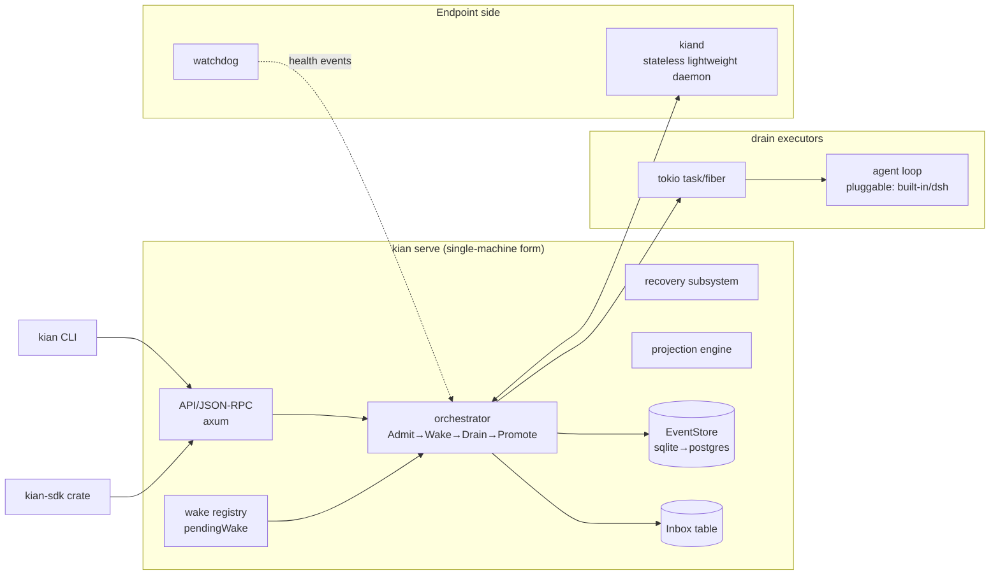
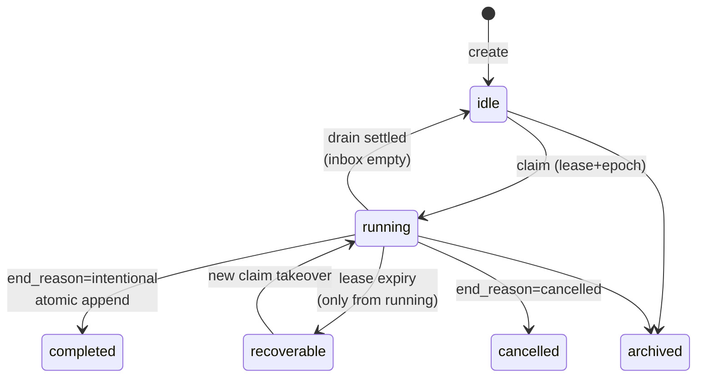
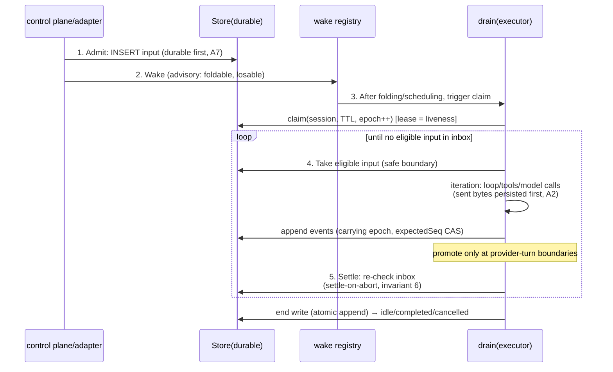
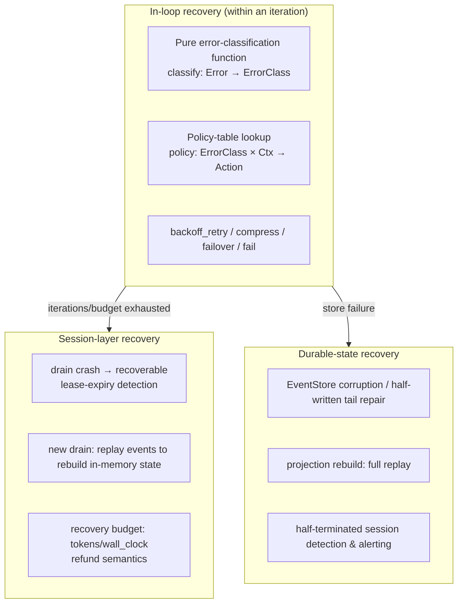
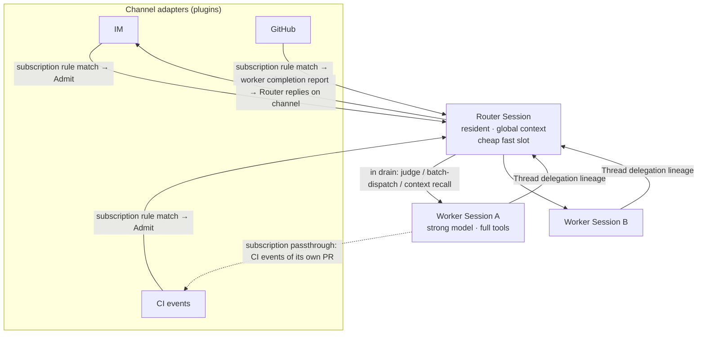
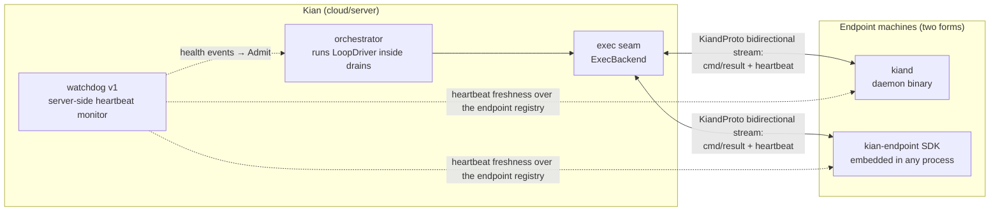
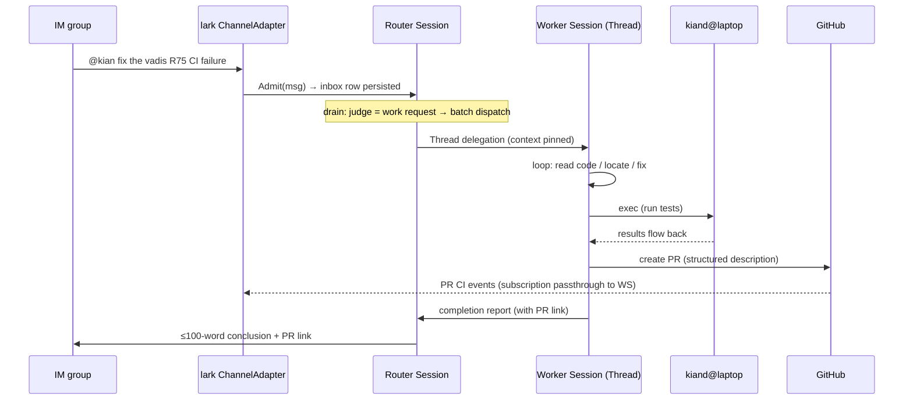

# Kian — Design v0.1

> Design = HOW. Spec lives in [docs/SPEC.md](../docs/SPEC.md); decisions live in [decisions/](decisions/).
> Language: **Rust**, async runtime tokio. This design follows axioms A1–A10 (Feishu design doc).

## 0. Goals and boundaries

### 0.1 Goals

- G1: Full Admit→Wake→Drain→Promote semantics on single-machine (sqlite) mode; S1 (kill -9
  recovery) with zero lost work.
- G2: NoSplitBrainWrite — when two processes contend for one session, stale-epoch writes are
  always rejected by the EventStore (expectedSeq CAS + epoch comparison).
- G3: The exact bytes of every model request are persisted (A2); replaying the same event stream
  is byte-identical.
- G4: Cache hit rate and invalidation causes become first-class observability metrics (A3);
  compression is the only deliberate invalidation point.
- G5: The super-agent reference architecture (Router/Worker/event subscriptions/BYOM) runs as a
  bundle on top of the core without modifying core crates.
- G6: Minimal core surface (A10): core crates import no provider-, channel- or daemon-specific
  code.

### 0.2 Non-goals

- No Web UI (CLI/API first).
- No multi-region / multi-Router horizontal sharding (article experiments show no throughput
  bottleneck at team scale).
- No credential-less credential mechanism (standalone Phase 3+ topic).
- No built-in LLM gateway (access resilience lives in an external gateway; Kian owns only slot
  determinism).
- No Temporal-style deterministic workflow constraints (LLMs are inherently non-deterministic;
  we replay bytes and events, not control-flow re-execution).

### 0.3 Decision quick reference

| ADR | Decision | Alternatives | Rejected because | Scope |
|-----|----------|--------------|------------------|-------|
| [001](decisions/ADR-001-rust-foundation.md) | Rust + tokio + sqlite-first | Go, TS | No-GC tail latency, type safety, single-binary deployment | Everything |
| [002](decisions/ADR-002-event-sourced-core.md) | Event-sourced core: append-only events + rebuildable projections | Direct state tables | A1 auditability; crash recovery = replay | core, storage |
| [003](decisions/ADR-003-super-agent-as-profile.md) | Super-agent is a profile/bundle composition pattern, not core capability | Router/Worker built into core | A10 narrow waist; the article: many variants, not an invariant structure | Everything |
| [004](decisions/ADR-004-cordis-inspired-plugin.md) | Plugin mechanism borrowed from Cordis (service keys/injection/reversible registration); Rust uses traits + registries | dylib dynamic loading | Stability first; compile-time plugin set | plugins |
| [005](decisions/ADR-005-fencing-via-expectedseq.md) | Safety = fencing (epoch + expectedSeq CAS); lease is only liveness | Lease TTL only | NoSplitBrainWrite must not depend on detection timeliness | core, storage |
| [006](decisions/ADR-006-model-slots.md) | Declarative model slots (slot→provider/model/fallback), immutable at runtime | Free runtime model switching | A3 cache-byte stability; P6 determinism | llm seam |
| [007](decisions/ADR-007-kiand-delivery-semantics.md) | kiand delivery: server-side durable queue, at-least-once, command-id correlation | Exactly-once via endpoint state; fail-fast offline; queue-as-events | Endpoint stays stateless (brain–hand separation); offline park is S5's core semantic; queue rows are pre-event state, not session facts | exec seam |
| [008](decisions/ADR-008-async-tool-completion-admitted-input.md) | Async `start()`/`stop()`: completion is an admitted input; job rows are pre-event durable state; `stop()` is honest cancellation | Completion-as-event; second dispatch queue; blocking drain | Full-duplex without loop changes; invariant-1 ordering; default-off tool pair | exec seam |

## 1. Architecture overview

### 1.1 System context (C4 L1)


### 1.2 Containers (C4 L2)



**The layered iron rule** (inherited from Feishu §4.1): the control plane only writes the inbox
and reads projections — it never touches execution; execution only appends events — it never
mutates projections directly; after a crash, replaying events rebuilds all in-memory state.

### 1.3 Relationship to the three references (synthesis map)

| Reference | What we borrow | Where it lands in Kian |
|-----------|---------------|------------------------|
| Super-agent article | Router/Worker two-layer, event-driven subscriptions, async ReAct / safe-boundary promote, channel bandwidth matching (IM ≤100 words), BYOM brain-hand separation, watchdog | **super-agent bundle** (not core): Router session template + Worker session template + subscription rules + channel adapters + kiand + watchdog |
| deepseek-harness | everything-is-a-plugin, session log as model-context truth, deriveMessages projection, capability seams (Service Definition/Provider/Consumer three roles), schema versioned migrations | Plugin system design (§6), event schema versioning (§3), model-context projection |
| Cordis | stable service keys, inject dependency declaration, typed event dispatch five modes, reversible registration side effects, narrow waist | Plugin system (§6): `Ctx` service registry, event dispatch modes, Footprint Ladder |
| Kian Feishu doc | All core semantics (P1–P8, A1–A10, concept model, state machine, six invariants, fencing) | **all of kian-core** |

## 2. Core execution model

### 2.1 Concept model and Rust type skeletons

| Concept | Persistence | Rust skeleton (illustrative) |
|---------|-------------|------------------------------|
| Agent | Versioned config (library table) | `struct AgentDef { id, version, model_slots: Map<SlotName, SlotSpec>, tools, budgets }` |
| Environment | Config (unversioned) | `struct EnvSpec { sandbox, network_allowlist, deps }` |
| Session | The one first-class durable entity | `struct SessionId(Uuid)`; state = projection |
| Input | Durable table rows | `struct InputRow { id, session, payload, admitted_at, eligible_at }` |
| Drain | No durable identity | `struct Drain { session, epoch: u64, claim: LeaseRecord }` |
| Turn | Event slice | Interval derivation over `enum TurnEvent` |
| Event | Append-only, never modified | `struct Event { seq, session, epoch, ts, kind: EventKind, bytes }` |
| Thread | Independent event stream + version pin | `struct Thread { id, parent_session, pinned_version }` |

### 2.2 Session state machine (projection-derived)



Rules:
1. **End write + state transition = one atomic append** (NoHalfTerminated). On sqlite = one
   transaction; on postgres = one INSERT..RETURNING. Corollary: session state is read only from
   the event projection.
2. **Safety by fencing**: claim issues a monotonically increasing epoch; every drain write carries
   it; the EventStore rejects stale epochs (expectedSeq CAS is the fence) → NoSplitBrainWrite.
   Lease (claim TTL + heartbeat) is only liveness.
3. recoverable is entered only from running; idle holds no lease and safely waits for the next
   wake.

C3 refinement (event→trigger mapping; the projection's contract): the projection folds events
through an explicit transition table. `session/created`→create; `drain/claimed`→claim — initial,
resume, or takeover: a second claim with no end write in between is the crash-recovery stream
shape and projects `running→running` (safety against true double-claims is the store's epoch
fence, not the projection); `session/ended{reason}`→end write, where `completed`/`cancelled` are
terminal and freeze the stream, while `interrupted`/`failed` release ownership cleanly and return
the session to `idle` (honest labeling lives in the events; resume = new claim; the final end
write records the final outcome); `input/admitted` and `thread/started` (C18, Phase 2)
preserve `idle`/`running`/`recoverable` — `thread/started` is appended to the worker's
stream after `session/created` but before the first `drain/claimed`, and to the Router's
stream mid-drain; every other kind is drain activity, legal only while `running`. EndReason
first-write-wins holds
within one drain episode: a second `session/ended` before the next claim is a named projection
error (the projection-side mirror of the store's end-write CAS race). `recoverable` (lease
expiry — a liveness observation overlaid from the expired-lease query) and `archived` (ops
action) are table edges with no v0 event trigger; later event kinds may drive them
(additions-only).

### 2.3 Admit → Wake → Drain → Promote



The six semantic invariants (inherited in full; resident as debug_assert + test assertions):
1. **Durable before execute**: an input is never woken before it is durable; side-effecting tool
   calls are logged first.
2. **Wake is advisory**: pendingWake is foldable, losable, concurrency-safe; at startup
   kiand/kian fully rebuilds the wake registry from the inbox → NoLostWork.
3. **Promote only at safe boundaries**: no event insertion into an in-flight provider-turn; steer
   resets the provider-turn allowance once per steer batch.
4. **Drain has no durable identity**: after a crash, no in-process continuation is assumed;
   recovery = a new drain replaying events + continuing to consume the inbox.
5. **Interrupt targets only the active ownership chain**: idle/missing → no-op; interrupted work is
   honestly labeled interrupted ≠ failed.
6. **Settle on abort**: before releasing ownership, an interrupting drain re-evaluates the inbox;
   if pending work exists it keeps pendingWake registered.

C9 refinement (the drain's consumption and promote-boundary mechanics, as implemented by
`kian-orchestrator`): the drain is the *sole* writer of `input/admitted` **events** — the
control plane (`admit`/`steer`) only writes inbox rows. When the drain takes a row at a safe
boundary it appends one `input/admitted` event carrying the §3.2 message payload
(`{"role","content","synthetic"?}`) and binds the row to that event's seq via the C6
event-driven consumption guard. The input-payload convention: a plain row's payload *is* the
message content; a steer row wraps it as `{"synthetic": true, "content": X}` so the strippable
marker survives the inbox round-trip. The C32 spill envelope extends this row-level convention: a
row payload of exactly `{"content": X, "spill": Y}` consumes as **two events in one fenced write
batch** — `input/admitted` carrying `{"role": "user", "content": X}` exactly as the bare content
would have produced, followed immediately by `input/spilled` carrying the opaque sidecar verbatim —
while rows without the envelope consume byte-identically to before. Promote-boundary enforcement lives in the drain-context
surface handed to the `LoopDriver` seam (`LoopDriver::Ctx`): input-taking is refused while a
provider turn is in flight, and every drain write carries the claim's epoch under expectedSeq
CAS (seq-mismatch from a fenced-out concurrent writer is repaired by re-reading the head; a
stale-epoch rejection abandons the drain — it never fights the fence). The "steer resets the
allowance once per steer batch" invariant reads: a newly eligible batch observed at a settle
point grants exactly one more driver episode. An end write with reason
`interrupted`/`failed` returns the session to `idle` with pendingWake deliberately kept
registered for the resumer (invariants 5/6); a drain that finds the projection terminal
releases without appending anything (terminal streams freeze).

### 2.4 Three-layer recovery (A4/A5)



- Error classification is a **pure function** (unit-testable, table-drivable); recovery policy is a
  **declarative table** (config-driven, disposition owned by the caller, A4).
- Every recovery kind has a one-shot guard (the recovery loop itself cannot run away); recovery
  consumption counts against a budget with refund semantics = unused remainder returned on task
  completion (A5).

C10 refinement (the implementation contract, `kian-orchestrator::recovery`):
- The class vocabulary is closed and string-keyed for the policy table: `provider_down`,
  `rate_limited`, `context_overflow`, `tool_failed`, `store_failure`, `budget_exhausted`,
  `validation_failed`, `empty_response` (the constraint-7 soft failure), `unknown`. Wrapping the
  typed seam/store errors (`ProviderError`, `ToolError`, `StoreError`, `InboxError`) means
  classification never parses error strings.
- Policy resolution is **first-match-wins** in declaration order (deterministic); a class no rule
  covers fails honestly — the runner never invents a default action. `kian.yaml` parsing is
  fail-closed (unknown class or action names refuse to load). The config-default table is the only
  hardcoded policy set.
- Disposition is caller-owned (A4): the bounded runner (`run_with_recovery`) only classifies,
  resolves, guards, budgets and sequences; side-effecting actions run through caller-supplied
  `RecoveryReactor` hooks (`compact`/`failover`/`ask`). `compress_then_retry` requires the reactor
  to append the observable `compact` event **before** invalidating the prefix (constraint 3).
- Ordering inside the runner: one-shot guard *before* budget — a repeated kind escalates
  regardless of remaining tokens. Retry-class actions consume `retry_cost_tokens` first; denial
  escalates with a distinguishable token/wall-clock cause.
- Escalation (L1 → L2) is an outcome, not an internal state change: the caller responds to
  `EscalatedToSession` by releasing the claim *without* an end write, so the session lands in
  `recoverable` via lease-expiry detection (ADR-005 liveness) and a fresh drain replays and
  continues. The loop is bounded by construction: ≤ one fire per class (≤ `ALL.len() + 1`
  operation invocations) and ≤ `tokens / retry_cost` retry actions.
- Budget counters (`consumed`/`refunded`/`returned`) are observable snapshots; `settle()` (task
  completion, A5) returns the unused remainder exactly once — the data source for the C14
  `recovery budget reset` command.

C15 refinement (session-layer recovery as implemented by `kian-orchestrator` + `kian serve`,
proven by the S1 chaos suite): the engine exposes `Engine::recovery_sweep()` — the §2.4-R4
liveness loop over the C6 expired-lease query — which wakes every session whose lease is past its
TTL *and* whose stream projects `running`; `kian serve` runs it on a ticker whose period equals
`drain.heartbeat_interval_ms`, so detection is bounded by `last_heartbeat + lease_ttl_ms +
heartbeat_interval_ms` (the §13 target plus at most one heartbeat of kill-to-last-heartbeat skew;
safety never depends on the timing — the takeover claim's epoch fences any lingering old owner,
ADR-005). The drain episode recognizes a *takeover*: a stream that already projects `running`
under a fresh claim belongs to a drain that died mid-episode, so the taker re-drives the loop to
an honest settle **even when the inbox is empty** (the killed episode consumed its inputs; the
startup inbox scan cannot see those sessions — without the takeover re-drive they would sit in
`running` forever while the sweep churned). Honesty is preserved end to end: the killed session
never projects `completed`/`failed` across the kill window (only `running`, overlaid
`recoverable` by the lease query), and the final end write lands exactly once, after the re-drive
actually settles.

## 3. Event model and schema evolution

### 3.1 Event classification (borrowing dsh's durable/live split)

| Class | Examples | Persisted | Purpose |
|-------|----------|-----------|---------|
| Durable events | turn/start, step/request, assistant/message (sent bytes), tool/call, tool/result, input/admitted, drain/claimed, session/ended | ✅ append-only | Truth and replay |
| Live events | streaming chunks, heartbeats, progress notifications | ❌ not persisted | UI/observability (derived from durable events or via a side channel) |

The durable kind set is exactly twenty (C18 + C31): the fifteen kinds frozen through Phase 1
(fourteen by C2 + the additive C14 `recovery/budget-reset`) plus the four Phase-2 additions —
`thread/started`, `thread/completed`, `evidence/verdict`, `channel/delivered` — and the Phase-3
addition `input/spilled`, all additions-only (no renames, no reformats of existing kinds) and all
non-context-bearing: thread lineage, evidence verdicts and delivery receipts are audit data that
never enter the model context. `thread/started` is state-preserving in `idle`/`running`/`recoverable`
(§2.2); the other Phase-2 kinds and `input/spilled` are drain activity. The spilled raw is the
verbatim channel payload kept in-stream but out of context — the Inline form of the same input
(the excerpt carried by its sibling `input/admitted`) is what the model sees, while the full raw
stays in the stream as the audit/recall copy (constraint 1: the event log remains the sole truth;
any spill index is a disposable projection over it). The pair is produced by the C32 consumption
write: the `{"content", "spill"}` envelope is a **row-level convention** riding in the existing
inbox row `payload` — not an event-payload change; the C4 frozen event payload contracts are
untouched, and the envelope never appears in any committed event.

### 3.2 Model-context projection (the implementation core of A2/A3)

`derive_model_context(session) -> Vec<Message>`: projects the next model request's messages from
the event stream. Rules:
- **History is immutable**: the bytes field of an assistant/message event *is* what was sent;
  replay is byte-identical.
- **Compression is the only deliberate invalidation point**: a `compact` event carries the
  pre-compression range [a,b) and the post-compression summary; the projection function skips the
  compressed range when it encounters the event. Compression must emit an event (observable, A3).
- **Synthetic messages are strippable** (A6): steer-injected synthetic user messages carry a
  `synthetic=true` marker; replay/export can strip them to restore the "real" context.
- **Request serialization is frozen (C8)**: model request bodies are serialized with `serde_json`
  compact output — object keys in lexicographic order (the workspace does **not** enable
  `preserve_order`; enabling it would silently change every request's bytes), while arrays keep
  caller-supplied order (the built-in loop passes tools in a deterministic order). The golden body
  hash is pinned by `kian-llm::provider::FROZEN_CHAT_BODY_SHA256`; changing the serialization
  contract is a constraint-3 event (prefix-cache invalidation for every session) and must update
  the hash and this section in the same change.

**C4 payload contracts (frozen after merge, additions-only)**: the context-bearing kinds —
`input/admitted`, `assistant/message`, `tool/call`, `tool/result` — carry a message payload in
`bytes`: `{"role": <non-empty string>, "content": <any JSON>, "synthetic"?: true}`; `content`
passes through verbatim and is never reformatted. A `compact` event carries
`{"from_seq": a, "to_seq": b, "summary": <message payload>}` with `a < b <= seq(compact)` and
pairwise-disjoint ranges; the projection emits the summary at the position of `from_seq` and skips
context-bearing events with seq in `[a,b)` exactly (skipped payloads are never parsed). The
canonical projection byte form (`context_to_bytes`: serde_json compact output, message fields in
declaration order `role`, `content`, `synthetic` only when true, object keys lexicographic —
`preserve_order` must stay disabled) is frozen stable content, as is the tool-schema serialization
owned by the provider (C8 `build_chat_body` above): both are prompt-prefix bytes, and changing
either is a constraint-3 event (observable invalidation + golden-hash update).

**C11 loop conventions (built-in ReAct loop, frozen after merge, additions-only)**: the built-in
loop (kian-loop) is a passenger inside the drain — it interacts with the engine only through the
`DrainCtx` surface (append, begin/end turn with payload, take eligible inputs at safe boundaries,
read the committed stream). Its event payloads extend the C4 contracts: `turn/start`/`turn/end`
carry `{"iteration": n}` where the counter is *derived from the stream* (count of prior
`turn/start` events — no resident loop state); `step/request` carries
`{"slot", "provider", "model", "iteration", "body"}` as the A2 audit copy appended before the
provider is called (the C8 provider-level `PersistSink` additionally covers fallback-request bytes
at the HTTP edge); `tool/call` content is `{"id", "name", "arguments"}` (role `assistant`, logged
before execution) and `tool/result` content is `{"call_id", "output", "is_error"}` (role `tool`).
An empty model response (or a `ProviderError::EmptyResponse`) is a soft failure: the loop consults
the declarative recovery table for class `empty_response` and reports `SoftFailed` — the engine
settles `failed`, never `completed`; the loop itself never retries (disposition is one-shot-guarded
and caller-owned, §2.4). Local tool execution (fs + exec) runs entirely inside `spawn_blocking`,
so a sleeping tool cannot stall concurrent drains; the built-in exec tool kills the child on
timeout and reports `timed_out` as an honest error result. Wiring: kian-loop depends on
kian-orchestrator (for `LoopDriver::Ctx = DrainCtx`) and on kian-llm (slot resolution +
`complete_turn`), matching the §7 crate map edge `KLD → KO`.

### 3.3 Schema versioning

- Event envelope carries a version field; JSON encoding (v0).
- Adjacent migration chain (vN→vN+1 = one migration crate module), borrowing dsh's generation
  mechanism: committed generations are never renamed, replaced or deleted; a new generation is
  published exclusively.

## 4. Super-agent reference architecture (bundle, not core)

**Key stance (ADR-003)**: the four super-agent traits (continuous/efficient/proactive/persistent)
are **composition patterns** over Kian primitives. The article itself says "similar design
constraints derive similar architectural choices", but deployment variants abound — so it goes
into a bundle, not the core. The core only guarantees: Thread (cross-session delegation), the
event-subscription Admit entry, the BYOM execution seam, and the watchdog event source.

### 4.1 Router/Worker two-layer (expressed via Thread)



- **Router session**: a resident session (idle long-lived); event judging uses the `router` slot
  (cheap fast model); it emits dispatch-decision events. Residency is mechanical (C26): the
  Router's loop driver parks between provider turns — while delegated threads are outstanding
  and while the inbox is empty — instead of settling, so the session never freezes after an idle
  final answer; completion reports and new channel events re-drive it in place.
- **Worker session**: derived via `Thread { parent_session: router, pinned_version }` delegation;
  context-isolated, full tools, `main` slot strong model. Workers never reply on the channel
  directly — completion events report back to the Router, which aggregates and replies (avoiding
  the chaos of multiple sessions replying independently).
- **Subscription passthrough**: subscription rules may carry a passthrough flag (e.g. CI events of
  a PR created by a Worker flow straight into that Worker's inbox without Router judgment) — the
  load-reduction device validated by the article. The registry is many-to-many (C38): a topic maps
  to the *set* of worker sessions that served it, and one event admits one durable row per
  subscriber (idempotent per `(session, event_id)`; a mid-set write failure is retried per
  subscriber), so workers sharing a topic observe each other's events and self-resolve conflicts
  without peer links — the Router stays the cross-task rendezvous, and only an empty set falls
  back to it.
- **Two-level filtering** (article §3.1, C36): the *Fast Path* is an admission taxonomy over
  provenance — a config-level `classes:` table keys `(channel, topic?, sender?)` to
  `candidate | explicit-only | ignore` with most-specific-wins resolution, evaluated in code
  **before** the rule set and before any model call (`ignore` and `explicit-only`-without-signal
  drops are audit lines + counters, no row, no wake; absent classes = today's behavior). The
  *Slow Path* is the Router's judge prompt (C26): it is the natural-language policy extension
  point — admission semantics that would need semantic judgment are edited as prompt text, not
  code.
- **Admission Inline/Spill shaping** (C33): the additive `superagent.shaping:` config carries
  `inline_cap_bytes` (absent = infinity, hence byte-identical legacy behavior), `first_chars`
  (default 50), and `neighbor_fields`. The subscription service applies it exactly once, after
  routing and immediately before the inbox row exists. At or below the serialized-raw byte cap,
  the existing `channel_event` wrapper is unchanged. Over the cap, `content` instead carries an
  Inline view (a strictly shorter excerpt, canonical `topic`/`event_id`, and any configured
  top-level scalar association ids), `"spill": true`, and `continuation: {event_id}`; the C32 row
  envelope carries the verbatim raw as its sidecar, producing the atomic admitted/spilled pair at
  the ordinary consumption write. Idempotent `(session, event_id)` admission still dedupes the
  whole pair. There is no retroactive re-shaper: committed context remains immutable and
  `derive_model_context` stays verbatim. Neighbor inlining v1 reads only fields on this payload;
  it never fetches cross-event IM history (that is a C35 recall hop).
- **Batching**: the Router drain batches naturally (a drain has "drain the queue" semantics —
  eligible inputs are consumed in one sweep) — matching the article §7.2 batch-merge experimental
  conclusion. The §7.2 observability shape is bundle-owned counters (C41), recorded by the
  resident Router's driver around each judge turn and snapshotted on the merged `/metrics` route
  as `superagent.router_batching`: `judge_turns`, `inputs_consumed` (batch size),
  `turn_duration_ms_total` / `mean_turn_duration_ms` (per-request wall duration),
  `amortized_ms_per_input` (duration/inputs — per-decision amortized latency), the bounded
  `batch_histogram` (buckets 1…128 plus overflow) and `last_turn`.
- **Speculation** (article §3.4, as a policy pattern over existing primitives): the Router may
  dispatch a worker on a *weak* signal by calling `spawn_worker` with `speculative: true`. The
  delegation wrapper gains one additive, model-visible field — `"speculative": true` inside the
  task `content` — so the worker's first message honestly says it was spawned on a weak signal,
  and the marker is audit-visible forever (the wrapper bytes live in both streams; legacy wrappers
  parse and replay byte-identically). The Router profile's `speculation: {max_outstanding: n,
  label: …}` config bounds concurrent speculative threads: the spawner enforces the cap with an
  honest tool error the Router model sees and reacts to (never a silent refusal), and the
  outstanding count is *derived from the Router's event stream* (`thread/started` without a
  consumed completion report — a pure projection, so the budget survives Router restarts).
  The article's silent-repro delivery policy ships as a **prompt template** on the Router profile
  (deliver only after the bug is confirmed *and* a simple fix found; otherwise stay quiet) — a
  config artifact, not code. Deliver-or-discard is the existing channel-policy gate: a discarded
  speculation simply never calls `reply` (no `channel/delivered`), while the speculative worker's
  own stream still audits every token spent — honest by construction. Per-session budgets (A5)
  are untouched; the cap is the Router-profile speculation budget.

### 4.2 Channel bandwidth matching (output policy)

Policies shape the reply **before the send** (`ChannelDelivery` carries already
policy-shaped content); the adapter delivers what it is given. Policy code lives in the
bundle (`kian-superagent`), never in a channel adapter and never in the core. Every
successful send is followed by a `channel/delivered` event; a policy rejection (e.g. a
structured payload missing a section) is an honest error to the loop — never a silent
send.

| Channel | Output policy (bundle built-in templates) |
|---------|-------------------------------------------|
| IM | ≤100-word hard rule; only direct questions / short conclusions; notify only when a decision or acceptance is needed |
| GitHub PR/Issue | Structured delivery: problem background / change notes / verification results |
| Email/docs | Structured summary drafting |
| Mock (in-memory) | built-in first-class bundle adapter (production code, not a test stub): the S4 IM stand-in, same ImPolicy/StructuredPolicy enforcement through the Router's dispatch tools |
| Lark/Feishu | the first *real* adapter (C44): IM row — same ImPolicy (≤100 words) through the Router's dispatch tools; receive is an adapter-side chat-history poll mapped to provenance-carrying `ChannelEvent`s (chat id → group, sender → sender), send resolves only on API acceptance; credentials env-only (`KIAN_LARK_APP_ID`/`KIAN_LARK_APP_SECRET`, fail-closed at startup); the channel is untrusted by default (C43) |

### 4.3 BYOM endpoint (kiand daemon / endpoint SDK)



**Endpoint access forms (same protocol, either or both)**:

| Form | Carrier | Fits |
|------|---------|------|
| daemon | `kiand` (= kian-endpoint library + thin main) | Resident on personal dev machines/servers (primary BYOM form) |
| SDK | `kian-endpoint` crate embedded in any process | Harnesses (the dsh process itself is an execution endpoint), user applications |

- The endpoint **keeps no session state** (brain-hand separation): it only executes commands and
  returns results; session logs live in Kian's EventStore.
- **The v1 watchdog is the server-side heartbeat monitor** (kian-exec, C21): a dead daemon cannot
  report its own death, so the authoritative health view is the server's heartbeat-absence
  observation over the endpoint registry — offline when `now - last_heartbeat > offline_after_ms`,
  online again on a fresh heartbeat; edge-triggered (one event per state change, no flapping), and
  freshness-based even when the transport is still up (a silent-but-connected endpoint is offline).
  Endpoint-side self-checks / anomaly self-healing remain **Phase 3**.
- The watchdog emits health events (endpoint offline) → they flow through
  Admit into the related session inbox (event-driven self-healing); the watchdog itself never
  writes session streams.
- Intermittent endpoint presence is the norm: commands queue in durable state and are consumed
  after the endpoint reconnects (BYOM's offline-tolerant semantics).
- **The two axes of separation**: where execution runs (ExecBackend provider: local /
  remote-endpoint / sandbox / cloud machine) and who the loop is (LoopDriver seam, see §6.2) —
  independently pluggable.
- **Async `start()`/`stop()` tool pattern (C37, ADR-008)**: the article's §4.1 per-session
  full-duplex in kian-native shape. `start` enqueues through the same durable queue and returns
  immediately with `{"status":"started","job_id":…}` (the drain is never blocked; the loop is
  untouched); an `async_jobs` row — pre-event durable state per ADR-007's pattern, committed
  before dispatch, job id = command id derived from the tool-call id — records *who to notify*.
  On settle, the kian-cli completion bridge admits a provenance-wrapped
  `{"kian":{"type":"async_result",…}}` envelope to the originating session's inbox and wakes it
  (invariant 1); the completion is promoted at the next safe boundary as a normal message.
  `stop` marks the job `cancelled` and kills best-effort (the v0 wire has no kill frame); the
  cancelled completion still lands, labeled `cancelled`. Completions to terminal sessions drop
  with an audit line. The pair mounts on the Router/Worker profiles config-gated
  (`superagent.async_tools`, default off).
- **Watchdog Session v2 (C40)**: the article's §6 progress judge — a *model-in-the-loop* resident
  session, not a health poll. It is a worker-template agent (own strong `main` slot) whose tools
  are exactly the read/intervene surface: `list_threads` / `read_progress` over `RecallPort`
  (thread status, last assistant message, age of outstanding threads), `intervene(thread_id,
  text)` — which admits a steer-marked `{"synthetic":true,"content":…}` row to the stuck worker
  through `InboxWriter` (control-plane-legal, no engine API; durable before the wake, consumed
  at the worker's next provider-turn safe boundary) — and `escalate(channel, text)`, a normal
  reply under the IM policy (≤100 words, `channel/delivered`). Each input is a timer tick; the
  drain is one judge turn, and every outcome — no-op (the default), nudge, escalate — is honestly
  in the watchdog session's own stream. **The timer input source is a channel** (`TimerChannel`,
  a production `ChannelAdapter` beside `MockChannel`, emitting
  `ChannelEvent{channel:"timer", topic:"watchdog", event_id:"tick-<n>", payload:{"tick":n}}` on a
  configurable, clock-injected cadence) routed to the fixed session by an ordinary subscription
  rule through the additive `Route::Session(SessionId)` variant (config-addressed, generic —
  nothing in the vocabulary names a watchdog). Rejected alternatives: an in-process interval
  admitting rows directly (ticks would leave no durable audit, bypass the pipeline's `event_id`
  idempotency, and fork the admission path) and a `TimerSource` core seam (constraint 10 —
  nothing generic justifies a seam). Ticks are idempotent by `event_id`, so a restart that
  re-emits `tick-3` dedupes against the committed row; ticks missed while the server was down
  simply never happened (the stream honestly shows no check ran); `emit_on_start: true` fires one
  immediate first check after restart. The v1 heartbeat watchdog (C21, above) is untouched —
  endpoint health and worker progress are orthogonal loops.

### 4.4 Security boundary (Phase 3+, stake planted)

Risks from article §8.4 are accepted as-is: a compromised cloud-side agent loop controls every
endpoint; endpoint credentials entering the model context leak. Kian's response roadmap: the exec
seam's data-egress tiering (A8) + credential-less use (future) + endpoint execution approval
policy (policy plugin).

### 4.5 The recall toolpack (Chain of Recall, C35)

The super-agent's working set is a **reference graph**: Trigger (a channel event), Thread (a
delegation) and Worker (a session) are objects that carry ids — the event id on the admitted
wrapper's Inline view, the thread id on `thread/started`, the worker session on both. Nothing
copies another object's content into a session's own context: recall *walks the graph on demand*
through three read-only `ToolProvider` tools mounted on the Router profile (config-gated,
default on) and per worker template (opt-in, `superagent.recall`):

- `recall_event(event_id)` — surfaces a spilled channel raw: the Inline/Spill-shaped view plus
  next-hop ids (the locality tool, the topic);
- `recall_neighbors(event_id)` — the locality view: channel events on the same topic within a seq
  window around the anchor, each entry Inline-shaped with its event id as the next hop;
- `recall_thread(thread_id)` — the thread's task, its status (from the worker's
  `thread/completed`, else `outstanding`) and the final summary, with the worker session as the
  next hop.

Every result is itself Inline/Spill-shaped — summaries + ids, reusing the C33 shaping vocabulary
(`first_chars` excerpts, `neighbor_fields` association ids) — so **multi-hop recall composes**:
each hop returns bounded views and the ids of the next hops, never a full context transfer. The
verbatim-in-one-output bound is the toolpack's own `output_cap_bytes` (default 8 KiB): above it a
surfaced value becomes the Inline view (excerpt + continuation handle) — no unbounded raw
re-injection, and the cap applies to tool outputs exactly as it applies to admission. Untrusted
hygiene (C43) survives every hop: a surfaced raw re-wraps through the `raw_view` marker keyed off
its sibling admitted content.

Results land as ordinary `tool/result` events appended at the tail by the unmodified built-in
loop — persisted before use, byte-stable thereafter, never reordering prior context (constraint
3; the log-before-execute `tool/call` discipline already holds). Reads go exclusively through the
`RecallPort` (C34): the spill index is the fast path, and a raw spilled after the startup rebuild
is found by scanning the Router stream and the workers it names — the stream stays the sole truth
and the index stays a disposable cache (constraint 1).

**Router global observability rides the event stream via recall, not Router context.** The
Router's own context stays the cheap Inline views + ids of what arrived; anything more (a spilled
raw, a sibling event, a worker's summary) is one recall hop away, audited as a `tool/result` on
the Router's stream. No capability may push global state into Router context — that is the
cache-byte-stability and cost discipline of §3.2/§4.1 applied to the super-agent layer.

## 5. Control-plane protocol (P5 protocolized)

Unified semantics (portable across harnesses/channels):

| Primitive | Semantics |
|-----------|-----------|
| `steer(text, scope)` | Inject a direction change; advisory; takes effect only at provider-turn safe boundaries; resets the allowance |
| `interrupt(reason)` | Abort the active drain; settle on abort (re-evaluate inbox); partial completion labeled interrupted |
| `queue(msg)` | Queue an input without interrupting the current drain |
| `confirm(token, decision)` | Confirmation gate: approve/reject/escalate; fail-closed (P8) |

Implementation: JSON-RPC over HTTP (axum) + SSE event stream. All control-plane operations **only
write the inbox / read projections** (the layered iron rule), never touching execution directly.

C13 refinement (the Phase-1 surface, as implemented by `kian-cli`): the wire is `POST /rpc` carrying
`{jsonrpc, id, method, params}` with the method set `create_session`, `submit`, `steer`, `queue`,
`interrupt`, `projection` (standard JSON-RPC error codes; unknown session = -32001), plus
`GET /sessions/{id}/events` — SSE frames `event: kian` (one per store event, interval-poll of the
event stream, strictly increasing seq), `event: done` after `session/ended`, `event: error` for an
unknown session. `confirm` is Phase 2+ and deliberately absent. The iron rule is enforced
structurally: the HTTP module sees only a `ControlPlane` trait (`create_session` / `submit` /
`steer` / `queue` / `interrupt` / `projection` / `session_events` — inbox writes and reads only);
`kian-cli::server` implements it over the engine, and a resident test greps the handler module for
execution symbols. `queue` and `submit` share the admit path (identical durable row; a drain in
flight folds the wake — the C16 same-sweep batch semantics); `steer` wraps the payload with the
strippable `synthetic` marker. Assembly: `kian.yaml` (listen, storage.sqlite, agent model
slots/tools/budgets, providers with `api_key_env` — secrets only ever read from the environment at
startup, fail-closed; drain lease/heartbeat/iteration/slot tuning; tools root; SSE poll; the
`recovery:` section parsed by C10's `PolicyConfig`) loads via the `kian-cli` config module with
`deny_unknown_fields` everywhere; the three built-in plugins (`openai-compat`, `local-tools`,
`react-loop` — the loop declares the other two as dependencies) activate through
`kian_plugins![...]` into the C7 `Ctx`, the loop resolves out of the activated `Ctx`, and the
engine runs the inbox rebuild **before** the listener accepts traffic (NoLostWork across restarts).

C17 refinement (S3 observability, as implemented by `kian-cli`): `GET /metrics` is a read-only
observability route merged into the serve router **outside** the `ControlPlane` handler module
(it names neither execution nor store-write APIs; it snapshots the C9 engine counters and derives
the S3 cache report). The S3 report is a pure projection over `step/request` audit copies: for
each consecutive request pair within a session, the message prefix must be byte-identical (the
provider-independent prefix-cache hit-rate proxy); the only counted invalidation cause is
`compact` — any other prefix change surfaces under `unexpected_prefix_change` and is a
constraint-3 violation. The same report is exposed by `kian cache-stats [--config <path>]
[--session <uuid>] [--json]`; the live-provider run is env-gated (`KIAN_API_KEY`), excluded from
CI, and recorded in the README run log.

C14 refinement (operational commands, as implemented by `kian-cli`): the SPEC §3.2 set lands as six
commands with two access modes. Read-only commands (`kian session inspect <id>`, `kian session
replay <id>`, `kian session export <id> [--since/--until]`, `kian lease inspect`) open the sqlite
file **read-only in-process** (`EventStore::open_read_only` — no migrations, no write path ever
held by the CLI) and derive everything from the event stream (constraint 1); resource resolution
is fail-closed (`--db`/`--url` else `kian.yaml`). Mutating commands talk to a running `serve`
through a dedicated **operational plane**, `POST /ops/rpc` (`wake_now`,
`recovery_budget_reset`, and — added in Phase 2, C27 — the demo/S4 injection
`mock_channel_send {channel, topic?, payload}`, which places one event onto a configured mock
channel and lets the subscription engine route it per `kian.yaml`),
mounted on the serve router outside the `ControlPlane` handler module behind its own
trait-isolated `OpsPlane` — the C13 wire surface and semantics stay untouched, and the resident
iron-rule test greps the ops handler module with the same forbidden-token table. `recovery budget
reset` appends an explicit additive event kind `recovery/budget-reset` (payload
`{"reason": string}`) through the normal epoch/expectedSeq-fenced store append — never a silent
counter wipe; the kind is projection-neutral in effect (state-preserving while running, contributes
no model-context message) and C3's additions-only default maps it to drain activity, so the ops
plane guards it: unknown → -32001, draining → -32002, terminal → -32003, idle → -32004 (an idle
session never consumed a recovery budget). `session replay` re-derives state, runs the C3
invariant predicates, optionally diffs the derived state against the live server projection
(`--url`), and verifies A2 end-to-end: for every `step/request` event it re-derives
`derive_model_context` over the pre-`turn/start` prefix (exactly what the built-in loop derived)
and asserts the canonical serialization is byte-identical to the recorded request body's messages
(reusing the frozen `to_chat_message` conversion, now public for exactly this comparison). `session
export` emits the stored envelopes one-per-line (JSONL; inclusive seq bounds); re-importing a
package into a fresh store appends under each event's own fence and projects the identical state
(S7 audit shape). All commands support `--json`; the schemas are frozen and documented in
`kian_cli::commands` module docs.

## 6. Plugin system (Cordis-inspired, Rust-ized)

### 6.1 Design mapping

| Cordis concept | Kian Rust implementation |
|----------------|---------------------------|
| Plugin = Service | `trait Plugin { fn apply(self, ctx: &mut Ctx) -> Result<Disposer> }` (returning a Disposer = reversible registration) |
| ctx container / service keys | `Ctx` = a typed service registry: `ctx.get::<dyn ModelProvider>()`, `ctx.get::<dyn ExecBackend>()` |
| inject dependency declaration | Construction-time dependency resolution (topologically-ordered activation, equivalent to inject semantics; Rust has no runtime declaration merging) |
| Typed event dispatch | `dispatch` enum: `emit` (observe) / `waterfall` (middleware, may short-circuit) / `parallel` / `serial` / `bail` (stops at the first bail value) |
| Reversible side effects | `Disposer` (teardown in reverse order); registration and disposal are paired |

**Static (compile-time) plugins first** (ADR-004): a plugin = a crate implementing the trait,
registered into the server binary via the `kian_plugins![...]` macro; HMR/dynamic loading
(dylib/wasm) is left to Phase 3. Rationale: the Rust dynamic-loading ecosystem is unstable, and
compile-time plugins already satisfy the narrow-waist goal of "capabilities are replaceable";
dsh-style total plugin-ification is its product choice — Kian's narrow waist is smaller.

### 6.2 Seam three roles (borrowing dsh capability seams)

Every seam names three roles: **Service Definition** (the trait) / **Provider** (the impl) /
**Consumer** (usually a model-visible tool).

| Seam | trait (illustrative) | Built-in Provider | Third-party swappable |
|------|----------------------|-------------------|-----------------------|
| `ModelProvider` | `complete(req: ModelRequest) -> Stream<ModelChunk>` | openai-compat (covers OR/kimi/ds) | any |
| `ExecBackend` | `exec(cmd, env) -> ExecResult` | local / remote-endpoint (kiand, endpoint SDK) | sandbox/cloud machines |
| `LoopDriver` | `drive(drain_ctx) -> Stream<LoopOutcome>` | built-in ReAct loop | dsh loop (being-integrated), custom loops |
| `ChannelAdapter` | `subscribe() -> Stream<ChannelEvent>`; `send(out) -> Future<SendReceipt>` | — | lark/im/github |
| `ToolProvider` | `schemas() -> Vec<ToolSchema>`; `invoke(call)` | built-in fs/exec/kiand | any |
| `RecoveryPolicySource` | `table() -> Vec<PolicyRule>` | config file | any |
| `WatchdogSource` | `health() -> Stream<HealthEvent>` | kiand heartbeat | any |

The async exec pattern (C37, ADR-008) adds no new seam: `AsyncResultSink` is a narrow
assembly callback (kian-exec → kian-cli completion bridge), not a provider/plugin
extension point — the `ToolProvider` role already covers the model-visible `start`/`stop`
pair, and the completion path is the ordinary Admit→Wake→Promote cycle, not a channel.

### 6.3 Footprint Ladder (capability growth ladder)

A new capability is attempted in order of core footprint, smallest first:
1. **Configuration** (zero footprint): recovery policy tables, subscription rules.
2. **Plugin** (edge): ChannelAdapter / ToolProvider / a new ModelProvider.
3. **Seam** (wider waist, requires an ADR): a new trait + three roles + built-in default.
4. **Core primitive** (last resort): entering kian-core requires proof it cannot be expressed at
   the edge.

## 7. Module layout (crate structure)

```mermaid
graph TB
    subgraph crates
        KC[kian-core<br/>concept model / state machine / invariants]
        KS[kian-store<br/>EventStore / Inbox / projection engine]
        KO[kian-orchestrator<br/>Admit→Wake→Drain→Promote<br/>+ recovery subsystem]
        KL[kian-llm<br/>ModelProvider seam + openai-compat]
        KE[kian-exec<br/>KiandProto server half:<br/>ConnectionManager<br/>+ durable queue]
        KP[kian-plugin<br/>Ctx/Plugin/Disposer/dispatch]
        KLD[kian-loop<br/>LoopDriver seam + built-in ReAct]
        KEP[kian-endpoint<br/>endpoint SDK library (KiandProto endpoint side)]
        KSA[kian-superagent<br/>Router/Worker bundle + channel templates]
        KCL[kian-cli<br/>serve/run/inspect/replay/export]
        KSDK[kian-sdk<br/>embedded SDK]
        KDD[kiand<br/>endpoint daemon = kian-endpoint + main]
    end
    KC --> KS
    KO --> KC & KS
    KL & KP & KLD --> KO
    KE --> KC & KS
    KSA --> KP & KO & KLD
    KCL & KSDK --> KO
    KDD --> KEP
    KE -.->|dials over TCP| KEP
```

| crate | Responsibility | Key interfaces |
|-------|----------------|----------------|
| kian-core | Concept model, session state machine, six-invariant assertions | `SessionId`, `EventKind`, `Projection`, `seams::*` |
| kian-store | EventStore (sqlite v0 → postgres), Inbox, expectedSeq CAS, epoch fencing, projection rebuild | `append(carrying epoch, expected_seq)`, `scan`, `project` |
| kian-orchestrator | Execution model, recovery subsystem (classification + policy + budget), control-plane implementation | `admit`, `wake`, `claim`, `drain_loop` |
| kian-llm | ModelProvider seam, slot resolution, sent-bytes persistence hooks | `ModelProvider`, `SlotResolver` |
| kian-exec | KiandProto server half: `ConnectionManager` dials the endpoint, validates the hello/welcome handshake (version mismatch is terminal), tracks heartbeat freshness (`last_seen`, `inflight`), pipelines commands and correlates results by command id, answers with ping, says bye on shutdown, and reconnects with bounded backoff. C20 adds the durable half (ADR-007): `endpoint_registry` + `exec_queue` tables in the server's `kian.sqlite` under this crate's own migrations, `RemoteExecBackend` (enqueue-first `ExecBackend`: park while offline, re-drive on connect/restart, honest `Timeout`→`abandoned` at `queue_timeout`), and `RemoteExecTool` (the same `exec` tool schema as the local built-in, routed through a configured endpoint). Depends on core + store only — never on the orchestrator | `ConnectionManager`, `KiandProto`, `RemoteExecBackend`, `RemoteExecTool`, `ExecStore` |
| kian-loop | LoopDriver seam, built-in ReAct loop | `LoopDriver` |
| kian-endpoint | Endpoint SDK library: KiandProto's endpoint-side implementation, embeddable in any process | `Endpoint::serve`, `Endpoint::embed` |
| kian-plugin | Ctx registry, Plugin trait, five-mode dispatch, Disposer | `Ctx`, `Plugin`, `Disposer` |
| kian-superagent | super-agent bundle: Router/Worker templates, subscription rules, channel output policies | profile assembly |
| kian-cli / kian-sdk | CLI and embedded SDK | `create_session`, `submit`, `steer`, `interrupt`, `events` |
| kiand | Endpoint stateless daemon (kian-endpoint + thin main) + watchdog | command execution + health events |

Dependency direction (the crate form of the layered iron rule): `kian-orchestrator` depends only
on core + store + seam traits; every provider/channel implementation is assembled through
`kian-plugin` and never enters the orchestrator dependency tree.

One bundle edge crosses the loop crate: `kian-superagent` depends on `kian-loop` for the reusable
evidence-gate evaluation (`evaluate_evidence_gate`, `CheckSpec`, the verdict payload — card C24's
public, pure functions consumed by C25's `WorkerLoopDriver` instead of duplicating gate semantics).
Types and pure functions only — no execution surface flows along that edge, and the bundle still
reaches the server exclusively through its ports (`InboxWriter`, `StreamPort`, and — as of C34,
Phase 3 — `RecallPort`, the read-only cross-session port: `read_events` over a seq window,
`list_threads` derived from `thread/started`, and the spill-index lookup. Assembly implements it
over the store's public scan; the spill index itself is a disposable `event_id → (session, seq)`
location cache rebuilt at startup from `input/spilled` events — a pure projection, the raws live
only in the streams), enforced by the crate-level iron-rule test.

Seam trait **definitions** (`ModelProvider`, `LoopDriver`, `ToolProvider`, `ExecBackend`,
`RecoveryPolicySource`, and — as of C18, Phase 2 — `ChannelAdapter` and `WatchdogSource`)
live in `kian-core::seams`; the implementation crates listed above
(kian-llm, kian-loop, kian-exec, …) implement and re-export them. Phase-1 decision (round-1 plan,
risk 1): hosting the traits in the core keeps the orchestrator dependency tree free of provider
crates while the built-in impls stay swappable. The Phase-2 seams follow the same rule:
`ChannelAdapter` and `WatchdogSource` are definition-only in core (no impls, no new
dependencies); their impls land in the bundle (`kian-superagent`) and `kian-exec`
respectively (ADR-003: super-agent semantics stay out of the core).

The KiandProto wire contract is deliberately declared **twice, once per half**:
`kian-endpoint` and `kian-exec` each carry their own golden-pinned frame types and
share no protocol code — two independent implementations of one contract, with the
golden tests asserting byte-identical frames and the pairing tests asserting both
`PROTOCOL_VERSION`s match. Any wire change is a same-commit dual update with a
version bump on both sides. `kian-exec` therefore has **no production dependency**
on `kian-endpoint` (it dials the endpoint over TCP; `kian-endpoint` appears only as
a dev-dependency for the real-TCP pairing tests).

## 8. Data flow (example: IM message → PR delivery)



## 9. Concurrency model

- **Per-session serial drain, cross-session concurrency** (invariant 2): a
  `DashMap<SessionId, DrainHandle>`; strictly serial within one session.
- The drain executor is a tokio task; model streaming responses use `Stream` + bounded-channel
  backpressure.
- Epoch/lease safety comes from store CAS; no cross-session global lock in-process.
- A kiand connection = one TCP connection carrying JSON-lines KiandProto frames with pipelined
  commands; the endpoint-side execution concurrency cap is configurable. **v1 topology (C22): the
  endpoint listens, the server dials.** quinn/quic and websocket-over-TLS remain the Phase-3
  transport upgrade path.

## 10. Error-handling strategy

- Pure classification function `classify(error, ctx) -> ErrorClass`: provider_down / rate_limited /
  context_overflow / tool_failed / store_failure / budget_exhausted / validation_failed …
- Policy table (declarative): `match → action`, action ∈ {backoff_retry, compress_then_retry,
  failover, interrupt_ask, fail}; disposition owned by the caller (A4).
- Every recovery has a one-shot guard; budget refund semantics (A5).
- end_reason state machine: completed / cancelled / interrupted / failed / recoverable
  (distinguishing intentional ends from crashes, A9).

## 11. Testing strategy

| Layer | Strategy | Tooling |
|-------|----------|---------|
| Invariants | Six invariants + NoHalfTerminated + NoSplitBrainWrite resident debug_asserts; table-driven exhaustive checks | built-in assertion macros |
| Classification function | Pure-function table-driven tests | cargo test |
| Chaos | kill -9 injection (at every drain stage), half-written store, lease-expiry races, two-process contention | scripted fault injection |
| Replay | A2 byte-consistency: same event stream → derive_model_context byte-identical | golden-bytes tests |
| e2e | S1–S7 acceptance scenarios | driven by kian-cli |
| Fuzz | EventStore append/scan, projection rebuild | cargo-fuzz |

## 12. Deployment architecture

- v0 single machine: `kian serve` (one binary + sqlite). Docker optional.
- v1 multi-replica: postgres EventStore + lease/fencing (claim row + epoch CAS); executor scale-out
  = a stateless worker pool claiming sessions.
- Endpoint side: kiand single binary (systemd/launchd managed) + watchdog.
- Hosted control plane (commercial layer, not in the open-source core): multi-replica hosting,
  audit console, evidence-gate reports — see the BP.

## 13. SLA and availability

| Dependency | Assumed SLA | Failure impact | Degradation |
|------------|-------------|----------------|-------------|
| LLM provider | 99% (no SLA guarantee) | iteration failure → L1 recovery (failover slot) | fallback model chain |
| sqlite | local file | single-machine store failure → L3 repair | postgres migration path |
| kiand endpoint | intermittently online (the norm) | exec queueing | durable queue + reconnect consumption |
| LLM gateway | externally governed | same as provider failure | slot fallback |

Kian's own availability target (single machine): after a drain crash, recoverable detection ≤
lease TTL + heartbeat interval; NoLostWork is guaranteed by inbox rebuild.

## 14. Security and privacy

- Control-plane/execution-plane separation + data-egress tiering (A8): orchestration authority
  never flows out.
- Endpoint credentials never leave the endpoint (kiand executes locally; returned results carry no
  credentials).
- Confirmation gates fail-closed (P8); audit = event-stream export.
- Credential-less credential use = Phase 3+ topic (same-source risk as article §8.4).

## 15. Cost model

- Runtime side: single-machine sqlite ≈ zero infrastructure cost; tokens dominate.
- The commercial translation of A3: higher cache hit rate → lower token cost (DS cache hits are
  ~30× cheaper) — cache hit rate is Kian's first-class metric.
- Compression is the only deliberate invalidation point: compression policy = a cost/context-
  quality tradeoff, configurable.

## 16. Migration and compatibility

- v0 event schema JSON + envelope version; adjacent migration chain.
- dsh being-integrated: the dsh loop as a Worker (Phase 3): a mapping protocol between harness
  session-log semantics and the Kian EventStore (harness events → a Kian durable-event subset).
- Sync with the Feishu design doc: this document is its Rust implementation design; the upstream
  doc's "why the agent loop is not enough" TODO section is argued by this document's §1/§2
  (write-back to upstream is the owner's call).
