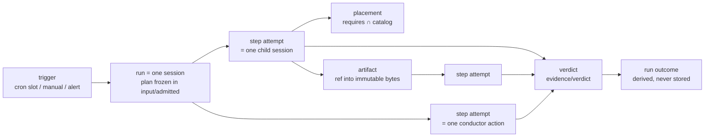

# Kian — Job Model (normative)

> **This document is the normative contract for declarative, multi-step work.** It defines what a
> *job* is, how a *run* of a job is carried, how a step's *placement* is chosen, how an *artifact*
> is handed between steps, and how a step or a run is *proven* done. It never defines truth: a run
> is an ordinary session, its plan is an ordinary `input/admitted` row, its step attempts are
> ordinary child threads, and its verdicts are ordinary `evidence/verdict` events
> (`EVENT-MODEL.md`). Triggers are owned by `CRON-MODEL.md`; execution mechanics by `DESIGN.md`;
> binding, capability declarations and dispatch by `WORKER-MODEL.md`; delegation and task outcomes
> by `MULTIAGENT-MODEL.md`.
>
> Status: **approved by the owner 2026-11-22; P0 and P1 landed** (the inventory is the
> **Implementation status** paragraph closing §0).
> [ADR-052](decisions/ADR-052-job-model.md) is accepted (the carrier decision, the derivation table
> and the freeze rule); the amendments it lists in §18.2 land with the code that needs them. Every
> claim about pre-existing behaviour cites `file:line` and was read, not assumed. The
> **Implementation status** paragraph closing §0 is the authoritative inventory of what has landed;
> a statement absent from it is a designed contract, not a description of shipped behaviour, and a
> section whose text and code disagree is corrected here rather than quietly believed.
> **P0** is the smallest useful ship — one agent step plus one delivery, honest status, one alert
> (§19.2); **P1** is the kernel described here (the DAG, retries, artifacts, deadlines).
> **Designed, not v1** is listed in §21.2. A declaration that asks for an unimplemented policy
> **refuses load** (§7.4): like `CRON-MODEL.md` §3.3 rule 8, this contract does not accept a knob it
> cannot enforce.

- **Owns**: the four axes and their isolation rule (§2); the vocabulary and invariants (§3–§4); the
  run carrier, its driver and its park discipline (§5); the derivation table for every identifier
  (§6); the `jobs:` declaration, its validation and its canonical frozen form (§7); readiness,
  dispatch, retry and the three timeouts (§8); the placement selector (§9); the effect ledger
  (§10); the verdict vocabulary and the outcome lattice (§11); artifacts (§12); delivery and the
  alert path (§13); the additive event keys (§14); the status projection and the `kian job` CLI
  (§15); the failure table (§16), the crash walkthrough (§17) and the footprint (§18).
- **Does not own**: expression grammar, timezone, DST, cursor, catch-up, overlap, firing records
  (`CRON-MODEL.md`); worker identity, membership, binding, 1:1 exclusivity, capability validity
  (`WORKER-MODEL.md`); chunking, tool-surface narrowing, task identity, task outcomes, board
  (`MULTIAGENT-MODEL.md`); envelope, kinds, payload schemas, change protocol (`EVENT-MODEL.md`);
  drain, claim, recovery classes, turn boundaries (`DESIGN.md`); wire frames, error codes, SSE
  (`API-CONTRACT.md`); serving forms and the binding projection's storage (`READ-MODEL.md`);
  channel adapters and their receipts (`CHANNEL-IMESSAGE.md`, `CHANNEL-WECHAT.md`).

This contract introduces **no** new event kind, **no** new table, **no** new HTTP route and **no**
new metrics key. It adds three additive event keys (§14), one `jobs:` config section, one request
field on the spawn path, one additive delegation-wrapper key, one read-only projection (§9.5), and
one CLI verb group (§15.3). Everything else it needs already exists and is cited.

## 0. Scope and authority split

The failure this contract prevents is a *category* failure, not a bug: an operator asks for "at
09:00 fetch, then summarize, then send, and tell me the truth about whether it was sent", and the
existing surfaces answer with four different mechanisms — a scheduler, a spawn path, a channel
adapter and an evidence gate — each of which owns a different third of the answer. Gluing them in
one prompt works once and then rots: the prompt encodes placement, the exit code stands in for
delivery, and nothing can answer *which step failed* or *did the message land*.

| Question | Owner |
|---|---|
| When does a job start, and what does a missed slot mean? | `CRON-MODEL.md` (§5, §9.1) — this contract only supplies the `job` target |
| What work is it, as a composition of steps? | **this file** §7 |
| Where does a step run, and which worker provides its hands? | **this file** §9 over `WORKER-MODEL.md`'s catalog |
| How is a step's attempt carried and fenced? | **this file** §5–§6 over `DESIGN.md` §2–§4 and `MULTIAGENT-MODEL.md` §5 |
| What proves the step happened? | **this file** §11 over `EVENT-MODEL.md`'s `evidence/verdict` and `channel/delivered` |
| What does a run's status mean? | **this file** §11.3, §15 (a projection, never a row) |
| Why a session and not a workflow server? | [ADR-052](decisions/ADR-052-job-model.md) |



**Implementation status.** The kernel landed as [ADR-052](decisions/ADR-052-job-model.md) describes.
This paragraph is the authoritative inventory; anything absent from it is designed, not shipped.

| Landed | Where |
|---|---|
| the plan, canonical form, digests, the identity derivations (§6), the plan-local half of §7.4 | `crates/kian-superagent/src/job/plan.rs` |
| readiness, the outcome lattices, the effect gate, retry backoff (§8.1, §8.6, §10, §11.3) | `crates/kian-superagent/src/job/outcome.rs` |
| the placement selector (§9.1–§9.3) | `crates/kian-superagent/src/job/placement.rs` |
| the marker, the stream facts, the status projection and its renderer (§15.1) | `crates/kian-superagent/src/job/status.rs` |
| alert-run construction (§13.3) | `crates/kian-superagent/src/job/alert.rs` |
| the conductor: park, dispatch, settlement, delivery, alerts, the run verdict (§5.3–§5.5, §8, §13) | `crates/kian-superagent/src/job/conduct.rs` |
| the `jobs:` section, the config half of §7.4, the lowering into `CronTarget::Job` (§7.1) | `crates/kian-cli/src/job_config.rs` |
| the assembly adapters, the driver routing, the sweep's job settlement, `kian job` (§5.3, §15.3) | `crates/kian-cli/src/{job_runtime.rs,superagent.rs,cron_engine.rs,job_cli.rs}` |

**Designed, not v1** — each with the phase that lands it in §21.2: the binding view (§9.5), enforced
cancellation (§8.5's honesty box), binary artifacts (§12), the HTTP/SSE status route (§15.3),
sweep-side alerting (§13.3), event triggers, `max_parallel > 1` and cross-run dependencies.

## 1. The pattern this contract abstracts

### 1.1 The concrete need

The driving case is one operator's daily digest (`~/kian-scheduler-spec.md`): at 09:00 Asia/Shanghai
fetch model rankings, Hacker News and Hugging Face; summarize in Chinese; send one iMessage; report
whether it *really* left the building; alert if it did not. Today it is a launchd plist running
`run.sh` on a Mac, which SSHes to a VPS, which calls an LLM over HTTP, which shells back out to a
local `imsg` binary and then polls `chat.db` twelve times hoping `is_sent=1`. Each hop is a
separate failure domain, none of them reports, and the success signal is a side effect of the
delivery tool rather than a receipt.

Read past the deployment accident and the requirement is not "cron" and not "a workflow engine". It
is one sentence:

> A named composition of steps, each of which declares the *capabilities* it needs and the
> *evidence* that proves it happened, started by a trigger, carried to completion by the runtime,
> and never silently declared successful.

That sentence is general. It recurs in every shape of "do these things in order on the machines
that can, and tell me the truth": nightly reports, ingestion pipelines, release checks, multi-machine
sweeps, agent-authored plans. So the abstraction is warranted, and this document is it. The
alternative — solve the digest with a big prompt plus `&&` — is not a smaller design, it is the
absence of one: placement, retry and verification end up encoded in prose, and the runtime cannot
report on work it cannot name.

### 1.2 What the spec conflates

The spec is a *requirements* document, and it folds four independent decisions into one config
object: `CronSchedule.steps[]` carries the trigger (cron/tz/catch-up), the plan (steps, depends_on,
prompt, output_schema), the placement (requires, exec_worker_pin) and the evidence (a delivery poll)
in one struct. Fusing them is what forces the spec's own open questions (§20, "does
`max_concurrent` mean per task or per step?"). Separating them answers most of them by construction.

| Spec ask | Axis | Where it lives today | Gap this contract fills |
|---|---|---|---|
| Fire at 09:00 Asia/Shanghai, catch-up `latest` | trigger | `CRON-MODEL.md` §2, §5 — landed | a schedule cannot name a *job*, only a session or a channel topic |
| Never hardcode a hostname in the work | placement | `WORKER-MODEL.md` §3 capabilities; `worker.rs` registration cache | capabilities exist as a *declaration*; nothing selects on them |
| "local first, VPS as fallback, never the wrong machine" | placement | — | no rank, no candidate set, no refusal path |
| fetch → summarize → send, with data dependencies | plan | — | a firing is **one** turn (`CRON-MODEL.md` §4); there is no step |
| 256 KiB artifact cap, by reference, no truncation | plan | — | no artifact notion at all |
| success = `is_sent=1 AND error=0` on a *new* row | evidence | `channel/delivered` receipts (`CHANNEL-IMESSAGE.md` §6) | the delivery *adapter* already proves this; nothing declares it as the step's proof |
| alert within 5 min when both paths fail | evidence + trigger | outbox + channel targets | no failure hook that is independent of the step that failed |
| per-step status, attempts, latency | evidence | events exist, unfiltered | no run index, no CLI |
| retries and timeouts per step | plan | `MULTIAGENT-MODEL.md` §5.3 (`child_timeout_ms` inactivity) | no per-step budget, no run budget |

### 1.3 The composition rule

The abstraction is worth having only if future needs extend it by adding a **value**, never a new
**mechanism**:

> Every new requirement must be expressible as a new value in exactly one of four vocabularies — a
> trigger kind (§2.1), a step action (§7.2), a capability (§9.1), or a check (§11.2) — and must not
> require a second scheduler, a second spawn path, a second delivery path, or a durable status
> column.

That rule is the acceptance test for this document. It is also why §14 adds keys rather than kinds:
every fact the model needs is already a fact the event catalog records about a session.

## 2. The four axes

### 2.1 Trigger — *when*

A trigger is an occurrence with a durable **slot** token, unique within (job, trigger kind). The
slot is what makes a run idempotent: `(job, slot)` names at most one run, forever.

| Kind | Slot token | Owner |
|---|---|---|
| `cron` | the cron firing id `{schedule_id}@{fire_time}` | `CRON-MODEL.md` §4 |
| `manual` | `manual:<26-char ULID>` — one slot per operator request, never re-used | §15.3 |
| `alert` | `alert:<failed run id>` — exactly one alert run per failed run, forever | §13.3 |
| `event` | *designed, not v1* (§21.2) | — |

A trigger resolves a slot into a run **decision**: which job, and which plan bytes. Resolution is
pure (`plan = resolve(job_id, loaded_config)`) and happens in the trigger's own actor: for cron, the
ticker that already claims firings (`crates/kian-cli/src/cron_engine.rs`). The trigger never
executes; it freezes the plan and admits one input row (`ResidentDispatcher::deliver` at
`crates/kian-cli/src/cron_engine.rs:839` is the existing shape of exactly this write).

### 2.2 Plan — *what*

A plan is a named, ordered-by-dependency set of steps. It is **declaration only**: no worker id, no
hostname, no absolute path, no time of day, no secret. Its whole authority is §7.

### 2.3 Placement — *where*

Placement is a pure function of the step's declared capabilities, the worker catalog, the
declared rank, and the live binding view (§9.5). It is computed **once per attempt, before the
attempt exists**, and committed in the attempt's dispatch record. It is never recomputed (J3):
a config edit, a membership change or a restart cannot re-point an attempt.

### 2.4 Evidence — *did it happen*

A step declares checks; the checks are predicates over the committed events of the attempt. A step
whose checks do not pass is not successful, no matter what its process exit code or its model
output said (J7). The run's outcome is a fold over step outcomes (§11.3).

### 2.5 Isolation rule

The axes may influence each other **only** through these named functions:

| From → To | Function | Section |
|---|---|---|
| trigger → plan | `resolve(job_id)` + canonicalization + digest | §7.1 |
| plan → placement | `candidates(step.requires)` | §9.2 |
| plan → evidence | `checks(step.verify)` | §11.2 |
| attempt → evidence | `observed(attempt events)` | §11.3 |
| evidence → trigger | `alert(run, reason)` = a new run with kind `alert` | §13.3 |

No other cross-axis channel exists. In particular: a plan may not contain a placement decision
(beyond the checked `pin` of §9.3), a trigger may not contain plan content (beyond the job id), a
placement may not weaken a check, and an evidence verdict may not start a step.

## 3. Terminology

Every term below is either an existing kian noun (and then the existing contract owns it) or a
new noun this document owns. No term is a table, a daemon, or a service.

| Term | Kind | Definition |
|---|---|---|
| **job** | config declaration | A named, reusable **plan** plus its limits. Lives in the `jobs:` section. Carries no trigger and no state. |
| **plan** | config, frozen per run | The ordered DAG of **steps** that a run executes. Canonicalised to bytes and digested (`plan_digest`). Once a run is admitted, *that* copy is the plan. |
| **step** | plan node | `id`, `action` (`agent` | `deliver`), `depends_on`, `requires`, `inputs`, `produces`, `timeout_ms`, `retries`, `effect`, `pin`. A step is a *description*, never an execution. |
| **trigger** | existing | What makes a run exist: a cron slot (CRON-MODEL), a manual `kian job run`, or an alert. The trigger's only job is to **admit one input row** with a `slot_token`. |
| **slot_token** | derived | The discriminator that makes `(job, slot)` unique: the cron `fire_time`, `manual:<monotonic 26-char ULID>`, or `alert:<failed run id>`. |
| **run** | session | One execution of one job at one slot. **A run is an ordinary session** whose first input carries the `job` marker; its drain is driven by the job conductor. There is no run table. |
| **run id** | derived string | `{job_id}@{slot_token}`, byte-compatible with cron's `{schedule_id}@{fire_time}` (`crates/kian-store/src/cron.rs:527`). |
| **conductor** | LoopDriver | The `JobLoopDriver` decorator that drives a run session's drain. Stateless: every tick re-derives run state from committed events. |
| **attempt** | derived pair | `(step, attempt_no)`, `attempt_no` starting at 1. Retries are new attempts, never a re-run of the same one. |
| **dispatch record** | parent-side commit | The run stream's `thread/started` for one attempt, carrying the frozen placement and `exec_worker`. Written **before** the child is admitted, so a crash after it is a re-drive, not a lost spawn. |
| **placement** | derived once per attempt | The resolved execution site: a worker id (agent steps) or `conductor` (deliver steps). Computed from `requires` × the worker catalog × declared priority, then **committed**. |
| **artifact** | reference | One declared output of an attempt: `{name, media, bytes, sha256, ref}` where `ref` points at committed event bytes (text) or a blob path (binary). Never a copy of content into a new store of record. |
| **effect** | plan attribute | `read` (retry freely) or `write` (a side effect that may have happened). Drives the retry gate (§10). |
| **verdict** | event | An `evidence/verdict` on the run stream: `{gate, passed, checks[], attempt}`, the exact payload `crates/kian-loop/src/evidence.rs` already defines. |
| **outcome** | derived enum | Per attempt `succeeded` | `unverified` | `invalid_output` | `timed_out` | `interrupted` | `failed` | `needs_operator` | `skipped`; per run `succeeded` | `failed` | `cancelled` | `unverified`. |
| **park** | execution state | The conductor holding its drain while a run is unfinished: it yields `TurnDone` on a coarse tick and writes nothing. Not a "waiting session state"; there is no such state. |

Two naming rules inherited from the codebase, stated so the vocabulary does not drift:

1. **No new noun for "task".** A step is not a task; `multiagent` tasks and their `task_id` stay
   exactly as `design/MULTIAGENT-MODEL.md` defines them. A job step's child may itself influence
   further delegation through the ordinary tool surface, and that has nothing to do with plans.
2. **No new noun for "workflow".** `design/DESIGN.md` §0.2 refuses deterministic workflow
   re-execution; a plan is a *data* description of who runs what next, executed by a drain that may
   be re-driven from bytes. It is not a program.

## 4. Invariants

These are the whole contract. A later change that violates one is a new ADR, not an edit.

**J1 — Stream is the sole truth for a run.** Every run fact is an event on the run session (or on a
child session reachable through `thread/started`). There is no run row, no board, no job status
column, no scheduler DB. Status is a projection (`design/MULTIAGENT-MODEL.md` §4.1 M1, AGENTS.md
constraint 1). *Consequence:* `kian job status` may be a table-free read of streams, and deleting
it loses nothing.

**J2 — The plan is frozen at admit.** The run's first `input/admitted` carries the canonicalised
plan and its digest. The conductor executes that plan, byte for byte. A config edit after admit
never affects a live run; a re-drive re-reads the committed copy. *Why:* constraint 13 plus the
spec's own R2/R4 (a run must be explainable after the config moved). *Observable:* the run's plan
digest is on its stream; a mismatch between config and the frozen digest is a fact, not an error.

**J3 — Placement is computed once per attempt and committed before the child exists.** The dispatch
record carries `exec_worker` and the candidate list with the reason the winner won. A re-drive
reuses the committed choice and never re-runs selection. *Why:* worker binding is session-immutable
and command rerouting is forbidden (`design/WORKER-MODEL.md`; AGENTS.md constraint 11 for model
slots, and the same cache/replay logic for placement).

**J4 — Dispatch is idempotent by derivation.** `(run, step, attempt)` derives the child's thread
id, session id and `task_id` by `uuid5` (§6); the dispatch record is written by the parent before
the child input is admitted; the child input's idempotency key is derived too. A crash anywhere in
the dispatch sequence heals by re-deriving the same three ids and re-admitting under the same key —
never a second child, never a second inbox row.

**J5 — The conductor is the only spawner of its run's steps.** No cron sweeper, no CLI, no HTTP
handler, no operator command ever spawns a step. The control plane only admits the run input row
(AGENTS.md constraint 9; `design/MULTIAGENT-MODEL.md` §4.1 M10).

**J6 — A conductor never settles while the run is unfinished.** It parks (§5.4). It must never yield
`Settled` with an unfinished plan, because `Settled` + empty inbox ends the session `Completed`
(`crates/kian-orchestrator/src/engine.rs:2075-2085`) and a terminal end freezes the stream
(`design/DESIGN.md` §2.2) — the run would be permanently un-drivable. It ends the run exactly once,
through one `session/ended`.

**J7 — No evidence, no success.** An attempt is `succeeded` only with a passing `evidence/verdict`
whose checks the plan declared. A child's `completed` end, a zero exit status, and a report that
merely *claims* success are **never** success by themselves. An attempt that ends without
evaluable evidence is `unverified`, which is a first-class non-success (AGENTS.md constraint 7;
the spec's R5 exists precisely because `exit 0` lied).

**J8 — A retry is a new attempt, never a re-drive of the old one.** New identity, new child, new
placement. A step never rebinds a worker, never waits for a worker to come back, and never re-sends
a request whose effect is unknown (§10).

**J9 — The effect gate is decided before the attempt, not after it fails.** `effect: read` may be
retried freely. `effect: write` may be retried only when the plan declares `idempotent: true` *or*
the previous attempt provably did not reach the effect. Otherwise the outcome is
`needs_operator` and the run halts honestly instead of guessing.

**J10 — Artifacts are references, not copies.** A text artifact is `{producer session, seq, sha256,
bytes}` pointing into committed, immutable event bytes: no TTL, no storage, replayable forever. A
binary artifact is a blob path + digest + TTL, and a missing blob is `artifact_unavailable`
(the check fails), never an empty string. An artifact over its declared cap is a **failed attempt**,
never a truncation (the spec's R4, honoured).

**J11 — One clock per stage.** `timeout_ms` bounds exactly one *attempt* and is observed by the
conductor. `deadline_ms` bounds exactly one *run* and is observed by the conductor. Neither is used
to bound admission, dispatch, or queue pickup: "no candidate" is an instant refusal, not a slow
timeout (AGENTS.md adversarial checklist, "waiting/timeout semantics").

**J12 — Truth is monotone.** The first committed outcome for an attempt, and the run's single end,
are final. Facts that arrive later from an abandoned child (a report after the conductor gave up)
are recorded on that child's stream and are **never** folded back into the run's outcome. *Why:* an
abandoned child may still finish; the run must not oscillate.

**J13 — Job facts are non-context-bearing.** No placement, verdict, artifact ref, slot, or digest is
rendered into a model prompt or into the cacheable prefix of a *later* turn. The only model-visible
job content is the child's task message, built deterministically from the frozen step spec
(AGENTS.md constraint 3; the `dream` marker precedent, `crates/kian-memory/src/driver.rs:332`).

**J14 — A delivery is a receipt, not a return value.** A deliver step succeeds only when a
`channel/delivered` receipt for the **frozen** target exists in that attempt and no failure fact
follows it. A transport `ok` without a receipt, and a receipt for a *different* target, are both
failures. Multi-part sends produce several receipts; "at least one landed" is not success for a
single logical message unless the plan says so.

**J15 — Capability is eligibility, never authority.** `requires` narrows which workers *may* run a
step. It grants nothing and enforces nothing: execution authority is the worker's own tool grants
and sandbox (`design/WORKER-MODEL.md` §9). A plan that needs a privileged effect must select a
worker that already has it; the selector cannot confer it, and a worker that lacks the tool fails
the step honestly.

**J16 — No silent degradation.** Every refusal is an in-stream fact with a reason code: no
candidate, cap exceeded, digest mismatch, gate failed, allowlist miss, budget exhausted. Nothing
"runs anyway", nothing is dropped without a record, and an unreadable child stream is `unknown`
(never "still running", never "dead").

## 5. The run: carrier, conductor, park, end

### 5.1 A run is a session, and why

The three candidate carriers and why only the third survives the repo's own rules:

| Carrier | Verdict |
|---|---|
| A durable `job_runs` table with a status column | **Refused.** A second store of authority; violates constraint 1 and MULTIAGENT §4.1 ("no board entity, ever"). |
| A supervisor daemon that spawns children on a timer | **Refused.** The control plane would be writing execution (constraint 9) and a global dispatcher would exist (`design/MULTIAGENT-MODEL.md` §4.1 M10). |
| **An ordinary session whose driver is a conductor** | **Chosen.** The only legal orchestrator is a drain (`design/DESIGN.md` §2.1: "the agent loop is just a control flow inside a drain"). A trigger already admits an input row into an ordinary session — cron does exactly this today (`crates/kian-cli/src/cron_engine.rs:839`, `ResidentDispatcher::deliver(..., Some("cron:{firing_id}"))`). |

A run session is not special in any persistent way: it has no new state machine, no new event kind,
no new table. What is special is only *which driver claims its drain* and *what that driver does*.

### 5.2 The first input row carries the plan

The trigger admits one row:

```json
{
  "role": "user",
  "content": "Run job \"digest\" for slot 2026-11-23T09:00:00+08:00 (cron).",
  "job": {
    "run_id": "digest@2026-11-23T09:00:00+08:00",
    "job_id": "digest",
    "slot": "2026-11-23T09:00:00+08:00",
    "trigger": "cron",
    "plan_digest": "sha256:9f2c…",
    "plan": { "steps": [ … ], "limits": { … } }
  }
}
```

Rules, in order of authority:

1. `job` is an **additive key**, exactly like `dream` (`crates/kian-memory/src/driver.rs:332-353`
   parses the marker and *never* inspects the message text). The conductor's dispatcher reads `job`
   from the event bytes, reversed-scanning for the newest `InputAdmitted` that has one.
2. The content line is for humans, operators, and the read model. It is **never** the authority for
   the plan, the slot, or the job id.
3. A row whose `job` key is present but unparsable (unknown schema version, missing `plan`, digest
   mismatch against the canonicalised plan) makes the conductor end the run `failed` with reason
   `invalid_job_input`. It does **not** fall back to "run as a plain agent": an unverified plan must
   not execute with the wrong authority.
4. A session whose stream has no `job` marker is never claimed by the conductor, even if the session
   id matches a derived run id. Routing is derived from the stream, not from a registry — this is the
   `MemoryLoopDriver` precedent (`crates/kian-memory/src/driver.rs:332`: "derived from the stream
   alone so a restarted server classifies a takeover identically").

The frozen `plan` is stored in the event, not in the row's content, for three reasons: events are
the immutable record; the digest can be recomputed by any reader; and the plan cannot be confused
with prompt text by a model.

### 5.3 The conductor

```text
ServeLoopDriver  (crates/kian-cli/src/superagent.rs:1209)
  ├─ Router session        → RouterDriver
  ├─ thread lineage        → WorkerLoopDriver
  ├─ job marker on first input → JobLoopDriver(inner = the ordinary agent loop)
  └─ else                  → default agent loop
```

The conductor is a **decorator over a real LoopDriver**, composed in the same place and the same
shape as the existing ones. It is not a new engine, not a new crate of execution logic, and it must
be mounted in `crates/kian-cli/src/server.rs` around the chosen driver (the same seam where
`MemoryLoopDriver` is wrapped today). Its dispatch happens in `ServeLoopDriver::drive`, which
already routes per session from the stream.

The conductor's own turn is *not* a model call. Its state machine per tick:

```text
tick(now):
  facts   = derive(run_stream)                 # pure: plan, dispatch records, verdicts, outcomes
  if facts.run_ended: return Stopped/SoftFailed  # already terminal: nothing to do
  promote_inputs()                             # drain any newly admitted rows (steer/cancel/answers)
  if canceled(facts):  verdict(run_failed, cancelled); end(Cancelled)
  if deadline_passed(facts): fail_run(deadline_exceeded); end(Failed)
  for attempt in facts.outstanding:            # started but no terminal fact
      observe(child_stream(attempt))           # via WorkerStreamsPort, read-only
      if closed(attempt): settle_attempt(attempt)
      elif attempt_timed_out(attempt, now): settle_attempt(attempt, timed_out); interrupt(child)
  for step in ready_steps(facts):              # deps satisfied, no dispatch record yet
      if no_placement(step): fail_run(no_candidate, step); end(Failed)   # instant, not a timeout
      dispatch(step)                           # §8.3, idempotent
  for step in retry_due(facts, now):
      dispatch(step, attempt + 1)              # §8.6
  if all_steps_terminal(facts) and no_outstanding(facts):
      verdict = run_verdict(facts); end(completed_or_failed)
      return Stopped("job finished")           # Single end, single reason
  return TurnDone                              # park tick: no event written
```

Three properties are load-bearing:

* **Nothing is held in memory.** Every tick re-derives from the stream, so a takeover, a restart, or
  a second server after a crash behaves identically. Memory may only cache; it may never decide.
* **Ticks write nothing.** The park tick yields `TurnDone` with zero appends, so a run that waits for
  hours adds no bytes to its stream and invalidates no cache. This is the `RouterDriver` park
  precedent (`crates/kian-superagent/src/router.rs:3060-3250`: "No provider call, no event write").
* **The conductor uses only legal ports.** `DrainCtx` for its own stream, `WorkerStreamsPort` for
  child reads, `InboxWriter` for child admits, `WorkerSpawner` for child creation, and
  `SpawnSessionWriter` for session creation. It never touches another session's store rows, and it
  never mutates a projection.

### 5.4 Park, and why park is the only honest wait

The settle rule is the crux. `crates/kian-orchestrator/src/engine.rs:2075-2085` ends the session
`Completed` whenever the driver yields `Settled` and the inbox is empty; `awaiting_input` is
produced only when the turn ended `Completed` **and** a pending `ask` exists
(`crates/kian-orchestrator/src/engine.rs` post-loop rule; `design/CONFIRMATION-MODEL.md`). A
terminal end freezes the stream. Therefore:

* a conductor **cannot** "settle and wait" — that would mark the run completed while steps are still
  running, freeze the stream, and lose the run forever;
* a conductor **cannot** park by ending the session and relying on a later wake — `Idle` after
  `interrupted`/`failed` is resumable, but a *run* that wants to wait for an hour is not a failure;
* a conductor **must** park inside `supervise()` by yielding `TurnDone` on a coarse tick
  (`crates/kian-orchestrator/src/engine.rs:2186-2226` keeps consuming the same stream; interrupt is
  observed at each outcome, so a parked run is still cancellable within one tick).

Park mechanics:

| Property | Value | Rationale |
|---|---|---|
| Tick floor | 100 ms (constant `JOB_TICK_MIN_MS`) | responsiveness for interrupts and manual cancel |
| Tick ceiling | 5 s (constant `JOB_TICK_MAX_MS`) | a run may wait 24 h; 5 s is 17k wakeups/day, all no-ops |
| Adaptive sleep | `clamp(next_due - now, floor, ceiling)` where `next_due` = min(attempt timeouts, retry backoff, run deadline) | a run with no outstanding work sleeps the ceiling; a run with a 2 s retry wakes exactly then |
| Events per tick | 0 | park must not grow the stream |
| Interrupt latency | ≤ one tick | `supervise` checks the flag at every outcome |
| Lease | untouched: one claim, ordinary heartbeat | a long park is not a crash (`MAX_UNENDED_CLAIMS = 3` counts claims, not ticks) |

One deliberate deviation from `RouterDriver`: the Router parks to wait for *inputs* and lets its
inner loop promote them. The conductor must promote them itself (`DrainCtx::take_eligible_inputs`
is public, `crates/kian-orchestrator/src/engine.rs:688`), because `supervise()` does not re-enter the
episodes loop while the stream is alive. Otherwise a `control/interrupt` admitted while a run parks
would sit unconsumed until the run ended. v1 meaning of a promoted row on a run stream:

| Row kind | v1 meaning |
|---|---|
| `control/interrupt` (or a steer row whose content is `cancel`) | cancel the run: no new dispatch, outstanding attempts abandoned, run ends `cancelled` |
| any other admitted message | recorded as an operator note on the run stream; **no** plan mutation. Plan mutation by steer is a P2 question (§21 Q6) because it would move the frozen plan. |

### 5.5 Ending a run (landed)

The **engine** owns the end write. `design/DESIGN.md` §2.3 makes the drain the sole writer of
`session/ended`, and the engine maps a driver's final `LoopOutcome` onto the reason
(`Stopped{…}` → `completed`, `Rotated` → `rotated`, `SoftFailed{…}` → `failed`, and any outcome
observed while the interrupt flag is set → `interrupted`). A driver cannot supply the end payload,
and a second end append would break constraint 4 (one atomic end per session).

So a run's outcome does **not** ride `session/ended`. The conductor writes **one**
`evidence/verdict` with gate `run` (§11.1) *before* it yields its final outcome, and the end reason
follows from that outcome:

| Run outcome | Run verdict (gate `run`) | Final `LoopOutcome` | `session/ended.reason` (engine) |
|---|---|---|---|
| `succeeded` | `passed: true`, `job.outcome: "succeeded"` | `Stopped{reason: "job run finished"}` | `completed` |
| `unverified` | `passed: false`, `job.outcome: "unverified"` | `Stopped{reason: "job run finished"}` | `completed` — the work happened; the missing evidence is in the verdict, not a lie about the reason |
| `failed` | `passed: false`, `job.outcome: "failed"`, optional `job.failed_step`, `job.reason` | `SoftFailed{reason: "job run failed"}` | `failed` |
| `cancelled` | `passed: false`, `job.outcome: "cancelled"` | `Stopped{reason: "job run finished"}`; the cancel row's interrupt flag then turns the engine's next outcome into `interrupted` | `interrupted` (or `completed` when the flag arrives after the conductor's final tick) |
| unparsable plan | `passed: false`, `job.outcome: "failed"`, `job.reason: "invalid_job_input: …"` | `SoftFailed` | `failed` |

`unverified` ends `completed` on purpose: the session really did finish its work, and kian's reason
vocabulary has no better word. The job-level truth is in the verdict, which is where it belongs.
`design/DESIGN.md` §7's honesty rule ("interrupted ≠ failed") forbids inventing a reason; reusing the
verdict plus the existing reason vocabulary is the honest option.

Two consequences another contract reads:

- the settlement sweep (`crates/kian-cli/src/cron_engine.rs` `settle_from_target`) settles a **job**
  firing from `kian_superagent::job::status::run_verdict(stream[..=end])` — never from the bare end
  reason, which cannot tell a success from an unverified run. A job stream that ends with no run
  verdict settles `failed` ("the run ended without an outcome"), because the conductor's silence is
  not evidence (J7);
- `session/ended.job` is **not** written by anything; the A3 row of §14 is retired.

## 6. Identity derivations

All ids are `uuid5` over committed inputs, so any process can recompute them from the stream.

```text
job_ns(job_id)            = uuid5(KIAN_NS, "kian:job:" + job_id)
run_session(job, slot)    = uuid5(job_ns(job), "run:" + slot)
run_id                    = job + "@" + slot
run_input_key             = "kian:job:run:" + run_id          # inbox idempotency key
spawn_uid(run, step, n)   = uuid5(run_session, "kian:job:step:" + step + ":" + n)
child_thread_id           = uuid5(run_session, "kian:thread:" + spawn_uid)     # reuses multiagent's shape
child_session             = SessionId(uuid5(child_thread_id, "kian:session"))   # reuses multiagent's shape
task_id(run, step, n)     = uuid5(run_session, "kian:task:" + step + ":" + n)
child_inbox_key           = "thread:" + child_thread_id      # the key WorkerSpawner admits under
plan_digest               = "sha256:" + hex(sha256(canonical_json(plan)))
step_digest               = "sha256:" + hex(sha256(canonical_json(step)))
alert_run_id              = alert_job + "@alert:" + failed_run_id
```

Notes:

* `KIAN_NS` is the fixed namespace uuid this document pins for job derivations: every job id lives
  under `KIAN_NS = 99be60b5-c4d7-52ec-8563-6de7b8697856`, itself derived once as
  `uuid5(uuid::Uuid::NAMESPACE_URL, "kian.dev/ns/job")`. It is recorded in
  [ADR-052](decisions/ADR-052-job-model.md) so it is a constant, not an accident: changing it
  re-derives every run session id and orphans every in-flight run.
* `canonical_json` sorts object keys recursively and emits no insignificant whitespace; the digest is
  over those bytes. Two configs that differ only in key order are the same plan.
* `spawn_uid` is seeded by the *logical* triple, not by an event sequence number. That is what makes
  a dispatch replayable after a crash: the conductor does not need to know "which spawn index this
  was", because the plan already fixed the step and the attempt.
* Reusing `child_thread_id`/`child_session` shapes keeps the multiagent read surface (recall,
  timeout walk, status projection) working unchanged on job children.


## 7. Configuration

### 7.1 One new section, one lowered trigger

```yaml
jobs:
  jobs:
    - id: digest                       # [a-z0-9] first, then [a-z0-9._-], <= 64 bytes
      limits:
        deadline_ms: 900000            # the whole run (§8.7); default 1800000
        max_parallel: 1                # v1: 1 only (§7.4 V10)
      plan:
        - id: gather
          action: agent
          requires: [net.unrestricted]
          prompt: |
            Collect today's sources. Return the digest inputs as one
            markdown block, at most 40 lines.
          produces: {name: sources, media: text, max_bytes: 24576}
          timeout_ms: 120000
          retries: 1
          effect: read
          verify:
            - {check: final_message_present}
            - {check: min_tool_results, n: 1}

        - id: compose
          action: agent
          depends_on: [gather]
          inputs: [{step: gather, name: sources}]
          prompt: |
            You are the editor. Use the supplied sources; do not fetch.
          produces: {name: digest, media: text, max_bytes: 24576}
          timeout_ms: 120000
          effect: read
          verify:
            - {check: final_message_present}
            - {check: artifact_within_cap, name: digest}

        - id: deliver
          action: deliver
          depends_on: [compose]
          channel: imessage
          target: {handle: "+8613800000000"}
          content: {from_artifact: {step: compose, name: digest}}
          verify:
            - {check: delivery_receipt, channel: imessage, target: {handle: "+8613800000000"}}

  triggers:
    - id: digest-morning             # the schedule id (the durable cursor key); defaults to the job id
      job: digest
      expr: "0 9 * * *"
      tz: Asia/Shanghai
      catch_up: latest                 # skip | latest (the spec's run_once); "all" is not a cron policy
      overlap: skip

  alerts:
    - id: digest-failed
      on_failure_of: digest
      channel: imessage                # must be independent of every deliver channel (§7.4 V12)
      target: {handle: "+8613800000000"}
```

One alert per failed run needs no repeat knob: the alert input row's idempotency key is
`kian:alert:<failed run id>`, so a re-driven conductor cannot alert twice and a second failure is a
second run id (§13.3).

`limits` is the whole job's budget and defaults; it is not a plan node:

| `limits` field | Default | Meaning | Reference |
|---|---|---|---|
| `deadline_ms` | `1800000` | Wall-clock budget for the entire run, measured from the run input's ts. | §8.7 |
| `max_parallel` | `1` | How many steps of one run may be in flight at once. v1 = 1. | §8.2 |
| `prefer` | `[]` | Job-wide default for every step's `prefer:` (soft placement order). A step's own list wins outright. | §9.3 |
| `accept_unverified` | `[]` | Steps whose `unverified` outcome still satisfies a dependent (§8.1). The run's outcome becomes `unverified`, never `succeeded`. | §8.1 |
| `defer_budget_ms` | `300000` | How long a step may wait for a busy-but-capable worker before failing `no_candidate`. | §9.4 |
| `inline_max_bytes` | `65536` | Largest artifact the conductor may inline into a consumer's prompt; larger refs must be read by the consumer. | §12.2 |

Two structural decisions, both forced by the authority split in §0:

**(a) A job carries no trigger; a trigger names a job.** The trigger list is *lowered at load* into
the existing `cron.schedules` runtime vector (`CronSection::to_runtime`,
`crates/kian-cli/src/config.rs:5419`), producing `CronRuntimeSchedule` values whose `target` is the runtime-only variant
`CronTarget::Job { job }` (a job trigger is its only source; the user-facing
`cron.schedules[*].target` keeps its two shapes and never accepts it). Everything the cron contract already
owns then applies with **no code path change**: the durable cursor, `claim_firing` on
`{schedule_id}@{fire_time}`, misfire/catch-up, overlap skip, coalescing, one-shot-at-a-time, the
settlement sweep (`design/CRON-MODEL.md` §9.1), `kian cron list|run-now|logs|rm`. A job trigger is a
cron schedule whose *turn* is a job run. This is why the model needs no second scheduler and no new
cursor table.

**(b) The job's resolved runtime form is a frozen value, not a live reference.** At trigger resolve
time the tick loop canonicalises the plan and embeds it in the input row (§5.2). Editing `jobs.jobs`
afterwards changes only *future* runs. Editing a trigger's `expr`/`tz` resets that trigger's cursor
exactly as `design/CRON-MODEL.md` §12.3 already specifies; editing a plan does not touch any cursor
because no cursor belongs to a plan.

### 7.2 Step schema

| Field | Type | Default | Meaning |
|---|---|---|---|
| `id` | string | — | Step identity inside the plan; also the artifact namespace and the `gate` suffix. |
| `action` | `agent` \| `deliver` | `agent` | `agent`: a child session bound to a worker. `deliver`: an in-conductor channel action (§13). P3 adds `exec` (a bare endpoint command, no model). |
| `prompt` | string | — | Required for `agent`. The task message, verbatim, plus the frozen inputs. |
| `requires` | string[] | `[]` | Capability names the worker must declare (`crates/kian-core/src/worker.rs:13-33`: ≤16, ≤64 bytes, `[a-z0-9]` first then `[a-z0-9._-]`). `[]` = any worker. |
| `pin` | string | absent | Exact worker id; when present, `requires` must be a subset of that worker's declared capabilities (V6). Renamed from the spec's `exec_worker_pin` to match the existing `exec_worker` verb. |
| `allow_offline` | bool | `false` | Admit an `Offline` worker as the last-ranked candidate (§9.2). Default `false`: a step cannot progress without tools, so dispatching to an offline worker is a guaranteed timeout. |
| `prefer` | string[] | the job's `limits.prefer`, else `[]` | Worker ids this step would rather run on, in order; a *soft* tie-break inside the deterministic sort key (§9.3). Ids that are absent or unrecognised rank nothing and never fail a load — a preferred machine may simply be gone today. Distinct from `pin`, which is a hard constraint. |
| `depends_on` | string[] | `[]` | Step ids that must reach a success outcome first (§8.1). |
| `inputs` | ref[] | `[]` | `{step, name}` artifact references; the producer's `produces.name` must exist (V5). |
| `produces` | spec | absent | `{name, media: text\|binary, max_bytes}`. At most one per step in v1; absent = no artifact (§12). |
| `output_schema` | object | absent | JSON object passed to the child as its structured-output tool schema (the existing `WorkerSpawner` `output_schema` path, `crates/kian-superagent/src/worker.rs:984`). |
| `timeout_ms` | u64 | `300000` | One attempt (§8.5). Observed, not enforced, for `agent` steps — see §8.5's honesty box. |
| `retries` | u8 | `0` | Extra attempts: total = `retries + 1`, ≤ 5 (V8). |
| `effect` | `read` \| `write` | `read` | The retry gate (§10). A `write` with `retries > 0` and no `idempotent: true` is a config error (V7). |
| `idempotent` | bool | `false` | Declares that repeating the effect is harmless. Only meaningful for `effect: write`. |
| `verify` | check[] | see §11.2 | Declarative predicates evaluated by the conductor over the attempt's own facts. |
| `on_failure` | `halt` \| `continue` | `halt` | `halt`: the run fails at this step. `continue`: independent steps still run; the run ends `failed` (not `succeeded`) unless the step is `optional: true`. |
| `optional` | bool | `false` | With `on_failure: continue`, a failed *optional* step does not fail the run (the run may still succeed). Distinct from `continue` alone, which keeps dispatching but still fails the run. |

`deliver` steps use instead: `channel` (required), `target` (required, the existing
`CronTarget`/`ChannelDelivery` target shape), `content` (`{text}` or `{from_artifact: {step,
name}}`, exactly one). They have no `requires`, no `pin`, no `retries` of their own (retry is the
outbox's bounded retry, reused as §13.3 describes), and no `output_schema`.

### 7.3 Canonicalisation and the digest

`canonical_json(value)` = recursively sorted object keys, no insignificant whitespace, UTF-8, arrays
in declared order. `plan_digest = "sha256:" + hex(sha256(canonical_json(resolved_plan)))` where
`resolved_plan` has every default filled in. Consequences:

* defaults are part of the digest: a run admitted before a default changed is *not* the same plan,
  and its digest says so;
* the frozen plan can be re-digested by an operator and compared to the stream, which is how
  "explain this run" is answered without trusting the config file;
* the step digest used in the child's task message (§8.4) is over the *frozen step*, so a re-drive
  produces byte-identical prompts (AGENTS.md constraint 3).

### 7.4 Validation

All checks run at config load (`CronSection::to_runtime` equivalent for the `jobs:` section) and
refuse the whole config with a path-qualified message. Nothing is validated lazily except where
stated. `deny_unknown_fields` on every struct, matching `CronSection`.

| # | Rule | Refusal |
|---|---|---|
| V1 | `id` shape per `crates/kian-core/src/worker.rs` rules; ≤64 bytes | `invalid job id` |
| V2 | Job ids unique; trigger ids unique **across `jobs.triggers` ∪ `cron.schedules`** | `duplicate schedule id` |
| V3 | Plan non-empty, ≤32 steps; step ids unique and shaped like V1; every `agent` step declares `prompt` | `invalid plan` |
| V4 | `depends_on` ⊆ plan, no self-edge, no duplicate entry, acyclic (topological sort succeeds) | `cycle in depends_on`, `duplicate dependency` |
| V5 | Every `inputs[i]` names a producer step that declares `produces` with that `name` | `unknown artifact` |
| V6 | `requires` valid capability names, ≤16; with `pin`, the pin is a *declaration*, so it is never a load error: the conductor checks `requires ⊆ declared(pin)` when it selects (§9.2) and refuses `pin_unknown` or `pin_ineligible` at dispatch. Config therefore loads offline, exactly like a `prefer:` entry that names a machine which is gone | `invalid capability` (load) / `pin_unknown`, `pin_ineligible` (dispatch) |
| V7 | `effect: write` with `retries > 0` requires `idempotent: true` | `write effect must be idempotent to retry` |
| V8 | `retries ≤ 5`; `timeout_ms >= 1000`; `timeout_ms * (retries + 1) <= deadline_ms` | `budget cannot be spent` |
| V9 | `deadline_ms >= 60000` and `>= max step timeout` | `invalid deadline` |
| V10 | `max_parallel == 1` in v1 | `max_parallel > 1 is P2` |
| V11 | `produces.max_bytes` in `1..=262144`; `media: binary` is refused in v1 (P3, §21.2) — whether an artifact is carried inline is `limits.inline_max_bytes`, not a per-consumer flag | `invalid artifact cap` |
| V12 | Every `alerts[].channel` differs from every `deliver` step's `channel` in the alerted job | `alert channel must be independent` |
| V13 | Every trigger's `job` exists; `catch_up` and `overlap` are the cron contract's values | `unknown job` |
| V14 | Every step reachable from a root (no orphan subgraph) | `unreachable step` |
| V15 | Every `id` has at most one trigger with `overlap: skip` and `max_concurrent == 1` (cron's defaults); explicit overrides allowed only where CRON-MODEL allows | `overlap policy unsupported` |
| V16 | `deliver` steps: `channel`, `target` and `content` present, `content` exactly one of `{text}` / `{from_artifact}`; no `requires`/`pin`/`retries`/`output_schema`; `channel` known to the channel registry at load; `target` shape valid for that channel | `unknown channel` / `invalid target` |
| V17 | `output_schema` is a JSON object, ≤16 KiB serialized | `invalid output_schema` |
| V18 | Prompts and schema strings contain no literal that matches the secret redactor's patterns (checked with the existing redactor) | `prompt contains a secret-shaped literal` |
| V19 | Job with no trigger is valid (manual-only) — recorded, not an error | — |
| V20 | A job referenced by `alerts[].on_failure_of` or a trigger must exist | `unknown job` |
| V21 | `unverified` is an allowed run outcome only if the plan has at least one `verify` check; a plan with no checks anywhere fails V21 | `plan declares no evidence` |
| V22 | `prefer` entries are non-empty, ≤ 128 bytes, unique within one list | `invalid prefer list` |

V21 deserves its own sentence: a plan that cannot produce evidence is not a plan, it is a prompt with
extra steps. The spec's R5 is the reason.

## 8. Readiness, dispatch, observation, retries

### 8.1 Readiness is a pure function

```text
ready(step, facts) :=
      step has no dispatch record for attempt 1
   ∧  every d ∈ step.depends_on: outcome(d) ∈ SUCCESS
   ∧  every i ∈ step.inputs: artifact(i.producer, i.name) exists ∧ within cap
   ∧  run not halted ∧ run deadline not passed ∧ attempts_used(step) == 0

SUCCESS := { succeeded }
```

`unverified` is deliberately **not** in `SUCCESS` by default: a downstream step that consumes an
unverified artifact is building on nothing. **But** a plan may declare
`limits.accept_unverified: [step_id, …]` for the editorial case ("a digest with no receipts is still
worth sending, but the run must not claim success"). Even then the run's outcome is `unverified`,
never `succeeded`. This is the same lattice discipline as `design/MULTIAGENT-MODEL.md` §4.4, where
`completed_unverified` is excluded from the success set by default.

Halted runs stop dispatching but never stop *observing*: outstanding attempts still settle and are
recorded, so the run's stream explains what was in flight when it halted (§10's ledger).

### 8.2 Ordering

Ready steps dispatch in plan declaration order, never in DAG-topological order. Two runs of the same
plan therefore dispatch in the same order, which makes the streams diffable. `max_parallel` is 1 in
v1, so "order" is observable as sequence; P2 lifts the cap and the ordering rule stays as a
tie-break.

### 8.3 Dispatch: the exact sequence

For one ready step, attempt `n`:

1. **Derive** `spawn_uid`, `child_thread_id`, `child_session`, `task_id` (§6); the spawner derives
   the child's inbox key from `child_thread_id` when it admits.
2. **Check for an existing dispatch record** at that identity on the run stream. If present, this is
   a re-drive: skip to step 5 with the committed placement. (This check is what makes the whole
   sequence idempotent; it costs one scan of the run's own stream.)
3. **Select placement** (§9): candidates from `requires`/`pin` × the binding view; deterministic
   order; empty ⇒ the run fails `no_candidate` with the candidate table in the verdict and **no
   child is created** (the spec's "no available worker within 5 s" — satisfied in microseconds, at
   refusal time, not by a timeout).
4. **Commit the dispatch record**: one `thread/started` on the **run** stream carrying
   `{thread_id, parent: run_session, worker: <chosen worker session or "" for deliver>, pinned_version,
   task: <the child task message>, exec_worker: <chosen id>, job: {run, step, attempt,
   step_digest, candidates, rationale, effect}}`. Parent-side write before any child write is the
   existing `spawn_worker` order (`crates/kian-superagent/src/router.rs:1441`, "Router-side
   thread/started written before the task row is admitted"), and it is what a takeover re-reads.
5. **Create the child** (agent steps only): `create_session(child_session, assignee)` if the
   assignee differs (`SpawnSessionWriter`, `crates/kian-superagent/src/worker.rs:689`), then
   `bootstrap(child_session)` if a bootstrap is mounted (`SessionBootstrap`,
   `crates/kian-superagent/src/bootstrap.rs:24`), then `spawner.admit(spawned)` -- which admits the
   task row under its thread-scoped key `thread:<child_thread_id>` (`worker.rs:97`) -- then
   `inbox.wake(child_session)`. Each of the four is independently idempotent (create-if-absent;
   bootstrap keyed; admit keyed by the thread-scoped key; wake advisory).
6. **Record the attempt as in flight** — nothing to write: the dispatch record *is* the fact. The
   conductor's derived state sees "dispatched, no terminal fact yet" and observes it next tick.

For `deliver` steps, steps 1-4 are identical except the placement is the literal `conductor` and
there is no child; step 5 performs the delivery itself (§13.2).

Two ordering rules that are easy to get wrong and therefore stated explicitly:

* **Never admit the child before the dispatch record.** A child that exists without a parent-side
  record is unreachable from the run after a crash (the run cannot derive its identity because it
  never committed the triple). The record-first order makes every crash window recoverable.
* **Never select a placement at dispatch time and again at retry time.** A retry is a *new*
  attempt: new selection, new record, new child. Re-using a selection across attempts would be a
  rebind, which `design/WORKER-MODEL.md` forbids.

### 8.4 The child task message

The message is a pure function of the frozen step and the frozen artifacts:

```text
[kian-job] run=digest@2026-11-23T09:00:00+08:00 step=compose attempt=1
[kian-job] plan=sha256:9f2c… step=sha256:41ab…
[kian-job] You are one step of a plan. Do only this step.

<the step's prompt, verbatim>

Inputs:
- sources (text, 8123 B, sha256:77de…):
<the artifact text, verbatim, or the refusal line if it exceeded the cap>

Report when done: one short paragraph plus any tool evidence you relied on.
```

Properties:

* the header lines are **content**, not structure: the child needs no job parser and cannot be
  confused about its role. They are also the "strippable marker" AGENTS.md constraint 2 requires for
  synthetic messages;
* the artifact text is inlined only when it is `media: text` **and** under its cap; otherwise the
  message says so and the step must fail honestly (never a silent empty section);
* no live config value appears: `step_digest` pins the prompt, so a re-drive is byte-identical;
* `child_task_message` is deterministic, so it can be re-derived and compared — the dispatch record
  stores it (existing `thread/started.task`), and a mismatch after a config edit is visible rather
  than silently different.

### 8.5 Observation, settlement, and the honesty box

Each tick, for every dispatched attempt without a terminal fact, the conductor reads the child's
stream through `WorkerStreamsPort` (`crates/kian-superagent/src/worker.rs:1414`) — read-only, no
store scan — and derives:

| Fact | Source |
|---|---|
| started / alive | `thread_liveness(child_events)`: `Released` for completed/cancelled/rotated; `Live` for failed/interrupted/awaiting_input; `NeverStarted` when no `session/created` and no `input/admitted` (`crates/kian-superagent/src/worker.rs:1487`) |
| last activity | max `ts` of the child stream (`0` if empty) |
| report | `thread/completed{summary}` + the child's final message |
| artifacts | per `produces`: a committed `assistant/message`/`tool/result` slice with `{session, seq, sha256, bytes}` |
| delivery receipt | `channel/delivered` on the child's stream (agent-driven reply) or on the run's (deliver step) |

Settlement writes exactly two facts, in this order:

1. `evidence/verdict` on the **run** stream: `{gate: "step:<id>", passed, checks[], attempt}`, using
   the exact payload shape `crates/kian-loop/src/evidence.rs` defines (so one reader understands both
   loop gates and job gates). Failed checks name `detail`.
2. The attempt outcome is *derived* from that verdict plus the child's end reason: `passed ∧
   Released(completed) ⇒ succeeded`; `released other ⇒ failed`; `!passed ⇒ failed`
   (`invalid_output` when the report is unparsable against `output_schema`); `interrupted ⇒
   interrupted`; `no terminal fact ∧ past timeout ⇒ timed_out`.

> **Honesty box — step timeouts are observed, not enforced (v1).** An interrupt is consumed at a
> driver's *outcome* boundaries, not inside an in-flight tool future: the acceptance test
> `interrupt_during_tool_execution_lands_interrupted` (`crates/kian-loop/src/integration_tests.rs:330`)
> exists precisely to prove the tool result still lands honestly before the interrupt settles. A child
> blocked inside a tool call bound to an **offline** worker therefore never sees our
> `control/interrupt`, and there is no queue-pickup bound in `kian-exec`'s durable command rows
> (`crates/kian-exec/src/sqlite.rs:357`) to fall back on. Consequences, all of which the model
> states rather than hides:
>
> * `timeout_ms` means "the conductor stops **waiting** and records `timed_out`", not "the child is
>   killed". v1 does **not** even admit `control/interrupt` to the abandoned child: a drain has no
>   write path into another session's stream, so the child keeps its worker binding and ends whenever
>   its own loop ends. The attempt's `timed_out` is final — J12, truth is monotone: a later fact from
>   the abandoned child is never folded back into the settled attempt;
> * an abandoned `effect: write` attempt is `needs_operator`: it may still reach the effect;
> * a retry that selects the same worker will find it `busy` (1:1 binding) and must consider the next
>   candidate, not refuse the step (§9.4);
> * the designed fix is a **cancellation seam** that lets an interrupt cancel the in-flight tool
>   future. That is a core change (rung 3, ADR) and is explicitly out of v1. Until it lands, the
>   model prefers short `timeout_ms` and `effect: read` steps over long blocking ones.

### 8.6 Retries

An attempt is retried iff **all** hold:

1. its outcome ∈ `{failed, timed_out, interrupted, invalid_output}` (never `succeeded`,
   `needs_operator`, `skipped`);
2. `attempts_used(step) <= step.retries`;
3. the effect gate passes: `effect: read` ⇒ yes; `effect: write` ⇒ `idempotent: true`, or the
   previous attempt's facts prove the effect did not land (§10.2);
4. the run deadline has not passed.

Backoff is derived, not stored: `next_attempt_due = last_verdict_ts + min(2000 * 2^(n-1), 60000)`,
the same shape and the same constants as the outbox's retry (`crates/kian-superagent/src/outbox.rs:94`,
`DEFAULT_BACKOFF_START_MS = 2000`, `DEFAULT_BACKOFF_CAP_MS = 60000`). Because it is a pure function of
the verdict's `ts`, a takeover computes the same due time and does not need a timer table.

Caps: `retries ≤ 5` (V8) and a run-wide cap of `sum(retries + 1)` dispatches. Hitting either yields
`attempt_budget_exhausted` — an honest failure, never an unbounded loop (AGENTS.md constraint 8).

### 8.7 The run deadline

`deadline_ms` is measured from the run input's `ts` (the trigger's commit), not from the first
dispatch, so time spent waiting for a worker or a queue counts against the run — that is what an
operator means by "the digest must be out by 09:15". On expiry: no new dispatch, outstanding attempts
are settled as `timed_out` (their children interrupted), the run verdict is `deadline_exceeded`, and
the run ends `failed`. The deadline is a *run* bound and is never applied to an individual step
(`timeout_ms` owns that), so the two clocks can never double-bound one wait — the checklist rule in
AGENTS.md.


## 9. Placement

### 9.1 What placement is allowed to decide

Placement answers exactly one question: *which execution site performs this attempt?* It may not
change the prompt, the checks, the timeout, the artifact caps, or the order. Everything placement
sees is (a) the frozen step, (b) the worker catalog, (c) the binding view. If a plan wants a
different prompt on a different machine, it declares two steps with different `requires`.

### 9.2 The candidate set

```text
candidates(step, catalog) :=
    if step.pin:      { w in catalog | w.id == step.pin and step.requires subset w.capabilities }
    else:             { w in catalog | step.requires subset w.capabilities }
```

`catalog` is the existing `WorkerDirectoryPort` (`crates/kian-superagent/src/directory.rs`):
read-only, disposable, no events, no rows, no wakes; capabilities are sanitized declarations
(`crates/kian-core/src/worker.rs`, `MAX_CAPABILITIES = 16`). Two properties are inherited and stated
because the spec's requirements depend on them:

* **Capability is a declaration, not authority** (`design/WORKER-MODEL.md` §9; J15). A worker that
  *declares* `net.unrestricted` but lacks the network is simply a step that fails. Nothing in the
  selector can grant or verify a privilege — so the spec's R7 "capability used to refuse privilege
  escalation" is realised as *selection*, and enforcement stays with the worker's own tool grants.
* **An offline worker is still a valid binding target** (`design/WORKER-MODEL.md`): the child session
  is server-side; only its tool calls park. A *step*, however, cannot progress without tools, so an
  `Offline` worker is admitted only when the step declares `allow_offline: true` (default `false`,
  §7.2). That default is what makes the spec's "no available worker within 5 s" true by
  construction instead of by a 300 s timeout, and the dispatch record's rationale names the state
  rank it used, so "the digest ran on a worker that was asleep" is explainable after the fact.

What is *admissible* is the candidate set minus two derived exclusions:

```text
admissible(step, attempt) := candidates(step, catalog) \ offline-exclusion \ repeat-exclusion
offline-exclusion := { w | w.state == Offline }                unless step.allow_offline
repeat-exclusion  := { w | w is the worker of any earlier attempt of this step,
                           in this run, whose outcome was not `succeeded` }
```

The repeat exclusion is **derived, not stored**: every earlier attempt's `thread/started.job` record
(A2) names its worker and attempt number, so the set is a pure function of the run stream (J1). It
exists because a retry is a second chance *on a different machine*, not a coin flip on the same one.
Without it the spec's "vultr is down ⇒ deliver locally" fails permanently: a still-`Online` vultr
whose network just died keeps winning the same sort key, so every retry repeats the same failure. A
step whose exclusions empty the admissible set fails `no_candidate`, and the verdict's `detail` names
which exclusion did it ("no worker declares `net.unrestricted`" vs "`vultr` already failed attempt
1" vs "every capable worker is offline").

### 9.3 The order, and why "most recent success" is not in it

```text
sort key := ( state_rank, declared_rank, id )        # lexicographic on the tuple
state_rank    := Online=0, Draining=1, Offline=2, Unknown=3
declared_rank := index in the step's prefer:[worker_id, ...] list
                 (falling back to the job's limits.prefer), else usize::MAX
id            := worker id, byte order
```

Total, deterministic, and computable by any reader from the catalog plus the config. The spec proposed
"online → most recent success → lexicographic". **Most recent success is dropped**, deliberately:

* it is hidden global state (which run succeeded where) that a restarted server recomputes
  differently if any history is pruned;
* it makes two identical runs dispatch differently, which destroys the diffability that makes the
  stream readable and makes acceptance tests order-dependent;
* it optimises for a preference the operator can already express statically with a step's
  `prefer:` list (§7.2), and
  ranking by *past* success is the classic way to starve a recovering worker forever.

The rationale recorded in the dispatch record is the full sorted candidate list with the ranks, so an
operator who wants "why this worker" gets an answer, and a plan that wants stickiness says
`prefer:` explicitly. Because placement is per step, so is preference: a plan whose gather step
wants the VPS and whose summarise step wants the laptop says so in two different `prefer:` lists,
and no global ordering policy has to arbitrate between them.

### 9.4 Busy, and the difference between "busy" and "absent"

A candidate whose binding view says it already carries a live binding is skipped, because
`design/WORKER-MODEL.md` allows one live binding per worker id. Three outcomes, three distinct facts:

| Situation | Class | Behaviour | Recorded as |
|---|---|---|---|
| admissible set `∅` (no worker declares the capabilities; every capable worker is `Offline` without `allow_offline`; every candidate already failed this step; or `pin` unknown) | **refusal, not a wait** | fail the step now, no child created; the run fails at this step | one step verdict: `evidence/verdict{gate: "step:<id>", passed: false, checks: [{name: "no_candidate", detail: <catalog table>}]}` |
| `candidates ≠ ∅` but all busy | **transient contention** | defer the step; re-try placement on a later tick; after `defer_budget_ms` (default 300000) fail `no_candidate` | a deferral writes **nothing** (a verdict per tick would flood the stream); the eventual refusal writes the same one-verdict shape with `checks: [{name: "all_busy", detail}]` |
| chosen worker refused at admit (`busy` race, stale cache) | **race** | skip to the next candidate in the same tick; if none, treat as "all busy" | the dispatch failure settles the attempt `failed` with `checks: [{name: "dispatch", detail}]` |

This split is what the spec's R3 actually needs: "empty candidate ⇒ fail + alert" (a typo in
`requires` must be loud, immediately) versus "the only capable worker is busy right now" (must wait,
and must not silently drop the day's digest).

There is **no** separate `placement:<step>` gate: a refusal is an ordinary step verdict carrying an
extra check, so the status projection, the run lattice and the settlement sweep keep reading one
vocabulary of gates.

> **v1 gap — the busy set is empty.** `WorkerBindingView` (§9.5) is P1, so the conductor dispatches
> with `busy: []` and can never observe `all_busy`. A job could therefore bind a worker that another
> live session already bound. Nothing corrupts (every child's writes are fenced by its own session),
> but the 1:1 rule of `design/WORKER-MODEL.md` §5.1 is not *enforced* for job dispatch until the view
> lands, and the spawn path's own refusal stays the only authority. Until then the honest guidance
> is one worker per `requires` set — which §7.4 V10 (`max_parallel: 1`) already forces.

### 9.5 The binding view (designed, not v1)

`busy_owner` today reads **only the caller's own stream** (`crates/kian-superagent/src/worker.rs:1553`,
`bound_workers(router_events)`), which is exactly right for a single resident Router and exactly
wrong for N independent conductors: each run would see an empty binding set and bind the same worker.
The model therefore requires one read-only projection, owned by `design/READ-MODEL.md`:

```rust
/// A disposable, memoised view of who is bound where, for placement only.
/// Not authority: the spawner's own admission check remains the refusal.
pub trait WorkerBindingView: Send + Sync {
    /// worker id -> live bindings, refreshed on a cadence; stale when the
    /// view is colder than its staleness bound.
    fn bindings(&self) -> BindingSnapshot;
}
pub struct BindingSnapshot { pub at_ms: u64, pub stale: bool,
                             pub by_worker: BTreeMap<String, Vec<Binding>> }
pub struct Binding { pub worker: String, pub parent: SessionId, pub child: SessionId,
                     pub thread: Uuid, pub started_ms: u64 }
```

Construction, stated so it cannot be mistaken for a second authority:

* source: for every session in a **non-terminal** state (`design/READ-MODEL.md` already projects
  session state), scan its `thread/started` events whose `worker` is set and whose child has no
  terminal fact (`thread_liveness` `Live`, `crates/kian-superagent/src/worker.rs:1487`);
* cost: bounded by the number of live sessions, refreshed on a 2 s cadence, never on the hot path;
* durability: none. It is a cache. Losing it costs one stale read, which costs one refused dispatch,
  which the conductor absorbs by trying the next candidate (§9.4 row 3);
* **it never decides alone**: the authoritative refusal stays at the spawn point. This is the
  difference between a cache and a source of truth, and it is the reason no CAS/lease table is
  needed (a compare-and-set binding lease is a P3 question, §21 Q9).

Known residual window, stated rather than hidden: two conductors can both read an idle worker in the
same tick, both commit a dispatch record, and both admit a child. The window is a few hundred
milliseconds, the consequence is contention (two sessions issue commands to one worker; the worker's
own queue serialises them) rather than corruption, and it is detected on the next refresh as a
`binding_conflict` verdict on both runs. It is not silently repaired.

## 10. Effects

### 10.1 The classification is a plan declaration

`effect: read` (default) and `effect: write` are *declarations about the world*, not about the tool
used. The plan author knows whether a step sends a message, files a ticket, or writes a file; the
conductor cannot infer it and must not guess. `deliver` steps are implicitly `effect: write`
(a message that landed has happened).

### 10.2 The retry gate, decidable from facts

| Effect | Evidence that the effect may have landed | Retry allowed? |
|---|---|---|
| `read` | irrelevant | always |
| `write`, `idempotent: true` | any | always |
| `write`, `idempotent: false` | child issued **no** `tool/call` before ending | yes |
| `write`, `idempotent: false` | child issued at least one `tool/call`, no receipt of the declared effect | **no** ⇒ `needs_operator` |
| `write` (`deliver`) | `tool/call` intent present and no `channel/delivered` for the frozen target | **no** ⇒ `needs_operator` (a send that may have landed is never re-sent) |
| `write` (`deliver`) | intent present **and** a `channel/delivered` for the target | `succeeded` — retry is not even considered |

"Child issued no `tool/call`" is deliberately conservative: a tool call that *would* have caused the
effect but crashed before its result counts as "may have landed", because kian-exec's durable command
rows can outlive their session (`crates/kian-exec/src/sqlite.rs:357`, `async_jobs`). Treating
"no result yet" as "no effect" is exactly the orphan bug AGENTS.md's checklist warns about.

### 10.3 needs_operator is an outcome, not an error string

When the gate refuses a retry, the attempt's outcome is `needs_operator`; the run halts at that
step and ends `failed` with the ledger in its verdict. v1 gives the operator two actions and no
more: re-run the job (a new run, new slot, no ledger confusion) or `kian job cancel` the run. A
`kian job resume --assume-no-effect` verb — which would mean "I checked; the effect did not land" —
is P2 (§21 Q7) because it needs a signed-in-human fact, and inventing one without an authority is
worse than needing a re-run.

### 10.4 The ledger is the verdict

There is no separate effect table. The facts that decide the gate are the attempt's own events
(child-stream `tool/call` count, run-stream intent + receipt), and the decision is the verdict's
checks: `{name: "effect_gate", passed: false, detail: "write effect unproven; no retry"}`. Reading
the run's stream tells you exactly why nothing was retried.

## 11. Evidence and outcomes

### 11.1 Where verdicts live

Verdicts are `evidence/verdict` events on the **run** stream — one per settled attempt, plus one per
run. The payload is the existing shape (`crates/kian-loop/src/evidence.rs`,
`verdict_payload(gate, verdict) -> {gate, passed, checks, attempt}`), which means one reader (and one
set of tests) covers loop gates and job gates.

Two gates carry job facts: a step verdict is gate `step:<id>` with `attempt = <step attempt number>`
(the dispatch ordinal, 1-based), and a run verdict is gate `run` with `attempt = 0` (a run settles
once). The job-owned facts ride an additive `job` key beside the shared shape, so a reader that knows
only the loop vocabulary still parses every verdict. `kian_superagent::job::status` exposes exactly
three readers — `verdicts(&[Event])` (step ordinals), `run_verdict(&[Event])` (the **last** `run`
verdict wins, so a re-driven final tick cannot rewrite a settled outcome) and `marker(&[Event])` (the
frozen plan) — and nothing else in the bundle re-parses verdict payloads. Verdicts stay
non-context-bearing: no model turn reads them (J13).

### 11.2 The check vocabulary

Four checks keep the exact meanings already implemented in `crates/kian-loop/src/evidence.rs:162-180`
and are evaluated by calling `evaluate_evidence_gate`, not by re-implementing it:

| Check | Passes iff |
|---|---|
| `final_message_present` | the attempt's stream ends with a non-empty `assistant/message` |
| `tool_result_since_last_user_input` | at least one `tool/result` after the last user input |
| `no_error_tool_result_tail{k}` | the last k `tool/result` events carry no error |
| `min_tool_results{n}` | at least n `tool/result` events |

Two checks are job-owned (a small evaluator in the job bundle; `kian-loop` is not modified):

| Check | Passes iff |
|---|---|
| `artifact_within_cap{name}` | an artifact of that name was harvested in this attempt, `bytes <= produces.max_bytes`, and its `sha256` matches the recorded bytes |
| `delivery_receipt{channel, target}` | a `channel/delivered` in this attempt whose `channel` matches and whose `target` equals the frozen target, **and** no later `tool/result` error for the same `call_id` |

`report_matches_schema` (validating the child's report against `output_schema`) is P2: v1 uses the
schema only as a tool the child may call, which is what today's `WorkerSpawner` does.

A plan's default `verify` when none is declared: `[final_message_present]` for `agent` steps and
`[delivery_receipt{...}]` for `deliver` steps. V21 then guarantees no plan is evidence-free.

### 11.3 The outcome lattice

Per attempt, first match wins:

```text
skipped        - a dependency failed and on_failure: continue skipped it, or the run halted
succeeded      - verdict passed and child ended completed (deliver: receipt matched)
unverified     - verdict has no evaluable checks (only when accept_unverified allows it)
invalid_output - verdict failed on the schema/report shape
timed_out      - no terminal fact by timeout_ms, or interrupted by the run deadline
interrupted    - child ended interrupted
needs_operator - the effect gate refused a retry
failed         - any other failing verdict
```

Per run, first match wins:

```text
cancelled  - a cancel row was consumed before the run finished
failed     - any step in {failed, needs_operator, timed_out, invalid_output} and not optional,
             or a run-level failure (no_candidate, deadline_exceeded, invalid_job_input,
             attempt_budget_exhausted)
unverified - every step in {succeeded, unverified, skipped(optional)} and at least one unverified
succeeded  - every step in {succeeded, skipped(optional)}
```

The lattice is total: every stream maps to exactly one outcome, and the mapping is a pure function in
the job bundle (unit-testable against fixtures, L1). `unverified` is never folded into `succeeded`
and `interrupted` is never folded into `failed` (AGENTS.md constraint 7).

## 12. Artifacts

### 12.1 The reference, not the copy

```json
{
  "name": "digest",
  "media": "text",
  "bytes": 7412,
  "sha256": "sha256:77de...",
  "ref": { "session": "0193c1...", "seq": 412 },
  "producer": { "run": "digest@2026-11-23T09:00:00+08:00", "step": "compose", "attempt": 1 }
}
```

A text artifact **is** a span of committed event bytes: the producer's final `assistant/message` (or
the structured payload the child returned when `output_schema` is declared). Reading it is a read of
the stream — no store, no TTL, no copy, no GC. `sha256` is over the exact bytes, so a reader detects
any divergence instead of trusting a copy.

The ref is committed on the run stream as one `tool/call` + `tool/result` pair under the conductor's
own tool name:

```text
tool/call   {call_id: "job:artifact:compose:1", tool: "job.artifact", args: {step, attempt, name}}
tool/result {call_id: "job:artifact:compose:1", ok: true, output: <the ref JSON above>}
```

Why a tool pair rather than a new event kind: the conductor really is performing an action (harvest),
the intent/result pairing is the existing discipline for exactly that, the outbox and other
projections ignore unknown tool names, and no `design/EVENT-MODEL.md` change is needed. A crash
between the two appends is healed by `repair_open_calls` (which records an honest `recovered` result)
and the next tick re-harvests under the same `call_id`, so the pair is idempotent.

### 12.2 Caps, and the refusal to truncate

* `produces.max_bytes` in `1..=262144` (the spec's 256 KiB), validated at load (V11).
* Over-cap = **attempt failure**, verdict `artifact_within_cap: false` with the observed size in
  `detail`. Never truncation: a truncated digest is a wrong digest that looks right.
* Inlining into the next step's message has its own cap (`limits.inline_max_bytes`, default 65536).
  An artifact larger than that is *referenced by digest and refused for inlining*, which fails the
  consumer's readiness check rather than silently sending a partial input — the consumer's plan
  should have included a summarising step instead.
* Binary (`media: binary`) is **designed, not v1**: it needs a worker-to-server upload seam plus a
  blob root, neither of which exists (`design/EVENT-MODEL.md` has no artifact kind and the worker
  surface has no upload tool). V11 refuses `media: binary` in v1 with `binary artifacts are P3`. The
  spec's "binary by reference only" is therefore honoured *by refusal*, which is the honest reading:
  a reference to bytes the runtime cannot fetch is not a reference.

### 12.3 What the run stream does *not* carry

No artifact bytes, no artifact copies, no artifact table. The run stream carries digests and refs
(tens of bytes each), and every payload stays in the producer's stream where it was committed. A run
with 32 steps and 32 artifacts adds about 32 small tool pairs. That is the whole storage story.


## 13. Delivery and alerts

### 13.1 Why delivery is a conductor action, not an agent step

The spec models delivery as a worker step with an `imessage.send` capability, plus a hand-rolled poll
of `chat.db` for `is_sent = 1 AND error = 0`. kian already does better, and the model must not
regress it:

* the channel adapter is **server-side** (`ChannelAdapter::send`, `crates/kian-core/src/seams.rs:357`;
  iMessage implementation in `crates/kian-superagent/src/imessage.rs:539` next to the bridge client);
* the recipient allowlist is the topics table, and an off-allowlist target is an honest
  `DeliveryFailed` — *the send path is the enforcement point*;
* the adapter returns an honest receipt or an honest error with a disposition
  (`not_started` / `may_have_completed` / `still_in_flight`), which is precisely the spec's R5
  "success = a real delivery receipt", already implemented;
* a worker-executed `imsg send` would bypass the allowlist, the echo guard, the part splitting, and
  the honest dispositions, and would replace a verified receipt with an exit status — the exact
  failure the spec is trying to escape.

So a `deliver` step runs **in the conductor's own drain**, on the server, through the mounted
`ChannelRegistry` (the same adapter instance the Router's `reply` tool uses). The delivery is
consequently *not* placed: there is no worker candidate, no capability, no binding. This is also why
the spec's R7 "the vultr worker must be refused for iMessage delivery" needs no rule: a worker is
never a candidate for a delivery in the first place.

### 13.2 The deliver step, step by step

```text
 1. content   := step.content.text
              | artifact(step.content.from_artifact)        # latest ref, cap-checked
 2. shaped    := ImPolicy::shape(content, target)             # the Router's own word budget
 3. call_id   := "job:deliver:<step>:<attempt>"
    append tool/call {call_id, tool: "reply", args: {channel, target, content: shaped}}
 4. receipt   := adapter.send(ChannelDelivery {channel, target, content: shaped})
 5. append channel/delivered {channel, target, policy, words, truncated, attempt, detail}
    append tool/result {call_id, ok: true, output: {message_id, ts_ms}}
 6. on ChannelError:
      not_started                       -> tool/result {ok: false, error}, failed, retry-safe
      may_have_completed or in_flight   -> tool/result {ok: false, error, unknown: true},
                                           needs_operator, never auto-retried
      Unavailable or DeliveryFailed     -> tool/result {ok: false, error}, failed, retried per 8.6
```

Four details that make this the same discipline as the Router's outbox rather than a parallel one:

* **Intent before send** (step 3 before 4). A crash between them leaves a pending intent, which is
  exactly the state the outbox's projection already classifies as `Pending` — the run stream is
  readable by the same rules (`crates/kian-superagent/src/outbox.rs:1-96`).
* **Receipt, not return value** (step 5). The `channel/delivered` payload is built by the existing
  `im_delivered_payload` (`crates/kian-superagent/src/policy.rs:841`), so a job receipt and a Router
  receipt are identical in shape and one reader covers both.
* **The retry gate is the effect gate.** A failed `deliver` is retried only when the error's
  disposition proves nothing was sent. "Unknown" is `needs_operator`, never a resend — the honest
  at-least-once caveat of the outbox exists because the outbox has a re-drive loop; a job does not
  need one, so it does not take that trade.
* **Multi-part sends:** the iMessage adapter splits long text and a partial failure names how many
  parts landed (`design/CHANNEL-IMESSAGE.md`). The check therefore requires a receipt for the frozen
  target *and* the absence of a following failure fact for the same `call_id`; a partial send never
  passes as success.

### 13.3 Alerts

An alert is **a run of a deliver-only job**, not a second notification mechanism:

```yaml
jobs:
  alerts:
    - id: digest-failed
      on_failure_of: digest
      channel: imessage          # must differ from every deliver channel in digest (V12)
      target: {handle: "+8613800000000"}
```

Lowering: each `alerts[]` entry becomes a synthetic job `alert:<id>` with a single `deliver` step whose
content is a fixed operator template plus the failed run's facts (job, slot, outcome, failing step,
verdict checks, a `kian job status <run>` hint). Trigger: the **failing conductor admits one alert
input row** at end of run, with idempotency key `"kian:alert:" + failed_run_id` into the derived
session for slot `alert:<failed_run_id>`. Consequences, all desirable:

* **No storm.** One alert per failed run, ever: the slot token is the failed run's id, so a re-drive
  of the failing conductor cannot admit a second alert row, and the alert run itself is a normal run
  whose own failure alerts nobody (an alert job has no `on_failure_of` — V20 forbids chains).
* **Independence is validated, not assumed** (V12): an alert whose channel equals a delivery channel
  of the failing job is a config error, because the commonest failure mode *is* that channel being
  down. The spec's R6 asks exactly for this.
* **The alert is itself evidenced**: its run has a receipt on its own stream, so "we alerted" is a
  fact, not a claim.
* The alert's own delivery failure does not retry forever: it follows 13.2 (unknown leads to
  `needs_operator`) and its run ends `failed` with the alert's stream showing why.

Known gap, stated: if the conductor dies before writing the run's end, no alert is admitted. The cron
settlement sweep still marks the firing failed after its stranded grace
(`design/CRON-MODEL.md` 9.1), so the failure is *visible*, but not *pushed*. Mitigation in v1 is the
operator surface (`kian job status`, `kian cron logs`); the designed fix is sweep-side alerting (a
sweep that admits the alert row when it settles a failed firing), P2.

### 13.4 The spec's kill switch

`KIAN_DIGEST_DISABLE=1` is a shell-level kill switch, and kian's equivalent is the trigger's
`enabled: false` (`design/CRON-MODEL.md`: declared-but-off schedules are validated and listed, never
fired) or `kian cron rm`. Because a disabled trigger admits nothing, no run exists, so no alert can
fire — the acceptance line "`KIAN_DIGEST_DISABLE=1` gives no delivery and no alert storm" is satisfied
by construction, and the environment contract does not grow an env var that only one job honours.


## 14. The additive surface

Everything below is additive: absent when jobs are unused, ignored by readers that do not know it,
and byte-identical for a config that has no `jobs:` section (`design/MULTIAGENT-MODEL.md` M8).

| # | Surface | Shape | Writer | Reader |
|---|---|---|---|---|
| A1 | `input/admitted.job` | `{run_id, job_id, slot, trigger, plan_digest, plan}` | the trigger | the conductor's dispatcher; the status projection |
| A2 | `thread/started.job` | `{run, step, attempt, step_digest, effect, candidates, rationale}` | the conductor, in the dispatch record | the status projection |
| A3 | `evidence/verdict.job` at gate `run` | `{outcome, plan_digest, steps: [{step, outcome}], failed_step?, reason?}` beside the shared `{gate, passed, checks, attempt}` | the conductor, before its final outcome | the sweep's settlement; the status projection; the alert template |
| A4 | `SpawnRequest.parent` field | `Option<SessionId>` | the conductor | `WorkerSpawner::prepare` |
| A5 | wrapper key `kian.parent` | `SessionId` string inside the delegation wrapper JSON | `WorkerSpawner::prepare` | the child's own lineage derivation |
| A6 | config section `jobs:` | section 7.1 | operator | `ServeConfig::load` |
| A7 | `CronTarget::Job { job }` | a runtime-only variant of the existing target enum | lowering | the cron tick |
| A8 | `WorkerBindingView` | section 9.5 — **designed, not v1** (the conductor dispatches with `busy: []` until it lands) | READ-MODEL refresh | placement only |
| A9 | CLI verb group `kian job` | section 15.3 | operator | — |
| A10 | metrics keys | `job_runs_total{outcome}`, `job_step_attempts_total{action}` | conductor | the metrics registry |

Not added, explicitly: no event kind, no table, no HTTP route, no JSON-RPC method, no SSE frame, no
environment variable, and no new crate in the narrow waist.

Why A3 is a verdict and not a key on the terminal event: the engine owns the end write (§5.5), so a
driver cannot put anything on `session/ended`, and a second end append would break constraint 4. The
run verdict is therefore the run's outcome *record*: a reader that holds the verdict (the settlement
sweep, an alert template) need not walk the run, and `kian_superagent::job::status::ended` reads it
first, falling back to the end reason only for a stream that has no verdict. The duplication is
*checked*: the status projection recomputes the outcome from the facts and a drift test asserts it
matches the verdict's `job.outcome` on every fixture (§18.4).


## 15. Status and the operating surface

### 15.1 The projection

```rust
pub struct RunView {
    pub run_id: String, pub job_id: String, pub slot: String,
    pub outcome: RunOutcome,            // pending | succeeded | unverified | failed | cancelled
    pub started_ms: u64, pub ended_ms: Option<u64>,
    pub plan_digest: String,
    pub steps: Vec<StepView>,
}
pub struct StepView {
    pub id: String, pub action: StepAction,
    pub state: StepState,               // pending | ready | dispatched | settled | skipped
    pub attempts: Vec<AttemptView>,
    pub next_due_ms: Option<u64>,       // retry backoff or timeout deadline
}
pub struct AttemptView {
    pub attempt: u8, pub worker: Option<String>,
    pub started_ms: u64, pub ended_ms: Option<u64>,
    pub outcome: Option<AttemptOutcome>,
    pub gate: Option<String>, pub checks: Vec<CheckOutcome>,
}
```

Derivation: one pass over the run stream, plus a liveness read of each live child through
`WorkerStreamsPort`. Pure, table-free, and cheap. It lives in the job bundle as
`job_status(events, child_reads) -> RunView` and is the only thing the CLI and a future read-model
route share.

### 15.2 What an operator sees

```text
$ kian job status digest@2026-11-23T09:00:00+08:00
run    digest@2026-11-23T09:00:00+08:00   failed (deadline_exceeded)
plan   sha256:9f2c   slot 2026-11-23T09:00:00+08:00   started 09:00:00   ended 09:15:02
step   gather    succeeded  attempt 1/2  worker vultr      2.4 s   checks 2/2
step   compose   succeeded  attempt 1/1  worker mac-mini   41.8 s  checks 2/2
step   deliver   timed_out  attempt 1/1  conductor         --      checks 0/1  (no receipt)
       verdict step:deliver attempt 1: delivery_receipt(imessage, +8613) = false
       detail  bridge unreachable: remote forward closed
next   --   alert alert:digest-failed@alert:digest@2026-11-23T09:00:00+08:00 (delivered 09:15:07)
```

Every line is derived from events; the "detail" is the verdict's own `detail`; nothing is invented by
the renderer.

### 15.3 The verbs

| Verb | Behaviour |
|---|---|
| `kian job list [--config] [--json]` | declared jobs and their triggers, plus the last run's outcome per job (from the derived sessions' streams; no table) |
| `kian job status <run or job> [--json]` | section 15.2; a job id resolves to its most recent run |
| `kian job run <job> [--slot <token>] [--json]` | manual trigger: admits one run input row with slot `manual:<ULID>` (or the given token, for reproducible tests) through the same path the cron tick uses; prints the run id |
| `kian job cancel <run> [--json]` | admits one control row (`kian job:cancel:<run_id>`) to the run session; the conductor consumes it at its next tick and ends the run `cancelled` |

Parsing follows the existing hand-rolled shape (`crates/kian-cli/src/main.rs:113-164`: a verb table
plus a dispatcher), and the store access follows `crates/kian-cli/src/cron_cli.rs:211-251` (open the
config, open the store, print). No new route in v1; a read-model route `GET /jobs/<run>` and an SSE
frame are an additive P2, and the projection above is what they would serve.


## 16. Failure table

Every row is a *fact in the stream*, never a log line. The verdict shape is always the existing
`evidence/verdict` payload — `{gate, passed, checks[{name, passed, detail?}], attempt}` — so one
reader covers step gates, run gates, and placement refusals alike.

| Failure | Where observed | Recorded as | Retried? | What the operator sees |
|---|---|---|---|---|
| Admissible set empty at dispatch | conductor, tick | `verdict{gate: "placement:<step>", checks: [{name: "no_candidate", detail}]}`; the step fails | **no** — a refusal, not a wait | the candidate table and which exclusion emptied it; the alert fires |
| All admissible candidates busy | conductor, tick | first a deferral verdict `{name: "all_busy"}`; after `defer_budget_ms` (300 s) `no_candidate` | the *dispatch* is deferred, not an attempt | `next_due_ms` per step; no child was ever created |
| Chosen worker refuses at admit (the view went stale) | the spawn point, dispatch | `verdict{name: "binding_conflict"}`, then the next candidate in the same tick | yes, same tick | two verdicts at one gate, `attempt` bumped |
| Child ends `failed` | settlement | §11 verdict, then attempt `failed` | yes within `retries`, on a *different* worker (§9.2) | the attempt list with worker ids and the child's end reason |
| Child ends `completed` but a check fails | settlement | attempt `unverified` | **no** — the work happened; a retry repeats it | the failing check name and its `detail` |
| Child ends `completed`, gate passes, schema invalid (P2) | settlement | attempt `invalid_output` | yes | the schema path that failed |
| Child never claims its input | conductor, by reading the child | attempt stays `dispatched`; at `timeout_ms` recorded `timed_out`, `detail: "never started"` | yes, after the timeout | honest: the design never assumes an admit was consumed |
| Worker goes offline mid-step | conductor, tick | `timed_out` at `timeout_ms` (the tool call parks; the child cannot progress) | yes, next candidate | the attempt's worker and elapsed time |
| Child stream unreadable (store error) | conductor, tick | **nothing** — no verdict is invented (J16: unreadable is unknown) | the read is retried every tick; `deadline_ms` eventually closes the run | the step stays `dispatched` until the deadline |
| Conductor crash / server restart | engine takeover | the run session goes `recoverable`; the epoch bumps; the conductor re-derives | automatic | `kian job status` answers identically before and after |
| Crash between the dispatch record and the child's admit | takeover | record exists; the child has no `input/admitted` | re-`create_session` (idempotent) + re-`admit` (same key) + `wake` | indistinguishable from a slow start |
| Crash between the deliver intent and the adapter call | takeover | intent `tool/call` with no `tool/result` and no receipt | **never automatically** — the message may have landed | attempt `needs_operator`; the intent's `call_id` is the audit handle |
| Deliver returns `may_have_completed` / `still_in_flight` | conductor | attempt `needs_operator` | never automatically | the adapter's own sentence, verbatim |
| Deliver returns `not_started` | conductor | attempt `failed`, retry-safe disposition | yes within `retries` | the error text and the disposition |
| Run `deadline_ms` exceeded | conductor, tick | outstanding attempts `timed_out`; run `failed` `deadline_exceeded` | no | the deadline and which steps were outstanding |
| Attempt budget exhausted, `Σ(retries+1)` | conductor | run `failed` `attempt_budget_exhausted` | no | total attempts consumed |
| Cancel requested (control row or `kian job cancel`) | conductor, tick | outstanding children get `control/interrupt`; attempts record `interrupted`; run `cancelled` | no | who asked (`requested_by`) and when |
| Alert channel also down | the alert run | that run fails with its own failed-receipt verdict | no chain — V20 forbids `on_failure_of` on an alert job | the alert run's stream is the only claim that it tried |
| Plan edited while a run is in flight | — | no effect at all; the run holds its frozen plan (J2) | — | a digest mismatch between config and run is expected and explainable |
| Job removed from config while a run is in flight | the next trigger sync | the trigger row stops advancing; the *run* is a session and finishes normally | — | `kian job status <run>` still answers |
| Host clock jumps backwards | the trigger | already-passed slots stay consumed (the cursor rule); a run's deadline is measured from *event* timestamps, so it stretches | no slot is dispatched twice (`firing_id` claim) | accepted limitation, stated not hidden |

### 16.1 What the conductor never does

Six prohibitions, each the inverse of an invariant:

1. **Never invents an outcome.** An unreadable child, a missing receipt, a vanished artifact are all
   recorded as the absence that was observed, with a reason code.
2. **Never retries an unknown effect.** (J9, §10.) Where the absence of a receipt cannot be told
   apart from an unreported success, the outcome is `needs_operator`.
3. **Never rebinds a live child.** A retry is a new attempt with its own derived identity; an
   existing child keeps its worker until it ends even if the conductor stopped waiting
   (WORKER-MODEL's no-failover, reconciled in §18.2).
4. **Never rewrites a settled attempt.** The first verdict for a step attempt is final (J12), even
   if the abandoned child produces more facts later.
5. **Never mutates the plan.** Configuration edits affect future runs only; a run's plan is data in
   its own first event.
6. **Never blocks on a wake.** Every wait is a park tick; the durable input is what changes state,
   and the tick is only how the conductor notices.

## 17. Crash windows, walked through

The claim is that a kill at *any* instruction leaves a state whose re-derivation is legal. This
section takes the windows one at a time and names the fact that carries each one. The machinery is
all existing: fencing by epoch + `expectedSeq` CAS (constraint 5), admit-before-wake (constraint 6),
and a takeover that re-drives `drive()` from committed events (constraint 9).

| # | Kill point | Durable state at that instant | Re-derivation |
|---|---|---|---|
| W1 | after the trigger admits the run input, before any drain claims it | one inbox row with the `job` marker; no `session/created` for the run | the wake is advisory; the startup scan finds the row and claims it; the drain appends `session/created` on first claim (the engine's `version == 0` path), so the marker is already in the stream when the conductor sees it |
| W2 | after the claim, before any dispatch | `drain/claimed{epoch}` + the job input | takeover bumps the epoch and re-drives; every step is `pending` and the tick dispatches from scratch. Three consecutive unended claims on one run end it `failed` `crashed` (`MAX_UNENDED_CLAIMS`), and that end fires the alert — a poison run cannot crash-loop invisibly |
| W3 | after the dispatch record (A2), before `create_session` | the run stream names `(step, attempt, worker, step_digest)`; the child has no events | the record *is* the placement decision (J3); the child's ids are derived from `(run, step, attempt)`, so the same ids come back; `create_session_with` returns early when the stream already exists |
| W4 | after `create_session`, before `admit` | the child has exactly one event (`session/created`) | the conductor sees a live-but-never-started child and re-admits it through the spawner, whose key is thread-scoped (`thread:<child_thread_id>`); the inbox dedupes on that key with first-write-wins, so a repeat admit cannot produce a second task message |
| W5 | after `admit`, before the child drains | one durable input row; the wake may be lost | the startup inbox rebuild re-derives the wake (constraint 6); the child claims, appends `input/admitted`, and runs |
| W6 | mid-child, anywhere | the child's stream is a prefix; its drain holds a claim with an epoch | the child is recovered independently by the three-layer recovery. The conductor only ever *reads* the child |
| W7 | after the deliver intent, before the adapter returns | `tool/call` with `call_id: "job:deliver:<step>:<attempt>"`, no result, no receipt | **not auto-retried**: the message may have landed. `needs_operator` plus the alert, with the `call_id` as the audit handle (§13.2) |
| W8 | after the last step settles, before the run's `session/ended` | all verdicts committed; no end | the next tick derives the outcome from the verdicts, writes the end, and admits the alert row |
| W9 | after `session/ended`, before the sweep settles the firing | the end carries the additive `job.outcome` | the settlement sweep picks it up on its next pass; a stranded firing is settled by `STRANDED_GRACE_MS` if the end never appears (CRON-MODEL §9.1) |

Three properties make the list finite rather than aspirational:

* **Every write the conductor makes is fenced or keyed.** The dispatch record is an ordinary `append`
  through `DrainCtx` (epoch-fenced, `expectedSeq` CAS); the child's admission is keyed; the verdict
  lands at a known position in the conductor's own stream.
* **Nothing is derived from the live tail.** Every decision reads the run's committed events, the
  catalog and the binding view — never process memory (the shape of constraint 13, applied to the
  conductor). A restarted conductor therefore makes the *same* decision: same worker, same prompt
  bytes, same verdict.
* **The one window that cannot be closed is named.** W7 (send-then-crash) is unresolvable without an
  idempotency key at the *channel*: a provider-side dedupe token would close it, and the iMessage
  adapter already mints a `client_id` per part for its own echo guard — the natural P2 hook. Until
  then the honest answer is `needs_operator`, which is why that state exists.

## 18. Footprint, amendments, and what this contract does *not* touch

### 18.1 Where this lands on the ladder

`design/DESIGN.md` §6.3 orders every new capability: **config → plugin → seam (with an ADR) → core
primitive (last)**. The job model is deliberately almost entirely rungs 1 and 2.

| Rung | What | Why it belongs there |
|---|---|---|
| **1 — config** | the `jobs:` section (§7.1); triggers lowered into the existing cron runtime vector; validation V1–V21 at load | Nothing new is *executed* by configuration: it describes a plan that the conductor interprets. Config is already the only way a schedule exists (`design/CRON-MODEL.md` §11). |
| **2 — plugin (bundle)** | the `JobLoopDriver` decorator, the plan/step types, the readiness and settlement functions, the two job-owned checks, the `deliver` action, the status projection, the `kian job` verb group | All of it is policy: which step runs where, when a retry is legal, what counts as success. Each is a decision inside a drain, which is the bundle's licence (`design/DESIGN.md` §4.7, constraint 10). |
| **3 — seam (with an ADR)** | *not taken in v1*; named if ever needed: (a) a cancellation seam so `control/interrupt` cancels an in-flight tool future, making step timeouts *enforced* (§8.5); (b) a channel-side idempotency key so send-then-crash can be retried (closes W7); (c) a worker-to-server artifact upload seam for binary artifacts (§12) | Each is a real seam, each needs its own ADR, none is needed to run the spec's case |
| **4 — core primitive** | *nothing* | A `job` table, a `Run` entity or a dispatcher daemon would each be pre-event state (ADR-014) and would contradict J1 and §4.1 of `design/MULTIAGENT-MODEL.md` |

The narrow-waist test holds: `kian-core`, `kian-store` and `kian-orchestrator` gain **no** code, and
the crates that gain code (`kian-cli`, `kian-superagent`, and the new bundle module) are already the
policy layer.

### 18.2 Amendments this contract requires

A design that needs no amendments would mean the other contracts already covered this. They do not:
five normative docs need a sentence each, and one needs a paragraph. Every amendment is additive, and
each is written out here so the landing change can make them together instead of discovering them one
review at a time.

**(1) `design/CRON-MODEL.md`.**

* §3.2 gains a third target shape: "`target: { job: <job id> }` names a job (§`design/JOB-MODEL.md`).
  The firing admits one input row carrying the frozen plan into the run session derived by §6 of that
  contract. A channel target still does **not** deliver anything by itself: delivery is a step."
* §3.3, the frozen-target rule, gains: "a job target is frozen by `job id`; the *plan* is frozen at
  admit time into the input row, so editing the plan mid-flight changes the next run, never this
  one."
* §9.1, settlement, gains: "for a job target the sweep reads the additive `job.outcome` from the
  `session/ended` payload instead of the bare end reason, because `unverified` and `succeeded` both
  end `completed`."
* §12.3 is unchanged and *reinforced*: a plan edit does not reset the cursor because the plan is not
  part of `declaration_digest` (`crates/kian-cli/src/cron_engine.rs:238-251` hashes the expression,
  the timezone and the target only).

**(2) `design/WORKER-MODEL.md`.**

* §9's "capabilities are declarations, not authority" gains one sentence: "A capability *is* an
  eligibility input when something selects a worker (job step placement, `design/JOB-MODEL.md` §9);
  eligibility grants nothing, and enforcement stays with the worker's own tool grants and sandbox."
  Without that sentence the two contracts read as contradictory.
* §5.1, the 1:1 rule, gains: "the binding set is derivable store-wide from every non-terminal
  session's `thread/started` with a live child; the spawn point remains the refusal, and the derived
  view (`WorkerBindingView`) is an optimisation and an observability surface, never an authority."
* The no-failover rule stands **unchanged**; §18.3 explains why the job model does not break it.

**(3) `design/MULTIAGENT-MODEL.md`.**

* §4.1's "no board entity, ever" gains a paragraph: "A *job run* is not a board. The plan is
  configuration, the run is an ordinary session, and the status view is a disposable projection — the
  three things §4.1 forbids (a tasks table, a mutable status column, a second store) are still
  absent. The difference is that a board is a place work waits, while a run is the record of work
  that was dispatched."
* §5.3's limits (`max_children`, `max_depth`, `child_timeout_ms`) gain a scope note: "these bound a
  Router's fan-out; a job run's `deadline_ms`, `max_parallel` and per-step `timeout_ms` are separate
  knobs with separate semantics (`design/JOB-MODEL.md` §7-8)."

**(4) `design/READ-MODEL.md`.** Gains `WorkerBindingView` as a serving surface: "a bounded-staleness
(2 s) read-only projection over non-terminal sessions' `thread/started` records, keyed by worker id.
Disposable, rebuildable, never a decision of record; its consumer is placement, whose real refusal is
the spawn point."

**(5) `design/EVENT-MODEL.md`.** No new kind. Three additive class-A keys and one wrapper key, all
absent by default: `input/admitted.job` (A1), `thread/started.job` (A2), `evidence/verdict.job` at the
step and run gates (A3), and `kian.parent` inside the delegation wrapper JSON (A5). `session/ended`
carries nothing: the engine owns that write, so the run outcome is recorded in the run verdict (§5.5). The catalog stays at 23 kinds, and the existing
additive-key discipline (readers ignore unknown keys; writers set them only when the feature is on)
means an old reader sees byte-identical behaviour.

**(6) `design/API-CONTRACT.md`.** v1: nothing. `kian job list|status|run|cancel` are CLI verbs that
open the store the way `cron_cli` already does (`crates/kian-cli/src/cron_cli.rs:211-251`). P2 adds
`GET /jobs/<run>`, the `job.status` JSON-RPC method and an SSE frame — additive, and only after the
CLI has proved the projection.

**(7) `design/DESIGN.md`.** §6.3's ladder table gains a bundle row; §4.7's bundle list gains a `job`
entry: declarative plans executed as step sessions, with placement, artifact refs and
receipt-based verification. §0.2's non-goal is *unchanged*, and this contract is its test case: the
conductor does not replay control flow deterministically — it re-derives *state* from committed
events and lets each step's agent be as non-deterministic as any other agent.

**(8) `AGENTS.md`.** The docs map gains a `design/JOB-MODEL.md` row naming it the normative job
contract, and `crates/kian-cli/tests/docs_map.rs`'s `AUTHORED` list grows to 17.

### 18.3 Why "a retry is a new attempt" does not break no-failover

`design/WORKER-MODEL.md` states the rule without qualification: a worker going offline never reroutes
a command or hands it to another id. The job model's retry is easy to misread as a violation, so it
matters that the two operate on different objects.

* **The rule protects a *child session*.** Once a child exists and is bound to worker W, nothing —
  not the conductor, not the Router, not an operator — moves that child to another worker. The
  conductor's timeout does not cancel the child (§8.5); it stops *waiting*, and the child keeps W
  until it ends.
* **A retry is a *new child* with its own identity.** `spawn_uid` is derived from
  `(run, step, attempt)` (§6), so attempt 2 is a second thread, a second session, a second binding —
  as if a human had submitted the job twice. No command is rerouted; a new command is created.
* **The abandoned child stays visible.** It is not disowned: its stream is still readable, its
  eventual end is still honest, and §11's monotone rule means its outcome cannot retroactively
  change a settled attempt.

That is the same shape as a person re-running a failed task by hand, which is the behaviour the
WORKER-MODEL rule exists to keep: the operator, not the runtime, decides to try again.

### 18.4 Tests this contract makes mandatory

Named here so the landing change can name them in its pull request, per the repository's L1/L2/L3
discipline.

| Level | Test | Proves |
|---|---|---|
| L1 | canonical plan JSON and `plan_digest` against a golden fixture | J2's freeze is byte-stable across restarts and refactors |
| L1 | `admissible()` truth table: capability mismatch, offline worker, `allow_offline`, repeat exclusion, empty set | §9.2's exclusions, including the spec's vultr-down case |
| L1 | attempt lattice and run lattice as pure functions over synthetic verdict lists | §11's first-match-wins and the rule that `unverified` is never `succeeded` |
| L1 | a registry test: every event kind the conductor writes is one of EVENT-MODEL's 23 | "no new event kind" is checked, not asserted |
| L2 | config lowering: `jobs.triggers` becomes `CronRuntimeSchedule { target: Job }`, and the user-facing schema **rejects** `target.job` | one scheduler, no second config surface |
| L2 | conductor crash simulation: kill the drain mid-tick at each of W1–W8 and re-drive | §17's table is executable, not prose |
| L2 | the deliver action against a fake adapter for every `SendDisposition` | §13.2's receipt discipline and the `needs_operator` branches |
| L3 | the digest end to end: real trigger, real worker, real iMessage adapter to a test handle; assert the receipt event, never a process exit code | the spec's acceptance lines (§19.3) |
| L3 | worker fallback: the selected worker goes offline, the next candidate wins; both unavailable, the step refuses within seconds and the run raises exactly one alert | the two scenarios the spec cares most about |

**As landed (P0–P1).** The rows above are executed at these levels. The canonical-bytes and
digest row is pinned by a golden fixture (`crates/kian-superagent/src/job/plan.rs`); the admissible
truth table is `crates/kian-superagent/src/job/placement.rs`; the two lattices are
`crates/kian-superagent/src/job/outcome.rs`; the kind-registry row is
`crates/kian-cli/tests/job_event_registry.rs`; config lowering and the `target.job` refusal are
`crates/kian-cli/src/job_config.rs` and `cron_targets_refuse_a_job_key`; the three delivery
dispositions (`Ok` → `succeeded`, `Timeout` → `needs_operator`, any other error → `failed`) are
`crates/kian-superagent/tests/job_conductor.rs`. Two rows are narrower than written, and that is the
truthful unverified list for this slice:

- **The crash row is deterministic windows, not OS kills.** `w1..w8_*` in
  `crates/kian-superagent/tests/job_conductor.rs` each build the *committed prefix a crash at that
  window leaves behind*, discard the conductor and drive a brand-new one over exactly that prefix:
  W1–W2 dispatch exactly once; W3 recreates the recorded child with the same derived ids; W4 re-admits
  with the same thread-scoped idempotency key and W5 never re-admits a durable row; W6 only observes;
  W7 settles `needs_operator` and never resends; W8 settles the run once, with one run verdict and one
  alert, and a repeat re-drive writes nothing new. W3/W4 required a real recovery path in the
  conductor (`observe` → `readmit_child`), not just a test. W9 is scheduler side and is covered by
  the cron settlement tests. What the harness does not do is kill a process at an arbitrary
  instruction (signals and timing would make the suite flaky); "any instruction" rests on the
  argument that every decision reads committed events (constraint 13) plus these windows.
- **The L3 rows are partial.** `crates/kian-cli/tests/job_run_e2e.rs` exercises a real server, the
  real CLI admit path and a real channel adapter, but with a **deliver-only** plan: no real worker
  and no iMessage adapter. The worker-fallback scenario (selected worker goes offline, next
  candidate wins; none available, one refusal and exactly one alert) is covered only at L1/L2.

## 19. Migrating the digest, and the phases

### 19.1 What each piece of today's script becomes

| Today | Becomes | Why it is better |
|---|---|---|
| a `launchd` plist on the Mac | a `jobs.triggers[]` entry (`expr: "0 9 * * *"`, `tz: Asia/Shanghai`, `catch_up: latest`) | the schedule survives the laptop sleeping; catch-up is a policy, not a shell hack |
| `run.sh`: baseline `max(ROWID)` from `chat.db` | gone | the receipt is an event, so no baseline is needed to tell old rows from new ones |
| `run.sh`: `imsg send` then poll `chat.db` 12 × 5 s for `is_sent = 1 AND error = 0` | a `deliver` step: the adapter already resolves exactly that condition and emits `channel/delivered` (§13) | no polling script, no 60 s blind window, and the receipt lands in the same stream as the work |
| `digest.py`: ssh to vultr, 8 s connect / 25 s child timeout, fall back to local fetch when under 20 lines | a `fetch` step with `requires: [net.unrestricted]`, `timeout_ms`, `retries: 1`, and a second candidate worker | the fallback is *placement*, not a branch in Python; the "20 lines" heuristic becomes a check on the artifact |
| `digest.py`: DeepSeek call, `max_tokens` 8000, retry at 16000 on `finish_reason = length`, 900-character trim | a `summarize` step with `inputs: [fetch.raw]` and a `final_message_present` check; the trim becomes the deliver step's content shaping | the step's success is a verdict, not a length heuristic |
| the 5-section Chinese format living in the prompt | the same prompt, versioned in the plan | a prompt edit is a config diff, and a run records the plan digest it used |
| "if everything fails, send me an alert" in the shell | `alerts: [{on_failure_of: digest, channel: imessage, ...}]` | the alert is a run with its own receipt, and V12 guarantees it cannot use the digest's own channel |

### 19.2 Phases

Each phase is independently shippable, independently verifiable, and leaves the system coherent if
the next one never happens.

**P0 — one agent step, one delivery, honest status.** `jobs:` config and lowering; the conductor for a
plan of exactly one `agent` step plus one `deliver` step; dispatch to a placed worker; the verdict for
`final_message_present` and `delivery_receipt`; the run's end keyed by outcome; `kian job status`;
`alerts:`; and the three additive event keys from §14.
*Exit:* the digest fires at 09:00 local for three consecutive days, each run ending `succeeded` with a
`channel/delivered` receipt, and a deliberately broken worker producing one alert within the first
tick after the deadline.
*Not in P0:* `depends_on` beyond a two-step chain, retries, artifacts, deadlines.

**P1 — the plan is a DAG.** `depends_on`, `inputs`/`produces` as text artifact refs, per-step
`retries` with the derived backoff, per-step `timeout_ms`, `deadline_ms`, the attempt and run lattices
in full, and the effect ledger's `needs_operator` outcome.
*Exit:* the spec's three-step digest (fetch → summarize → deliver) with the fetch retried once on a
second worker, and a forced timeout producing `timed_out` rather than a hang.

**P2 — the operating surface.** `accept_unverified`, `kian job resume --assume-no-effect`, schema
checks (`report_matches_schema`), `GET /jobs/<run>` plus SSE, sweep-side alerting for the case where
the conductor died before writing its end, and a channel-side dedupe key to close W7.
*Exit:* an operator can answer "did last night's run deliver, and if not, what exactly happened"
from the CLI or the wire without reading a log file.

**P3 — the expensive edges.** Binary artifacts (needs the worker-to-server upload seam), an enforced
cancellation seam, and per-step cost accounting from `turn/end` usage.
*Exit:* a step may produce a PNG; a timed-out step actually stops executing.

**P4 — more shapes of trigger and fan-out.** Event triggers and parent-triggered runs; `max_parallel >
1` with the exclusivity view hardened; cross-run dependencies.
*Exit:* two jobs chained by "when B's artifact appears in A" without a new mechanism.

### 19.3 The spec's acceptance lines, mapped

Each line of `~/kian-scheduler-spec.md`'s acceptance section becomes an observable predicate, a
verification level, and the phase that first proves it.

| The spec asks | The observable predicate | Level | Phase |
|---|---|---|---|
| three days at 09:00, each with `chat.db` showing `is_sent = 1` | three run streams whose end carries `job.outcome = succeeded` and whose deliver step has a `channel/delivered` receipt; the `call_id` on the receipt is the message that landed | L3 | P0 |
| vultr down, the digest still arrives | an attempt 1 `timed_out` on the remote worker, attempt 2 `succeeded` on the local one, both in the same run stream | L3 | P1 |
| both unavailable, an alert within 5 minutes | one `alert` run admitted within the tick after the failed run's end; its own receipt | L3 | P0 |
| per-step status and duration | `kian job status <run>` prints each step's state, attempts, worker and elapsed time from the stream alone | L2 | P0 |
| no duplicate delivery | exactly one `tool/call` intent and exactly one `channel/delivered` per deliver step per run; a re-run of the same slot dedupes on the input key | L2 | P0 |
| worker offline, "no available worker" in 5 s not 90 s | the step fails `no_candidate` at the dispatch tick; no child session is ever created (assert the absence of `session/created`) | L2 | P0 |
| `KIAN_DIGEST_DISABLE=1`: no delivery, no alert storm | the trigger's `enabled: false` ⇒ the sweep skips the slot with reason `disabled`; no run, therefore no alert | L1 | P0 |
| fetch with `timeout_ms: 1000` fails the firing with a timeout error kind | the attempt is `timed_out` and the run's end carries `reason: "timeout"`; the cron firing is `failed` with the same reason | L2 | P1 |

Two of these deserve a note because the spec's phrasing hides an ambiguity:

* **"no duplicate delivery" cannot be absolute.** The honest statement is at-most-one receipt *and* at
  most one intent per attempt, with the send-then-crash window (W7) surfacing as `needs_operator`
  rather than as a silent second send. A system that promises exactly-once here is either lying or
  using a channel that supports dedupe keys.
* **"alert within 5 minutes" is a property of the *sweep*, not of the conductor.** In P0 the alert is
  admitted by the failing conductor, so its latency is one tick (≤ 5 s). If the conductor itself died
  before writing its end, the P2 sweep-side alerting is what covers the case — and until P2 that case
  is *visible* (the firing is failed) but not *pushed*. Stating this now is the difference between a
  known gap and a surprise in production.

### 19.4 Rollback

The rollback story is the reason the footprint matters.

* **Configuration is the whole feature.** Deleting the `jobs:` section removes the triggers (the
  lowering produces no runtime schedule), leaves in-flight runs to finish as ordinary sessions, and
  changes nothing else. There is no schema to migrate, because there is no new table (§14).
* **Old readers are unaffected.** The three additive keys and the wrapper's `kian.parent` are ignored
  by any reader that does not know them, and are absent unless the feature is on — so a binary
  rollback is a config rollback.
* **The one irreversible effect is external.** A message that landed cannot be un-sent. That is why
  the deliver intent is committed *before* the call (§13.2): after a rollback, the stream still
  explains what was sent, even though nothing will send again.
* **In-flight runs** are listed by `kian job list --active` and stopped by `kian job cancel <run>`,
  which is a control-plane row and therefore legal at any moment (constraint 9).
* **The spec's ten uncommitted changes** (§7 of the spec's risk list) are not a reason to widen this
  change: the job model touches no file those changes touch, except `crates/kian-cli/src/config.rs`
  and `main.rs`, which are the two files any config-shaped feature must touch regardless.

## 20. The spec's own open risks, answered

The spec closes with a list of things it could not settle. Each gets a decision here, with the reason
and the place it lands, because an unanswered risk in a spec becomes an argument in review.

| The spec's worry | Decision | Why |
|---|---|---|
| Is the capability vocabulary an enum or an open string? | **An open, validated, namespaced string.** Not an enum. | An enum needs a recompile per capability, which contradicts the config-first ladder and would make a new machine's abilities a release event. `crates/kian-core/src/worker.rs` already owns the grammar (lowercase start, then `[a-z0-9._-]`, ≤ 64 bytes, ≤ 16 per worker, sanitized) and the plan's `requires` is validated by the same function, so there is exactly one definition. Governance is three small rules: capabilities are *properties of a machine*, never of a person or a task; the dotted prefix names the domain (`net.`, `fs.`, `channel.`) so a vocabulary can grow without collisions; and a plan may ship before the worker that satisfies it (a load-time warning, a dispatch-time `no_candidate`) so configuration and fleet move independently. |
| A worker cannot be *verified* to honour a capability it declares. | **Accepted, and moved out of the trust boundary.** | This is `design/WORKER-MODEL.md` §9's position and it is the right one: a capability is a claim used for *eligibility*, and a claim can be wrong. What must not be claimed is enforcement. The protection comes from the shape of the effects instead: a sensitive effect is a conductor action (delivery, which never enters a worker), and everything else is verified *after the fact* by a check on the produced artifact or receipt. A worker that lies produces a failed verdict, not a silent privilege escalation. |
| Artifact location and TTL cleanup. | **Text artifacts have no location and no TTL** (they are refs into immutable streams, §12). Binary artifacts are not in v1. | Adding a blob store now would add the first mutable content store to a system whose axiom is that history is immutable. When binary lands (P3), GC is a refcount scan over run streams and TTL is a *completeness* bound, not a disk-reclaim mechanism: a missing blob is `artifact_unavailable`, never a truncated file. |
| Timezone and DST, "later". | **Already solved, not by this contract.** | `kian-cron` carries IANA zones, the gap-is-skip and overlap-is-run-once rules, and DST tests (`design/CRON-MODEL.md` §2). The job model inherits them by lowering triggers into the same runtime vector. Its only clock statement is §8.7: a run's deadline is measured from *event* timestamps, so a wall-clock jump stretches a deadline instead of expiring a run. |
| Does `max_concurrent` mean per task or per step? | **Two distinct names, never one word.** The trigger's existing `max_concurrent` bounds *runs of one schedule* and keeps its cron meaning. The new `limits.max_parallel` bounds *steps of one run* and is 1 in v1. | The spec conflated them because it only ever had one step. Two knobs with two names cost nothing and avoid the class of bug where raising one silently changes the other. |
| Capability used to *forbid* privilege escalation (the vultr worker must never send iMessage). | **Structural, not policed.** | A `deliver` step is not placed at all: it runs in the conductor, against the server-side channel adapter with its allowlist and echo guard (§13). No worker is ever a candidate for a send, so the escalation cannot be expressed, let alone attempted. This is stronger than a selector rule and needs no configuration. |
| Secrets "env or a 0600 file, never in logs". | **The plan holds no secrets, and the conductor never reads one.** | A step's credentials are the worker's own launch environment (`design/WORKER-MODEL.md` §6, env-only tokens); the server-side secrets a deliver step needs live in the adapter's own config. Two consequences follow: prompts are *persisted* (constraint 2), so a secret typed into a prompt is persisted forever — hence validation V17 rejects secret-shaped literals in step text; and a deliver step's target comes from configuration, never from model output, so a prompt injection cannot redirect a message. |
| `retries` semantics. | **`retries` means extra attempts**: total = `retries + 1`, capped at 5, and additionally bounded by the run's attempt budget (§8.6). | Matches `crates/kian-superagent/src/outbox.rs`'s `MAX_ATTEMPTS = 6` shape (initial + 5) without importing the constant, and it is the reading that makes `retries: 0` mean "do not retry", which is what an operator expects. |
| Same-day idempotence (R1). | **The slot token is the idempotency key, and a manual run is a different slot.** | `{job}@{slot}` with `slot = fire_time` for cron, `manual:<ULID>` for a person, `alert:<run>` for an alert (§6). Claiming the slot is the existing `claim_firing` insert-first-wins (`crates/kian-store/src/cron.rs`), so a double tick, a restart and a catch-up sweep all converge on one run. A manual run cannot collide with a cron run because it is a different token — and it *should* be able to, since a person asking twice is two requests. |
| The ten uncommitted changes on the branch. | **Not a reason to widen or narrow this design.** | They are unrelated working-tree state. §19.4 states the real rollback: delete the config section; the additive surface means no migration. |

## 21. Open questions, and what is deliberately not here

### 21.1 Open questions

Each is either a decision for the owner at the gate or a question that a later phase answers. None
blocks P0.

| # | Question | Current position | When it must be settled |
|---|---|---|---|
| Q1 | Does the conductor need `max_parallel > 1` at all? | No. v1 is 1, and the exclusivity view is explicitly a best-effort projection until it is hardened. Sequential steps already cover every case the spec has. | P4, with the binding view's CAS story |
| Q2 | Does `pin` survive? | Yes, as an operator escape hatch (a plan can name a specific machine), validated ⊆ the declared set and never a substitute for `requires`. It is *not* a scheduling feature; when it makes a plan non-portable that is the plan author's explicit choice. | already settled here; revisit if a fleet wants per-plan affinity |
| Q3 | Is `deliver` really a step, or a special run-level field? | A step. Uniform verification, uniform status, uniform alerting outweigh the special-casing, and the fact that it is *not placed* is expressed as policy on the step, not as a second kind of thing in the schema. | keep |
| Q4 | Should verification be an open DSL? | No. `CheckSpec` in `crates/kian-loop/src/evidence.rs` is a closed enum for a reason: a check must be a pure predicate the reviewer can read. P2 adds exactly one more (`report_matches_schema`) rather than a language. | P2, if a second real need appears |
| Q5 | Where does the status wire live? | CLI first (P0), then `GET /jobs/<run>` + SSE + a JSON-RPC method (P2). The projection is proved against real streams before it becomes a contract. | P2 |
| Q6 | Can an operator edit a run's plan, or steer a running step? | No plan mutation, ever (J2). A steer is an operator note on the run's stream. An explicit per-step retry (`kian job step retry <run> <step>`) is P2 — an act, not an edit. | P2 |
| Q7 | Does an alert need its own trigger? | No. The failing conductor admits the alert input; the alert job has no trigger, and V20 forbids it from having `on_failure_of`, so chains cannot form. | keep |
| Q8 | How is a step's prompt versioned for reproducibility? | The plan digest covers the prompt text, and the run's first event carries the whole plan. A run is therefore self-describing even after the config changes — which is also why `kian job status` can show "this ran on plan X" without reading today's config. | keep |
| Q9 | What about a plan whose steps depend on results computed at run time (dynamic DAG)? | Out of scope, and a signal to stop: the moment a plan must be *computed* per run, the honest answer is "write a different job", not "add an expression language". The plan is static data; a step may loop inside itself as an agent, which is where dynamism already lives. | reconsider only with a concrete second use case |
| Q10 | Is `artifactId = name` enough, or do artifacts need namespacing? | Enough: `inputs` names `step.artifact`, and steps are unique within a plan (V6). A global name would invite cross-run coupling, which is P4 at the earliest. | P4 |
| Q11 | What happens to a run whose job is deleted from config? | The run finishes: it is a session, and its plan is in its own stream. The *trigger* row stops advancing. Status stays queryable. | keep |
| Q12 | Should the conductor tick be configurable? | Not in v1: 100 ms floor, 5 s ceiling, adaptive to `next_due_ms` (§5.4). A knob here is an invitation to tune a number nobody can measure; the ceiling already bounds interrupt latency. | revisit if park traffic shows up in metrics |

### 21.2 Designed, not v1

Stated explicitly so no reader assumes these exist, and so the phase plan above has a place for each.

| Capability | Why not v1 | Needs |
|---|---|---|
| binary artifacts | no blob store exists; adding one adds the first mutable content store | a worker-to-server upload seam, a content-addressed root, GC (P3) |
| enforced step timeouts | an interrupt is observed only at a driver outcome, so a child parked in a tool call never sees it (§8.5) | a cancellation seam that cancels the in-flight tool future (P3) |
| per-step cost accounting | `turn/end` usage exists, but attributing it per step needs the child's usage folded into the run | a rollup in the status projection (P3) |
| event-triggered and parent-triggered runs | the trigger vocabulary is open by design (§2.1), but a second trigger kind needs its own admit path and its own dedupe story | P4 |
| `max_parallel > 1` | needs the exclusivity view hardened beyond a 2 s cache | P4 |
| the binding view (§9.5) | the projection is derivable but the store-wide scan it needs is a new read surface with its own budget; v1 ships with `busy: []` and names the gap in §9.4 | P1 (READ-MODEL owns the shape) |
| sweep-side alerting (conductor died before its end) | the failing conductor is the alert's author in v1 | P2; the fire is visible as `failed` in the meantime |
| HTTP / JSON-RPC / SSE status | CLI proves the projection first | P2 |
| `kian job resume --assume-no-effect` | an operator decision that must be explicit and audited, not a flag | P2 |
| schema checks on step output | `output_schema` is accepted and recorded now, but the check lands with P2 | P2 |
| channel-side idempotency key (closes W7) | needs a provider dedupe token, not a kian change alone | P2 |
| cross-run dependencies | would make runs a graph, which is the board this model refuses | P4, if ever |

## Closing: what this contract claims, and what it asks the owner to decide

**The claim.** The scheduler spec is not a request for a scheduler. It is a request for four
separable things — *when* (trigger), *what* (plan), *where* (placement) and *whether it really
happened* (evidence) — and only the first of those already exists. Adding the other three as
vocabulary inside the existing engine, rather than as an engine beside it, is what makes the
abstraction worth having: a run is a session, a step is a child session, a verdict is the event kind
the evidence gate already defines, a receipt is the event the channel adapter already writes, and the
only genuinely new object is a *declarative plan* — data, frozen at admit, interpreted by a
decorator that holds no state of its own.

**What is new, in one list.** One config section (`jobs:`); one runtime-only target variant; one
spawn request field (`parent`); one wrapper key (`kian.parent`); three additive event keys; one
read-only projection (`WorkerBindingView`); one CLI verb group. No event kind, no table, no route, no
env var, no new crate in the narrow waist (§14).

**What the owner should look at first**, per the repository's gate discipline:

1. **Is the adversarial reasoning self-consistent?** §16 and §17 are the test: every failure has a
   recording, every crash window has a carrier, and the one window that cannot be closed (a send
   followed by a crash) is named as `needs_operator` instead of being papered over.
2. **Is the interface delta acceptable?** The list above is the whole delta. If any of it feels
   larger than the use case justifies, the phase plan (§19.2) says which line can be dropped without
   breaking the rest — and P0's two-step digest is the smallest useful ship.

**Status: proposal.** Not landed. Landing requires ADR-052, the amendments in §18.2, and the tests in
§18.4.

