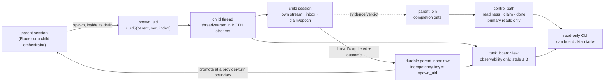

# Multiagent model — the multiagent-domain contract

- **Status**: implemented through P4 in code + tests (R15–R17: the delegation core, the P2 roster
  and spawn inputs, the P3 task board, and the P4 `depends_on`/`group` arguments, readiness gating
  and audit key groups behind `superagent.board.gating`). **No live-run evidence exists** — nothing
  here has run against a live provider or a multi-session production store; §10 says exactly what
  is unverified. Every normative sentence remains a requirement the tests pin, not a claim about
  observed behavior.
- **Date**: 2026-11-15
- **Owns**: multiagent-domain *semantics* — parent/child delegation, spawn identity, the named-agent
  roster, the board ruling (control path vs observability view), child authority and limits, outcome
  semantics, the config surface, degradation, boundaries, UNVERIFIED, and the change protocol for all
  of the above.
- **Does not own**: event envelope/kinds/payload bytes ([EVENT-MODEL](EVENT-MODEL.md) — no payload
  **key set** changes before P4, and P4's two additive key groups of §7.2 are a proposal that lands
  there when it lands; the byte classes are drawn once in §0.3), serving forms and the view
  declaration ([READ-MODEL](READ-MODEL.md)),
  wire/RPC/CLI/metrics shapes ([API-CONTRACT](API-CONTRACT.md)), worker membership and dispatch
  ([WORKER-MODEL](WORKER-MODEL.md)), memory scopes ([MEMORY-MODEL](MEMORY-MODEL.md)), assembly/HOW
  ([DESIGN](DESIGN.md) §4.1/§4.7/§4.8), rationale and rejected alternatives
  ([ADR-029](decisions/ADR-029-multiagent-delegation-and-board.md)), product scope and status
  (`docs/SPEC.md`).

## 0. Scope and authority split

| Question | Owner |
|---|---|
| What is a parent/child/roster entry/task/board? How does delegation behave, what may a board answer, what does each failure mean, what can be configured? | **this file** |
| Why one tier instead of two, why no board entity, what was rejected, how reversible each choice is | [ADR-029](decisions/ADR-029-multiagent-delegation-and-board.md) |
| What bytes does `thread/started` / `thread/completed` / `evidence/verdict` carry? Which kinds are context-bearing? | [EVENT-MODEL](EVENT-MODEL.md) §3/§4.2 (frozen through P3; §7.2 keys are P4) |
| The delegation wrapper's existing `mandate` object, issuance and revalidation | [ADR-012](decisions/ADR-012-delegation-mandate.md) |
| Thread lineage, the two-layer Router/Worker shape, subscription passthrough, 1:1 worker exclusivity, speculation cap | [DESIGN](DESIGN.md) §4.1 |
| Worker identity, membership, binding, queue dispatch, worker-tool execution | [WORKER-MODEL](WORKER-MODEL.md) |
| Memory scope identity (`agent.id`) and note folding | [MEMORY-MODEL](MEMORY-MODEL.md) §2/§3 |
| The `task_board` view's declaration (source, version key, staleness class, control-read ban) | [READ-MODEL](READ-MODEL.md) §6 |
| The exact CLI verb shape and JSON of `kian board` / `kian agents` / `kian tasks --all` | [API-CONTRACT](API-CONTRACT.md) (operator surfaces), [DESIGN](DESIGN.md) §4.7 |
| Is multiagent in product scope, and what is its status per phase? | `docs/SPEC.md` §5 |

This contract introduces **no** new event kind, **no** new table, **no** new HTTP route, **no** new
ops method, **no** new metrics key, and **no** core-crate change. It introduces one additive config
block (`superagent.multiagent`), one additive config list (`superagent.roster`), one additive
read-surface switch (`superagent.board`, off by default), three read-only CLI verbs
(`kian board`, `kian tasks --all`, `kian agents` — §4.2), and — only at phase P4, behind an explicit
owner gate — two additive payload key groups on events that already exist (§7.2). **No event-payload
key set changes before P4**; §0.3 draws that boundary once, because the rest of this file depends on
it.

### 0.1 Invariants (M1–M10)

- **M1 Sole truth.** No multiagent fact is stored outside the event stream, a durable inbox row, or
  disposable config/view (AGENTS.md constraint 1). The board is never a source of truth, in any phase.
- **M2 One mechanism.** The only way to obtain a child is a `Thread`. There is no same-session child,
  no in-process sub-drain and no second, lighter delegation tier.
- **M3 Narrowing only.** A child's authority only ever narrows, and the narrowing that is *enforced*
  is structural: the child's tool surface is the parent's surface intersected with the roster entry
  and the role denials. The Mandate's `scope` is advisory text, recorded and never a permission
  (§5.1). A wider authority is a new thread, never a mutation. No new event kind may add a child
  out of the parent's authority range.
- **M4 Derived spawn identity.** A spawn's identity is a pure function of committed state at the
  requesting `tool/call`'s own `seq`; a replay of that committed call never mints a second child.
- **M5 Exactly-once is not claimed.** A spawn may be `unknown` (a *spawn* outcome, §6.1.2 — never a
  child outcome); completion delivery is at-least-once, delivered by the **pair of completion writes**
  plus a reconciliation rule (§2.2), and deduplicated by idempotent admission per
  `(parent session, child session, spawn_uid)`.
- **M6 Outcome honesty.** `interrupted ≠ failed`; an empty response is never success and is never in
  any success set (§6.1, §4.4); no outcome is synthesized from absence; a spawn reported `unknown` is
  never auto-promoted; the evidence gate is owned by the parent's join, not by the child's prose.
- **M7 No control read on a view.** Every claim/promotion/done decision evaluates the primary
  (events + durable inbox rows + config), never `task_board` (READ-MODEL R8).
- **M8 Feature-off is byte-identical.** Absent config ⇒ no new payload key, no new prompt byte, no
  behavior change.
- **M9 No catalog in a prompt or schema.** Roster data reaches the model only through read-only tool
  results; the spawn argument is a plain string, never an enum (the ADR-021 supersession discipline).
- **M10 Single spawner.** Only a parent's own drain spawns its children. No global dispatcher, no
  cross-parent spawn, no volunteer pool in v1.

### 0.2 Where the load-bearing claims are anchored

`file:line` numbers are verified against tree `037aee5`. This round adds one additive subsection
(DESIGN §4.8, +13 lines), so **DESIGN line numbers after it shift**; the section reference is the
durable citation and the line range is the evidence of record.

| Claim in this file | Anchor |
|---|---|
| `Thread` = independent stream + version pin; `AgentDef` = versioned slots/tools/budgets | `design/DESIGN.md:128,135` |
| Workers report to the parent, never reply on the channel; subscription passthrough is many-to-many | `design/DESIGN.md:592-603` |
| 1:1 exclusivity is a stream-derived check placed before any side effect; lineage-before-admit bounds the crash window | `design/DESIGN.md:639-647` |
| A concurrency cap is a pure projection over the parent stream (the speculation precedent) | `design/DESIGN.md:687-702` |
| A missing `thread/completed` already means `outstanding`, not `failed` | `design/DESIGN.md:964-966` |
| The existing board-like surface is a disposable projection with a read-only CLI | `design/DESIGN.md:1057-1073` |
| Footprint Ladder order: config → plugin → seam → core primitive | `design/DESIGN.md` §6.3 (`:1500-1507`) |
| 24 kinds, additions-only; the three facts we lean on (`thread/started`, `thread/completed`, `evidence/verdict`) | `design/EVENT-MODEL.md:94,116-118` |
| Two-copy additive-key discipline (top-level audit vs wrapper `content`) | `design/EVENT-MODEL.md:168-186` |
| An additive key must leave legacy bytes byte-identical and must not change `derive_model_context` | `design/EVENT-MODEL.md:188-190,194-197` |
| Idempotent inbox admission per `(session, idempotency_key)`; derived event id precedent | `design/EVENT-MODEL.md:201-206` |
| Five reserved inbox-row envelopes (we add no sixth) | `design/EVENT-MODEL.md:213-224` |
| New-kind checklist (our candidates fail it); additive-key evolution rules | `design/EVENT-MODEL.md:256-278` |
| Read class split; R1 truth separation; R8 no control read on a view | `design/READ-MODEL.md:57-59,68-71,94-97` |
| Views are declared before built, disposable, and may not serve control reads | `design/READ-MODEL.md:195-209,270-278` |
| Member-vs-session naming is never conflated; one additive config section precedent; spawn validation order; no membership data in prompt/schema | `design/WORKER-MODEL.md:28-30,150-169` |
| Memory scope is `agent.id`; notes are scoped; no derived-session-id machinery for scopes | `design/MEMORY-MODEL.md:56,106,139-141` |
| Mandate is immutable, issued once at spawn, and the fence is tool surface + audit | `design/decisions/ADR-012-delegation-mandate.md:34-46,72-73` |
| Today's child thread id is minted randomly (the replay-duplicate risk this contract closes) | `crates/kian-superagent/src/worker.rs:721-727` |
| Constraints 1, 5, 6, 7, 11, 13; tool schemas are prompt-prefix content | `AGENTS.md:15-18,29-32,33-37,48-50,54-59,77-79` |



### 0.3 The byte boundary, drawn once

The first draft described this boundary three different ways (a two-copy `spawn_uid`, a report that
"carried the pairing facts", and a `contract` key placed at two different levels). Here it is drawn
once; every later section refers to this table instead of re-deciding.

| Byte class | What it is | Where it lives | Phase |
|---|---|---|---|
| **A. Audit keys** | new keys on an existing event payload, **outside** `content`, non-context | `thread/started` / `thread/completed` top level + the `multiagent` group (§7.2) | **P4 only** — one-way, owner gate |
| **B. Wrapper content** | the child's first message bytes (spawn side), model-visible | the delegation wrapper `content` (§2.1) | **P1** — new wrappers only |
| **C. Report content** | the parent's input row `content` (completion side), model-visible | the `{"synthetic":true,"content":X}` inbox row (§3.2) | **P1** — new reports only |
| **D. Tool schema / prompt prefix** | the `spawn_worker` arguments and the judge-prompt line | §7.3 | **P2** (and P4 separately, §7.3) — the constraint-3 process each time |

Three consequences, and they are the whole of the boundary:

1. **P1–P3 change no event-payload key set.** No key is added to, removed from or moved within an
   existing payload's top level before P4. That is the claim the `SPEC` row and §8.1/§8.2 make.
2. **P1 does add message bytes** — classes B and C — on *new* delegations only. This is not a payload
   change: it is the class the ADR-020 discipline already governs (`speculative`, `mandate`,
   `exec_worker` all ride wrapper content), and every legacy wrapper, persisted `step/request.body`
   and prompt stays byte-identical (EVENT-MODEL §4.2).
3. **Pairing needs no byte at all.** The parent already knows the child session id and thread id it
   minted, and `spawn_uid` is recomputable from the requesting `tool/call`'s own `seq` (§2.1); the
   child's report carries `thread_id` today (`thread_report_content`, `worker.rs:427-433`). So the
   join pairs by **derivation plus an existing byte**, and the `spawn_uid`/`task_id` copies in wrapper
   and report content are for the *child's* echo and the audit trail, not for pairing.

Rule for any future addition: a fact that a *model* must see is class B or C (and only on new
messages); a fact that only the audit needs is class A and waits for P4; a fact that changes a tool
schema or a prompt prefix is class D and is a constraint-3 change. There is no fifth class.

## 1. Terms and identity

- **Parent session** — the session whose drain calls `spawn_worker`. It may be the resident Router or
  any session that is allowed to delegate (a child orchestrator).
- **Child thread** — the `Thread { id, parent_session, pinned_version }` record of one delegation
  (DESIGN §2.1). Lineage and the delegation wrapper are durable there (EVENT-MODEL §3).
- **Child session** — the delegated session: its own event stream, its own inbox, its own claim and
  epoch, its own slot bindings, its own Mandate. A child is a *session*, never a nested loop.
- **Delegation wrapper** — the message payload that is simultaneously the child's first message and
  the durable record of the spawn (EVENT-MODEL §4.1/§4.2). New additive facts ride here only as new
  bytes on new wrappers.
- **`spawn_uid`** — the derived identity of one spawn *request*:
  `uuid5(parent_session, "kian:spawn:<seq>:<index>")`, where `seq` is the committed `seq` of the
  `tool/call` that requested the spawn and `index` is the 0-based position of the request inside that
  call (today a call carries exactly one spawn — `spawn_worker` mints one thread per `SpawnRequest`
  (`crates/kian-superagent/src/worker.rs:721-727`) — so the index is always `0`; it exists so that
  batching later does not change the derivation). Derived, never minted: the same discipline as the
  derived event id (EVENT-MODEL §4.4).
- **Task** — a unit of work with an identity that survives attempts, **parent-local in v1**:
  `task_id` is either the derived thread id of the single delegation that *is* the work, or
  `uuid5(parent_session, "kian:task:<task_key>")` when the spawn declares a `task_key` (§7.3), so
  several attempts *inside one parent* refer to the same unit. A `task_id` is never shared across
  parents in v1: a cross-parent (fan-in) namespace would need an atomic fenced claim on one
  authoritative stream, which is a deferred design (§4.3 item 1, §9), not a v1 fact. A task is
  **not** a row: it is the derived name of facts that live on `thread/started` / `thread/completed`
  (§4.3, §7.2).
- **Attempt** — `attempt ≥ 1`, the count of `thread/started` events in the parent's stream carrying
  the same `task_id` (plus one for the current spawn). A retry, and a successor spawned after
  `input_required`, are attempts, not new units of work.
- **Roster / roster entry** — a named agent in bundle config (`superagent.roster`) resolving to one
  `AgentDef` (DESIGN §2.1) plus a description and per-entry limits. A roster entry is an *identity*,
  not a machine (the execution-worker catalog in WORKER-MODEL is a different axis) and not a profile
  home (no separate state root: MEMORY-MODEL's `agent.id` scope is the native persistent identity).
- **Board view** — `task_board`, a disposable materialized view (READ-MODEL §6) over lineage,
  completion, evidence verdicts and pending-inbox state. Observability only.
- **Control path** — the pure functions that answer "may this be claimed?", "may this be promoted?",
  "is this done?" at decision time, from the primary.
- **Join** — the parent-side act that admits one child completion as a durable parent inbox row and
  applies the completion gate.
- **Task outcome** — the closed nine-value vocabulary of §6.1; the fact "what became of this unit of
  work". Some values ride `thread/completed`, two do not, and §6.2's **Carrier** column names which
  for each value. It refines `thread/completed.status` where a completion exists; it never redefines
  it.
- **Spawn outcome** — a *different* fact, about the **dispatch**, not the child: `dispatched` or
  `unknown` (§6.1.2). It has no event carrier; it is reported to the parent in the `spawn_worker`
  tool result (and, at P4, may be echoed in an audit key). A lost spawn and a failed child are never
  the same value (§6.1.2).
- **Join group** — the (parent session, `group`) pair that a fan-in policy evaluates over; `group` is
  an optional spawn argument carried only from P4 (§7.3). Absent, a child belongs to the parent's
  default group and `join: all` over `depends_on` is the only policy.
- **Leaf child / orchestrator child** — a leaf may not delegate (`max_children: 0`); an orchestrator
  child may, until `max_depth` is reached. Both are ordinary child sessions; the difference is policy.

## 2. Delegation is a child session — one tier

**Rule.** `spawn_worker` creates a child session via `Thread`. The *spawn call* happens inside the
parent's drain (that is the "session-internal" half); the child is a full session (that is the
durable half). There is **no** second, lighter mechanism: "light" is a policy (roster entry, budgets,
`max_children`, `max_depth`), never a different object.

Why the mechanism cannot be shared instead, stated once so it is not re-litigated per feature:

| Attempt | Why it is refused |
|---|---|
| Child messages in the parent's stream | every message-bearing kind is context-bearing (EVENT-MODEL §3, §4.3); isolation-by-filter would be a context-affecting payload change, refused by §4.2's rule and by constraint 3 |
| Two concurrent children in one session | one claim and one monotonic epoch per session (AGENTS.md constraint 5); two children would be two writers on one stream — `NoSplitBrainWrite` |
| A child with a different model inside the parent session | slots are session-immutable (AGENTS.md constraint 11); a different model is a different session, which is exactly what a child thread is |
| A non-durable "light" tier for hermes parity | a second semantics for the same object, and the one a caller picks by accident; the child thread already beats the reference gap (§2.2) |

### 2.1 Spawn identity and replay

The spawn is an **effect**, and the durable record of an effect can be absent while the effect
committed. The derivation fixes the *identity*; it cannot make the effect exactly-once:

- `spawn_uid` is computed from the parent stream at the requesting `tool/call`'s own `seq` (never from
  the live tail — AGENTS.md constraint 13), so a replay of that committed call recomputes the same
  value.
- The child thread id and its session id are minted **from** it
  (`uuid5(parent_session, "kian:thread:<spawn_uid>")` and the session id derived from that thread),
  so lineage is findable by derivation instead of by scanning, and a second spawn of the same
  committed call cannot produce a different child.
- `spawn_uid` appears in **two different byte classes**, not two copies of one decision (§0.3): the
  wrapper-`content` copy is **class B, P1** (model-visible, new wrappers only — the `speculative` /
  `mandate` / `exec_worker` precedent), and the top-level `thread/started` copy is **class A, P4**
  (audit, outside `content`, no context effect). The child echoes the identity in its report so the
  audit trail can be joined without re-deriving; **pairing itself needs neither copy** — the parent
  derives `spawn_uid` from its own committed `tool/call` seq and already holds the child thread id it
  minted (§0.3, consequence 3). Until P4 the audit copy is simply absent, and nothing in P1 depends
  on it.

Replay classification (normative):

| Observation for a committed `tool/call` | Classification | Action |
|---|---|---|
| `thread/started` with that derived thread id / `spawn_uid` exists | committed-and-recorded | serve the recorded outcome; never mint a second child |
| absent, and the resolution is provably unchanged (§2.1.1) | absent-and-permitted | mint (deterministically) and dispatch |
| absent, and the resolution cannot be proven unchanged | spawn outcome `unknown` (§6.1.2) | report `unknown` honestly in the tool result and the audit; never re-resolve onto a different definition, never a fabricated success, never a silent duplicate |
| present but unverifiable (record unavailable, child stream archived, disagreement between the recorded definitions) | spawn outcome `unknown` (§6.1.2) | the same honest report; a *new attempt* requires a new `tool/call` (a new `spawn_uid`) |

`spawn_uid` is a **replay-dedupe identity**, not a scope→session-id mapping: MEMORY-MODEL's refusal of
derived-session-id machinery for memory scopes stands (MEMORY-MODEL §5).

#### 2.1.1 The spawn's resolution is pinned, never re-resolved (constraint 13)

A derived `spawn_uid` fixes *which* spawn this is; it does not fix *what the spawn resolves to*. The
roster entry, the `AgentDef` and the assembled tool surface are assembled from live config, and the
dangerous path is exactly the replay above: a parent that crashed between its committed `tool/call` and
the `thread/started` write re-dispatches after a config reload, and the same roster name can resolve to
different slots, tools or budgets — a silent change in what the retry does, which is what constraint 13
forbids.

The rule, with no new event kind:

- **Resolution runs once per spawn request** and its *identity* is written into the spawn's own durable
  record: the wrapper content (class B) carries `assignee` (the roster entry id), `agent_def` and
  `agent_def_version`, and the Mandate's already-immutable `policy_version` stamps the config revision
  (DESIGN §4.7: `policy_version` rides the mandate verbatim). The expanded tool surface is **not**
  recorded — it is a pure function of `AgentDef@agent_def_version` ∩ role denials, so recording the
  definition identities is sufficient and keeps the model-visible bytes small.
- **Replay rehydrates, never re-consults live config.** When the spawn record exists, the join, the
  board and any takeover read `assignee` / `agent_def` / `agent_def_version` / `policy_version` from the
  committed wrapper. An unresolvable pinned definition (`AgentDef@version` gone, roster entry renamed,
  copies disagreeing) is an explicit `unknown`/refusal — never a re-resolution onto whatever the roster
  says today.
- **Only the absent row may re-resolve, and only when it is provably identical.** A committed
  `tool/call` whose `thread/started` is absent is re-dispatched only if the current resolution's
  `(policy_version, agent_def_version)` pair equals the pair stamped on the parent session's most
  recent committed delegation (the parent's own stream is the record). If the parent's stream carries no
  such stamp, or the pair differs, the replay is a **spawn outcome `unknown`** and a retry becomes a
  new attempt — a new `tool/call`, a new `spawn_uid` — never an invisible re-resolution.
- **Roster drift is reported, not applied**: a policy-version change affects new spawns only
  (§3.1), and the existing `superagent.policy.version` drift machinery (DESIGN §4.7) reports the
  mismatch on live sessions instead of rewriting them (constraint 3).

### 2.2 The durability tier, stated precisely

| Fact | Durable? | Carrier |
|---|---|---|
| Spawn lineage | yes | `thread/started`, in both streams |
| Child work in progress | yes (events); an in-flight provider turn is at-least-once | child stream + claim fence |
| Child completion | yes — as a **pair of writes** (§2.2.1), reconciled if only the first landed | `thread/completed` in the child's stream, then one durable parent inbox row |
| Parent re-entry after a crash | yes | the inbox row survives; the wake registry is rebuilt at startup (AGENTS.md constraint 6) |
| Spawn exactly-once | **no — an `unknown` window exists** | §2.1, §2.1.1 |
| The spawn acknowledgement the model sees | yes, as an ordinary `tool/result` in the parent's stream (constraint 2) | §3.2 |

#### 2.2.1 The completion is a pair of writes, and the pair is reconciled

The completion is **two writes in that order**: (1) `thread/completed` in the child's own stream, then
(2) the report admitted as one durable parent inbox row. The landed code does exactly this
(`crates/kian-superagent/src/worker.rs:1492-1510`) and it documents the hole this contract must close:
the pre-existing idempotent re-entry path scans the child stream, finds `thread/completed` and
**returns before admitting the report** (`worker.rs:1481-1486`), so a crash between the two writes
leaves the child's outcome durable, the parent permanently uninformed, and — worse — a parent reading
"no report" as "still working" for a child that has in fact finished.

Normative rule:

- **The report bytes are a pure function of the child's committed events at the end write's own `seq`**
  (constraint 13's pattern applied to the completion): `{thread_id, status, summary}` recomputed from
  the same events the completion used (`thread_report_content`, `worker.rs:427-433`). Re-derivation is
  therefore byte-stable, which is what makes re-admission a genuine no-op.
- **An existing `thread/completed` never short-circuits the report.** On any takeover, resume or
  re-entry into the completion step where `thread/completed` already exists but the drain cannot prove
  the admit committed, the child **re-issues the admit** with the same idempotency key and then
  settles. Admission is idempotent per `(session, idempotency_key)` (EVENT-MODEL §4.4), so the
  re-issue is a no-op when the row is already there. This is what makes "delivery at-least-once" true
  rather than asserted: the repair path is the child's own forward progress, and it needs no read of
  the parent's tables.
- **Reconciliation is observable, not silent**: the re-issue is an audit line, and the board view
  labels the parent's task state from the completion (never from "no row ⇒ outstanding") while the row
  is missing.
- The same rule covers a parent that is already terminal: the row is admitted, has no consumer, and is
  surfaced as orphaned (§3.2) — never dropped, never invented as consumed.

This is the structural advantage over the reference implementation's process-tied delegation (its
running child dies with the owner and leaves the result unknown). Kian claims the durable tier for
*lineage, execution and completion*, and refuses to claim it for *spawning*.

## 3. Cross-session composition

Composition reuses, in this order, everything that already exists:

| Layer | Primitive | Anchor |
|---|---|---|
| Lineage + version pin | `Thread { id, parent_session, pinned_version }` | DESIGN §2.1 |
| Authority | immutable Mandate, single issuance at spawn, revalidated before follow-up routing | [ADR-012](decisions/ADR-012-delegation-mandate.md) |
| Fan-out transport | subscription registry, many-to-many topic → live-subscriber set | DESIGN §4.1 |
| Agent identity | `AgentDef` + memory scope `agent.id` | DESIGN §2.1, MEMORY-MODEL §2 |
| Execution target | `endpoints[]` execution-worker catalog (a machine, never an identity) | WORKER-MODEL §5 |
| Join | durable parent inbox row | AGENTS.md constraint 6 |

What multiagent **adds**, all of it config or bundle code:

1. **Roster** (§3.1) — "which agent" becomes a durable, auditable choice instead of a prompt
   improvisation.
2. **Selection rule** — the roster reaches the model only through a read-only `list_agents` tool
   result. The `spawn_worker` argument `agent` stays a plain non-empty string validated at spawn; it
   is **never** an enum and never a prompt block. This is the ADR-021 supersession discipline applied
   unchanged: the catalog in the schema was withdrawn precisely because it made membership a
   prompt-prefix fact (WORKER-MODEL §5), and a roster would repeat that mistake.
3. **Join contract** (§3.2) — one durable parent inbox row per completion, carrying the contracted
   facts, promoted at the next provider-turn boundary.
4. **Board view** (§4) — a discovery/audit surface over the same facts.

### 3.1 Roster semantics

- A roster entry is `{id, description, agent, mandate_template, tools_allow, limits, output_schema?,
  harness?}`. `id` is the name the model uses; `agent` is an `AgentDef` reference and the memory
  scope; `description` is the one line used for selection; `mandate_template.scope` is the advisory
  scope text the entry carries (§5.1); `tools_allow` is intersected with the parent's surface (never
  a widening); `limits.max_children: 0` makes the entry a leaf; `output_schema` is the optional
  default expectation for this entry's children (§3.2.1).
- `harness` ([ADR-049](decisions/ADR-049-per-agent-harness-selection.md)) selects the entry's worker
  inner loop: `kian` (the built-in loop, the default) | `dsh` | `claude` | `codex`. A bridged entry
  owns its tools in the harness child: its agent declares no `tools:`, `tools_allow` is empty, and
  `spawn_worker` refuses an `exec_worker` binding for it (never an audit-fiction route). The kian-loop
  default is unchanged when the key is absent.
- **A spawn records the resolution, not the name** (§2.1.1): the entry id, the `AgentDef` id and its
  version, and the mandate's `policy_version` ride the wrapper content. That is what makes a replayed
  spawn reproducible after a roster edit, and why a roster change can affect new spawns only.
- **Absent/empty roster ⇒ the feature is off**: no `list_agents` tool, no roster validation, and
  `spawn_worker` behaves exactly as it does today (byte-identical wrappers).
- A roster entry is **not** a profile: no separate config root, no separate state root, no per-entry
  credentials in v1, no per-entry scheduler. Persistent per-agent state already exists as the
  `agent.id` memory scope; a second home would fork truth (constraint 1).
- A roster change affects **new spawns only**. Persisted wrappers, persisted prompts and live
  sessions are never rewritten (constraint 3); the `superagent.policy.version` drift machinery
  reports the mismatch instead (DESIGN §4.7).

### 3.2 Join contract

**Spawn side — the acknowledgement the model sees.** `spawn_worker`
returns before the child does anything else:

```json
{"spawn_uid": "…", "thread_id": "…", "task_id": "…", "spawn_outcome": "dispatched"}
```

- It is an ordinary `tool/result` (`{"role":"tool","content":{"call_id":…,"output":…,"is_error":false}}`,
  EVENT-MODEL §3) persisted in the parent's stream before the parent's next request — constraint 2
  applies to it like any other model-visible byte.
- `spawn_outcome` is `dispatched` or `unknown` (§6.1.2). A refusal is **not** an outcome: validation
  fails first and returns an honest tool error naming the bound (§5.4), creating no thread.
- The frozen instruction line (§7.3, P2) says what the model must do with it: *"record the
  `thread_id`; end your turn — the report arrives as an input before your next turn. Do not block on
  it, do not poll, and do not call `spawn_worker` again for the same work: a retry is a new attempt
  and needs a new call."* The parent therefore never waits mid-turn, which is the interaction parity
  the reference implementation's handle-and-continue behaviour provides.

**Completion side.**

- The child's completion is admitted to the parent as exactly the existing
  `{"synthetic": true, "content": X}` inbox-row envelope (EVENT-MODEL §4.5) — **no sixth reserved
  envelope**, because the task facts ride at spawn and in the report `content`, not in the envelope.
- **Idempotency key: `spawn:<spawn_uid>`**, which is 1:1 with today's `report_key(thread_id)`
  (`thread-report:<thread_id>`, `worker.rs:93-95`) under P1's derived ids — so a legacy row and a new
  row can never double-admit the same completion, and an upgrade needs no migration.
- **Pairing is derivation-only** (§0.3, consequence 3): the parent already holds the child thread id it
  minted and can recompute `spawn_uid` from the requesting `tool/call`'s `seq`; the report's existing
  `thread_id` (`thread_report_content`, `worker.rs:427-433`) is the existing byte that anchors it. The
  additional report-content keys — `spawn_uid`, `task_id`, `contract` when a gate ran — are **class C
  (P1) model-visible content on new reports**, carried so the child's echo is auditable and the parent
  can derive the outcome without a second read; they are **not** what makes pairing work.
- **The join target is `thread/started.parent`, read from the child's own stream — never ambient Router
  configuration.** Today the admit is hard-wired to `core.config.router`
  (`worker.rs:1509`), which is right only because today's only parent is the Router; for a nested
  orchestrator child it would send the report to the root. The restart path reads the same field, so
  the target is durable by construction.
- The join applies the **completion gate** (§6.3) before any promotion, and reads the child's
  committed stream (or the report's verdict reference), never the child's prose claim. **Output-schema
  validation is not re-run in the join** — the child's own bounded gate already validated and committed
  the verdict (§3.2.1); a second, divergent validation in the parent would create two answers to one
  question.
- Promotion happens at the parent's next provider-turn boundary (AGENTS.md constraint 6). A join
  never inserts an event into an in-flight provider turn.
- If the parent is already terminal, the report has no consumer: it is **not** lost (the child's own
  stream records completion, and the row is durable) and it is **not** fabricating a consumer. The
  board view surfaces the row as orphaned; no other mechanism is introduced.
- A report whose key already exists is a **duplicate delivery**, folded into one row — never an error,
  and never a second consumer.

#### 3.2.1 The expected result, where it is declared and who validates it

A completion gate needs a persisted *expectation*, not just a result. Otherwise nothing can be
validated after a restart and `invalid_output` is underivable.

- **Declared**: an optional `output_schema` on the `spawn_worker` call (**P2**, class D — it changes the
  tool schema, so it lands under the §7.3 constraint-3 process) with an optional per-roster-entry
  default (also P2). `invalid_output` is therefore reachable from P2 onward and is never derived by a
  P1 join — there is no expectation to violate yet, and the contract says so instead of implying that a
  P1 child can miss a schema nobody declared. Bounded size; a value that is not a valid JSON Schema is
  refused before any side effect (§5.4).
- **Persisted with the spawn**: the schema bytes the child is told about ride the wrapper content
  (class B, P1), so a restart reconstructs the expectation from the child's own stream — constraint 2
  ("if a model-visible input exists, a session event for it exists") is satisfied by the wrapper that
  *is* that input.
- **Validated by the child, once, at its own end write**: a pure function over the final answer bytes
  and the pinned schema, no model call — the same shape as the landed evidence gate
  (`evaluate_evidence_gate`, bounded by `gate.max_retries` with the attempt counter stream-derived, so
  the budget survives episodes and takeover: `worker.rs:1446-1468`).
- **One-shot correction, in the same child**: a miss admits exactly one correction input to that child
  (it is still live — no end write has happened) and re-enters the loop; a second miss commits
  `evidence/verdict{gate:"output_schema", passed:false, checks:[…], attempt}` and the child ends
  `failed` with the **raw answer preserved** in the report content. A correction never becomes attempt
  N+1 of the task: the attempt counter is the stream-derived retry budget, and only an exhausted
  budget ends the child.
- **Derived**: the join reads that committed verdict and derives `invalid_output` (§6.2) — one
  validation, one carrier, two readers.

## 4. The board ruling (normative)

This is the answer to the round's second question: *does cross-session multiagent need a durable
task-board entity?* The ruling is a constraint consequence, not a preference, and the draft states it
as MUST/MUST NOT.

### 4.1 No board entity, ever

- A `tasks` table, a board row, a mutable status column or any durable object that can disagree with
  the event log **MUST NOT** be introduced. That would be a second source of truth: forbidden by
  AGENTS.md constraint 1 and READ-MODEL R1, in every phase, not just this one.
- No second store, no workflow server, no separate scheduler database.
- The reference implementation's row-per-task shape **MUST NOT** be adopted as an internal model. A
  workflow engine's records describe *what a process did*; kian's streams already are that record.
- A **job run** is not a board (JOB-MODEL §1): the plan is configuration, the run is an ordinary
  session, and the status view is a disposable projection — the three things this section forbids (a
  tasks table, a mutable status column, a second store) are still absent. The difference is that a
  board is a place work waits, while a run is the record of work that was dispatched.

### 4.2 "Board" means two surfaces, split by read class

| Surface | What it is | Authority | Declared in |
|---|---|---|---|
| **A. Board view** (`task_board`) | disposable materialized view over `thread/started`, `thread/completed`, `evidence/verdict` (cross-session, via parent lineage), pending-inbox state and the session directory | **observability only**; may be stale within the declared bound `B`; **MUST NOT** serve any control read | READ-MODEL §6 (one additive table row, added when P3 lands) |
| **B. Control path** | every decision — may this be claimed? may it be promoted? is it done? — computed at decision time from events + durable inbox rows + config | authoritative; primary reads only (READ-MODEL R8) | `kian-superagent` bundle code |

- The operator surface is a **read-only CLI** (`kian board`, `kian tasks --all`, `kian agents`), the
  `kian tickets` / `kian workers` precedent. There is no web UI: it stays a non-goal (DESIGN §0.2).
- The board view **MUST NOT** write, authorize, or be cited as justification for a spawn, a claim, a
  promotion or an end write. A stale view can mislead a human; it may never mislead the runtime.

### 4.3 What a board over today's bytes can and cannot show

A board built only on existing bytes renders **threads, not a task graph** — it is `ticket_stage`
generalized. Three load-bearing facts are named as the gap list, and their status is **not uniform**:
two are missing today and one becomes load-bearing only if the deferred shared work pool ever exists.

1. **Multi-parent dependency edges.** `thread/started` carries one `parent`; fan-in ("start when A, B
   and C are done") has no durable edge. The parent session is a node, not a join. *(Deferred with the
   rest of fan-in: v1 tasks are parent-local, §1, §9.)*
2. **Arbitration between two spawners for one unit** — *conditional, and only if unassigned work ever
   exists.* Under M10 no agent ever selects work from a shared pool and §4.4 answers "who owns this
   unit" from `thread/started` plus the child's projected state, so v1 needs no fourth fact here. The
   real gap in v1's shape: two *different parents* declaring the same `task_key`
   would derive different ids and could each spawn for what a human calls one unit — which is why v1
   refuses a cross-parent task namespace outright (§1) instead of reconciling it after the fact.
3. **Completion verification reference.** `thread/completed` carries `status` and `summary`; whether the
   work passed a gate is a separate fact (`evidence/verdict`). Linking it per task is what prevents
   premature-termination and unverified-completion failures.

Everything else a board shows is inferable or already durable: task existence ≈ thread existence;
lifecycle ≈ `session/ended` / `thread/completed` reason; "waiting on a person" ≈ the structured
report `state` (`waiting`, the landed additive key on stated reports — DESIGN §4.7); audit ≈ the
append-only streams. The board view **MUST** label the absent fact (item 3) as absent until §7.2 lands;
it **MUST NOT** infer any of them from prose.

### 4.4 Readiness, claim, promotion — the control path (**phase P4**, §8.1)

Everything in this subsection is gated by `superagent.board.gating` (§7.1): in P1–P3 a parent may spawn,
but it does not evaluate `depends_on` or a join group, because no input carries them (§7.3).

- **Readiness is a pure function of the primary**: a task is ready iff every `task_id` in its
  `depends_on` has a completion whose derived task outcome is in the **success set**, and no claim on
  it is live. The success set is exactly `{completed_verified}` plus `{completed_unverified}` when
  policy accepts unverified work — **`empty_output` is never a member, at any policy setting** (§6.1.1).
  Pure, restart-safe, view-free.
- **No arbitration is needed in v1, and that is a consequence of the task namespace, not an omission.**
  `task_id` is parent-local (§1) and the only spawner of a parent's children is that parent's own drain,
  so two spawners cannot race one `task_id`: the fence is the parent's monotonic claim epoch plus the
  parent's single-writer stream. A cross-parent namespace would need an atomic claim in one authoritative
  stream beyond the parents — deferred with fan-in, and refused here rather than half-built (§9).
- **A claim is the spawn itself.** The child's `thread/started` is the claim's audit record; the fence
  is the child session's drain epoch. No claim table, no lease row, no lock service.
- **The only spawner of a parent's children is that parent's drain** — the single-owner posture already
  used for 1:1 worker exclusivity (DESIGN §4.1) and the single-Router boundary. There is no global
  dispatcher, no promotion daemon and no cross-parent spawn.
- The board view (surface A) recomputes §4.3's facts; it never authorizes anything.

### 4.5 The rung on the Footprint Ladder

DESIGN §6.3's ladder is respected exactly, in this order:

| Step | Rung | Artefact |
|---|---|---|
| roster + limits + join policy | 1 — configuration | `superagent.multiagent:`, `superagent.roster:` (absent = off) |
| scheduler/join/CLI code | 2 — bundle/plugin | `kian-superagent` + read-only CLI verbs; no seam, no core crate (AGENTS.md constraint 10) |
| `task_board` view | additive serving contract | one READ-MODEL §6 row; disposable |
| task facts (§7.2) | additive event payload, P4 only | EVENT-MODEL §3/§4.2, added under EVENT-MODEL §6.3 |

**No new seam. No core primitive. No new event kind. No second store. No web UI. No global
dispatcher.** The largest single lift is the P4 key group, and it is deliberately last precisely
because the view is useful without it.

## 5. Authority, tools and limits

### 5.1 Narrowing only

Two different things narrow, and they must not be confused — the first is enforced, the second is
advisory:

- **Enforced (structural, machine-checkable): child tool surface = parent's surface ∩ roster
  `tools_allow` ∩ role denials.** The intersection is computed at assembly, so the enforcement boundary
  is the tool surface plus the audit — exactly where ADR-012 put it
  ([ADR-012](decisions/ADR-012-delegation-mandate.md):72-73 calls it "kian's fence"). Prompt text may
  restate authority; it never widens it.
- **Advisory (recorded, not a permission): the Mandate's `scope`.** It is inherited from the roster
  entry's `mandate_template.scope` and recorded in the immutable wrapper. ADR-012 defines `scope` as
  `"<natural-language bounds>"` (ADR-012:24-27) and no subset relation is defined over natural
  language, so this contract does **not** claim the text is "narrower by construction" — it claims only
  that the text is inherited, recorded and audited, while the *boundary* is the tool surface above.
- The child's Mandate is otherwise derived from the parent's: `granted_by` ← the spawning session,
  `source` ← the triggering provenance, `policy_version` ← the config revision (§2.1.1). A wider
  authority is a **new thread**, never a mutation (ADR-012).
- The child inherits nothing else implicitly: no parent history, no parent context, no parent tools
  beyond the intersection. The wrapper *is* the child's first message (EVENT-MODEL §3, §4.1).

### 5.2 Role-based denials

| Capability | Parent | Child — leaf | Child — orchestrator | Enforced by |
|---|---|---|---|---|
| `spawn_worker` | allowed, subject to the caps | **denied** | allowed until `max_depth` | tool-surface assembly + depth projection |
| channel reply / `deliver_structured` | allowed (output policy) | **denied** | denied | DESIGN §4.1 (workers never reply; the parent aggregates) |
| control plane (interrupt another session or chain) | allowed | **denied** (own epoch only) | denied | tool surface; the control plane writes only inbox rows (constraint 9) |
| memory notes | allowed (the `agent.id` scope's own memory session) | **denied in-drain in v1** | denied in-drain in v1 | structural: `memory/note` is emitted **only** by a memory-session drain (MEMORY-MODEL §3.1, D8 — one writer), so a child's notes never land in the child's own stream; a child's durable memory arrives through the `agent.id` scope's memory session and creation-time injection, which is the landed contract |
| human interaction | via the channel | no `clarify` analog: the child reports `input_required` upward, its drain ends, and its **session stays live and resumable** (§6.2) | same | the structured report `state` + the child's own end/liveness state |

The reference implementation needs a fixed denylist because its children share the parent's process
and memory. Kian does not: isolation is structural, so the denials that matter are the ones that
would cross a *boundary* (spawn, channel reply, control plane, memory-session write).

### 5.3 Bounds, all projection-derived

| Bound | Meaning | Default | On refusal |
|---|---|---|---|
| `max_children` | per parent session: children that still **hold** the parent, i.e. `thread/started` on the parent stream whose child has not been released. Release is the landed liveness projection (`ThreadLiveness`): `thread/completed{completed}` or `session/ended{completed,cancelled}` release; `failed`/`interrupted` stay live-resumable and keep holding; a lineage-only reservation that never started releases after `queue_timeout_ms` (DESIGN §4.1, `worker.rs:1051-1068`) | `4` | honest tool error naming the cap and the current count; **never truncation, never a silent drop** |
| `max_depth` | spawn-chain hops from the root session | `1` (a child is a leaf; an orchestrator child needs an explicit raise) | honest tool error naming the bound |
| `child_timeout_ms` | **inactivity** bound on a child (not total runtime) | `900000` | `control/interrupt{requested_by:"child_timeout"}`, then honest `stalled` (§6) |
| `join` | fan-in policy: `all`, `any`, `quorum:<n>` — **P4 only** | `all` | partial results are admitted and judged individually; no implicit any-of success |
| `output_schema` | per-child expectation (§3.2.1), on the call or the roster entry | absent ⇒ no schema gate | a malformed schema is a refusal before any side effect |

`max_children` is derived the same way the speculation cap is (DESIGN §4.1: a pure projection over
the parent's stream), so the bound survives restarts. No hard ceiling above the configured value
exists: config is the policy, and the refusal path is what keeps it honest.

These bound a Router's fan-out; a job run's `deadline_ms`, `max_parallel` and per-step `timeout_ms`
are separate knobs with separate semantics (JOB-MODEL §7–8).

### 5.4 Validation order (every refusal precedes every side effect)

The existing spawn order (WORKER-MODEL §5) with the multiagent checks inserted:

`argument shape (incl. task_key / output_schema / group / depends_on shapes → §7.3) → feature off →
roster resolution (and its pin, §2.1.1) → depth → max_children → execution-worker checks
(unknown id → 1:1 busy → offline-known allowed) → follow-up ownership → speculation cap → mandate
issuance → mint identity / lineage / admit`

A refusal creates no thread, no row, no provider call and no `thread/started`. Two order facts matter:
the **roster resolution precedes `max_children`** so an unknown agent id never discloses the cap state,
and **`output_schema` shape validation precedes resolution** because a malformed schema must not consume
a resolution attempt. `depends_on` referents and cycles are checked at P4 readiness time (§4.4), where
the task graph exists — not at spawn, where a dependency may legitimately not exist yet.

## 6. Failure and outcome semantics

### 6.1 Two facts, never one value

The draft's single vocabulary mixed two different facts — what happened to the *dispatch* and what the
*child* returned — so `unknown` was defined as a `thread/completed.outcome` even though a lost spawn
has no child and no completion to carry it. They are separated here.

#### 6.1.1 The task outcome (nine values, closed; carrier per value)

`completed_verified | completed_unverified | invalid_output | empty_output | budget_exhausted |
stalled | interrupted | failed | input_required`

- **Derived, never typed**: each value is a pure function of the child's own committed events at the
  decision's own `seq` (constraint 13's pattern). The parent's join derives it; the board recomputes
  it; neither reads the other.
- **Three of the nine have no `thread/completed` carrier**, and that is a fact about the existing event
  set, not a gap to paper over: `stalled` and `interrupted` end a session through
  `control/interrupt` + `session/ended{interrupted}` with **no** `thread/completed` (the server owns
  the interrupt end write and the worker deliberately writes no status it cannot observe —
  `worker.rs:61-66`), and `input_required` is a live child that has not ended at all. §6.2's **Carrier**
  column names the carrier for every value; §7.2's P4 `outcome` key therefore persists the six
  completion-borne values (all but `stalled`, `interrupted` and `input_required`), and the other three
  are derived on demand (the board has them in P3; the key adds nothing there).
- **`empty_output` is in the vocabulary on purpose.** Constraint 7 is categorical: an empty model
  response is a soft failure. It is distinct from `stalled` (a *content* fact vs a *timing* fact), and
  the vocabulary has not shipped anywhere, so adding it now costs no compatibility. It is **excluded
  from the success set at every policy setting** (§4.4), which is what makes M6 true rather than
  aspirational.
- In P1–P3 the join derives the value from events **without persisting it**; the additive audit key
  that records it is P4 (§7.2), so the vocabulary ships with the join and the durable copy waits for
  its gate. **Reachability is phased and stated**: `invalid_output` needs the P2 `output_schema` input
  (§3.2.1) and is not derived before P2; `stalled` needs the P1 inactivity bound; `input_required`
  needs only the landed report `state`. A value that cannot yet be derived is never emitted as if it
  had been.

#### 6.1.2 The spawn outcome (two values, no event carrier)

`dispatched | unknown` — reported in the spawn's `tool/result` (§3.2) and, at P4, echoable as an audit
key. **A refusal is not an outcome**: validation precedes every side effect (§5.4) and returns an
honest tool error. `unknown` is the honest classification of the replay rows in §2.1/§2.1.1 — "an effect
may have committed and no record exists". It is never promoted, never counted as a child outcome, and it
never appears on `thread/completed`. A lost spawn and a failed child are different facts with different
remedies: the first needs a new attempt, the second needs a decision about the work.

### 6.2 Condition → carrier → outcome → parent behavior

| Condition | Child appends | Carrier (→ derived outcome) | Parent behavior |
|---|---|---|---|
| Normal end, gate passed | `thread/completed{status:completed}` + `evidence/verdict{passed:true}` | `thread/completed` + verdict (→ `completed_verified`) | admit as success; may promote dependents |
| Normal end, no gate, non-empty answer | `thread/completed{status:completed}`, report `content` with the answer | `thread/completed` (→ `completed_unverified`) | admit, **labelled**; promotes only if policy accepts unverified work |
| **Empty final answer despite tool work** | `turn/end{outcome:soft_failure}`, then `thread/completed{status:failed}`; the report says the answer was empty | `thread/completed` + `turn/end` (→ **`empty_output`**) | **non-success, never promotes, at any policy setting**; audited as a soft failure; no dependents released |
| Contract miss (schema invalid) | one correction input admitted; still invalid ⇒ `evidence/verdict{gate:"output_schema",passed:false}`, `thread/completed{status:failed}`, raw text preserved in the report | `thread/completed` + verdict (→ `invalid_output`) | not success; the parent decides retry-as-new-attempt or accept; the work is neither discarded nor silently rerun |
| Budget/turn/token exhausted | `session/ended{reason:failed}` with the class (+ `thread/completed{status:failed}` if the loop reached its completion step) | `session/ended{failed}` (→ `budget_exhausted`) | honest non-success; no best-guess promotion |
| Inactivity timeout | `control/interrupt{requested_by:"child_timeout", reason:…}` → `session/ended{interrupted}`; **no `thread/completed`** | `control/interrupt` + `session/ended` (→ `stalled`) | interrupted ≠ failed; the child stays resumable; the task reads `stalled`, never "outstanding" forever |
| Explicit stop by a person or the parent | `control/interrupt{requested_by:"<session-uuid>"}` → `session/ended{interrupted}`; **no `thread/completed`** | `control/interrupt` + `session/ended` (→ `interrupted`) | partial results preserved; never mapped to `completed` |
| Process crash, session recoverable | nothing yet (no end write) | **no event** (→ no outcome; the task reads `outstanding`) | session `recoverable`; a new claim resumes; the completion pair is reconciled (§2.2.1); if recovery is refused the spawn-side honesty rule applies, not an invented outcome |
| **Child needs a decision it cannot get** | the question as its last message + a report row admitted to the parent with `state:"waiting"`; **no `thread/completed`, no `session/ended`** | the report's structured `state` + the child's liveness (→ `input_required`) | §6.2.1 — the parent answers, escalates or abandons; the child is **live and resumable**, never a terminal child to be "answered" |
| Duplicate completion delivery | idempotent admission | the idempotency key (→ unchanged) | one parent inbox row per `(parent, child, spawn_uid)`; the new key is 1:1 with today's `report_key(thread_id)`, so no double-admit on upgrade |

#### 6.2.1 The `input_required` lifecycle (a live child, never a terminal one)

The draft ended the child `completed` and then had the parent "answer" it — which has no recipient,
because `session/ended{completed}` is terminal (EVENT-MODEL:123). The correct lifecycle uses what the
landed vocabulary already gives us:

1. **The child's drain ends without an end write.** It admits its question to the parent as a report row
   (idempotency key `ask:<spawn_uid>:<round>`; report `state:"waiting"`, the landed additive key on
   stated reports — `REPORT_STATE_KEY`,
   `worker.rs:487-504`; "waiting on a person" is a structured field, never inferred from prose) and
   returns. No `thread/completed`; no `session/ended`. The session is idle and **resumable** — the same
   state a session sits in between drains — and it keeps holding its `max_children` slot (§5.3), which
   is honest: the work is not finished.
2. **The parent answers by admitting an ordinary input** to that child session, idempotency key
   `answer:<spawn_uid>:<round>`, `round` derived from the child's own stream (so a replayed answer is a
   no-op). The child wakes under its own epoch and continues with the same context — no re-run of
   prior turns, no lost prefix. Nothing writes into a terminal session, because none is terminal.
3. **The parent may instead escalate** (its own channel, if it has one) or **abandon** (`control/interrupt`
   to the child + the task marked abandoned in the audit). Both are recorded; neither invents a result.
4. **If the child cannot be resumed** — archived, cancelled, or the answer cannot be delivered — the
   parent spawns **attempt N+1 of the same `task_id`** (a new `tool/call`, hence a new `spawn_uid`, and
   `attempt` counts the `thread/started` events carrying that `task_id`). That is what the `attempt`
   counter exists for.
5. `input_required` is therefore a **task outcome without a completion**; it is never a
   `thread/completed.outcome` value, and a child that reported it is never described as finished.

### 6.3 Rules

- **A waiting worker writes no completion.** When a worker ends `awaiting_input`
  (CONFIRMATION-MODEL phase 2), the worker driver suppresses `thread/completed` and the parent
  report: the ticket stays outstanding and the worker stays live, so follow-ups route to the same
  session and the answer resumes it. The join sees "outstanding", never "failed".
- **The completion gate lives in the parent's join**, evaluated against the primary before promotion —
  never in the board view and never in the child's prose. Schema validation runs once, in the child
  (§3.2.1); the join reads the committed verdict rather than re-deciding it.
- **`unknown` is a *spawn* outcome** (§6.1.2), not a euphemism for `failed` and not auto-promoted: it is
  the honest classification when a dispatch may have effected something and no record exists. The child
  side has no `unknown` value at all — a child that produced no evidence and no completion is
  *outstanding* (row 8 above), which is a different statement.
- **No outcome is synthesized from absence.** A missing `thread/completed` means *outstanding*, not
  *failed* (the `recall_thread` read already models this: DESIGN §4.5) — except where a named carrier
  says otherwise (`stalled`/`interrupted` from `control/interrupt`, `input_required` from the report
  `state`), which is exactly why §6.2 names the carrier per row.
- **An empty answer is never success** and never enters a success set (constraint 7, §6.1.1), and a stop
  passes the evidence gate or is reported as unverified.
- **A stranded child is visible**: a child whose parent went terminal is orphaned on the board view,
  never silently dropped and never invented as consumed.

## 7. Config surface

### 7.1 The block (bundle config, absent by default)

```yaml
superagent:
  multiagent:                  # absent ⇒ the whole capability is off (byte-identical)
    max_children: 4            # per parent session, projection-derived
    max_depth: 1               # spawn-chain hops from the root session
    child_timeout_ms: 900000   # inactivity bound, not total runtime
    join: all                  # all | any | quorum:<n>   (P4)
  board:                       # the P3 read surface; absent ⇒ off, fail-closed
    enabled: false             # task_board view + `kian board` / `kian tasks --all`
    gating: false              # P4: readiness/claim evaluation over depends_on + join groups
  roster: []                   # named agents (absent/empty ⇒ off; legacy spawn unchanged)
  # - id: researcher
  #   description: "<one line used for selection>"
  #   agent: <agent.id>        # AgentDef reference; also the memory scope
  #   mandate_template: {scope: "<advisory scope text>", strength: explicit|inferred}
  #   tools_allow: [...]       # intersected with the parent's surface — never a widening
  #   limits: {max_children: 0}   # 0 ⇒ leaf
  #   output_schema: {...}     # optional default expectation for this entry (§3.2.1)
```

Both `board` keys are declared here because this file owns the config surface and two phases are gated
by them (§8.1): absent or `false` means off, an unparseable value refuses to boot, and neither key can
enable anything the `multiagent` block has not already enabled (`board.gating: true` with
`multiagent` absent is a refusal, not a silent no-op). `read_model.views.enabled` remains the
view-machinery switch READ-MODEL owns.

Unknown or malformed values refuse to boot (the fail-closed config discipline used by the permission
table and `workers.token_env`); an absent block is not an error and changes nothing.

> **`join` narrowing (R17, P4 landing note).** Config accepts and validates `all` | `any` |
> `quorum:<n>` (n ≥ 1), but **v1 evaluates only `all`** — the one shape with an evaluation site
> (one spawn, one parent). `any` and `quorum:<n>` **refuse to boot** naming the missing evaluation
> site and the §9 deferral; they are *not* accepted-and-ignored, because a silent accept would
> imply any-of success (§5.3's `join` row, §9:882-888). This narrows the accepted *bootable* value
> set, is reversible, and touches no bytes.

### 7.2 The P4 additive payload keys (landed R17; owner gate; one-way)

Two key groups on events that already exist, both **class A** (§0.3): outside `content`, non-context,
omitted when unset, leaving legacy bytes byte-identical (EVENT-MODEL §4.2, §6.3):

| Event | Additive keys (audit, outside `content`) | Context |
|---|---|---|
| `thread/started` | `"spawn_uid"`, `"multiagent": {task_id, depends_on[], assignee, attempt, group?}` | non-context (audit); the model-visible half is the wrapper `content` copy (class B, P1) |
| `thread/completed` | `"spawn_uid"`, `"multiagent": {task_id, outcome, evidence_ref?, contract?}` | non-context (audit) |

- **Key naming.** `thread/started`'s payload already carries `"task"` — the delegation wrapper message
  payload itself (EVENT-MODEL §3). The task-fact group therefore uses the namespaced key `"multiagent"`,
  mirroring the config block, so a reader can never confuse the wrapper with the task facts.
  (`"outcome"` likewise rides inside that group.)
- **`contract` has exactly one shape in two classes, and it is never top-level**: the P1 copy is a
  **report-content** key (class C, §3.2: `{"passed": <bool>, "errors": [...]}`), the P4 copy is the
  audit twin inside `multiagent` on `thread/completed`. The earlier draft placed it top-level in one
  section and nested in another; this is the single placement.
- **Two classes, one rule.** A fact a child must echo or act on is written to wrapper/report **content**
  (P1); a fact only the audit needs is written **outside** content (P4). A fact that is parent-side
  bookkeeping (`depends_on`, `group`) rides outside `content` only. No fact may appear in `content`
  alone without its audit twin being permitted later, and no fact may appear at a payload's top level
  except `spawn_uid` and the `multiagent` group.
- **Disagreement is malformed history**, refused rather than reconciled (the ADR-020 two-copy rule).
- `evidence_ref` is `{session, seq}` — a durable pointer to the verdict, not a copy of it.
- **`outcome` persists only what a completion can carry** (§6.1.1, six of the nine values); `spawn
  outcome` is **not** an event key in any phase — it is a tool-result fact (§3.2), because a dispatch
  that never became a child has no event to ride.
- **No new kind is justified**: lineage, completion, verification and authority all already have
  carriers. EVENT-MODEL §6.2's checklist fails for every candidate kind, so no candidate is made.

### 7.3 The spawn inputs, and the prompt/schema bytes per phase

**The new spawn arguments — these five and no others.** This is the input surface the task graph is a
projection of; without it `depends_on`, a task key and a join group have nowhere to come from:

| Argument | Type / bound | Phase | Carried to the child in | What it enables |
|---|---|---|---|---|
| `agent` | non-empty string, never an enum | **P2** | wrapper `content` | roster selection; the `agent.id` memory scope |
| `task_key` | non-empty string, parent-scoped | **P2** | wrapper `content` | a `task_id` that survives attempts (§1) |
| `output_schema` | JSON Schema object, size-bounded | **P2** | wrapper `content` | the schema gate ⇒ `invalid_output` (§3.2.1) |
| `depends_on` | array of `task_key` strings | **P4** | audit group only (§7.2) | readiness (§4.4) |
| `group` | non-empty string | **P4** | audit group only (§7.2) | join groups (§1, §5.3) |

Each is refused when malformed (empty string, wrong type, oversized schema, a `depends_on` referent that
does not exist or a cycle, at P4) — before any side effect, in the order of §5.4. None is an enum and
none carries catalog content: the roster reaches the model only through `list_agents` results (M9).

Byte classes per phase (§0.3):

- **P1 — no model-visible prefix byte at all.** No argument is added to the tool schema in P1; the
  delegation contract is enforced at assembly and validation, and the only new bytes are inside *new*
  delegation wrappers and *new* reports (classes B and C).
- **P2 — one constraint-3 change, taken as one change**: the three arguments above (`agent`,
  `task_key`, `output_schema`) plus one frozen instruction line in the judge prompt (call `list_agents`,
  never invent an id; record the `thread_id`; end your turn — §3.2). That is a constraint-3-relevant
  change and is handled as one: the tool-schema golden is updated in the same change, the change is
  observable (a new `superagent.policy.version` label plus the drift report), **new sessions** render
  the new schema, and **live sessions keep their persisted prompts** — nothing rewrites prior context
  (AGENTS.md constraint 3 and the tool-schema note at `AGENTS.md:77-79`).
- **P3 — no model-visible byte at all**; the board is an operator surface.
- **P4 — a second, separately gated class-D change**: `depends_on` and `group`, with their own golden
  update and policy-version label, because gating is gated (`superagent.board.gating`, §7.1).
- The roster's *contents* never enter the schema or the prompt: `agent` is a string, never an enum
  (the ADR-021 supersession), so an equivalent roster edit changes no prefix byte.

## 8. Phases, version and degradation

### 8.1 Phases and rollback

| Phase | Content | Config gate | Rollback | Contract files touched |
|---|---|---|---|---|
| **P1 — delegation core** | child-thread delegation contract: `spawn_uid` derivation, the wrapper's task-identity bytes, mandate narrowing, `max_children`/`max_depth`/timeout, the outcome vocabulary **derived in the join** (the persisted key is P4), join = durable parent inbox row + the §2.2.1 reconciliation, the spawn ack, `thread/started.parent` as the join target | `superagent.multiagent` absent ⇒ off | drop the block: **multiagent semantics are off** (no roster, no `list_agents`, no `spawn_uid` derivation, no multiagent caps, no join pairing, no outcome vocabulary) while plain `spawn_worker` keeps working **byte-identically** — the capability that exists today is not removed (§8.3 row 1) | this file, ADR-029 |
| **P2 — roster + spawn inputs** | `superagent.roster`, `list_agents`, the three new spawn arguments (`agent`, `task_key`, `output_schema`), the selection/instruction prompt line, the schema gate, `kian agents` | `roster` absent/empty ⇒ off | drop the block; the tool schema returns to its P1 form for new sessions (live sessions keep theirs) | this file + DESIGN §4.8 |
| **P3 — board view v0** | `task_board` materialized view over existing bytes + read-only `kian board` / `kian tasks --all` | `superagent.board.enabled` (default false) + `read_model.views.enabled` | drop the view (views are disposable by contract) | READ-MODEL §6 (one additive row) |
| **P4 — task facts / gating** | the §7.2 key groups, `depends_on` + `group` arguments, readiness gating | `superagent.board.gating` (default false) | disable gating; **emitted keys are not removable** (additions-only) — hence an owner gate | EVENT-MODEL §3/§4.2 + an ADR addendum |
| **Deferred (named, not designed)** | shared *unassigned* work pool with volunteer claims; cross-parent fan-in plus the task namespace and atomic claim it needs; cross-kian federation | — | — | future ADR |

**What each phase changes, in the §0.3 byte classes** — this is the claim to check a phase against:

| Phase | Audit keys (A) | Wrapper/report content (B, C) | Tool schema / prompt (D) | Model-visible prefix |
|---|---|---|---|---|
| P1 | none | yes (new delegations only) | **none** | unchanged |
| P2 | none | yes | three arguments + one prompt line, as one constraint-3 change | new sessions only |
| P3 | none | none | none | unchanged |
| P4 | **the two key groups** | yes | two arguments, separately gated | new sessions only |

So "P1–P3 need no payload change" is true in the only sense that can be true: **no event-payload key
set changes before P4**, while P1 and P2 do add message content (and P2 a schema). Anything stronger
would be false — the join contract *is* new content bytes on new delegations, and this table says so.

P1 alone delivers session-internal multiagent and beats the reference durability gap; P2 delivers
cross-session composition with no new durable object; P3 delivers the visible board with zero contract
risk; P4 is the only step that adds durable facts, and it is separable precisely because §4 split the
protocol from the view. Feature-off is byte-identical at every phase.

### 8.2 Version and upgrade

- This contract has **no wire version**: no frame, no route, no event kind changes in P1–P4. What can
  change, per phase (§0.3, §8.1's byte table): **P1** — new delegation-wrapper and report content only
  (new children, new reports); **P2** — the `spawn_worker` tool schema (`agent`, `task_key`,
  `output_schema`) plus one frozen prompt line, for new sessions, treated as one observable constraint-3
  change (§7.3); **P3** — nothing model-visible; **P4** — the two additive audit key groups plus the
  `depends_on`/`group` arguments.
- Config is versioned by the existing `superagent.policy.version` label; a roster or policy change
  affects new spawns and is reported by the drift machinery, never applied by rewriting a live
  session (constraint 3).
- Upgrade order is irrelevant because there is no peer protocol; a kian restart re-derives every
  multiagent fact from streams and inbox rows.

### 8.3 Degradation

| Condition | Detection | Behavior | Blast radius |
|---|---|---|---|
| `superagent.multiagent` absent | assembly | the capability does not exist: no `list_agents`, no roster validation, today's `spawn_worker` bytes | none |
| Roster entry unknown at spawn | validation | honest tool error naming the known ids; no thread, no row | that call |
| Roster entry removed while children run | join | running children finish; their reports are admitted; new spawns of that entry are refused | that entry |
| `max_children` / `max_depth` exceeded | projection | honest tool error naming the bound and the count; never truncation | that call |
| Child stalls (inactivity) | timer | `control/interrupt{requested_by:"child_timeout"}` → `session/ended{interrupted}` (no `thread/completed`); the task reads `stalled`; partial work preserved | that child |
| Child session crash | claim/lease | child reads `recoverable`; a new claim resumes and finishes the completion pair (§2.2.1). While no completion exists the task reads **`outstanding`** — which is honest; the dishonest version, reading it as "still working" *after* a completion has landed, is repaired by the reconciliation rule | that child |
| Completion durable, report row absent (crash between the two completion writes) | the child's own stream on its next entry | the child **re-admits** the report under the same idempotency key (§2.2.1), which is a no-op if the row exists; the task never reads as "still working" once `thread/completed` exists | that child |
| Child stream archived (retention on) | read reports `archived` | the board labels the task `archived`; readiness never coerces it to done | that task |
| Board view stale/corrupt/absent | freshness gate | honest full-stream derivation (READ-MODEL §6) | the view only |
| Board view unreachable for an operator | CLI | the CLI falls back to the primary, slower, same answers | the operator surface |
| Parent session terminal before a child completes | lineage + parent state | completion stays durable on the child stream; the report has no consumer; the row is labelled orphaned | that thread |

No row above maps onto a `completed` session, invents a result, silently drops work, or re-spawns a
duplicate child. Every row is an audit line plus an honest error at the seam.

## 9. Boundaries and non-goals

- **One kian instance.** No federation, relay, cross-instance dispatch or cross-instance roster
  (WORKER-MODEL §9).
- **No profile homes.** A roster entry is config over `AgentDef`: no separate state root, no per-entry
  credentials, no per-entry scheduler, no git-distributed profile artifact.
- **No shared unassigned work pool.** Volunteer-style claiming across independent agents needs a
  drained board session and therefore a seam or a new primitive; it is deferred and named, not
  designed here.
- **No cross-parent task namespace in v1.** A `task_id` shared by several fan-in parents requires an
  atomic, fenced claim on one authoritative stream (otherwise two parents each see "no live claim" and
  each spawn in their own stream); that is a real design with its own ADR, not a naming choice, and v1
  keeps `task_id` parent-local so no half-built arbitration exists (M10, §4.4).
- **No web UI**; the operator surface is the read-only CLI.
- **No new event kind, table, migration, HTTP route, ops method or metrics key.**
- **No control read on a view**, no "fresh enough" exception.
- **No mid-session model/policy change** for a child (a different model is a different session).
- **No implicit history inheritance**: the wrapper is the only inherited byte range; a fork/full-history
  mode is not part of this contract.
- **No plugin/hook dependency.** `design/PLUGIN-SPEC.md` (in flight, R13) is a forward reference only:
  this contract does not require it and cites no line numbers into it.
- Deployment remains the owner's later discussion.

## 10. UNVERIFIED (must stay visible)

- **Implemented through P4, but with no live-run evidence.** R15–R17 landed the delegation core,
  the P2 roster and spawn inputs, the P3 task board, and the P4 `depends_on`/`group` arguments,
  readiness gating and the §7.2 audit key groups — all pinned by tests, none of it run against a
  live provider, a live child delegation, or a multi-session production store. Every rule above is
  now a requirement the tests pin, not an observation of shipped behavior.
- **Spawn exactly-once is not claimed and not measured.** The `unknown` window (§2.1) is a design
  admission; a fault-injection experiment that crashes between the committed `tool/call` and the
  `thread/started` write would be the first honest measurement of it, and it does not exist yet.
- **In-flight provider turns of a child are at-least-once**; the completed-turn record is the durable
  unit. No test measures the cost of a re-run turn.
- **No located evaluation of this architecture exists.** Published work covers durable execution,
  delegation topologies and task boards separately; none measures an event-sourced lineage plus a
  materialized board. The design is composed from adjacent evidence, not validated as a whole — the
  evidence base and its nine primary citations are in [ADR-029](decisions/ADR-029-multiagent-delegation-and-board.md)
  §Context, so the *why* outlives this ticket directory.
- **The `max_children: 4` default and `max_depth: 1` are policy decisions, not findings.** The
  literature defines no general depth or fan-out contract; both numbers are config and may be
  revisited without a contract change.
- **Retention interaction is designed, not exercised.** The "child stream archived" row of §8.3
  depends on the read model's `archived` reporting; the combination has not been run.
- **The board view's staleness bound `B`** is inherited from the rebuild cadence (READ-MODEL §6) and
  is unmeasured for a cross-session board.
- **Cost of a roster-based selection** (one extra read-only tool round-trip per dispatch) is
  unmeasured.

## 11. Change protocol

| Change | Starts here? | Also required in the same change |
|---|---|---|
| Delegation semantics (tiers, spawn identity, join, outcome vocabulary, bounds) | **yes** — this file | code + tests; ADR if the *why* changes |
| The spawn input surface (a `spawn_worker` argument, its bound, or its phase) | **yes** — §7.3 | the tool-schema golden updated in the same change + a `superagent.policy.version` label; constraint-3 review |
| The completion pair and its reconciliation rule | **yes** — §2.2.1 | worker-side code + a crash-window test (kill between the two writes) |
| The board ruling (a new durable entity, a control read on a view) | **yes** — this file, and an owner gate | ADR-029 supersession by link; EVENT-MODEL/READ-MODEL change only if the ruling is reversed |
| Roster semantics (entry shape, selection, limits) | **yes** — this file | config validation tests; DESIGN §4.8; `kian agents` surface |
| An event payload key (`spawn_uid`, `multiagent`) | no — [EVENT-MODEL](EVENT-MODEL.md) §3/§4.2 | golden + legacy-byte tests, additions-only regression, this file's §7.2 |
| The `task_board` view declaration | no — [READ-MODEL](READ-MODEL.md) §6 | this file's §4.2 row, rebuild + freshness tests |
| A wire frame, route, ops method, metrics key, CLI JSON shape | no — [API-CONTRACT](API-CONTRACT.md) | SDK fixtures where applicable |
| Assembly/HOW, crate placement, config surface, CLI verb shape | no — [DESIGN](DESIGN.md) §4.1/§4.7/§4.8 | config validation tests, docs map |
| Rationale, alternatives, deferred seams | no — a new ADR (append-only; supersede by linking) | — |
| Product scope / status row | no — `docs/SPEC.md` §5 | — |

Three rules bind every change here: **a board is never truth** (M1, M7), **a child is always a
session** (M2), and **authority only narrows** (M3). A change that violates one of these is not a
change to this contract — it is a supersession of it, with an ADR.

## 12. Drafting corrections (recorded here; the decision log is not re-edited)

This file implements the Round 14 decision log D1–D8. Where drafting departs from a shorthand in that
log — or from the first draft of this file — the departure is recorded here, in the repository, rather
than by editing a frozen record or leaving the reason in a ticket directory.

| # | Correction | Stays inside |
|---|---|---|
| 1 | Key name `task` → namespaced `multiagent` (`thread/started` already carries `"task"`) | D3 |
| 2 | Join admission reuses the existing `{"synthetic":true,"content":X}` envelope and `(session, idempotency_key)`; no sixth envelope | D3 |
| 3 | Child thread and session ids are derived from `spawn_uid` | D1 |
| 4 | `outcome` is derived in the join; the persisted key is P4 | D1, D3 |
| 5 | The P2 schema change is labelled constraint-3-relevant (golden in the same change, drift reported, live prompts never rewritten) | D2 |
| 6 | `outcome` moved from a top-level `thread/completed.outcome` into the `multiagent` group, so one placement rule covers every key (§7.2) | D3 |
| 7 | **Task namespace is parent-local.** The log's `uuid5(board_scope, "kian:task:<key>")` is not adopted: `task_id = uuid5(parent_session, …)`, and cross-parent fan-in is deferred *with* its namespace (§1, §9). Reason: under M10/D1 a cross-parent namespace buys nothing until fan-in exists, and without an atomic fenced claim on one authoritative stream it is unsafe (two parents can each observe "no live claim" and each spawn); the extra authoritative stream that would fix it is exactly what D3's board-entity refusal forbids. | supersedes one clause of D3.4 **within** D3 — the board stays a protocol, not a table |
| 8 | The byte boundary is drawn once, as four classes (§0.3). "P1–P3 need no payload change" is stated as "no event-payload **key set** changes before P4", with P1's wrapper/report content named explicitly | D1–D3 |
| 9 | `unknown` is a **spawn** outcome and never a `thread/completed.outcome` value | D1 (honest tier statement) |
| 10 | `empty_output` is a task-outcome value, excluded from every success set at every policy setting | constraint 7, M6 |
| 11 | `input_required` is a live, resumable child with **no** completion — never a terminal child that is then "answered" | constraint 7; EVENT-MODEL:123 |
| 12 | The join target is `thread/started.parent` from the child's own stream, not the assembly's Router | D1 (lineage is durable) |
| 13 | The spawn's resolution (entry, `AgentDef` + version, policy version) is pinned in the wrapper; a replay rehydrates instead of consulting live config | D1 + AGENTS.md constraint 13 |
| 14 | The expected `output_schema` is declared at P2 and validated **once, in the child**; the join reads the committed verdict instead of re-validating | D1 (one carrier, one validation) |

A note on typography, since the first draft's verification claim was loose: this file uses `∩`, `≥`,
`→` and `←` as mathematical symbols. They are typographic, not a language breach (AGENTS.md
constraint 12), and they are not "symbols already used in the existing normative docs" — `∩`/`≥`/`←`
appear in no other `design/` or `design/decisions/` file (`→` and `≤`/`≈`/`≠`/`∈` are used elsewhere).
The claim was wrong; the usage is deliberate.
