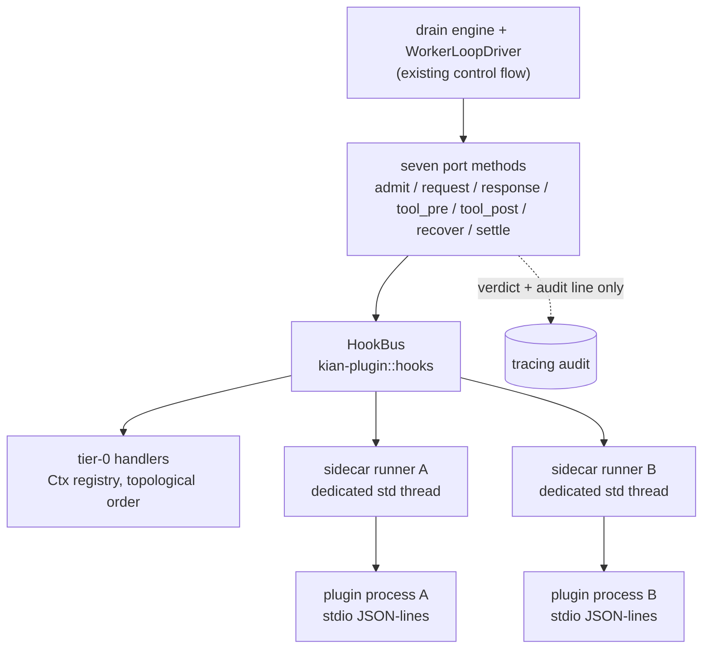

# Hook plugins — the harness-extension contract

- **Status**: normative (v2 — Round 13). The contract binds the implementation round that follows
  it; **no `hooks` module, no `sidecars:` section and no port exists in the tree yet** (§14 records
  exactly what the implementation round must build, and §16 records what is deferred). Round 13 is
  docs-only (owner decision D6): this file plus
  [ADR-028](decisions/ADR-028-harness-hook-plugins.md) and a pointer in [DESIGN §6.4](DESIGN.md)
  are the whole change.
- **Date**: 2026-11-15
- **Revisions**: v2.1 (R13-04d, 2026-11-15) closes the ten MUST-FIX items of the codex FINAL
  cross-review — F1 (fallback dispatch), F2 (dsh request/response ports), F3 (out-of-grant speech),
  F4 (multi-target preflight), F5 (`required` + frame overflow), F6 (`binding.harness`/`profile`),
  F7 (digest coverage), F8 (handshake identity + admission epoch), F9 (settle-gate append failure),
  F10 (dependency claim + SHA-256). The closure table is
  [ADR-028 Appendix B](decisions/ADR-028-harness-hook-plugins.md). No item widened the contract;
  three narrowed it (F2, F5, F6) and the narrowings are recorded as limitations (§16.17, §16.18);
  **v2.2 (R13-04e, 2026-11-15)** closes the two blockers of the codex CONFIRMATION review, both as
  corrections rather than narrowings — F11 (the §8.1 worked example contradicted its own narrowing
  rule: `scopes.server` now lists both instances, `worker.node-zulu` narrows through `use:`, and §8.2
  pins `use:` as a **filter** over `scopes.server`) and F12 (one multi-target `admit/pre` **evaluation**
  fans out to one `hook` frame **per target session**, each carrying that target's `session`/`worker`/
  `seq` and post-narrowing `deadline_ms`; the first deny refuses the event for every target). The
  closure table is [ADR-028 Appendix C](decisions/ADR-028-harness-hook-plugins.md).
- **Replaces**: the untracked v1 draft (three-tier: compile-time / stdio sidecar / wasm-gated). v2
  specifies **two** tiers; wasm is non-normative future work (owner D8, §16).
- **Owns**: hook-plugin semantics — the tier model (compile-time / stdio sidecar), the hook-point
  vocabulary and its payload catalog, the seven interception port methods and where they attach, the
  capability-grant set, the sidecar manifest and its validation, the stdio ABI, per-worker plugin-set
  resolution and its digest, session consistency, the failure/quarantine policy, the security and
  trust model, and the migration/rollback rules for all of the above.
- **Does not own**: seam trait definitions ([`crates/kian-core/src/seams.rs`](../crates/kian-core/src/seams.rs),
  [DESIGN §6.2](DESIGN.md)); the `Ctx`/`Plugin`/`Disposer` runtime and the five dispatch modes
  ([`crates/kian-plugin/src/ctx.rs`](../crates/kian-plugin/src/ctx.rs),
  [`crates/kian-plugin/src/dispatch.rs`](../crates/kian-plugin/src/dispatch.rs), ADR-004); event
  envelope, kinds and payload bytes ([EVENT-MODEL](EVENT-MODEL.md) — **unchanged by this contract**);
  wire frames, HTTP routes and metrics keys ([API-CONTRACT](API-CONTRACT.md)); worker identity,
  membership and binding ([WORKER-MODEL](WORKER-MODEL.md)); harness internals (kian-loop, kian-dsh);
  product scope (`docs/SPEC.md`).

## 0. Scope and authority split

| Question | Owner |
|---|---|
| What a hook is, when it fires, what it receives, what it may answer, what that answer does | **this file** |
| Why sidecars, why before wasm, why no dylib, why these failure defaults, what was rejected | [ADR-028](decisions/ADR-028-harness-hook-plugins.md) — **extends** [ADR-004](decisions/ADR-004-cordis-inspired-plugin.md), which is never edited |
| Static-first, compile-time plugin runtime, `Disposer`, five dispatch modes | [ADR-004](decisions/ADR-004-cordis-inspired-plugin.md) + `kian-plugin` |
| Seam three roles and the seam catalog | [DESIGN §6.2](DESIGN.md) + [`crates/kian-core/src/seams.rs`](../crates/kian-core/src/seams.rs) |
| Where a new capability must be attempted first (config → plugin → seam → core) | [DESIGN §6.3](DESIGN.md) Footprint Ladder — hooks are rung 2, never rung 3 |
| Event kinds and payload bytes; the one additive payload **value** this contract requires | [EVENT-MODEL](EVENT-MODEL.md) §4.2 — no kind and no new key: one existing payload value's closed set is widened in the implementation round (§4.4, §16.1) |
| Tool-permission provenance (`tool/call.permission`) | [ADR-015](decisions/ADR-015-tool-permission-provenance.md) + [DESIGN §3.2](DESIGN.md) |
| Worker identity, the 1:1 binding, lazy per-id tool sides | [WORKER-MODEL](WORKER-MODEL.md) §3, §7 |
| `sidecars:` config shape, `KNOWN_PLUGINS` collision check, assembly order | `kian-cli` (`config.rs`, `plugins.rs`) — **future implementation work** (§14), not this round |

**Owner rulings this file implements** (Kanban `t_41bfc314`, comment by `default`, 2026-11-15):
D1–D7 from the round brief, **D2 as amended** (no context mutation at any tier), **D8** (tier 2
removed from the normative contract), and **R1–R16**. Where this file states a rule, the ruling it
implements is cited as `(R9)` etc.; where the architect had to choose a mechanism inside a ruling,
[ADR-028](decisions/ADR-028-harness-hook-plugins.md) records the choice and its rationale.

This contract introduces **no new event kind, no new table, no new HTTP route, no new ops method
and no new metrics key** (owner D3). Every model-visible hook effect rides an existing honest path
(§4, §12); every non-model-visible effect is a `tracing` audit line (§10.6).

## 1. Terms

- **Hook** — a named point in the execution lifecycle at which registered handlers may receive a
  payload and (at veto-capable points only) answer with a verdict. A hook is *not* a seam: it never
  resolves a service, never provides one, and never mutates the payload it receives.
- **Tier 0** — a hook handler that is part of the server binary, registered at build time
  (`kian_plugins![...]`). The only tier that may occupy a `Ctx` service key (ADR-004, D1).
- **Tier 1 / sidecar** — a child process declared in `sidecars:`, speaking the stdio ABI of §7,
  which may **observe** and (where the hook allows) **veto**. It can never provide a seam service
  and can never mutate a payload (D2 as amended).
- **Port** — the single call site in existing control flow at which the bus is consulted (§4). A
  port is a plain-data interface; harnesses never see plugin types and plugins never see harness
  types.
- **View** — the immutable, serializable struct a port passes to the bus (`AdmitDraft`,
  `RequestMeta`, `ToolCallView`, `ResponseView`, `SettleView`, `RecoveryView`). Tier-0 handlers
  receive the same Rust struct the tier-1 ABI serializes, so both tiers observe identical fields.
  A view is **read-only by construction**: it carries no `&mut` handle to anything the drain owns.
- **Verdict** — the answer to a veto-capable hook: `Allow` (the default when no handler denies) or
  `Deny { reason }`. There is no `ask` and no `allow`-as-opinion (§3.3).
- **Class default** — the outcome a hook falls back to when its handlers are **unreachable**: dead
  (crash), too slow (`deadline_ms` expiry), quarantined, busy (§7.5), or unable to answer at all. The
  class default is *normative per hook class* and asymmetric by design (§11.1, R9), and for
  `admit/pre` also **per origin**, because only the channel-borne port is
  veto-capable in v1: an unavailable handler refuses a channel-borne input and merely loses the
  observation of an API-borne one (§3.4.3, §4.1). It is **only** an unreachability default: a reply
  that is out of grant, illegal for the hook's mode, or otherwise malformed is *speech*, and speech is
  discarded rather than resolved to a default (§5.2, §11.1).
- **Veto-capable subscriber** — the only entity a fail-closed class default can belong to: a handler
  whose grants include the `veto:*` grant for the hook being dispatched (§5.1). An observe-only
  subscriber that is unreachable costs its observation and nothing else; it can neither answer a
  denial nor cause one by silence or by speech (§5.2, §11.1).
- **Dispatch** — one bus consultation of one hook for one event **and one target session**, carrying a
  fresh `dispatch` id, that target's session id and worker id, that target's `seq` and — for
  **drain-phase hooks only** — the fencing `epoch` at consultation time (§7.3). For a drain-phase hook
  the target is the one drain's session. `admit/pre` is the one hook whose evaluation spans several
  sessions: it is **one evaluation** of the event but **one dispatch per (subscriber, target
  session)**, so a plugin in three targets' sets receives three frames, with three ids, for one
  inbound event (§4.1, §7.2). `admit/pre` and `admit/post` run before a drain exists, so their frames
  carry no `epoch` at all (§7.2, §7.3).
- **Session scope vs server scope** — a tier-0 registration made at process start is **server
  scope** (applies to every session); a registration made through the session-scoped registration
  API (§5.3) applies only to sessions whose effective set contains it (R13).
- **Effective set** — the set of plugin instances resolved for one session from the two config
  scopes of v1 (§8), each with its narrowed limits. It is a **pure function of (config snapshot,
  the durable `exec_worker` binding)** and nothing else (R1). No harness- or profile-scoped set
  exists in v1: neither value is durable, so neither may be a resolution input (§8.2, §16.18).
- **Set digest** — the `sha256:` string defined in §8.5, computed over the canonical form of the
  effective set. It is the identity of "which plugins were in force", recorded at session open in one
  audit line and recomputed at claim **by the same process** (§9.2). It is not a durable baseline: its
  coverage is one process lifetime, and a cross-process restart cannot compare against it (§9.1).
- **Quarantine (process)** — a plugin instance that crossed its failure window (or committed an
  immediate-trigger violation) is skipped at the bus for the **remaining lifetime of the server
  process**; each of its subscriptions takes that hook's class default per §11.1 (fail-closed where it
  held `veto:tool`/`veto:admit`, abstain where it held `veto:settle`, a lost observation where it held
  only `observe:*`). No live reload exists (§6.5, §12).
- **Quarantine (session)** — the sidecar hooks of one session whose recomputed set digest no longer
  matches the digest recorded at open are skipped **for that session's lifetime**; their hooks take
  class defaults (§9, R1). The two quarantines are different counters with different lifetimes and
  different audit shapes.
- **Honest error** — a `tool/result` with `is_error: true` whose content states the real reason a
  call did not execute. A model-mediated denial is never a silent skip and never a fabricated
  success. The **admission** veto is the one refusal whose sender does not learn of it in v1 — there is
  no inbound refusal wire, so it is audit-only; §3.4.3 states it and §16.15 owns it.
- **Protected terminal outcome** — `interrupted`, `failed` and user `cancelled`. No hook may block,
  delay or convert one (constraint 7, R2).
- **Worker id** vs **worker session** — `exec_worker` (an endpoint id string) names the machine a
  session is bound to ([WORKER-MODEL §1](WORKER-MODEL.md)); the worker **session** is a session uuid.
  Every dispatch carries both (§7.3) — never an implicit identity (R11).

## 2. The two tiers

| Tier | Carrier | Registered | May provide seam services | May subscribe hooks | May mutate a view | Trust |
|---|---|---|---|---|---|---|
| **0 — compile-time** | in-process crate | `kian_plugins![...]` at build | **yes — the only tier** (`ctx.provide::<dyn ModelProvider>` …) | yes | **no** (v1; see §3.3) | trusted — same binary, same authority as built-ins |
| **1 — sidecar** | child process, stdio JSON-lines | `sidecars:` config at boot | **no, ever** (D2) | yes (observe / veto only) | **no, ever** (D2 as amended) | **operator-trusted extension** — the same trust class as an `endpoints:` address (R10, §10.1) |

Tier 1 adds **no new third-party crate**. Spawning a process and speaking JSON lines needs only
`std` (`process`, `io`, `thread`, `time`) plus crates `kian-plugin` already links (`serde`,
`serde_json`, `futures`, `tracing`, `thiserror`), **plus one workspace dependency edge that is already
pinned and already compiled**: `sha2 = "0.10"` (`Cargo.toml`, `[workspace.dependencies]`) for the
manifest, payload and set digests of §8.5 — the same crate `kian-store` (view-set digest),
`kian-orchestrator` (snapshot digest), `kian-llm`, `kian-superagent` and `kian-cli` already use. The
implementation round therefore adds exactly one line to
[`crates/kian-plugin/Cargo.toml`](../crates/kian-plugin/Cargo.toml) (`sha2.workspace = true`) and the
lockfile does not grow a package. [`crates/kian-plugin/tests/static_only.rs`](../crates/kian-plugin/tests/static_only.rs)
— which greps `cargo tree -p kian-plugin -e normal` for `libloading`, `dylib` and `wasm*` — keeps
passing **untouched**: `sha2` matches none of its refusal patterns (§13.2). There is no tier 2 (§16,
owner D8).

**The ABI is a process boundary, not a language boundary.** A sidecar may be written in any language
that can read and write newline-delimited UTF-8 JSON on stdio — a compiled binary, a scripting
runtime, a shell pipeline; the carrier is all kian sees. kian never inspects the child beyond
`argv[0]` and its digest (§6.2 rule 6); the child's runtime, frameworks and dependencies are
invisible to the contract. The obligations that do bind the child are exactly the protocol's:
restate the identity in `ready` (§7.3), answer each `id` once in the hook's legal mode (§7.4), and
honour the purity rule for verdicts (§8.6) — a dynamic-language plugin's `ready` set equality is
checked by the protocol but rests on its own honour (§17).

The other two edges the ports require, stated exactly (§4, ADR-028 D11):

- **`kian-loop` grows a dependency edge on `kian-plugin`.** Its port sites must *construct* the views
  (`RequestMeta`, `ToolCallView`, `ResponseView`, `RecoveryView`) and name the port trait, so an
  injected trait object alone would not remove the edge; the edge is acyclic (`kian-plugin` depends on
  `kian-core` only) and the **instance** is still injected at construction — the loop never builds a
  bus (§4).
- **`kian-dsh` gains no edge.** It stays `kian-core`-only, which
  [`crates/kian-dsh/tests/narrow_waist.rs`](../crates/kian-dsh/tests/narrow_waist.rs) asserts, so its
  one v1 port (`tool/post`) is a **crate-local trait over a locally declared view struct** whose
  serialization is byte-identical to §3.2.6, adapted to the real bus in assembly — the same shape as
  the crate-local `DshCtx` port ([ADR-010](decisions/ADR-010-dsh-session-mapping.md)).



The bus never writes events, never touches projections and never imports a harness (D4). Every
arrow above is a function call inside the server process except the two stdio pipes.

## 3. Hook vocabulary

### 3.1 The catalog

`Mode` is the tier-0 dispatch mode ([ADR-004](decisions/ADR-004-cordis-inspired-plugin.md) /
[`dispatch.rs`](../crates/kian-plugin/src/dispatch.rs)); it also fixes the legal sidecar reply
(§7.4). `Sidecar` is v1 availability. `Answer` names the exact power the reply has.

| Hook id | Fires at the port | Mode | Sidecar (v1) | Answer | Payload | Durable trace |
|---|---|---|---|---|---|---|
| `admit/pre` | §4.1, **once per inbound event** (one evaluation; one `hook` frame per target session, §4.1), after Inline/Spill shaping and before **any** target's inbox row is written | `flow` | yes (channel-borne: observe + veto; API-borne: observe only) | `next` = no opinion; `stop` = **veto** → no row is written for **any** target (requires `veto:admit`) | §3.2.1 | one audit line; no row ever existed |
| `admit/post` | §4.1, after a target's row is durable | `emit` | yes | `ack` only | §3.2.2 | the inbox row itself |
| `turn/request` | §4.2, the **primary** request already assembled and persisted, before the first provider call | `emit` | yes — ReAct only in v1 (no dsh site, §16.17) | `ack` only | §3.2.3 | the `step/request` event (already appended) |
| `turn/response` | §4.3, provider turn settled | `emit` | yes — ReAct only in v1 (no dsh site, §16.17) | `ack` only | §3.2.4 | existing step / `turn/end` events |
| `tool/pre` | §4.4, after the declarative permission gate, before `tool/call` is appended | `bail` | yes where kian mediates the call (never under dsh, §3.5) | `null` = abstain; `deny` = **veto** (requires `veto:tool`) | §3.2.5 | attempted `tool/call` + honest-error `tool/result` |
| `tool/post` | §4.4, after `tool/result` is appended | `emit` | yes | `ack` only | §3.2.6 | the `tool/result` event |
| `recover/decided` | §4.5, a class → action resolution happens | `emit` | yes | `ack` only — **no veto, ever** | §3.2.7 | existing `turn/end.error` audit |
| `settle/pre` | §4.6, before the engine is allowed to settle `completed` | `bail` | yes | `null` = abstain; `deny` = **completion veto** (requires `veto:settle`) | §3.2.8 | one synthetic `input/admitted` (or the end write on override) |
| `harness/<name>/<point>` | harness-declared; registry §3.6 | harness-declared | only if that harness is mounted and declares the id | as declared | §3.6 | harness-owned |
| `plugin/load`, `plugin/refuse`, `plugin/quarantine` | bus lifecycle (§6.5) | `emit` | **no** — bus-owned, tier 0 only | `ack` only | §3.2.9 | one audit line each |

Two closures that bind the whole catalog:

1. **No per-chunk point.** No hook fires per streamed token or per SSE frame. A stdio round-trip on
   the model-critical path per chunk is refused in v1 (industry precedent: Envoy's streamed
   processing needs an explicit framing/backpressure contract before it is safe;
   [ADR-028](decisions/ADR-028-harness-hook-plugins.md) records the deferral).
2. **`tool/*` covers kian-mediated calls only.** Under the dsh bridge every tool runs inside the
   child; there is no pre-effect port (§3.5, §16.4). A mapped `tool/call` from the child's stream is
   **after the effect** and is never presented as a veto opportunity.

### 3.2 Payload catalog (closed)

Every field is normative. `≤N` means a UTF-8 byte bound enforced **before** serialization; a
truncated string sets its sibling `*_truncated: true`. No payload carries a secret: each string
field passes the existing secret redactor ([`crates/kian-core/src/secrets.rs`](../crates/kian-core/src/secrets.rs))
before it is serialized for a sidecar, and redaction is defense-in-depth, never a sandbox claim
(§10.4). Tier-0 handlers receive the **unredacted** view (same process, same authority).

Ordering metadata present on **every** dispatch (added by the frame, §7.3): `dispatch`, `session`,
`worker`, `seq`, `deadline_ms` — plus `epoch` for **drain-phase hooks only** (`turn/*`, `tool/*`,
`recover/decided`, `settle/pre`). The identity triple names the frame's **target**: for a drain-phase
hook that is the one drain's session, and for `admit/pre` it is the one target session that frame
belongs to (§4.1, §7.2, §7.3). `admit/pre` and `admit/post` are consulted **before a drain exists**,
so their frames carry no `epoch` key at all — not `null`, not `0`, absent (§7.2). It is not repeated
in the per-hook tables below.

#### 3.2.1 `admit/pre`

```json
{"origin":"channel","targets":[{"session":"<uuid>","router":false},{"session":"<uuid>","router":true}],
 "input":{"role":"user","synthetic":false,"content_preview":"<≤4096 bytes>","content_bytes":91234,
          "content_sha256":"<hex>","content_truncated":true,"inline_view":false},
 "channel":{"name":"lark","event_id":"<opaque>","topic":"<str|null>"},
 "admission":{"policy":"inline_cap_bytes=8192","spilled":true}}
```

| Field | Type | Meaning |
|---|---|---|
| `origin` | `"channel" \| "api"` | which ingress produced the input; decides veto availability (§3.4) |
| `targets` | array of `{session, router}` | **the complete fan-out set this one evaluation covers** — exactly the target list the write loop will visit, sorted by session id (§4.1). It is never "the first target" or a representative: one evaluation is one verdict for the whole event |
| `input.role` | string | the role the row would carry |
| `input.synthetic` | bool | true for steer-injected content (strippable, EVENT-MODEL A6) |
| `input.content_preview` | string ≤4096 | redacted, possibly truncated head of the content |
| `input.content_bytes` | u64 | exact serialized content length |
| `input.content_sha256` | 64 hex | digest of the **unredacted** serialized content (correlation only, never reversible) |
| `input.content_truncated` | bool | true when the preview is shorter than the content |
| `input.inline_view` | bool | true when the row will carry only an Inline view (over-cap spill) |
| `channel` | object \| null | channel provenance for `origin:"channel"`, `null` for `"api"` |
| `admission` | object | the shaping that will be applied (`policy`, `spilled`) |

**One event, one evaluation, every target — and one frame per target.** The view above is produced
**once** per inbound event, from the post-shaping payload, and covers the whole fan-out set in
`targets`. There is no per-target *evaluation*: the subscriber fan-out is computed for the event as a
whole and there is exactly one verdict, so two targets can never end up with different verdicts for
the same event, and a `stop` is a veto of *the event* — no row is written for any target (§4.1). The
*frames*, however, are per target: each `(subscriber, target session)` pair gets its own `hook` frame
carrying that target's `session`/`worker`/`seq` and that target's post-narrowing `deadline_ms`,
because effective sets, limits and quarantine are per session (§1, §8.2). §4.1 states the full
fan-out rule.

#### 3.2.2 `admit/post`

```json
{"session":"<uuid>","event_id":"<event-id>","seq":41,"origin":"channel","deduplicated":false,
 "input":{"role":"user","content_bytes":91234,"spilled":true}}
```

`event_id`/`seq` name the durable row that now exists. `deduplicated` mirrors the inbox receipt.

#### 3.2.3 `turn/request`

```json
{"slot":"main","provider":"openai-compat","model":"gpt-5","iteration":2,
 "request_bytes":48211,"request_sha256":"<hex>","message_count":11,
 "tool_names":["fs_read","fs_write"],"tool_schema_sha256":"<hex>",
 "timing":"pre_send","step_request_seq":57}
```

| Field | Type | Meaning |
|---|---|---|
| `slot`,`provider`,`model`,`iteration` | string/u64 | exactly the `step/request` payload fields |
| `request_bytes`,`request_sha256` | u64, hex | size and digest of the exact persisted body |
| `message_count` | u64 | number of messages in the body |
| `tool_names` | string[] | sorted tool names in the body's `tools` array |
| `tool_schema_sha256` | hex | digest of the serialized tool array (the prefix-cache identity) |
| `timing` | `"pre_send"` | the only value **ever dispatched in v1**: the observation happens before the provider is called (ReAct). `post_attempt` is **reserved** for the deferred dsh site (§16.17) and no v1 dispatch carries it |
| `step_request_seq` | u64 | seq of the `step/request` this view describes |

**Fires once per provider turn, on the persisted primary body — never per fallback attempt.**
`provider_turn` builds one body, appends it as `step/request` (A2), and only then calls the provider
([`react.rs:537`](../crates/kian-loop/src/react.rs) is that append; the port fires immediately after
it returns). The slot's fallback chain is traversed **inside** `complete_turn`, which rebuilds the
body per fallback target "so the model name always matches the provider actually called"
([`react.rs:557`](../crates/kian-loop/src/react.rs)) — those rebuilt bodies are provider-layer
internals, they are not persisted as a second `step/request`, and they are **not** re-dispatched to
`turn/request`. A fallback switch is already its own durable audit (`slot/fallback`, EVENT-MODEL), so
nothing is lost: a plugin sees exactly the bytes the session persisted as its primary request, exactly
once, before the first provider call. A reader must not read this hook as "one dispatch per HTTP
attempt" — it is one dispatch per provider *turn*.

**The request body itself is never shipped** in v1. A body-bearing observe right would be a new
grant with its own privacy and size argument; it is deferred (§16.7).

#### 3.2.4 `turn/response`

```json
{"iteration":2,"outcome":"final_answer","tool_calls":0,"text_bytes":1422,
 "reasoning_bytes":0,"usage":{…provider usage verbatim…},"error":null,
 "timing":"settled"}
```

`outcome` uses the `turn/end` vocabulary (`final_answer | tool_calls | soft_failure | error`).
`error` is `null` or `{"class":"<classifier class>","action":"<policy disposition|none>"}` — the
same audit object the event already carries. `usage` is the provider's verbatim object (audit-only).

#### 3.2.5 `tool/pre`

```json
{"call_id":"call_abc","name":"exec","iteration":2,
 "arguments":{"cmd":["rm","-rf","/tmp/x"]},"arguments_bytes":38,"arguments_sha256":"<hex>",
 "arguments_truncated":false,
 "permission":{"evaluated":"allow","policy":"configured","matched":"rule[3]"},
 "surface":"react"}
```

| Field | Type | Meaning |
|---|---|---|
| `call_id` | string | the model's call id |
| `name` | string | tool name |
| `arguments` | JSON \| string | the parsed arguments (redacted) when their serialization fits the frame bound; when it does not, a **string** — the longest UTF-8 character-boundary prefix of that serialization that fits — with `arguments_truncated:true` |
| `arguments_bytes`,`arguments_sha256` | u64, hex | exact size and digest of the unredacted serialized arguments |
| `permission` | object | the declarative gate's decision, which has **already** run (§4.4 ordering) |
| `surface` | `"react"` \| `"harness"` | `"react"` for the built-in loop; `"harness"` for a tool the external-harness bridge gates before execution (ADR-045, §3.5) |

The two forms are exhaustive and unambiguous, which is what makes a closed ABI parseable: with
`arguments_truncated:false`, `arguments` **is** the complete parsed value; with
`arguments_truncated:true`, `arguments` **is a string** — never a partially serialized object, which no
plugin could parse and which could not be told apart from a malformed dispatch — and
`arguments_bytes`/`arguments_sha256` still describe the complete unredacted serialization, so the
truncated case is detectable and correlatable while never mistakable for the whole input.

A handler that receives `arguments_truncated: true` may still deny; it may not claim to have
inspected the full arguments — the reason string is audited and model-visible, so an over-claim is a
contract violation, not merely a bug.

#### 3.2.6 `tool/post`

```json
{"call_id":"call_abc","name":"exec","is_error":false,"output_bytes":812,"output_sha256":"<hex>",
 "redactions":[{"kind":"env_line","name":"OPENAI_API_KEY","count":1}]}
```

No tool output content is shipped in v1 (§16.7). `redactions` mirrors the `tool/result` provenance
report — aggregate counts only, never values.

#### 3.2.7 `recover/decided`

```json
{"error_class":"rate_limited","action":"backoff_retry","iteration":3}
```

`action` is a disposition name from the declarative table or `"none"` (no rule matched).
**A hook may not veto or alter recovery**: recovery policy is a declarative table owned by the
caller (constraint 8, R2). This point exists so a plugin can *observe* which class fired.

`{error_class, action}` carries the same two values as the `turn/end` error audit object the loop
already builds ([`react.rs:786-795`](../crates/kian-loop/src/react.rs)), with `class` spelled
`error_class` in this payload (the ABI names the field explicitly instead of shipping a bare `class`
key), plus `iteration` — the loop's own iteration count
([`react.rs:412`](../crates/kian-loop/src/react.rs)), which is not part of that audit object. Every
field is fillable at the consultation itself: the policy lookups run in `provider_turn` at
`react.rs:601` (provider error) and `:615` (empty response), whose frame holds `iteration` as its own
parameter (`:525`, fed from the loop's local), and `recovery_audit` (`:786`) builds the `{class,
action}` object from the same policy source.

**No recovery-internal state is shipped**: the classifier's attempt index (`ClassifyCtx.attempt`,
[`recovery.rs:121-122`](../crates/kian-orchestrator/src/recovery.rs)), the one-shot guard's fired set
(`OneShotGuard`, [`recovery.rs:388`](../crates/kian-orchestrator/src/recovery.rs)) and the recovery
budget (`RecoveryBudget`, `:440`) live in `kian-orchestrator::recovery`, which the loop does not see —
carrying them would need the orchestrator import the layering forbids (D4), so a closed catalog does
not name them.

#### 3.2.8 `settle/pre`

```json
{"reason":"completed","turns":4,"tool_calls":7,"evidence":"passed",
 "vetoes_used":0,"vetoes_remaining":3,"episodes":2}
```

| Field | Type | Meaning |
|---|---|---|
| `reason` | `"completed"` | **the only value ever dispatched** — protected reasons never reach the gate (§3.4.2) |
| `turns`,`tool_calls`,`episodes` | u64 | counters from the same pass |
| `evidence` | `"none" \| "passed" \| "failed"` | the evidence gate's state for this session, if it ran |
| `vetoes_used`,`vetoes_remaining` | u64 | **this plugin's** completion-veto budget in this session — per plugin, so a second gate has its own numbers. Counted over **any** synthetic row in the stream whose `content` begins with `[kian:hook-veto plugin=<name> ` (prefix including the trailing space, so `plugin=foo` never matches `plugin=foobar`), matching `synthetic` + prefix and **never** `role` — not only vetoes this plugin issued (trust boundary: a `steer`-capable caller can mint such a row, §4.6) |

#### 3.2.9 `plugin/*`

`plugin/load`: `{"name","version","abi","manifest_sha256","hooks","capabilities","scope":"server"|"session"}`.
`plugin/refuse`: `{"name","code","message"}` with `code` from the closed set `malformed_manifest`,
`name_invalid`, `name_collision`, `missing_binary`, `digest_mismatch`, `abi_mismatch`,
`unknown_hook`, `unknown_capability`, `grant_mismatch`, `ready_mismatch`, `spawn_failed`.
`plugin/quarantine`: `{"name","reason","failures","window_ms","lifetime":"process"|"session"}` with
`reason` from `restarts_exhausted`, `protocol_violation`, `frame_overflow`, `stderr_overflow`,
`digest_mismatch`.

### 3.3 Verdicts and reply modes

| Mode | Legal replies | Capability required by the reply |
|---|---|---|
| `emit` | `ack{note?}` | none (subscription's `observe:<class>`) |
| `flow` (`admit/pre`) | `flow:"next"` / `flow:"stop", reason` | `next`: none · `stop`: `veto:admit` |
| `bail` (`tool/pre`, `settle/pre`) | `bail:null` (abstain) / `bail:{decision:"deny", reason}` | `null`: none · `deny`: `veto:tool` / `veto:settle` |
| any | `err{code,message}` | none — and the codes split by §11.1: `deadline` and `crashed` are **self-declared unreachability** (→ the class default), while `malformed`, `unauthorized`, `unsupported_hook` and `protocol_violation` are **speech defects** (the reply is discarded and the outcome is as if the handler were absent) |

Four refusals that are normative:

- **No denial by proxy.** A subscriber that lacks the `veto:*` grant for a hook can never change that
  hook's outcome — not by answering out of grant (discarded, §5.2), and not by silence (its
  unreachability costs its observation, never the action, §11.1). Otherwise an `observe:tool`-only
  audit plugin could deny a tool call by sending an unauthorized `deny` or by hanging, which is
  privilege escalation through a failure mode.
- **No `ask`/escalate.** A drain has no attached human; an "ask" verdict has no addressee and cannot
  be modelled without a new wire surface (D3). Industry systems that expose `ask` pair it with an
  interactive approver — kian does not have one inside a drain.
- **No `allow`-as-opinion.** Only `deny` is a verdict. An extension can never *manufacture*
  permission; absence of a denial leaves the declarative gate's decision standing. (Industry
  precedent: Claude Code and dsh match several hooks and the most restrictive answer wins, so an
  `allow` from one hook can never outweigh another's `deny` — dropping `allow` states the same rule
  in a smaller vocabulary.)
- **No mutation, at either tier, in v1.** `mutate:context`, `mutate:admit` and any transform of a
  view do not exist (owner D2 as amended). A tier-0 handler that wants to change behavior implements
  a seam or a declarative table, not a hook; a prefix-safe transform grammar would need its own ADR
  because the provider prefix cache and replay byte-identity (constraint 3) are both at stake.

### 3.4 Coverage matrices

#### 3.4.1 Hook × harness

`both` means the point fires with identical payload shape regardless of harness; the port differs
but the view does not.

| Hook | ReAct (`kian-loop`) | dsh bridge (`kian-dsh`) | Note |
|---|---|---|---|
| `admit/pre`, `admit/post` | yes | yes | harness-independent: they fire before the drain, at the admission boundary in the bundle (§4.1) |
| `turn/request` | yes — `timing:"pre_send"` | **no** | the bridge's only request-shaped site is a mapping function that runs *before* the driver appends `step/request` (`mapping.rs:411` → append at `driver.rs:650`), and three of §3.2.3's normative fields (`message_count`, `tool_names`, `tool_schema_sha256`) cannot be derived from an opaque child body. Removed from v1 rather than approximated (§16.17) |
| `turn/response` | yes | **no** | there is no settled-response site that can fill §3.2.4: the bridge never sees provider `usage` or an `error{class,action}` pair (no classifier on that path, §16.5). `mapping.rs:447` is `map_tool_call`, not a settled assistant turn. Removed from v1 (§16.17) |
| `tool/pre` | yes (`surface:"react"`) | **no** for dsh | every dsh tool runs inside the child with no pre-effect port (§16.4); the harness bridges (`kian-claude`/`kian-codex`) fire `tool/pre` for tools the harness gates, with `surface:"harness"` (ADR-045) |
| `tool/post` | yes | yes — retrospective, via a crate-local port at the driver's post-append site (§3.5) | dsh maps the child's tool record after the effect; observe-only, honest about sequencing |
| `recover/decided` | yes | **no in v1** | the only registered resolution site today is the ReAct path (§4.5); a bridge-side site is a future owner task (§16.5) |
| `settle/pre` | yes — worker lineage only (§3.4.4) | yes — worker lineage only (§3.4.4) | the gate sits in `WorkerLoopDriver`, which wraps the inner `LoopDriver` **of a worker-lineage session**; which sessions those are is a separate dimension with its own matrix (§3.4.4) |
| `harness/<name>/*` | registry | registry | no harness declares a point in v1 (§3.6) |

**Goal 3 restated honestly**: a plugin that subscribes only to points marked `yes` in **both**
columns is one binary serving both harnesses with one vocabulary and one payload shape. In v1 that
shared subset is `admit/pre`, `admit/post` and `tool/post`; everything else is ReAct-only
(`turn/request`, `turn/response`, `tool/pre`, `recover/decided`) or harness-independent-but-narrow
(`settle/pre`). This is not a promise that both harnesses offer the same *powers*, and a manifest that
requires a ReAct-only point should set `required = false` (or accept a boot refusal under a dsh-only
deployment). The two removed rows are removed because the bridge cannot populate their normative
payloads — an honest narrowing, not a missing port (§16.17).

#### 3.4.2 End reasons (`settle/pre`)

These rules presume the gate **exists**; §3.4.4 states which sessions have one. On a Router (resident)
session or on the built-in/memory assembly there is no gate in v1, so `completed` is written with no
consultation at all and this table does not apply there.

| End reason | May a hook veto? | What happens |
|---|---|---|
| `completed` via the loop's own settle (`LoopOutcome::Settled`) | **yes**, where the gate is mounted (bounded, §4.6) | a denial re-arms the loop with one synthetic input; on budget exhaustion settlement proceeds and one audit line records the override |
| `completed` via a harness-declared stop (`LoopOutcome::Stopped`) | **no** | the harness decided to stop; a policy extension may not hold a session its own harness stopped. (The resident episode-budget parking signal, `EPISODE_BUDGET_STOP_REASON_PREFIX`, is not a settle at all — the Router parks the session instead of ending it, ADR-024.) |
| `interrupted` | **no** | protected: the end write happens with no bus consultation |
| `failed` | **no** | protected (constraint 7 — an honest failure must never be laundered into a longer session) |
| `cancelled` | **no** | protected (user intent outranks a policy extension) |

The gate is **never consulted** for the four protected classes: they do not reach the port at all, so
a wedged or absent plugin cannot delay them (R2).

#### 3.4.3 Admission coverage

| Producer | Passes `admit/pre`? | Veto in v1 |
|---|---|---|
| channel-borne input (subscriptions fan-out) | yes — **one evaluation per inbound event**, covering the whole target set (§4.1) | **yes**, but audit-only — no inbox row is written for any target, so the drop is real; in v1 **no** receipt, NACK or error code reaches the sender, because no inbound refusal wire exists (§4.1, §16.15) |
| API-borne input (`submit`) | yes — observe only | **no** — there is no wire to express a refusal; extending the receipt or adding an error code is deferred (§16.3). On a dead/quarantined/timed-out sidecar the observation lapses and the input is admitted unchanged, with one audit line (§11.1: the default is per origin, and an observe-only subscriber has no verdict to lose) |
| queue/steer (`queue`, `steer`) | yes — observe only | no — same reason (deferral §16.3) and the same failure default: the observation lapses, the input proceeds |
| internal producers: watchdog timers, async completion, memory injection, subscription pings, cron firings | **no** | n/a — recorded limitation (§17): these write rows through paths that do not pass the admission port |

**The failure default follows the veto column, not the hook name.** Only the channel row is
veto-capable, so only the channel row can fail closed; on the observe-only rows a handler that is
dead, quarantined or over `deadline_ms` costs its observation and nothing else — the input is admitted
unchanged with one audit line. This is R9's class default applied to a *verdict-capable port*, not an
exception to it: R3 makes the channel port the only veto-capable one in v1, and refusing an API-borne
input would discard a caller's work with a caller-visible outcome the contract has no wire to express
— exactly the silent skip §1's honest-error rule refuses (§4.1, §11.1 state the same rule).

The same rule generalises, and §11.1 states it as the governing one: **a class default belongs to a
`veto:*` grant, not to a hook id and not to a subscription.** Concretely, an observe-only subscriber
to a veto-capable hook — say an audit plugin that subscribes `tool/pre` with `observe:tool` only —
takes the *observation* default (lapse + audit) whether it is unreachable **or** answers out of grant;
it can never produce a denial by failing or by speaking. Only a subscriber holding the matching
`veto:*` grant can take the fail-closed default, and its unreachability is a fail-closed denial
(§5.2, §11.1).

This matrix is the honest scope of "admit" in v1. A plugin that must gate *all* work, including
internal completions, cannot be written against v1's admission point — no fallback, no half truth.

#### 3.4.4 Where the settle gate exists (the driver dimension)

`settle/pre` is a property of the **assembly a session runs under**, not of a harness — and the mount
point is narrower than "the wrapper". `WorkerLoopDriver` is constructed only on worker sides
([`plugins.rs:1083`](../crates/kian-cli/src/plugins.rs) for the static worker side, `:1165` and `:1214`
for the lazily built per-worker-id sides); the Router (resident) session is driven by `RouterDriver`
(`plugins.rs:1061` for the watchdog side, `:1073` for the router side) and the built-in/memory assembly
by `ServeLoopDriver` ([`server.rs:647`](../crates/kian-cli/src/server.rs), `:654`, `:701`). Even inside
`WorkerLoopDriver`, a stream that is **not** a worker stream is a documented transparent pass-through
of its terminal outcome — it never reaches `Phase::Terminal`
([`worker.rs:1288-1330`](../crates/kian-superagent/src/worker.rs)).

| Session assembly | Driver that owns the end boundary | `settle/pre` in v1 |
|---|---|---|
| worker-lineage session (a worker side, static or per-worker-id) | `WorkerLoopDriver` | **yes** |
| Router / resident session | `RouterDriver` | **no** |
| built-in and memory assembly | `ServeLoopDriver` | **no** |
| non-worker stream inside `WorkerLoopDriver` | `WorkerLoopDriver`, `thread_id: None` | **no** — pass-through, never `Phase::Terminal` |

Consequences, stated rather than implied:

- a completion gate guards **worker-lineage sessions only** in v1. The Router session — the resident
  session a single-operator deployment's own conversation runs in — has no gate, so no plugin may claim
  that "a session cannot settle `completed` without my approval" without naming the assembly it guards;
- the fix is a second mount site in `kian-superagent` (a phase in `RouterDriver`, which already holds
  the router `InboxWriter`), not a change to this vocabulary. It is a non-goal for v1 (§15) and a named
  deferral with an owner (§16.16);
- the implementation round must assert this table by test rather than by reading (§17).

### 3.5 `surface` and the dsh boundary

`tool/pre`'s `surface` field is `"react"` for the built-in loop and `"harness"` for a
harness-gated tool that reaches kian's approval path (Claude `can_use_tool`, Codex `on-request`
actions; [ADR-045](decisions/ADR-045-harness-approvals-at-tool-pre.md)). Auto-approved harness
tools never reach the port. The dsh bridge runs a `dsh --profile
sdk` child which executes its own tools ([ADR-010](decisions/ADR-010-dsh-session-mapping.md));
[`crates/kian-dsh/src/mapping.rs`](../crates/kian-dsh/src/mapping.rs) consumes the child's
already-emitted tool records, and `kian-dsh` has no tool provider and no invocation port. Therefore:

- a dsh-child tool call **cannot** be vetoed before its effect, and this contract does not pretend
  otherwise (it is the difference between "logged before execute" and "observed after execute");
- `tool/pre` never fires under dsh — not even as a no-op — so a plugin's audit line never claims a
  pre-effect check that did not happen;
- `tool/post` fires retrospectively with the honest `timing` implication: the effect already
  occurred, and it reaches the bus through a **crate-local** dsh port (a trait over a locally declared
  struct whose serialization is byte-identical to §3.2.6) injected at driver construction — `kian-dsh`
  names no `kian-plugin` type and keeps its `kian-core`-only waist (§2,
  [`narrow_waist.rs`](../crates/kian-dsh/tests/narrow_waist.rs)). Its call site is the driver's
  post-append branch, after `ctx.append(EventKind::ToolResult, …)` returns `Ok`
  ([`driver.rs:650`](../crates/kian-dsh/src/driver.rs)). `name` is taken from the step's mapped
  `tool/call` for that `call_id`; if the child emitted a result with no matching mapped call, the
  observation is **skipped with one audit line** rather than dispatched with a fabricated name.

`turn/request` and `turn/response` do **not** fire under dsh in v1 (§3.4.1, §16.17). The reason is not
timing but payload honesty: `mapping.rs:411` is a pure mapping function that runs before the driver's
append, so a post-persist site exists — but §3.2.3 requires `message_count`, `tool_names` and
`tool_schema_sha256` from the body, which kian cannot read out of an opaque child request; and no
bridge site can fill §3.2.4's `usage` and `error{class,action}`, because the bridge has no provider
usage and no classifier (§16.5). A row that cannot populate its own normative fields is removed, not
approximated.

Tools executed by kian itself while a dsh session runs are not a v1 case (there are none: the
bridge's tool surface is the child's).

### 3.6 The `harness/<name>/*` namespace

- **Shape**: `harness/<harness>/<point>`, both segments `^[a-z0-9][a-z0-9_-]*$`. There are no
  wildcard subscriptions.
- **Registry**: a harness declares its points in `kian-plugin::hooks`'s static registry (an array of
  `(harness, point, mode)` — implementation round). A registry entry is contract only when the
  harness that owns it ships it, and it must then appear in §3.1 (the row) **and** §3.4.1 (which
  harness fires it) **and** §3.2 (its payload) in the same change.
- **The v1 registry is empty.** Neither kian-loop nor kian-dsh declares a point, so:
  - a manifest subscribing a `harness/…` id is refused at boot with `unknown_hook` (validation rule
    8) — a deterministic refusal, never a silently-never-firing subscription;
  - the bus never dispatches a harness point in v1.
- **What a harness point may never be**: a tool or model concept. Points are that harness's own
  lifecycle points (start/end/error families). A point may not be veto-capable until the harness has
  a real pre-effect boundary to gate — which is precisely why a dsh child tool call cannot be
  expressed as `harness/dsh/tool_pre` (§3.5): by the time the bridge sees it, the effect has
  happened, and naming it "pre" would be a lie in the vocabulary itself.

## 4. The interception ports

This contract specifies **seven port methods at nine call sites**. R4 named four; v2 adds two observe
points that require no new edge (the admission port sits where shaping already happens, and
`recover/decided` observes a consultation the loop already performs) plus `tool_post`, which §3.1 and
§4.4 already required but which the v2 sketch omitted from the trait. One method (`tool_post`)
attaches at a second site under dsh through a crate-local port (§3.5); the two dsh `turn/*` sites the
earlier draft claimed were **removed** because no bridge site can populate their normative payloads
(§16.17). Each row below is a call the existing control flow already makes, wrapped so the bus is
consulted once. All are **called from** the owning crate and **implemented in** `kian-plugin::hooks`;
no harness type crosses the boundary. Shapes are defined in `crates/kian-plugin/src/hooks/ports.rs`
(implementation round) over plain serde structs:

```rust
pub trait HookPorts: Send + Sync {
    fn admit(&self, draft: &AdmitDraft) -> BoxFuture<'static, AdmitVerdict>;
    fn request(&self, meta: &RequestMeta) -> BoxFuture<'static, ()>;      // observe
    fn response(&self, view: &ResponseView) -> BoxFuture<'static, ()>;    // observe
    fn tool_pre(&self, call: &ToolCallView) -> BoxFuture<'static, ToolVerdict>;
    fn tool_post(&self, view: &ToolPostView) -> BoxFuture<'static, ()>;   // observe
    fn recover(&self, view: &RecoveryView) -> BoxFuture<'static, ()>;     // observe
    fn settle(&self, view: &SettleView, ctx: &SettleCtl) -> BoxFuture<'static, SettleVerdict>;
}
```

`SettleCtl` is the one port that needs an effect (§4.6): it exposes exactly two operations — admit
one synthetic input, and read the veto count — implemented by the caller (kian-superagent) with the
`InboxWriter` it already holds. No port receives a `DrainCtx`, no port may append an event.

`kian-orchestrator`, `kian-core` and `kian-store` gain **nothing** (D4): no trait, no trait object, no
field. Today `kian-superagent` and `kian-cli` depend on `kian-plugin`; after the implementation round
`kian-loop` does too (row (b)) — that is the only new edge, it is acyclic, and `kian-dsh` stays
`kian-core`-only (§2). No crate gains a dependency on `kian-loop`.

| Port | Owner crate (caller) | Trait method | Today's call site | Dependency edge required |
|---|---|---|---|---|
| (a) admission | `kian-superagent` | `admit` | [`subscriptions.rs:477`](../crates/kian-superagent/src/subscriptions.rs) (`shape_channel_input_marked`, before any inbox row) | already present (`kian-superagent → kian-plugin`) |
| (a′) admission, API-borne | `kian-cli` | `admit` (observe) | [`server.rs:1183`](../crates/kian-cli/src/server.rs) (`ControlPlane::submit` → `engine.admit`) | already present (`kian-cli → kian-plugin`) |
| (b) request | `kian-loop` | `request` | [`react.rs:537`](../crates/kian-loop/src/react.rs) (the assembled primary body, immediately after `append(StepRequest)`) | **new**: `kian-loop → kian-plugin` (allowed, R4), with the bus instance injected at construction |
| (c) response | `kian-loop` | `response` | [`react.rs:520`](../crates/kian-loop/src/react.rs) (`provider_turn`, the settled `TurnResult`) | as (b) |
| (d) tool pre | `kian-loop` | `tool_pre` | [`react.rs:676`](../crates/kian-loop/src/react.rs) — **after** `evaluate_permission`, **before** `append(ToolCall)` / `invoke` at `:710` | as (b) |
| (d′) tool post, ReAct | `kian-loop` | `tool_post` | [`react.rs:710`](../crates/kian-loop/src/react.rs) — after the `tool/result` append, executed and declared-denial arms alike (§4.4) | as (b) |
| (d″) tool post, dsh | `kian-dsh` | `tool_post` (crate-local trait) | [`driver.rs:650`](../crates/kian-dsh/src/driver.rs) — the post-append branch after `ctx.append(EventKind::ToolResult, …)` returns `Ok` | **none**: the port is injected at driver construction and its view struct is declared crate-locally (§2, §3.5); `narrow_waist.rs` keeps `kian-dsh` on `kian-core` only |
| (e) settle | `kian-superagent` | `settle` | [`worker.rs:1276`](../crates/kian-superagent/src/worker.rs) — the `Phase` machine that yields `LoopOutcome` | already present |
| (f) recovery | `kian-loop` | `recover` | [`react.rs:787`](../crates/kian-loop/src/react.rs) (`recovery_audit` → `consult_policy`) | as (b) |

`kian-orchestrator`, `kian-core` and `kian-store` gain **nothing** (D4): no trait, no trait object,
no field. Today `kian-superagent` and `kian-cli` depend on `kian-plugin`; after the implementation round
`kian-loop` does too (row (b)) — that is the only new edge, it is acyclic, and `kian-dsh` stays
`kian-core`-only (§2). No crate gains a dependency on `kian-loop`.

### 4.1 Admission port (`admit/pre`, `admit/post`)

Called in the subscriptions fan-out **after** the shaping decision and **before the first inbox
write**, i.e. at the one point where the bundle knows the payload, the targets and the provenance
(`subscriptions.rs:477`). It wraps the existing shaping: the view carries the payload the write
*would* produce.

**Normative ordering for a multi-target admission** (the fan-out admits to several sessions — a rule
route, a passthrough fallback, the Router):

1. **Inline/Spill shaping** runs first and once (`shape_channel_input_marked`, `:477`), producing the
   single payload every target would receive.
2. **`admit/pre` is evaluated once**, at that same channel-policy boundary, over the complete target
   set (§3.2.1 `targets`). It is **one evaluation, not one per target**, so there is exactly one
   verdict per inbound event and no ordering ambiguity between targets — but that one evaluation fans
   out to **one `hook` frame per target session** (next paragraph), because the subscriber set, the
   deadline and the frame identity are per target.
3. **The inbox writes** then happen exactly as they do today — the per-target loop at
   [`subscriptions.rs:499`](../crates/kian-superagent/src/subscriptions.rs), each `inbox.admit` +
   `inbox.wake`.
4. **`admit/post`** fires per target that was actually admitted, with that target's receipt — it is
   single-target by construction, so its frame identity is already that target's.

**Per-target frames (one evaluation, N frames).** Effective sets, narrowed limits and quarantine are
per **session** (§1, §8.2), so a sidecar in one target's set need not be in another's. The dispatch is
therefore a grid over (target session × that target's resolved subscribers):

- **One `hook` frame per (subscriber, target) pair**, carrying that **target's** identity in the frame
  fields — `session` = the target session's uuid, `worker` = that target's durable `exec_worker` (the
  empty string when it has no binding), `seq` = *that* target's last observed seq (`0` when that
  session has no event yet) — each with **its own `id`**, and with no `epoch` (§7.2, §7.3).
  `payload.targets` still lists the complete set, so the plugin sees the whole fan-out it is answering
  for while the frame identity says which target this frame belongs to. No frame ever mixes identities
  (one session's `worker` with another's `seq`).
- **Replies correlate per target**, by `id` (§7.4), so a per-target `stop` is unambiguous. A plugin may
  answer `next` at one target and `stop` at another; a `stop` on **any** frame refuses the admission
  **for all targets** — no inbox row is written anywhere — because the event is one decision (§3.2.1).
- **The first deny in the grid wins.** `[order]` ranks subscribers exactly as in §8.3, per-sidecar
  serialization (§7.5) means one plugin's own frames arrive one at a time, and the order inside a
  plugin is `[order]` then target session id. Once a valid `stop` has arrived, frames for that event
  that have not been sent are not sent, and replies already in flight are discarded as moot (`skipped`
  in the audit line, §8.3). Nothing is retried (§7.5).
- **A target whose resolution has no subscriber for the hook gets no frame — that is not an error.** Its
  effective set simply contains no sidecar subscribing `admit/pre` (or no sidecar at all); the event's
  single verdict still covers it, and that verdict is `next` unless some other target's frame vetoed.
  An absent frame is never read as a verdict, and never as an abstention that could be upgraded.
- **Each frame carries its own `deadline_ms`**, from that target's resolved, post-narrowing limits
  (§8.2) — one target's worker-specific deadline never applies to another target's frame.
- **The class default is per subscribed target; the outcome is still global.** An unreachable (crashed,
  overdue, busy or quarantined) sidecar holding `veto:admit` in *its own* target's set refuses the
  event for *every* target (§11.1); an `observe:*`-only subscriber's unreachability costs only that
  observation. Where no subscriber exists for any target, no default fires.
- **The write loop starts only after the grid resolves** — after the last reply, or at the first deny —
  so no inbox row can exist for an event that a later frame vetoes. Item 3's per-target
  `inbox.admit` / `inbox.wake` loop and its partial-write semantics are untouched, because a `next`
  verdict means no hook was able to withhold a write.

A plugin in three targets' sets therefore sees three frames for one inbound event, and a target with no
subscribing sidecar sees none. The count is bounded by (targets × subscribers for that hook). Admission
therefore waits longer than a single dispatch: each sidecar serializes its own frames — the same
serialization that keeps a multi-target event off the busy-fail-fast path (§7.5) — so the worst case is
`max over sidecars (the sum of that sidecar's per-frame deadline_ms)` — each frame's own
post-narrowing deadline (§4.1), summed over the frames that sidecar serializes — with sidecars running
concurrently: the cost of
one evaluation over N durable sessions, paid at the admission boundary and never inside a drain.

Hooks never write: the port returns a verdict, and the bundle's own loop does every write. **A partial
write is unchanged fan-out behavior, not a hook behavior** — today the loop logs a failed target with
`warn!`, keeps the rows already written, remembers the first error and returns it after the loop
([`subscriptions.rs:520-541`](../crates/kian-superagent/src/subscriptions.rs)), leaving the failed
subscriber to the adapter's idempotent retry (`:568-575`). v1 adds nothing to that: a veto is the only
way a hook prevents a write, and a veto prevents *all* of them; a storage failure after a `next`
verdict behaves exactly as it does without any plugin, so the semantics cannot be mistaken for a
plugin-induced drop. (The alternative — two-phase "write none if any fails" — would be a new
transactional guarantee over N sessions and is not part of this contract.)

Then, per verdict:

- `next` → proceed unchanged;
- **the class default is per origin** (§11.1), because only one origin has a verdict to lose. At
  `origin:"channel"` the port is veto-capable, so deadline/crash/quarantine **of a `veto:admit`-holding
  subscriber** fail **closed** — the admission is refused for every target, no row is written, one
  audit line, sender not told (next bullet). An observe-only subscriber's unreachability, and any
  out-of-grant or malformed **reply**, never refuses anything (§5.2, §11.1). At `origin:"api"`
  (`submit`, `queue`, `steer`) the port is **observe-only** in v1 (§3.4.3, R3: an API-borne veto has no
  wire, §16.3), so there is no verdict to fail closed: the observation lapses, the input is **admitted
  unchanged**, and one audit line records the lapse. An `admit/pre` failure never drops an API-borne
  input in v1 — dropping it would be the silent skip §1 forbids, with no wire left to say so;
- `stop` → **no inbox row is written for any target**; one audit line names the denying plugin, the
  hook id, the reason, the channel, the denying target (the line's `session`) and the size of the set it
  refused (`targets=<n>` from the view, §3.2.1, §10.6). **The sender is not told in v1**, and this
  section does not pretend otherwise: there is no inbound refusal
  wire to carry a refusal. The channel seam has inbound
  `subscribe()` and outbound `send()` only ([`seams.rs:344-351`](../crates/kian-core/src/seams.rs)); the
  fan-out's failure path is a `warn!` that leaves the drop to the adapter's idempotent retry
  ([`subscriptions.rs:520-534`](../crates/kian-superagent/src/subscriptions.rs)), and
  `SubscriptionService::spawn` turns a handling error into one more `warn!` (`:568-575`). A
  channel-borne veto is therefore an **audit-only refusal**: no row, hence no wake and no model turn,
  and the only record is the audit line; a redelivery is re-vetoed (§8.6 purity) rather than admitted.
  Making that refusal sender-visible needs a wire, which D3 forbids this round — it is deferred with an
  owner (§16.15). This is the one place in the contract where a refusal's target is never notified, and
  it is named here because a silent drop is exactly what §1's honest-error rule refuses to hide;
- the port never fires for the internal producers listed in §3.4.3.

`admit/post` fires per admitted target after the row is durable, with the receipt.

**Control plane stays dumb** (constraint 9): the port lives in the bundle, which already writes the
inbox and reads projections; nothing about admission moves into the engine.

### 4.2 Request port (`turn/request`)

Observe-only. It fires **after** the request body is persisted as `step/request` and **before** the
provider call, so the observed request is by construction the one recorded (persist-what-you-send:
the hook cannot see bytes that were not persisted, because there are none).

**Exactly once per provider turn, and only for the persisted primary body** (§3.2.3): the body that
was appended at `react.rs:537`. The fallback chain is traversed inside `complete_turn`, which rebuilds
the body per fallback target (`react.rs:557`); those rebuilt bodies are provider-layer internals, are
not persisted as a second `step/request`, and are **not** dispatched here. So the hook's semantics are
one dispatch per turn — never one per HTTP attempt — and a `slot/fallback` switch is observed through
its own durable event, not through this port.

There is **no dsh site** in v1 (§16.17): the bridge's post-persist append exists
(`driver.rs:650`), but the view's normative fields cannot be filled from an opaque child body, so the
row was removed rather than approximated. `timing` therefore only ever carries `"pre_send"` in v1.

### 4.3 Response port (`turn/response`)

Observe-only, fires once per settled provider turn with the assembled `ResponseView` — never per
chunk (§3.1 closure 1). There is **no dsh site** in v1 (§16.17): a settled bridge step can fill
`outcome`, but not `usage` (the child's step never carries a provider usage object into the mapping)
and not `error{class,action}` (the bridge runs no classifier, §16.5), and `mapping.rs:447` is
`map_tool_call` rather than a settled assistant turn. Two of the view's normative fields with no
source is a phantom port, so the row is removed.

### 4.4 Tool port (`tool/pre`, `tool/post`)

Ordering is normative and matches the existing permission discipline
([ADR-015](decisions/ADR-015-tool-permission-provenance.md)):

1. the declarative `permissions` table is evaluated (`react.rs:676`);
2. **then** `tool/pre` is consulted (one bus call, deadline-bounded);
3. `tool/call` is appended **in both arms** with its `permission` provenance — a denial is logged
   before any effect (log-before-execute stays true for hook denials);
4. a denied call **never** reaches `self.tools.invoke` (`react.rs:710`); the model receives an
   honest-error `tool/result` whose content is
   `{"error":"denied by plugin <name>: <reason>","policy":"hook"}`;
5. `tool/post` fires after the `tool/result` append (rows (d′) and (d″) in §4) — executed calls, and
   also the honest-error result of a declared-permission denial, so the surface is uniform. Under dsh
   the same hook fires retrospectively from the bridge's post-append branch (§3.5), which is the only
   form the bridge can honestly offer.

**The one required EVENT-MODEL amendment** (§16.1): `tool/call.permission.policy` is the closed set
`"default" | "configured"` today (EVENT-MODEL §4.2). A hook denial adds the value `"hook"` and uses
`matched` to carry `"<plugin>:<hook>"`. `evaluated`, `policy`, `matched` and `reason` already exist,
so no new key is needed — but the value set does change, and EVENT-MODEL is the source of truth for
it. The implementation round therefore carries a **same-change EVENT-MODEL amendment**; this
docs-only round only names it (D3, D6, R6).

### 4.5 Recovery port (`recover/decided`)

Observe-only at every site where a class → action resolution happens. v1 registers exactly one site,
the ReAct loop's (`react.rs:787`). A hook may not become a second policy table: the classification
is a pure function and the policy is declarative (constraint 8). Additional resolution sites (the
dsh path, if it grows one) are owned by their crate and register into the same vocabulary (§16.5).

### 4.6 Settle gate (`settle/pre`) — the mechanism

The engine decides settlement from the driver's outcome: `Supervised::Settled` → `end_reason =
Completed` → **one atomic `session/ended` append** (`engine.rs:1463`, `end_session` at `:728`), and
`end_session` is a method on the concrete `DrainCtx` inside `kian-orchestrator`. A decorator wrapped
around `DrainCtx` therefore **could not** intercept that call — and putting a trait object into the
orchestrator would violate D4. v2 resolves this at the seam the outcome actually crosses:

1. `WorkerLoopDriver` ([`worker.rs:1276`](../crates/kian-superagent/src/worker.rs)) is a `LoopDriver`
   decorator that already owns the terminal-outcome decoration (lineage, evidence gate,
   `thread/completed`, Router completion report). It gains one phase: before propagating
   `LoopOutcome::Settled`, it consults `settle`. It has everything the gate needs in-crate — the
   `InboxWriter` it already holds (for the admitted input) and `StreamPort::read_stream`
   ([`worker.rs:564`](../crates/kian-superagent/src/worker.rs)) for counting.

   **Coverage, stated before the mechanism.** This phase exists only where the wrapper is mounted and
   the stream is a worker stream: worker-lineage sessions, and only those (§3.4.4). The Router
   (resident) session (`RouterDriver`) and the built-in/memory assembly (`ServeLoopDriver`) have **no**
   completion gate in v1 — a `completed` written there is never consulted. Nothing below should be read
   as covering them; §15 records it as a non-goal and §16.16 as the owning deferral.
2. It consults the gate **only** for `LoopOutcome::Settled` — the loop's own completion decision.
   `SoftFailed`, `Stopped`, and every interrupt path propagate untouched: the engine maps
   `failed`/`completed`/`interrupted` per its own rules, `interrupted`/`failed`/`cancelled` never pass
   through the gate, and a **harness-declared stop is not a settle** (a policy extension may not hold
   a session the harness itself chose to stop — §3.4.2).
3. On `deny` with budget remaining it **admits one synthetic input** through the `InboxWriter` it
   already holds — the existing, honest steer path:

   `input/admitted{role:"user", synthetic:true, content:"[kian:hook-veto plugin=<name> hook=settle/pre reason=<reason>] <reason> — address this before finishing."}`

   persisted **before** the model can see it (persist-what-you-send), strippable via the existing
   `synthetic` marker (EVENT-MODEL A6). It then propagates the outcome unchanged. The engine's own
   check does the rest: `Supervised::Settled` + eligible input → `continue 'episodes` ("steer
   allowance reset: one more episode per newly eligible batch", `engine.rs:1415`) and the empty-inbox
   settle branch cannot fire because the inbox is non-empty.

   Nothing renders a `system`-role marker: step 3 admits through that same steer wrapper, whose
   consumption plan hard-codes `role:"user"` (`engine.rs:1595-1602`, asserted at `:2612-2616`), and
   the budget predicate below never reads `role` at all.

   **When that append itself fails, the veto is not swallowed** — the failure path is normative and
   three steps long:

   1. **The gate does not settle.** The append error is returned to `WorkerLoopDriver` and propagates
      through the **existing append-failure route** of the drain — the same mapping every append
      failure in that path gets (the outcome becomes the driver's honest failure, never
      `LoopOutcome::Settled`, so the engine writes `failed`/`interrupted` and the session stays
      **recoverable and resumable**). No `completed` is written, so the plugin's veto did have its
      effect; what failed is persistence, and the failure is reported as a failure.
   2. **The veto budget is consumed anyway.** The marker row does not exist, so the stream-derived
      count cannot see it — the gate therefore counts this veto in an **in-process counter** for the
      drain lifetime and treats `vetoes_used = max(rows_naming_this_plugin, this_gate's_attempts)`.
      Without that, a persistently failing inbox could be re-spent on every re-arm; with it, one veto
      is one veto, and the session's next drain re-derives the count from the stream as usual (§4.6
      budget rule). The bound stays bounded: the drain ends, and nothing loops.
   3. **One audit line** (`hook-veto-admit-failed`, §10.6), plus whatever the drain's own failure path
      emits: `hook=settle/pre plugin=<name> vetoes=<n> error=<append error> reason=<reason>`. The line
      says *applied and unpersistable* — it never claims the model saw a steer message that no row
      carries.

   The alternative — treating a failed append as "veto not applied, proceed to settle" — is exactly
   the swallow this rule forbids: the model would never wake, the session would end `completed`, and no
   durable artifact would record that a gate said no.
4. On `deny` with budget exhausted it propagates the outcome **without** admitting anything and emits
   one audit line: `hook=settle/pre plugin=<name> override=true vetoes=3 reason=<reason>`.
5. On `timeout`/`crash`/`quarantined` — **unreachability** — it **fails open** (§11.1, R9):
   settlement proceeds, one audit line records the abstain. A reply that is out of grant or illegal
   for the mode is a **speech defect**: it is discarded as an opinion (§5.2), which for this hook
   happens to land on the same outcome (settle) but is audited as a defection, not as a lapse.

**Budget — per plugin, per session.** `vetoes_used` = the number of `[kian:hook-veto …]` synthetic
inputs **naming this plugin** already in this session's stream. The marker carries `plugin=<name>`
(step 3), so the count is per plugin with no new state, and it survives a crash/restart because the
stream is durable (constraint 1: the count is a projection, not a side table). `max_settle_vetoes` is a
manifest limit (default 3, clamp 0..=10; `0` disables the gate) and it bounds **that plugin's** vetoes
in **that session** — it is not a session-global pool, so a second gate does not inherit the first's
consumption and one greedy gate cannot exhaust another's. The session-wide bound is therefore the sum
of its mounted gates' limits (at most `10 × |effective set|`), each individually one-shot-guarded and
each audited with its own count. Bounded, and honest when it gives up — exactly the evidence-gate
discipline extended to a second stop condition (R2).

**Trust boundary — the count is a content convention, not a provenance proof.** The predicate is
*any* synthetic row in this session's stream whose `content` begins with the
`[kian:hook-veto plugin=<name> ` prefix — not *a veto this plugin issued* — and it reads `synthetic`
plus that prefix and **never** `role`. `Engine::steer`
([`engine.rs:1014-1026`](../crates/kian-orchestrator/src/engine.rs)) admits
`{"synthetic":true,"content":<caller content>}`, and the consumption plan (`:1588-1602`) renders
exactly that two-key shape as `{"role":"user","content":<caller content>,"synthetic":true}`
(asserted at `:2612-2616`) — the same shape as the marker step 3 writes, because step 3 admits
through that same wrapper. A caller who can `steer` can therefore mint a marker-bearing row, and
`steer` is the only public ingress that can: `submit` and `queue` write the caller's content to the
inbox unwrapped (`server.rs:1183-1197` and `:1214-1227` → `Engine::admit`), so no row they write
carries a top-level `synthetic:true`; the wire guard (`is_reserved_envelope`,
[`api.rs:381-390`](../crates/kian-cli/src/api.rs), applied at `:398`) additionally refuses the exact
reserved two-key sets on all three input methods, and the steer wrapper is added engine-side
afterwards. The budget therefore bounds a **runaway or wedged plugin** — a gate denying every settle
and re-arming forever, which is the case the limit exists for — and it is **not** a control against a
caller who can steer. It does not need to be: that caller already holds the public `interrupt`, and
an `interrupted` end is never gate-consulted (§3.4.2). Widening the steer envelope with a bus-only key
is **not** the fix: the wrapper is exactly two keys by design (kian-96 / N-1, `:1589-1594`), because
a superset is ordinary client content — the wire guard enforces only exact key-set equality — so
consuming one as a wrapper would let the public wire mint the strippable marker itself, and by the
same widening any other reserved marker. An unforgeable count would need a provenance field the bus
writes and the wire guard refuses — a wire change, not a doc change (§17).

Why this is not a hole in constraint 4: the veto never splits an end write. It only decides whether
an end write happens *this* episode; when it does happen it is still one atomic append.

## 5. Capability grants

### 5.1 The closed v1 set

| Grant | Exact meaning | Requires subscription to |
|---|---|---|
| `observe:admit` | may receive `admit/pre` and `admit/post` | a hook in the admittance class |
| `observe:turn` | may receive `turn/request` and `turn/response` | one of them |
| `observe:tool` | may receive `tool/pre` and `tool/post` | one of them |
| `observe:recover` | may receive `recover/decided` | it |
| `observe:settle` | may receive `settle/pre` | it |
| `veto:admit` | may answer `flow:"stop"` at `admit/pre` (channel-borne only in v1); the refusal is **audit-only** — no row is written and v1 has no sender-visible notification (§4.1) | `admit/pre` |
| `veto:tool` | may answer `bail:{decision:"deny"}` at `tool/pre` | `tool/pre` |
| `veto:settle` | may answer `bail:{decision:"deny"}` at `settle/pre` | `settle/pre` |

Removed from the v1 set (D2 as amended): `mutate:context`, `mutate:admit`, `mutate:tool`. The names
are **reserved** — a manifest naming one is refused with `unknown_capability` at boot, so a future
transform grammar cannot silently inherit today's configurations. A `veto:*` grant implies the
matching `observe:*` and is refused without it (a handler cannot veto what it does not receive).

A `veto:*` grant is therefore the **only** thing that lets a subscriber change an outcome, and it is
the only thing a fail-closed default may belong to (§11.1). An `observe:*`-only subscriber gets its
observations and nothing else — no denial by reply, no denial by silence, no denial by crash.

### 5.2 Enforcement is at dispatch, not only at load

- Boot: every capability must be in the closed set, and every subscribed hook must be covered by its
  `observe:*` grant.
- Dispatch: a reply variant whose grant is absent is **not an opinion**. It is refused as
  `err:unauthorized`, and — this is the normative part — it is **discarded**: the outcome is exactly
  what it would have been if that plugin had never answered at all. It is **not** resolved to the
  hook's fail-closed class default (an earlier draft said it was, which handed an `observe:tool`-only
  plugin the power to deny a tool call by replying `deny` out of grant — privilege escalation through
  a reply the contract had already rejected).
  - Only subscriber, `tool/pre`: the call proceeds on the **declarative permission gate's** decision —
    a hook denial cannot exist without the grant, so nothing denies.
  - Only subscriber, `admit/pre` (channel): the input is **admitted** (one audit line; no row is
    withheld).
  - Only subscriber, `settle/pre`: the hook abstains and the session settles.
  - Several subscribers: the other verdicts decide exactly as if the defector were absent; the audit
    line records that it answered out of grant.
  - One `hook-discard` audit line always (§10.6): `hook=<id> plugin=<name> code=unauthorized
    grant=<reply-required-grant> outcome=discarded`.
- **Unreachability and speech are different classes and never resolve into each other** (§11.1): the
  class default is taken only when a **veto-capable** subscriber cannot answer (deadline, crash,
  quarantine, busy); a reply that the bus refuses is not the subscriber being unavailable — it is
  present and speaking without authority.
- Wrong-mode reply (an `ack` at a `bail` hook, a `flow` at an `emit` hook, a duplicate frame id) is
  `err:malformed` and, like the above, is a **speech defect**: the reply is discarded, the outcome is
  as-if-absent. It also counts toward the failure window (§6.4) — health accounting and outcome
  accounting are separate questions, and conflating them is what produced the escalation above.

### 5.3 Tier-0 registration is hook-scoped

The existing `Ctx` dispatch keys handlers by kind and Rust `TypeId`
([`dispatch.rs`](../crates/kian-plugin/src/dispatch.rs)) and carries no plugin/hook/session
metadata, so the hook bus keeps its **own** registry in `kian-plugin::hooks` (R13):

```rust
pub struct HandlerId { pub plugin: &'static str, pub hook: HookId, pub grants: GrantSet, pub order: i32 }
pub fn register(h: HandlerId, f: impl HookFn) -> Disposer;   // server scope
pub fn register_scoped(scope: SessionScope, h: HandlerId, f: impl HookFn) -> Disposer;
```

`Disposer` is the existing reversible-registration type, so disposal order is registration-reverse
and identical to today's semantics. A registration made at process start is **server scope**; a
`register_scoped` registration participates only in sessions whose effective set contains it. Raw
`Ctx::on`/`on_waterfall`/`on_bail` stay exactly as they are for non-hook typed events — ADR-004's
surface is unchanged.

## 6. Sidecar manifest, lifecycle and limits

### 6.1 The manifest (closed TOML)

```toml
[plugin]
name = "approval-gate"          # must equal the instance key in `sidecars.plugins`
version = "0.1.0"               # semver, reported in `hello`/`ready`
abi = 1                         # protocol generation (accepted set grows additively)
order = 0                       # dispatch order within a hook (i32, default 0; tiebreak: name)
required = true                 # per-instance boot policy: this plugin's refusal is fatal iff true (§6.2)

[process]
argv = ["/usr/local/lib/kian/plugins/approval-gate"]   # argv[0] absolute; no shell ever
sha256 = "<64 lowercase hex>"   # digest of argv[0]; verified at spawn and at every respawn
cwd = "/var/lib/kian/plugins/approval-gate"            # optional, absolute, must already exist (rule 14)
env_allow = ["APPROVAL_URL"]    # deny-by-default: env_clear, then exactly these names
startup_timeout_ms = 2000       # hello→ready deadline, clamp 100..=30000

[grants]
hooks = ["tool/pre", "tool/post"]
capabilities = ["observe:tool", "veto:tool"]

[limits]
deadline_ms = 500               # per dispatch, clamp 50..=5000
max_payload_kib = 256           # symmetric frame bound, clamp 16..=1024
restarts_per_window = 3         # failures per window before quarantine, clamp 1..=10
restart_window_ms = 60000       # sliding failure window, clamp 1000..=3600000
max_settle_vetoes = 0           # only meaningful with `settle/pre`; clamp 0..=10
max_stderr_line_kib = 8         # per stderr line, clamp 1..=64
stderr_rate_kib_per_min = 1024  # retained stderr per minute, clamp 64..=65536
```

`max_payload_kib` is the **wire-byte** bound enforced while scanning a line, in **both** directions,
before any unbounded buffering or JSON parse (§7.6). 256 KiB is a kian policy value, not an industry
constant, and the server clamp is authoritative.

### 6.2 Validation (per instance, fail-closed, no repair)

Validation is **per instance**: each `sidecars.plugins` entry is checked on its own, and a failure
refuses **that instance**, naming the offender and the code. There is no partly-mounted instance and
no default that repairs a manifest; and there is **no whole-section refusal** — one broken plugin does
not unmount the others (the earlier draft's "boot refuses the whole `sidecars` section" contradicted
its own `required = false` rule and is withdrawn). An instance is refused when **any** of these holds:

| # | Rule | `plugin/refuse` code |
|---|---|---|
| 1 | Unknown key anywhere in the file (deny-unknown-fields) | `malformed_manifest` |
| 2 | `[plugin].name` not `^[a-z0-9][a-z0-9-]{0,63}$`, or ≠ the instance key | `name_invalid` |
| 3 | `name` collides with `KNOWN_PLUGINS` ([`config.rs:2231`](../crates/kian-cli/src/config.rs)), a tier-0 plugin name, or another instance | `name_collision` |
| 4 | `version` not semver, or `order`/`required` wrong type → `malformed_manifest`; `abi` outside the accepted set (`{1}`) → `abi_mismatch` | `malformed_manifest` / `abi_mismatch` |
| 5 | `argv` empty, `argv[0]` relative, or containing a shell metacharacter path that does not exist as a file | `missing_binary` |
| 6 | `sha256` absent, not 64 lowercase hex, or not equal to the file's digest at spawn | `digest_mismatch` |
| 7 | `env_allow` entry not `^[A-Za-z_][A-Za-z0-9_]*$`, duplicated, or naming a kian secret env var | `malformed_manifest` |
| 8 | any `hooks` entry not in the §3.1 catalog, or a `harness/*` id the mounted harness does not declare | `unknown_hook` |
| 9 | any `capabilities` entry outside §5.1 (including `mutate:*`) | `unknown_capability` |
| 10 | a subscribed hook whose class `observe:*` grant is absent, or a `veto:*` grant with no subscribing veto-capable hook | `grant_mismatch` |
| 11 | any `[limits]` value outside its clamp | `malformed_manifest` |
| 12 | the plugin's `ready` frame restates anything other than the manifest identity: `plugin.name`, `plugin.version`, `abi` or the canonical `manifest` path differ (§7.3), or `hooks`/`capabilities` are not the manifest's set (order-insensitive) | `ready_mismatch` (a differing `abi` → `abi_mismatch`) |
| 13 | `hello`→`ready` exceeds `startup_timeout_ms` | `spawn_failed` |
| 14 | `cwd` present but not absolute, not an existing directory, or not readable and writable by the server's user | `malformed_manifest` |

Rule 14 is a boot-time configuration check, not a spawn step: the server never creates a directory at an
operator-supplied path (a configured `cwd` is the operator's to provision), so a bad one is a
`malformed_manifest` refusal during validation rather than a `spawn_failed` at handshake. When `cwd` is
absent there is nothing to check — the server creates a fresh empty directory under its own runtime
directory for that instance (§10.3 step 3).

**`required` is per plugin instance, never per section.** Each `sidecars.plugins` entry carries its
own `[plugin].required` value in its own manifest, and it decides exactly one thing: whether **that
instance's** refusal is fatal. `required = true` → `kian serve` refuses to start (fail-closed boot: the
operator asked for a gate and the gate cannot be there). `required = false` → that instance is absent
with one `plugin/refuse` audit line, and every other instance mounts normally. It is not a section-wide
switch and there is no way to declare "optional" for the whole `sidecars:` block.

Two boundary cases, stated because they are where a per-instance policy can be under-specified:

- a manifest that cannot be **parsed** (rule 1, or a rule-4 type error) cannot declare `required =
  false` either — the unknown key or the wrong type is exactly what prevents reading the field. Such
  an instance is **fatal** (fail-closed) and the audit line says
  `code=malformed_manifest required=unknown`;
- a `sidecars.plugins` or `sidecars.scopes` **grammar** error (an unknown scope key, a set entry that
  is not a declared instance, a `limits:` key naming an undeclared instance) is a config error with no
  owning instance, so it refuses boot as config validation does everywhere else in `kian-cli` — no
  plugin-level downgrade applies to it.

### 6.3 Lifecycle

```
configured → spawning → handshaking → ready ⇄ busy
                                  ↘ refused (absent; fatal iff required)
ready|busy → crashed → (respawn, digest re-verified) → handshaking
            → quarantined (process lifetime) | stopped (bye, clean exit)
```

- **One process per plugin per server**, for the whole server lifetime (R11). Not per session, not
  per worker, not per hook.
- **One in-flight dispatch per sidecar.** While busy, a new dispatch to that sidecar **fails fast to
  the hook's class default** — it never queues (§7.5).
- **Respawn** happens only after a crash or deadline kill, inside the failure window, with the digest
  re-verified; the child is re-handshaked before it takes another dispatch.
- **Quarantine** is one-way inside a process (§6.5).

### 6.4 Counters (the state machine, precisely)

One window plus two immediate triggers. A *success* is any well-formed reply (`ack`, `flow`, `bail`).

- `failures`: a deque of monotonic timestamps of **consecutive** failures — a reply clears it.
  Window-counted failures are: `err:deadline`, a crash (process exit while a dispatch or handshake was
  pending), `err:malformed`, `err:unauthorized` (wrong-mode/ungranted reply) and `stderr_overflow`
  (the retained-rate bound, §10.5).
- **`frame_overflow` is not window-counted.** A frame over `max_payload_kib`, in either direction, is a
  structural violation — the child sent, or failed to accept, a line that cannot exist under this
  contract — and it quarantines that plugin **immediately** (one strike, §6.5). The earlier draft
  counted it both ways (window increment *and* direct quarantine), which is not a rule; the
  distinction is now principled: a resource signal is rate-bounded, a protocol violation is not
  tolerated at all. `protocol_violation` (unknown/duplicate/unsolicited frame id) is immediate for the
  same reason.
- On each failure: push `now()`, drop entries older than `restart_window_ms`, then
  `if len(failures) >= restarts_per_window → quarantine(restarts_exhausted)`.
- `restarts` (a separate counter) counts actual respawns and is **reported**, not thresholded; the
  admission rule is the `failures` window above. Both appear in the quarantine audit line so the two
  numbers can never be confused again (this is the fix for the draft's "three consecutive deadlines
  or crashes in a sliding window, restarts_per_window" ambiguity).
- In-flight crash: that dispatch takes the class default, `failures` gets an entry, and the respawn
  happens only if the window has not tripped quarantine.

### 6.5 Quarantine

- **Trigger** — exactly two mechanisms, and each reason names which one produced it:
  - **Window trip** (`restarts_exhausted`, or `stderr_overflow` when the tripping window contains only
    stderr-rate entries — the deque is kind-tagged for exactly this report): from §6.4's counter.
  - **Immediate, one strike** (`protocol_violation`: unknown/duplicate/unsolicited frame id or an
    unbounded-backlog attempt; `frame_overflow`: a line over `max_payload_kib` in **either**
    direction; `digest_mismatch`: the binary's digest no longer matches the manifest at **respawn** —
    at boot the same condition is a `plugin/refuse` with code `digest_mismatch`, §6.2 rule 6). None of
    these is ever window-counted, and none is ever forgiven by a later well-formed reply.
- **Effect**: the instance is skipped at the bus. That is **two different outcomes per subscription**,
  because a default belongs to a grant and not to a plugin (§5.1, §11.1):
  - every hook where the instance held the matching `veto:*` grant takes that hook's class default per
    §11.1 — **fail-closed** for `tool/pre` and channel-borne `admit/pre` (a quarantined approval gate
    denies; it does not quietly start approving), **fail-open** for `settle/pre` (a quarantined quality
    gate abstains, it does not hold a session hostage);
  - every hook where it held only `observe:*` simply loses the observation, one audit line each;
  and one `plugin/quarantine` audit line records name, reason, failure count and window.
- **Lifetime**: the remaining lifetime of the server process. There is **no live reload and no
  un-quarantine surface** in v1 (a new ops method is forbidden by D3). Operators recover by
  restarting `kian serve`; the child is then respawned with a clean slate, and the previous
  quarantine remains visible in the logs.
- **Never confused with session quarantine** (§9.3), which is per-session, triggers on a digest
  mismatch, does not stop the process, and does not affect other sessions.

## 7. The stdio ABI (v1)

### 7.1 Carrier

Newline-delimited UTF-8 JSON objects, one per line, on the child's stdin (server→plugin) and stdout
(plugin→server) — the same carrier shape as the dsh bridge child ([ADR-010](decisions/ADR-010-dsh-session-mapping.md)).
A line must not contain a raw newline; the decoder scans for `\n` **with** a byte bound (§7.6).
stderr is never parsed (§10.5).

### 7.2 Frames

| Frame | Direction | Closed shape |
|---|---|---|
| `hello` | S→P | `{"v":1,"manifest":"<canonical absolute path>","plugin":{"name","version"},"abi":1,"hooks":[…],"capabilities":[…],"deadline_default_ms":500,"max_frame_bytes":262144}` |
| `ready` | P→S | `{"v":1,"manifest":"<canonical absolute path>","plugin":{"name","version"},"abi":1,"hooks":[…],"capabilities":[…]}` |
| `hook` | S→P | `{"id","hook","session","worker","seq","epoch"?,"deadline_ms","mode","payload"}` |
| `ack` | P→S | `{"id","ack":true,"note"?:<str ≤256>}` |
| `flow` | P→S | `{"id","flow":"next"}` or `{"id","flow":"stop","reason":<str ≤512>}` |
| `bail` | P→S | `{"id","bail":null}` or `{"id","bail":{"decision":"deny","reason":<str ≤512>}}` |
| `err` | both | `{"id"?:<str>,"code","message":<str ≤512>}` |
| `bye` | S→P | `{}` |

**`session`, `worker` and `seq` name the frame's target — never a representative.** For a drain-phase
hook the target is the one drain's session, so the triple is that session's identity. For `admit/pre`
one inbound event produces one frame **per target session** (§4.1): each frame carries that target's
`session` uuid, that target's durable `worker` id (the empty string when it has no binding) and **that
target's** last observed `seq` (`0` when it has no event yet). Each frame has its own `id`, so a reply
is attributable to exactly one target; a plugin answering for several targets answers several frames.
A frame never mixes identities, and a plugin must not infer the target set from the frames it happens
to receive — `payload.targets` (§3.2.1) is the complete set.

Closed `err.code` set: `deadline`, `malformed`, `unsupported_hook`, `unauthorized`, `crashed`,
`protocol_violation`. A code outside the set is itself `malformed`.

**`epoch` is present only on frames for drain-phase hooks.** The `epoch` field of a `hook` frame is
the fencing epoch of the drain that consulted (§7.3), so it exists for `turn/*`, `tool/*`,
`recover/decided` and `settle/pre`. `admit/pre` and `admit/post` are consulted **before a drain
exists**, so their frames omit the key entirely — no `null`, no sentinel, no `0`. A plugin must not
require `epoch` on an admission frame, and the bus never sends one; a reply is unaffected either way
(an admission hook's legal replies carry no epoch).

`reason`/`note` are **audit strings**: they are logged and (for vetoes) become model-visible text
inside the honest error or the synthetic input. They must never contain secrets — the server
redacts them again before they are logged or persisted (defense in depth; a plugin cannot be trusted
to redact).

### 7.3 Handshake and identity

**The sidecar identity is the tuple `(manifest canonical path, [plugin] name, version, abi)`.** The
canonical path is the absolute, symlink-resolved path of the manifest file the server loaded; the
other three are the manifest's own declared values. That tuple — not the instance key alone, and not
whatever the child believes about itself — is the identity every later step compares.

1. Spawn → `hello` carrying that identity (`manifest`, `plugin.name`, `plugin.version`, `abi`) plus
   `hooks`, `capabilities`, `deadline_default_ms` and `max_frame_bytes`.
2. The child answers `ready`, which **must restate the identity exactly** — `manifest`,
   `plugin.name`, `plugin.version` and `abi` equal to the `hello` values — and restate `hooks` /
   `capabilities` with **set equality** (order-insensitive). Any mismatch is a typed refusal:
   `abi_mismatch` when the `abi` differs, `ready_mismatch` for a differing path, name, version or
   hook/capability set. Refused, audited, and fatal iff `required` (§6.2). Without this rule the
   manifest digest would identify one artifact while the running child claimed another.
3. `abi` is the single version identity: the `abi` integer in the manifest **is** the `v`/`abi` on
   the wire — there is no second numbering and no negotiated downgrade. An `abi` outside the accepted
   set is a typed refusal at boot (never a shim, never a half-compatible mount); the accepted set
   grows additively only ([WORKER-MODEL §7](WORKER-MODEL.md) posture).
4. `plugin.version` is reported, audited, and included in the session digest (§8.5) — a changed
   binary is a changed effective set even if its name is the same.
5. No dispatch is sent before `ready`. A hook for a point the plugin did not declare is never sent:
   dispatch is filtered by the declared hook set at the bus.

Every dispatch carries full identity — `session` (the **target** session's uuid), `worker` (that
target's `exec_worker` id, or the empty string for a session with no worker binding), `seq` (that
target's last observed seq at consultation — `0` when it has no event yet), a fresh `dispatch` uuid,
and `epoch` (the fencing epoch of the drain that consulted) **for drain-phase hooks only**:
`admit/pre` and `admit/post` run before a drain exists and their frames omit `epoch` (§7.2). At
`admit/pre` the identity is per target because the evaluation is not: one event, N frames, each
naming its own target (§4.1, §7.2), and no frame presents one target's identity as the event's. No plugin may infer
identity from state; a plugin that needs "the same session as last time" must compare the ids it was
given (R11), and a plugin that needs a drain fence must read `epoch` only where the contract says one
exists.

### 7.4 Reply legality per hook

Exactly as §3.3. A reply that is legal but carries an ungranted power is `err:unauthorized`; a reply
that is illegal for the hook's mode is `err:malformed`. **Both are speech defects: the reply is
discarded and the outcome is as if the handler had been absent** (§5.2 — never the fail-closed class
default). A second reply for the same `id` is `protocol_violation`, which is immediate quarantine
(§6.5) and, for that dispatch, also as-if-absent.

### 7.5 Ordering, idempotency, retries

- **Order per sidecar**: dispatches are serialized by the single in-flight rule. No ordering promise
  exists *across* plugins for `emit` hooks, and none is needed: each handler sees an immutable view.
  The frames of **one** `admit/pre` event aimed at one sidecar are that rule's own sequence, not a
  collision: the bus sends the next target's frame when the previous one is answered (order:
  `[plugin].order` then target session id, §4.1), so a two-target event never trips the busy path below.
- **No retry.** The bus never re-sends a dispatch id. A deadline reply is final for that dispatch.
  (A drain replay after a crash re-drives the loop, which produces *new* dispatches; a payload-pure
  veto therefore yields the same verdict, which is precisely why purity is a contract obligation
  (§8.6) rather than a style note.)
- **Busy fail-fast** (R11): while a sidecar has one dispatch in flight, any further dispatch to that
  sidecar is resolved immediately at the bus by the same grant-keyed rule as any other
  unreachability (§11.1) — fail-closed where it holds the matching `veto:*` grant, a lost observation
  where it holds only `observe:*` — and emits an audit line
  `hook=<id> plugin=<name> busy=true default=<deny|abstain|lapse>`. It is never queued, so one slow
  plugin cannot create head-of-line blocking across workers, and the default keeps the direction
  honest (an action hook defaults to deny, a settlement gate to abstain, an observer to silence).
- **Graceful stop**: `bye`, close stdin (half-close), wait a bounded grace period, then kill the
  whole process group. EOF without the expected reply is a crash, never an empty allow.

### 7.6 Bounds (normative)

| Bound | Default | On violation |
|---|---|---|
| line bytes, either direction | `max_payload_kib` (256 KiB) | `frame_overflow` → the class default for that dispatch **and immediate quarantine** of that plugin (not a window increment, §6.4, §6.5) |
| buffered bytes while scanning for `\n` | same bound, enforced **before** buffering | as above |
| stderr line | `max_stderr_line_kib` (8 KiB) | line dropped, `stderr_overflow` counted once per drop-burst |
| stderr retained | `stderr_rate_kib_per_min` (1024) | excess dropped, one audit line per minute, `stderr_overflow` |
| internal channels | bounded (one slot per sidecar) | the "busy" path (§7.5) |
| dispatch deadline | `deadline_ms` (500) | class default (§11) |

stderr is drained **concurrently** (a child that fills its stderr pipe must never block its stdout),
is tagged with the plugin name, is never parsed, and is never logged with payload content.

## 8. Per-worker resolution

### 8.1 The two scopes (closed YAML grammar)

```yaml
sidecars:
  plugins:                                   # instance declarations ("what may exist")
    approval-gate:
      manifest: "/etc/kian/plugins/approval-gate.toml"
    cost-audit:
      manifest: "/etc/kian/plugins/cost-audit.toml"

  scopes:                                    # "who gets which instance"
    server: ["approval-gate", "cost-audit"]  # every session — the widest set any worker may hold
    worker:                                  # per execution-worker id — narrows only, never adds
      node-zulu:                             # keeps the gate, tightens it, drops the auditor
        use: ["approval-gate"]               # ⊆ scopes.server: the only name this worker gets
        limits:
          approval-gate: { deadline_ms: 200 } # 500 → 200 (§7.6); widening refuses boot (§8.2)
      node-yankee:                           # keeps both instances, tightens only the auditor
        limits:
          cost-audit: { max_payload_kib: 64 } # 256 → 64 KiB
```

**v1 has exactly two scopes, and that is a narrowing with a reason.** Harness- and profile-scoped
sets (`scopes.harness.<react|dsh>`, `scopes.profile.<router|worker|default|watchdog>`) are **not in
the grammar**: neither value is recorded durably anywhere in the event model — `session/created`
carries `{}` and no kind carries a harness or profile field (EVENT-MODEL §3) — so a resolution that
depended on them could not be recomputed at claim from durable state, which is what §9.2 requires and
what R1 asked for. The narrowing is recorded as a limitation with its reopening trigger (§16.18); D3
forbids closing it this round with a new event or payload field.

Rules that make the grammar closed:
- `plugins` keys must equal their manifest `[plugin].name` (§6.2 rule 2).
- A set entry anywhere must be a declared `plugins` key (a typo cannot silently do nothing).
- `scopes` accepts exactly the keys `server` and `worker`; `harness:` or `profile:` is an unknown key
  and refuses boot (§6.2, boundary case 2) — a silently ignored scope is exactly the failure mode this
  closure forbids.
- `worker.<id>` entries carry `use:` (a subset) and/or `limits:` (per-instance narrowing); an unknown
  key refuses boot (rule 1).
- `limits:` is expressible **only** under `worker.<id>` in v1. Server-scope narrowing is not in this
  grammar and is refused by rule 1, so there is exactly one narrowing source; a value that widens a
  manifest limit is refused at boot (§8.2 invariant 2).
- Every `limits:` key must name an instance **that worker can actually receive** — in its `use:` when
  it declares one, otherwise in `scopes.server` — checked at boot exactly like `use:`. A narrowing for
  a plugin this worker can never hold is a config error, not a silent no-op (it would be a limit
  nobody ever sees applied).
- `worker.<id>.use` must be a subset of `scopes.server` at boot (§8.4) — checked statically, so a typo
  is a boot failure, not an invisible no-op. **That subset rule is what makes `use:` a filter and not a
  second source**: at resolution time the worker layer can only remove names from the server set
  (§8.2), and a name it restates is *declared* at the worker layer, so `use:` narrows and never adds.
- An **empty** `use: []` is legal and is *not* the same as omitting the key: it resolves that worker to
  an empty set — the per-worker form of §13.3 — while an absent `use:` keeps the whole server set
  (§8.2). An empty server list is likewise legal and means "no sidecars for anyone".
- Deleting the whole `sidecars` section is valid and means "no sidecars" (§13.3).

### 8.2 Resolution (pure pseudocode)

`resolve` is a pure function of (boot config, the session's durable binding). No wall clock, no I/O, no
registry cache, and **no assembly or harness knowledge** — the binding is the durable `exec_worker` id
from [ADR-020](decisions/ADR-020-durable-worker-binding.md) and nothing else:

```
resolve(cfg, binding) -> EffectiveSet:
  server = cfg.scopes.server                    # every name is a declared instance (boot check)
  w      = cfg.scopes.worker[binding.exec_worker]    # absent → no narrowing layer at all

  chosen  = {}                                  # name -> declaring layer ("server" | "worker")
  dropped = []                                  # server names this worker narrowed away
  for name in sorted(server):                   # sorted iteration, never config-file order
      # narrowing: the worker layer may never ADD (§8.1) — `use:` is a FILTER over the server
      # set, not a second source. `use ⊆ scopes.server` is a static boot check, so resolution
      # can never see a name the server scope did not declare.
      if w?.use is present and name not in w.use:
          dropped.append(name)                  # one audit line; the name is simply absent here
          continue
      # A name the worker's `use:` restates is declared BY the worker layer, so it takes that
      # scope (the layer the set digest records, §8.5). With no `use:`, the worker layer
      # declares nothing and every name stays server-scope.
      chosen[name] = ("worker" if w?.use is present else "server")

  # `limits:` exists only at the worker scope (§8.1), so there is exactly one narrowing
  # source and it applies to every name in that worker's set.
  narrow = w?.limits ?? {}

  effective = []
  for name in sort_by(chosen.keys):
      m = load_manifest(cfg.plugins[name].manifest)      # validated at boot, cached
      limits = min_keys(m.limits, narrow[name] ?? {})    # each key may only shrink
      effective.push({ name, m, limits, layer: chosen[name] })
  return EffectiveSet(effective)
```

A session with **no** durable worker binding (`exec_worker` absent — a legacy or local session) resolves
the server scope only; that is a deterministic answer, not a fallback, and it is what makes the router
session's set reproducible without inventing a profile.

Three invariants the pseudocode enforces:

1. **Innermost declaration wins by name** and a replaced name never appears twice — there is no
   shadow copy and no double subscription (a name is unique in `chosen`). The worker layer is a
   **filter** over the server set, so "innermost" can only relabel or remove: `use:` never introduces
   a name, and a name it omits is absent from that worker's set (one audit line, no error).
2. **Narrowing only.** `min_keys` takes the smaller of two limits for every bounded key, and
   `limits:` has exactly one source (the worker scope), so a widen can only come from config and
   refuses boot (values are static, so this is always detectable). A `limits:` key for a name the
   worker cannot receive is refused at boot (§8.1), so `narrow[name]` never names an instance outside
   `effective` and no limit is silently dropped.
3. **Determinism.** Iteration is sorted by name; there is no dependence on YAML key order, on
   plugin-spawn completion order, or on which worker registered first.

**The §8.1 example, walked through `resolve`.** `plugins` declares two instances, so every set entry
names a real instance; the boot checks pass because `node-zulu.use = ["approval-gate"]` is a subset of
`scopes.server`, every `limits:` key names an instance that worker can receive, and both narrowed
values (200 ms < 500 ms, 64 KiB < 256 KiB) shrink a manifest bound (§7.6, §8.2 invariant 2). `server`
iterated sorted is `["approval-gate", "cost-audit"]`.

- **`node-zulu`**: `w?.use` is present, so `approval-gate` is chosen at layer `worker` while
  `cost-audit` is not in `use` and goes to `dropped` (one audit line, not an error), and
  `narrow = {approval-gate: {deadline_ms: 200}}` shrinks that one bound. **Effective set:
  `{approval-gate}` only** — scope `worker`, `deadline_ms` 200, every other limit at its manifest
  value. The cost auditor never runs for a session bound to `node-zulu`, so its `turn/request`
  observation is simply absent (never a lapse, because the instance is not in the set).
- **`node-yankee`**: the same sorted `server` list is walked with `w?.use` absent, so both names are
  chosen at layer `server` and nothing is dropped, while `narrow = {cost-audit: {max_payload_kib: 64}}`
  shrinks that one bound. **Effective set: `{approval-gate, cost-audit}`** — both scope `server`,
  `cost-audit` at `max_payload_kib` 64, `approval-gate` at its manifest `deadline_ms`.
- **Any other worker id, and a session with no durable binding**: `w` is absent, so the server set is
  returned unchanged — the deterministic answer of the paragraph below, not a fallback.

**Limitation (F6, §16.18).** v1 cannot express "this plugin runs only under dsh" or "only in the router
profile", because neither value is durable. The nearest honest expressions are (a) **worker-id
scoping**: list the plugin in `scopes.server` and give every *other* worker an explicit `use:` list
that omits it — which really removes it, because `use:` is a filter (§8.1); `node-zulu` above is
exactly this shape — per-worker sets are still fully expressible, at the cost of enumerating the
workers that must not have it, and the set a session sees is still a function of its durable binding;
or (b)
`required = false` plus a manifest that subscribes only points the target assembly has (§3.4.1).
Reopening needs a **durable harness/profile record** — a BEGIN-only payload field on `session/created`
(the same class of change as §16.2) — and then the two middle layers return to `resolve`; it does not
need a new resolution rule.

### 8.3 Dispatch order inside one hook

1. Tier-0 handlers, in topological activation order (dependency graph; declaration index as the
   tiebreak) — unchanged ADR-004 semantics.
2. Then sidecars, ascending by `[plugin].order`, tiebroken by name.
3. For `bail`/`flow` hooks: **the first `deny`/`stop` wins**, remaining subscribers are skipped for
   that dispatch, and one audit line records `winner`, `skipped` count and the reason. Skipped means
   *not consulted because a verdict already exists*. A subscriber that cannot answer is **not** skipped:
   if it holds the matching `veto:*` grant its unreachability is itself a fail-closed denial (§11.1) —
   this is the one case whose outcome does not depend on position, because "not reachable" cannot be
   read as "abstained" — while an `observe:*`-only subscriber's unreachability is a lost observation
   with one audit line. A speech defect (out-of-grant or wrong-mode reply) is discarded and treated as
   as-if-absent (§5.2), never as a denial.
4. At `admit/pre` one event is a **grid** of frames — target session × that target's subscribers
   (§4.1). `order` ranks subscribers inside a target exactly as above, and the one rule that survives
   the grid is the veto: **the first `stop` anywhere in it ends the event for every target**, and
   frames for that event not yet sent are not sent. Per-sidecar serialization (§7.5) means a plugin's
   own frames arrive one at a time, ordered by `order` then target session id.

### 8.4 Worker ids and the lazy path

Worker-id scopes are resolved lazily, exactly like the tool sides of
[WORKER-MODEL §3](WORKER-MODEL.md): the shape of every `worker.<id>` entry is validated at boot; an
unknown or offline id simply resolves when a session with that binding appears (the binding is
durable, ADR-020, so the resolution is reproducible). **The existing per-id tool-side cache is not
this mechanism**: `WorkerSideFactory` ([`superagent.rs:615`](../crates/kian-cli/src/superagent.rs))
is keyed by `(id, description)` and cached for the process lifetime, which is correct for tool
surfaces and wrong for hooks — hook resolution is per **session** (session + binding + config
snapshot), and §9's digest is computed per session. The two must not be conflated.

### 8.5 The set digest

```
canonical = json_compact_keys_sorted({                     # schema 2
  "schema": 2,
  "plugins": [ {                                           # sorted by name, ascending bytes
      "name":            <str>,
      "version":         <str>,
      "abi":             <u32>,
      "scope":           "server" | "worker",              # the layer resolve() chose
      "order":           <i32>,
      "required":        <bool>,
      "binary_sha256":   "<64 lowercase hex>",             # the manifest's [process].sha256
      "process_sha256":  "<64 lowercase hex>",             # see below: argv+env_allow+cwd+startup
      "hooks":           [<str> …sorted],
      "capabilities":    [<str> …sorted],
      "limits":          { "deadline_ms", "max_payload_kib", "restarts_per_window",
                           "restart_window_ms", "max_settle_vetoes", "max_stderr_line_kib",
                           "stderr_rate_kib_per_min" }    # every key, post-narrowing
  } … ] })

process_sha256 = hex(sha256(utf8(json_compact_keys_sorted({
    "argv":              [<str> …in order],                # argv[0] + arguments
    "env_allow":         [<str> …sorted],                  # NAMES only, never values
    "cwd":               <str|null>,
    "startup_timeout_ms":<u64> }))))

digest = "sha256:" + hex(sha256(utf8(canonical)))          # sha2 0.10 `Sha256` (§2)
```

**The field list above is the whole input, and it is closed.** Each entry is there because a change to
it can change what a plugin *does* or whether it is there at all:

| Field | Why it is behaviour-bearing |
|---|---|
| `name`, `version`, `abi` | which artifact, which generation of the wire contract (§7.3) |
| `scope` | what `resolve` produced for this session; a differing scope with an equal set means resolution changed, which is the one thing §9.2's guard exists to catch |
| `order` | dispatch position inside a hook for `bail`/`flow` (first deny wins, §8.3) |
| `required` | whether a refusal of this instance is fatal to boot (§6.2) |
| `binary_sha256` | a different binary is a different plugin even with the same name |
| `process_sha256` | different arguments, environment allowlist, working directory or startup budget is different behaviour; the env **values** never enter the digest (they are secrets and they change without a config edit) |
| `hooks`, `capabilities` | what it receives and what it may do (§5.1) |
| every `limits` key | deadline, frame bound, restart window, completion-veto budget, stderr bounds — each changes observable behaviour, and each is the post-narrowing value, so a worker override is captured |

A behaviour-bearing field that is not on this list is a **spec bug**: adding a field to §6.1 means
adding it here in the same change (a manifest field that cannot change behaviour does not belong in
§6.1 at all). Conversely, three things are deliberately *outside* the input: the manifest **path**
(identity at handshake, §7.3 — the contents are the behaviour, and moving a file changes nothing), the
YAML's textual layout (comments, key order, a per-scope key move that resolves to the same effective
set) and anything a session cannot observe.

Two lists, so the rule cannot be read backwards:

- **Changes the digest**: a different binary, version or `abi`; a changed grant or hook set; a changed
  clamp, window or veto budget; a changed `argv`/`env_allow`/`cwd`/startup budget; `order`,
  `required`; a different resolved `scope`; adding or removing a plugin from the effective set.
- **Does not change the digest**: a reordered YAML, a comment edit, a moved key that resolves the same,
  an env var's *value*, and the manifest's file path.

### 8.6 Purity obligation for verdicts

A sidecar's answer to a veto-capable hook must be a **pure function of (hook id, payload)** — no wall
clock, no RNG, no network, no "state from last time". This is a contract obligation, not something
the bus can enforce, and it is what makes replay-correct: a re-driven loop re-dispatches the same
payload and must get the same verdict. The `reason` string is the auditable evidence of the rule that
fired. A plugin whose verdict depends on cross-dispatch state is out of contract; its state is
disposable cache (R11).

## 9. Session consistency (R1)

### 9.1 Why not durable pinning — and what the digest cannot do

Pinning the effective set in a session-start payload would be a new BEGIN-only field on an existing
event — an EVENT-MODEL change, which this round forbids (D3, D6). The earlier draft of this section
then argued the pin was *also* unnecessary, because `(config snapshot, binding)` determines the set and
"the config snapshot's identity is recoverable from the digest". **That argument was circular and is
withdrawn**: recomputing the old digest needs the old snapshot, which is exactly what a restarted
process no longer has.

The digest of §8.5 is recorded in one **audit line** at session open (§9.2 step 1). A `tracing` line is
a log record, not a store: it has no table, no payload and no read API — the store's tables are
`events`, `inputs`, `claims`, `view_rows`/`view_state`, `projection_snapshots`, `maintenance_leases` and
`archived_sessions` ([`crates/kian-store/src/migrations.rs`](../crates/kian-store/src/migrations.rs)),
none of which holds a plugin-set digest — and it dies with the process that wrote it. The digest is
therefore **not** a durable baseline and this contract does not treat it as one. The audit line stays,
because it is the operator's record of which plugins were in force; it is not the guard's baseline.

Stated plainly: the guard compares only **within one process lifetime**. A cross-process restart
re-resolves the set from the current config and **v1 cannot detect that the config changed** — which is
exactly R1's case. That is an open gap, not a closed finding: §16.2 owns it, and the only mechanism that
closes it is durable pinning (§9.4).

### 9.2 The rule (and its true coverage)

1. At session start (first drain of a stream), compute `set_digest` (§8.5) and record it in **one
   audit line**: `hook-set session=<uuid> digest=<sha256:…> plugins=<n> names=<csv>`. No event, no
   row, no payload change — and, deliberately, no durable record (§9.1).
2. At every claim served **by the process that recorded it** — a takeover of the lease, or a resume
   after a drain crash inside this process — recompute the digest from the *current* config snapshot
   and the *durable* binding. Those two are the whole input: the config snapshot is fixed for the
   process lifetime (there is no live config reload, §6.5, §13.1) and the binding is the durable
   `exec_worker` id (ADR-020); no harness, profile or assembly value participates (§8.2, §16.18).
3. Equal → proceed; the hooks in force are the ones the audit line names.
4. **Not equal → session-lifetime quarantine of the sidecar hooks** (§9.3). Inside one process this can
   only fire if resolution stops being a pure function of those two inputs (a future reload path, or a
   scope read from mutable state) — an operator editing the config file changes nothing until
   `kian serve` restarts. That is the honest value of the check: an invariant guard, fail-closed when
   the invariant breaks.
5. **A cross-process restart is out of coverage.** The recording died with the old process; the new one
   re-resolves from the *current* config and records a fresh `hook-set` line. A session resumed after a
   restart runs under the set as re-resolved, and **v1 cannot detect that it differs** from the set the
   session opened with. R1's "config changed between crash and resume" case is **not** closed in v1
   (§16.2).
6. Tier-0 handlers are *not* affected by a mismatch: they are compiled into the binary and their
   identity is the build, not the config.

### 9.3 Session quarantine

- Scope: that session, in that process, for the rest of its drain lifetime — including resumes served
  by the same process. It does **not** span a restart (§9.2 step 5).
- Effect: sidecar hooks of that session take their class defaults; tier-0 handlers keep working.
- Audit: one line naming the diff —
  `hook-set-mismatch session=<uuid> recorded=<digest> current=<digest> added=<csv> removed=<csv> changed=<csv>`.
- It is not the process quarantine (§6.5): no process is stopped, no counter is shared, and other
  sessions are unaffected.
- Within a process it is a visible, honest downgrade whenever the invariant breaks — never a silent
  "byte-identical" claim (§13.3).

### 9.4 Deferred upgrade path — and the only fix for the restart gap

Adding a `hook_set` payload object to `session/created` (additive, BEGIN-only) would make the set
durable rather than re-derivable, and it is the **only** mechanism that closes §9.2 step 5: with the
set in the stream, a restarted process can *compare* instead of guessing. It requires its own
EVENT-MODEL amendment — a BEGIN-only payload field, which D3 forbids in this round — and an ADR line;
it is **explicitly deferred** (§16.2) and v1 must not be read as promising it.

## 10. Security model

### 10.1 Trust statement (the correction that matters)

Tier 1 is an **operator-trusted extension**, the same trust class as an `endpoints:` address — not an
untrusted sandbox and not "an untrusted process" (R10). Concretely:

- A sidecar runs as the **same OS user** as kian, with full filesystem, network and process reach. It
  can read `~/.ssh`, open a socket, and fork children. The stdio pipe is a **crash and protocol
  boundary**, not a confinement boundary.
- Redacted payload views (§3.2) are **defense in depth** against accidental leakage into a plugin's
  logs. They are never a claim of isolation, and no sentence in this contract may be read as one.
- Real confinement is out of v1 scope. The two legitimate routes are (a) an operator OS wrapper
  (§10.3, optional, not managed by kian) or (b) the non-normative future wasm direction (§16.6, gated
  by a distinct trigger and its own ADR).
- **No kian secret ever crosses the pipe by construction** (§10.4): the child's environment is
  `env_clear` + an exact allowlist, no kian secret env var may be named in `env_allow` (validation
  rule 7), and payload views never carry credentials — the secret redactor runs before serialization.

### 10.2 Capability grants are the authority

A sidecar's only powers are the grants in its manifest (§5): observe classes and, where the hook
allows, a denial. It cannot provide a seam service, cannot mutate a view, cannot write an event,
cannot touch a projection and cannot veto recovery. A grant that a reply does not have is refused **and
discarded** at dispatch (§5.2): the plugin's answer is ignored, the outcome is what it would have been
without that plugin, and the attempt is audited — so a buggy or malicious plugin cannot escalate by
answering more than it was given, and cannot obtain a denial it lacks the grant for by answering out of
grant or by going silent, because silence belongs to the same rule only when the grant is `veto:*`
(§11.1).

### 10.3 Spawn hardening (v1 baseline, normative)

1. **Absolute `argv[0]`, never a shell**; no `PATH` lookup, no glob expansion.
2. **`env_clear()` first**, then exactly the `env_allow` names with the server's values. No inherited
   `PATH`, `HOME`, proxy variables or credentials.
3. **Dedicated `cwd`** (manifest `cwd` or a server-chosen empty directory).
4. **Pipe only stdin/stdout/stderr**; close other inherited descriptors before exec.
5. **Killable process group**: a deadline kills the child **and its descendants**, then a bounded
   reap; a stuck group must not survive and must not hang the reaper.
6. **Digest verification** of `argv[0]` at spawn and at every respawn; a mismatch refuses the plugin.
7. **Bounded everything** (§7.6): frame bytes both directions, internal channels, stderr, deadline,
   restart window.
8. **Optional operator OS wrapper**: an operator may point `argv[0]` at a `sandbox-exec`/`bwrap`
   wrapper with a narrow profile. kian does not manage such profiles and does not claim one exists;
   if the operator marks the wrapper required in their own deployment, its failure must refuse to
   start (their side of the contract), not fall back to a bare process.

### 10.4 Secrets

- Deny-by-default environment (§10.3 step 2); `env_allow` may not name a kian secret variable
  (validation rule 7).
- Payload views carry redacted strings; a veto `reason` is re-redacted server-side before it is logged
  or persisted.
- No payload view contains a model API key, a channel token, a worker token or a kian credential: the
  fields are enumerated (§3.2), so what cannot be sent is auditable by inspection.

### 10.5 stderr and logs

stderr is drained concurrently with bounded line size, bounded retained rate, a plugin-name tag, and
no payload content. A violation drops bytes, emits one audit line per burst/minute, and counts toward
the failure window. Log lines never contain a payload field value from §3.2 (`content_preview`,
`arguments`) — they carry identity, hook id, counters and codes only.

### 10.6 Audit lines (field catalog)

Every line is a `tracing` event on the existing sinks — no new file, no new table.

| Line | Fields |
|---|---|
| `hook-set` | `session, digest, plugins, names` |
| `hook-set-mismatch` | `session, recorded, current, added, removed, changed` |
| `hook-dispatch` | `hook, plugin, session, worker, seq, epoch, dispatch, outcome, elapsed_ms` |
| `hook-veto` | `hook, plugin, session, dispatch, reason, skipped, winner, targets` — `session` is the target whose frame denied; `targets` is the size of the refused fan-out set (`1` for every hook except `admit/pre`, §4.1) |
| `hook-default` | `hook, plugin, reason(class default cause), busy?` |
| `hook-discard` | `hook, plugin, code, grant, outcome=discarded` (a speech defect: the reply was refused and the outcome is the as-if-absent one, §5.2) |
| `hook-veto-admit-failed` | `hook, plugin, session, vetoes, error, reason` (the settle gate's synthetic input could not be appended, §4.6) |
| `hook-override` | `hook, plugin, session, vetoes, reason` (settle budget exhaustion) |
| `hook-quarantine` | `plugin, reason, failures, window_ms, lifetime` |
| `hook-refuse` | `plugin, code, message` |
| `hook-respawn` | `plugin, restarts, digest_ok` |

Aggregate facts only: no payload contents, no secret material, no reason strings longer than the
ABI allows (512 bytes). `hook-set` and `hook-set-mismatch` are the operator's record of which set was in
force; they are **not** a durable baseline for the guard (§9.1).

### 10.7 Layering (the iron rule, restated for hooks)

The bus is called **from** drain/wrapper control flow and returns a verdict. It never appends an
event (only the port's caller does, through its own existing path), never writes a projection, and
never mutates a view. A sidecar's memory is a cross-session disposable cache; after any restart the
bus re-attaches and nothing is re-derived from the plugin. Truth never leaves the event stream
(constraint 1), and the control plane stays dumb (constraint 9).

## 11. Failure policy

### 11.1 Class defaults (the asymmetry is normative)

**Two failure classes, and they are disjoint.** Every failure is first classified, and only one of the
two classes has a default at all:

| Class | Members | Outcome |
|---|---|---|
| **Unreachability** — the handler cannot answer | `deadline_ms` expiry, process crash, quarantine (§6.5), busy fail-fast (§7.5), handshake never completed, EOF without a reply | the hook's **class default**, per the table below |
| **Speech defect** — the handler answered wrongly | a reply whose grant is absent (`err:unauthorized`), a reply illegal for the hook's mode (`err:malformed`), an `err` whose code is `malformed`/`unauthorized`/`unsupported_hook`/`protocol_violation`, an unparseable reply | the reply is **discarded as an opinion**; the outcome is exactly the as-if-absent outcome (§5.2). Never the class default |

A handler that sends `err{code:"deadline"|"crashed"}` is **declaring itself unreachable**, so that
reply lands in the first class. That grants it nothing it did not already have — it could always force
the default by not answering — and it fixes a real asymmetry: an honest plugin that knows it cannot
decide must not be mistaken for one that is speaking out of turn.

**A class default is a property of a `veto:*` grant, not of a hook id.** This is the general rule; the
per-origin split of §4.1 and §3.4.3 is one instance of it, and all three sections state the same thing:

| Subscription on the dispatched hook | Unreachability default | Rationale |
|---|---|---|
| holds `veto:tool` (only `tool/pre` has this hook) | **fail CLOSED** — deny, honest error `{"error":"denied by plugin <name>: hook unavailable (<cause>)","policy":"hook"}`, one audit line | an approval gate that admits when unavailable is not a gate. Deny is honest, reversible (the model sees why and can retry or rephrase) and never a silent skip |
| holds `veto:admit` (`admit/pre`, `origin:"channel"` — the only veto-capable admission port in v1) | **fail CLOSED** — the admission is refused for every target: no inbox row is written, one audit line. The unreachable subscriber sits in **one** target's set, but the refusal is the event's, so it covers the whole set (§4.1). **The sender is not notified** in v1 (no inbound refusal wire, §4.1, §16.15) | same argument at the ingress boundary — minus a notification v1 cannot deliver, which is stated rather than implied |
| holds `veto:settle` (`settle/pre`) | **fail OPEN** — abstain, settlement proceeds, one audit line | a wedged quality gate must not hold a session hostage (constraint 8: recovery is bounded), and terminal outcomes are protected (R2). Fail-closed here would convert a plugin outage into a session that can never end |
| holds only `observe:*` — at **any** hook, including a veto-capable one, and at an observe-only port (`admit/pre` for `origin:"api"` — `submit`, `queue`, `steer`; `turn/*`, `tool/post`, `admit/post`, `recover/decided`) | **lapse** — the observation is lost, one audit line; the action proceeds exactly as if the plugin were absent | an observer has no decision to lose, so nothing may be denied on its behalf. "Fail closed" here would let an `observe:tool`-only audit plugin deny tool calls by crashing, and at an API origin it would discard a caller's input with no wire to say so (R3, §16.3). R9's fail-closed default belongs to the veto-capable port, and a default belongs to the grant that makes the port veto-capable |

Two consequences worth stating because they are where implementers guess:

- **With several subscribers, an unreachable `veto:*` holder is a denial, at any position.** "First
  deny wins" (§8.3) is about ordering of *answers*; a subscriber that cannot answer cannot be assumed
  to have abstained, so a hook with an unreachable veto-capable subscriber fails closed even if the
  subscriber ordered last — a deny is a deny, and the outcome must not depend on where the gate sits
  in `[plugin].order`.
- **A hook with no `veto:*` subscriber cannot fail closed at all.** There is no unreachable gate to
  miss; every default in that configuration is a lapse.

This asymmetry is the point: the *same* failure has opposite correct answers depending on whether the
hook's verdict gates a side effect. Envoy reaches the same conclusion per filter (`failure_mode_allow`
is a per-filter choice, not a global rule); kian states it once, per hook class and per grant.

### 11.2 The rest of the failure contract

| Question | Answer |
|---|---|
| How long do we wait? | `deadline_ms` per dispatch (default 500, clamp 50..=5000), measured from write to reply |
| What decision follows expiry? | the class default (§11.1) — never a fabricated opinion, never a late answer applied to another dispatch |
| Is outstanding work cancelled? | the child is killed for a timeout and respawned per §6.4; late replies for a dead dispatch id are refused as `protocol_violation` |
| When do repeated failures quarantine? | §6.4 (window + consecutive counter) — one mechanism, two numbers reported — **except** `frame_overflow` and `protocol_violation`, which quarantine immediately on the first occurrence (§6.4, §6.5) |
| Which honest degradation remains? | class defaults + audit lines + quarantine status; nothing degrades into "pretend the plugin agreed" |

## 12. Model-visible bytes (the honest guarantee)

The draft claimed a per-worker set may "never change model-visible bytes". That is false, because a
denial becomes model context. v2 states the real guarantee (R8):

1. **Identical inputs, identical surfaces.** Tool schemas, tool order (sorted), and the request body
   for a given context are identical across worker ids and across plugin sets — the hook bus adds no
   bytes to the request (`turn/request` is observe-only and never edits `step/request`).
2. **Divergence begins at the first policy outcome.** A `deny` is a different `tool/result` than an
   executed call, so histories legitimately diverge *after* the hook. The guarantee is:
   **identical prefixes up to the first policy divergence**.
3. **Deny bytes are stable.** For identical `(hook, payload)` a plugin must produce the same reason
   (§8.6), and the honest-error text is a fixed template, so re-running the same session yields the
   same bytes at the same point — replay and the provider prefix cache survive (constraint 3).
4. **Worker scope may mount observe/veto hooks only** — never a context-mutating one, because none
   exists in v1 (D2 as amended). This is what makes (1) checkable rather than aspirational.

## 13. Config surface, compatibility and rollback

### 13.1 Config

- A new top-level `sidecars:` section (§8.1). `plugins:` is untouched: still `KNOWN_PLUGINS`-only
  ([`config.rs:2231`](../crates/kian-cli/src/config.rs), fail-closed at `:2432`) — no new name, no
  new semantics (D7).
- Instance names must not collide across `plugins:`, `sidecars.plugins` keys and tier-0 plugin names;
  a collision refuses boot (§6.2 rule 3).
- Assembly order: sidecar runners start in `start_services`, **after** the inbox rebuild — never in a
  plugin's synchronous `apply`. The existing assembly rule is unchanged; the bus registers its ports
  when the driver/wrapper is constructed.

### 13.2 What the existing gates keep proving

[`static_only.rs`](../crates/kian-plugin/tests/static_only.rs) is **untouched by this round** and by
the implementation round. It greps `cargo tree -p kian-plugin -e normal` for `libloading`, `dylib*`
and `wasm*` package names. What that proves is exactly: **kian-plugin's normal dependency tree
contains no dynamic-loading crate**. It does **not** prove process isolation, behavioral
compatibility, or safety of a sidecar — this contract never claims it does (S09).

The one dependency the implementation round adds — `sha2.workspace = true` (§2) — is **not** in that
refusal list and must not be added to it: `sha2` is a pure-Rust digest with no loading, linking or
runtime-code surface, and it is already a normal dependency of `kian-store`, `kian-orchestrator`,
`kian-llm`, `kian-superagent` and `kian-cli`. Adding a refusal pattern for it would break the gate's
stated purpose (no dynamic loading) and would make the digest unimplementable. If a future reviewer
wants a keep-list rather than a deny-list, that is a change to the test with its own ADR, not a
side effect of this contract.

### 13.3 Rollback

- **Fresh deployment / feature never enabled**: deleting the `sidecars:` section returns behavior
  that is byte-identical to a build without the feature (no bus, no ports, no spawn).
- **Existing sessions**: `sidecars:` has no live reload, so a rollback is an edit plus a `kian serve`
  restart (§6.5, §13.1) — and a restart is exactly where the guard's coverage ends (§9.2 step 5). A
  session resumed after the restart runs with the set as re-resolved from the *current* config, i.e.
  with no sidecars; **v1 neither records nor detects that change at the session level**, and the last
  `hook-set` audit line from the old process is the operator's only record. No document may call that
  byte-identical to an unextended run, and none may claim the guard caught it. Inside one process, a
  session quarantine (§9.3) still applies if the resolution invariant breaks; for a `tool/pre` gate that
  takes the fail-closed class default, audited per session.
- **Per plugin**: `required = false` is the reversible knob (§6.2); a process quarantine is
  reversible only by restarting the server (§6.5).

## 14. Implementation phases (who builds what)

This round ships **no code** (D6). The implementation round(s) own the following, in order, each with
its own review:

| Phase | Deliverable | Owner crate(s) | Depends on |
|---|---|---|---|
| P1 | `kian-plugin::hooks`: `HookId`, views, `GrantSet`, `HandlerId`, registry, `Disposer`, tier-0 dispatch, `HookBus` façade with no sidecars | `kian-plugin` | this file §3, §5 |
| P2 | The seven port methods wired into their nine call sites (observers + `tool_pre` + `tool_post` + settle gate with `SettleCtl`; worker-lineage sessions first, §3.4.4), tier-0 handlers only, plus the `kian-loop → kian-plugin` edge and the crate-local dsh `tool_post` port | `kian-loop`, `kian-superagent`, `kian-dsh` (port trait only), `kian-cli` (assembly) | P1, §4, §9 |
| P3 | Sidecar runner: spawn hardening, stdio ABI, deadlines, quarantine, per-worker resolution, `sidecars:` config + validation, digest + session quarantine | `kian-plugin`, `kian-cli` | P1, §6–§9 |
| P4 | The one EVENT-MODEL amendment for `permission.policy:"hook"` (§4.4), plus its goldens | `EVENT-MODEL`, `kian-loop` | P2 |
| P5 | One in-tree reference sidecar (a `tool/pre` approval gate) + the ABI goldens | a new example crate / `docs` | P3 |

Nothing in P1–P5 may add an event kind, a table, an HTTP route or an ops method (D3). A phase that
discovers it needs one stops and asks the owner.

## 15. Boundaries and non-goals

- Not a provider/exec/channel extension mechanism: those remain seams, tier-0 only (D1, D2).
- Not a sandbox (§10.1).
- Not a per-token streaming interceptor (§3.1 closure 1).
- Not a place to implement policy: recovery policy stays declarative, tool permission stays the
  declarative table. A hook may deny; it may not decide *which* recovery action fires.
- Not a second state machine: sidecar state is disposable cache; the event stream is the only truth.
- Not a way to change a session's model slot or its binding (constraint 11, ADR-020).
- Not a plugin marketplace/loader: no runtime download, no update channel, no hot reload (§16).
- Not a completion gate on the Router (resident) session or on the built-in/memory assembly in v1:
  `settle/pre` exists only where `WorkerLoopDriver` is mounted and the stream is a worker stream
  (§3.4.4). A gate there needs a second mount site in `kian-superagent`; it is a named deferral (§16.16).
- Not a dsh request/response observer in v1: `turn/request` and `turn/response` fire under the ReAct
  loop only, because no bridge site can fill their normative payloads (§16.17).
- Not a harness- or profile-scoped plugin set in v1: the effective set is a function of the config
  snapshot and the durable `exec_worker` id only (§8.2, §16.18).
- Not a sender-visible admission refusal in v1: a channel-borne veto writes no row but tells the sender
  nothing, because no inbound refusal wire exists (§4.1, §16.15).

## 16. Deferred register (item → reason → owner)

Every deferral carries the ruling that deferred it and the artefact that would reopen it. Nothing here
may be promised in prose elsewhere. **Row ids are stable citations** — the rest of this document (and
ADR-028) refers to them as §16.1 … §16.18.

| # | Deferred | Why | Owner / trigger |
|---|---|---|---|
| 16.1 | `permission.policy:"hook"` EVENT-MODEL value | D3/D6: no event change in a docs-only round | implementation P4; same-change EVENT-MODEL amendment (§4.4) |
| 16.2 | Durable plugin-set pinning on `session/created` | **this row owns R1's restart gap**: the §9 guard compares only within one process lifetime, so a config change across a restart is undetectable in v1; pinning is the only mechanism that closes it and it needs an additive EVENT-MODEL payload field (D3) | future ADR + BEGIN-only payload field (§9.4); owner = this contract |
| 16.3 | API-borne admission veto (`submit`, `queue`, `steer`) | there is no wire to express a refusal; needs an API-CONTRACT error code or receipt field. Until it lands the port is observe-only, so an unavailable handler lapses the observation and the input is admitted unchanged (§11.1) | API-CONTRACT owner; R3 |
| 16.4 | Pre-effect veto for dsh-child tools | the bridge has no tool invocation port; child tools are the child's (`kian-dsh` has no tool provider) | `kian-dsh` design task; R14/S07 |
| 16.5 | `recover/decided` under dsh | no policy-resolution site exists on the bridge path today | `kian-dsh`; registers into §3.1 vocabulary |
| 16.6 | Wasm tier (former tier 2) | D8: removed from the normative contract; **distinct** trigger = untrusted third-party demand for isolation (not ADR-004's policy-extension trigger, which tier 1 satisfies) | new ADR; security memo §6.2 lists the research defaults |
| 16.7 | Payload-bearing observe (`request` body, tool output content) | size + privacy argument, and a new grant; hashes suffice for v1 audit uses | future grant + ADR line |
| 16.8 | Context/argument transform (any tier) | D2 as amended; a prefix-safe transform grammar must answer ordering, replay and cache-byte identity | its own ADR |
| 16.9 | Live plugin reload / un-quarantine / restart ops method | D3 forbids a new ops surface; process restart is the v1 recovery | owner, with an ops-surface round |
| 16.10 | Hook latency/veto/quarantine metrics keys | API-CONTRACT owns metrics keys; none is added this round | API-CONTRACT round |
| 16.11 | `harness/<name>/*` point registry entries | no harness declares a point in v1; the namespace and refusal rules exist (§3.6) | the declaring harness |
| 16.12 | kian-managed OS confinement (Seatbelt/bwrap/Landlock/seccomp profiles) | out of v1 scope (R10); operators may wrap `argv` themselves (§10.3) | future ADR with a threat model |
| 16.13 | Signed plugin distribution (cosign/identity) | SHA-256 pinning is the proportionate self-hosted baseline; signatures matter when artifacts cross a publisher boundary | operator opt-in; security memo §4 |
| 16.14 | Per-session sidecar processes | R11 fixes one process per plugin per server; cost/isolation trade is unmeasured | measurement + owner decision |
| 16.15 | Sender-visible admission refusal (a channel NACK/delivery-failure, or an API error code) | no inbound refusal wire exists — `ChannelAdapter` has `subscribe()` + `send()` only — so a vetoed admission is audit-only and its sender is never told (§4.1, §11.1) | API-CONTRACT / channel round, together with §16.3's API-borne veto |
| 16.16 | `settle/pre` on the Router (resident) session and on the built-in/memory assembly | `WorkerLoopDriver` is mounted only on worker sides; `RouterDriver` and `ServeLoopDriver` own their end boundaries, so a completion gate guards worker-lineage sessions only in v1 (§3.4.4) | `kian-superagent` (a phase in `RouterDriver`); supervisor round |
| 16.17 | `turn/request` and `turn/response` under the dsh bridge (owner ruling F2) | no bridge site can populate the normative payloads: the request view needs `message_count`/`tool_names`/`tool_schema_sha256` from a body kian cannot parse (`mapping.rs:411` runs *before* the driver append, so the site itself exists), and the response view needs provider `usage` and an `error{class,action}` pair the bridge never sees (§3.4.1, §3.5, §4.2, §4.3) | `kian-dsh` + a payload amendment that makes those fields optional for that harness (its own ADR); the rows return in the same change |
| 16.18 | Harness- and profile-scoped plugin sets (`scopes.harness`, `scopes.profile`) — **the removal that narrows goal 2** (owner ruling F6) | neither value is durable: `session/created` carries `{}` and no kind records a harness or profile (EVENT-MODEL §3), so an effective set that depended on them could not be recomputed at claim from durable state (§8.2, §9.2). v1 resolves `server` + durable `exec_worker` only, and expresses "only under dsh / only for the router profile" by worker-id scoping or `required = false` (§8.2) | a **durable harness/profile record** — a BEGIN-only field on `session/created`, the same class of change as §16.2 (D3) — then both middle layers return to `resolve` |

## 17. UNVERIFIED (must stay visible)

- **No kian latency measurement exists** for any hook path: sidecar round-trip, tier-0 dispatch,
  settle-gate overhead, or the cost of the digest at claim. §11's `deadline_ms` default of 500 ms is a
  policy starting point, not a measured bound. The implementation round must publish p50/p99 for a
  warm sidecar per hook class before the defaults are called tuned.
- **The admission coverage matrix (§3.4.3) is derived from code reading**, not from a run: it depends
  on which producers call `shape_channel_input_marked`/`InboxWriter::admit` directly. The
  implementation round must assert the exclusions with a test that fails if a new internal producer
  starts bypassing the port.
- **The dsh `tool/post` correlation is read from code, not exercised.** The bridge port fires after the
  driver's `ToolResult` append, but §3.5 requires a `call_id → name` record for the open step that the
  mapper does not keep today; the implementation round must add it and test that a result arriving with
  no mapped call is skipped with an audit line rather than dispatched with a fabricated name. The same
  test should pin the append-branch site (`driver.rs:650`): the dedupe path appends nothing, so it must
  dispatch nothing.
- **The settle-gate re-arm path** (§4.6 step 3) is specified against the engine's current
  `Supervised::Settled` arm ([`engine.rs:1411-1419`](../crates/kian-orchestrator/src/engine.rs):
  `has_eligible_inputs` at `:1412`, `continue 'episodes` at `:1415`). It is not yet exercised
  by any test; the implementation round must prove that a veto cannot produce a `StreamEnded` →
  `failed` outcome and cannot produce an unbounded episode loop.
- **The settle-veto count's forgeability is read from the code, not measured.** §4.6's `vetoes_used`
  is computed from a marker in row *content*, and the same content can be minted by any steer-capable
  caller — [`engine.rs:1014-1026`](../crates/kian-orchestrator/src/engine.rs) admits the two-key
  `{"synthetic":true,"content":…}` wrapper and `:1588-1602` renders it as the synthetic row
  `{"role":"user",…,"synthetic":true}` verbatim. No test demonstrates this inversion yet, and none
  can show the budget is *sufficient*: it is a policy bound on a plugin's own loop, not a measured
  control against a caller. The implementation round owes
  a test that a steer-minted marker does consume the budget (§4.6's documented behaviour has to be the
  real one) and, if an unforgeable count is ever required, a bus-only provenance key that the wire
  guard refuses — a wire change, and not widening the steer envelope. That test must pin the *shape* as
  well as the count: the gate's own marker row renders `{role:"user", content:"[kian:hook-veto …",
  synthetic:true}` (step 3 reuses the steer wrapper, `engine.rs:1595-1602`), so the predicate is
  `synthetic` + content prefix — reading `role`, or `role:"system"` per an earlier draft of §4.6, would
  make the paragraph and this test false at once.
- **`ready`-frame set equality** assumes a plugin can enumerate its hooks exactly; a plugin built with
  a dynamic language is on its honour (the check catches mismatch, not intent).
- **stderr rate semantics** (`stderr_rate_kib_per_min`) is a kian policy value; no industry constant
  was found for it or for `max_payload_kib`.
- **The settle-gate coverage table (§3.4.4) is read from the assembly code, not from a run.** The
  implementation round must assert by test that a Router-session `completed` never consults the bus and
  that a worker-lineage session does — an exclusion nobody tests is an assumption.
- **The session-consistency guard's coverage (§9.2) is also a reading, not a measurement.** No test yet
  demonstrates that a restart cannot detect a config change, which is the honest statement being made
  here; the implementation round owes that negative test too.

## 18. Change protocol

- **Any semantic change to hook behavior starts in this file.** Then: the wire parts (if any) go to
  [API-CONTRACT](API-CONTRACT.md), event bytes to [EVENT-MODEL](EVENT-MODEL.md), placement/assembly to
  [DESIGN §6](DESIGN.md), and the "why" to a **new** ADR that links [ADR-004](decisions/ADR-004-cordis-inspired-plugin.md)
  and [ADR-028](decisions/ADR-028-harness-hook-plugins.md). ADRs are append-only; neither ADR-004 nor
  ADR-028 is ever edited.
- **Adding a hook id** requires: a row in §3.1, a payload subsection in §3.2, a reply mode in §3.3, a
  row in §3.4.1 (both harness columns), a grant in §5.1 if it can veto, and a class default in §11.1.
  A hook id without all six is not part of the contract.
- **Adding a capability** requires a §5.1 row with its exact meaning, a dispatch-side enforcement
  rule, and an ADR line — a capability that cannot be enforced at dispatch is not admissible.
- **The findings ledger** for the review that produced v2 (external finding ids C01–C21, self-findings
  S01–S11, each mapped to the rule that fixes it or the §16 entry that defers it) is
  [ADR-028 Appendix A](decisions/ADR-028-harness-hook-plugins.md).

### 18.1 Round 13's four goals, traced

| Goal | Where it is answered |
|---|---|
| (1) harness-lifecycle hooks | §3 catalog (§3.1), payload catalog (§3.2), reply modes (§3.3), the seven port methods at their nine call sites (§4) |
| (2) per-worker plugin sets | §8 (grammar, pseudocode, narrowing, digest), §9 (session consistency and its guard) — **narrowed by F6**: two scopes (`server` + durable `exec_worker`), no harness/profile sets (§16.18) |
| (3) one plugin reusable across harnesses (kian-loop ReAct / kian-dsh bridge) | §3.4.1 hook × harness matrix — the shared v1 subset is `admit/pre`, `admit/post`, `tool/post` — §3.5 the dsh boundary and its exclusions (including the removed `turn/*` rows, §16.17), §4 the per-harness port edges, §8.6 purity (what makes replayable reuse possible) |
| (4) safe execution | §6 manifest/lifecycle/counters/quarantine, §7 the ABI and its bounds, §10 trust and spawn hardening, §11 the failure policy matrix, §12 the byte guarantee |
