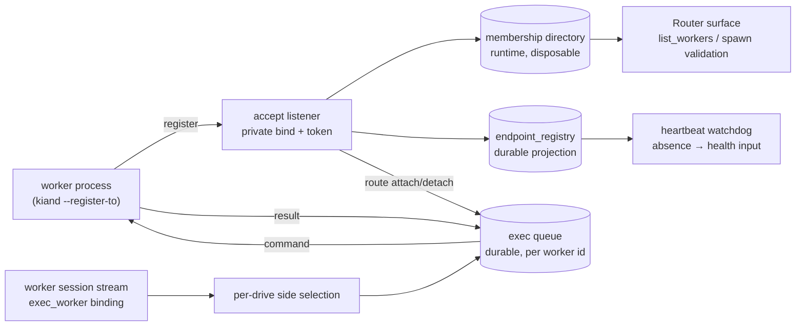

# Worker model — the worker-domain contract

- **Status**: normative (landed with Round 12; ADR-021 implemented and reviewed — acceptance and
  review evidence in the board's `shared/round12/` and the CHANGELOG R12 entry).
- **Date**: 2026-11-08
- **Owns**: worker-domain *semantics* — identity, membership lifecycle, binding and dispatch rules,
  catalog/discovery, security boundary, version/upgrade policy, degradation, boundaries, UNVERIFIED,
  and the change protocol for all of the above.
- **Does not own**: wire frames/params/errors ([API-CONTRACT](API-CONTRACT.md) §8/§9), event
  envelope/kinds/payload bytes ([EVENT-MODEL](EVENT-MODEL.md) — unchanged by this contract), serving
  forms ([READ-MODEL](READ-MODEL.md)), assembly/HOW ([DESIGN](DESIGN.md) §4.1/§4.3/§4.7), rationale
  ([ADR-020](decisions/ADR-020-durable-worker-binding.md),
  [ADR-021](decisions/ADR-021-runtime-worker-membership.md)), product scope (`docs/SPEC.md`).

## 0. Scope and authority split

| Question | Owner |
|---|---|
| What is a worker, how does membership transition, what may a binding mean, how is a command dispatched or queued, what does the Router see, what is the security boundary, what happens on each failure, how does the wire version upgrade? | **this file** |
| Why runtime membership, why worker-dial, why a shared token and not mTLS, what was rejected | [ADR-021](decisions/ADR-021-runtime-worker-membership.md) |
| Why a durable per-session binding, why 1:1, why the binding rides two existing events | [ADR-020](decisions/ADR-020-durable-worker-binding.md) (D1–D4, D8–D16; D5/D6/D7 superseded by ADR-021) |
| Frame names, field names, `PROTOCOL_VERSION`, the rejection reason set, upgrade notes | [API-CONTRACT](API-CONTRACT.md) §8, §9.1/§9.2 |
| The additive `exec_worker` keys on the delegation wrapper and `thread/started` | [EVENT-MODEL](EVENT-MODEL.md) §3, §4.2 |
| Queue durability, at-least-once, command-id dedupe, re-drive | [ADR-007](decisions/ADR-007-kiand-delivery-semantics.md) |
| The 1:1 live-session exclusivity and the single drain it leans on | [ADR-009](decisions/ADR-009-multi-replica-claim-admission.md) |
| Crate placement, assembly, config surface, CLI verb shape | [DESIGN](DESIGN.md) §4.3/§4.7 |

This contract introduces **no** new event kind, **no** new table, **no** new HTTP route, **no** new
ops method, and **no** new metrics key. It fixes one wire version (KiandProto v3, owned by
API-CONTRACT §8) and one additive config section (`workers:`).

## 1. Terms and identity

- **Worker** — an execution endpoint process that runs commands on its own machine. Two carriers,
  one identity: the `kiand` daemon and the `kian-endpoint` library embedded in a process.
- **Worker id** (`endpoint_id`, `endpoints[].id`) — the **identity**. An opaque non-empty string,
  1–200 bytes, no control characters. It is never an address: an address can change, an id must not.
  A worker that restarts, upgrades or moves reuses its id and is the *same* worker to every rule here.
- **Execution worker vs worker session** — never conflated. `exec_worker` (the id) names the machine;
  `worker` on `thread/started` names the worker **session** uuid. The two are different objects with
  different lifecycles.
- **Member** — the runtime directory entry for an id: description, protocol version, connection
  generation, last-seen, observed peer address. Disposable; a projection of live connections.
- **Last-declared cache** — the two *declaration* facts (description, protocol version) persisted on
  the registry row for the cold-start catalog (ADR-025). It is a cache, not a membership fact: the
  live directory wins while the worker is connected, and a row served from the cache is flagged
  `declaration_stale`. State/liveness/bindability never come from it.
- **Binding** — the durable, session-immutable assignment of one worker session to one worker id
  (ADR-020). Not a member, not a connection, not a route.
- **Route** — the live command channel for one worker id, created when a member registers and torn
  down when it leaves. The only component that turns queue rows into wire dispatches.
- **Static worker / dynamic worker** — a static worker is a pinned `endpoints:` entry (kian dials it;
  its description is config-owned); a dynamic worker is one that registered itself over the
  registration listener.
- **Enrolled worker** — a dynamic id listed in `workers.tokens`; it authenticates with its own
  token, and a listed id never accepts the shared token. With `workers.enrolled_only: true` the
  enrollment map is the complete admission set ([ADR-031](decisions/ADR-031-worker-enrollment.md)).
- **Capability declaration** — the optional `capabilities` list a worker sends in `register`
  (v3, [ADR-032](decisions/ADR-032-worker-declared-capabilities.md)). The server sanitizes it and
  caches the accepted list on the registry (migration v5); `list_workers` and `kian workers`
  surface the live declaration or the cached one. It never enters a prompt, a tool schema or the
  event stream.
- **Drain holder** — the single process permitted to run a session's drain (ADR-009). Not a worker
  fact; listed here only because "1:1" and "no split brain" are different rules.

## 2. Membership lifecycle

A member is `online`, `offline`, or (briefly) `draining`. State is **computed**, never stored: online
means *a live connection and a heartbeat inside `offline_after_ms`*; draining is the teardown window;
everything else is offline. The durable projection never carries a third state.

| Transition | Trigger | Result |
|---|---|---|
| **Join** | an authenticated `register` on the listener | member online with a new connection generation; a route is attached and immediately re-drives that id's `pending`/`inflight` rows; one audit line |
| **Heartbeat** | a `heartbeat` frame on the live connection | last-seen advances (server clock); the registry row refreshes; state stays online |
| **Heartbeat absence** | no heartbeat for `offline_after_ms` while the transport is still up | state computes to offline; the existing watchdog observes the same staleness from the registry's last-heartbeat column and admits the ordinary `endpoint_health` input to affected live worker sessions. The route stays attached (the transport is up; a route is not an authority) |
| **Graceful leave** | the worker sends `bye`, then exits | route detached, state draining → offline, audit line distinguishes a graceful leave |
| **Crash** | transport loss with no `bye` | identical in effect to a leave, different audit wording; the row stays durable and parked |
| **Replace** | a newer authenticated `register` for an id that is currently online | after serializing on the per-id slot: the old connection is closed, its route detached, the new route attached, the generation incremented, one `replaced` audit line. The old connection's outstanding rows re-drive on the new route by the ordinary queue rule — no special fencing code |
| **Kian restart** | process start | the directory is empty; registry rows persist with stale timestamps, so every id reads offline. The last-declared description/version survive on the registry row and are served for registry-only ids with `declaration_stale: true` (ADR-025) until the worker re-registers — then the live declaration replaces the cache. Dynamic ids are **not** re-seeded: kian does not invent members it has not been told about this process lifetime |
| **Kian upgrade** | new binary, same identity | same as a restart, plus the version policy (§7). No worker-side config change is ever required |
| **Worker restart / upgrade** | the worker process restarts with the same id | it reconnects with bounded backoff and re-registers; the binding is unchanged; subsequent commands go to the same id |
| **Version mismatch** | a peer whose protocol revision differs | typed refusal, one audit line, no state change, no half-compatible connection (§7) |
| **Id collision (static)** | a dynamic registration whose id is a static pin | refused and audited; the static pin keeps the id and its route |
| **Id collision (malformed)** | an id violating §1's shape rule | refused and audited; a worker validates its own id at startup, so this is a defence, not a path |

Membership facts never enter the event stream: no `worker/joined`, `worker/left` or similar kind, and
no membership column anywhere durable except the existing registry row (id, addr, last heartbeat,
state, and the two last-declared cache columns of ADR-025 — declarations, not liveness). **Stale ids
are never pruned** in this contract: a previously known id stays visible and offline, which is what
makes §3's offline-known binding honest. (A TTL would make a known worker look
unknown and turn an honest park into a refusal — the reason the TTL question is deferred.)

## 3. Binding contract

- **Immutable.** A worker session's binding is durable bytes on its own stream (the delegation wrapper
  and its `thread/started`, ADR-020) and never changes for that session's lifetime. Nothing in
  membership touches it: a join, leave, replace or restart never rewrites, reorders or re-emits it.
- **Derived, never resident.** Routing is a per-drive selection from the session's own stream. There
  is no binding map, no routing table. Restart rebuild therefore equals replay by construction.
- **1:1 over live sessions.** One worker has at most one live bound worker session. "Busy" is
  live-session based, not connection based: `completed`/`cancelled` release the worker,
  `failed`/`interrupted` are resumable and still hold it, and a never-started reservation holds it
  only until its lease timeout. An **offline** worker with a live bound session is still busy.
- **Offline is a valid binding state.** A spawn may bind a known-but-offline worker: the command is
  enqueued durably, parks, and runs when the worker returns or ends in the honest queue timeout. The
  spawn result and one audit line say `offline — commands will queue`.
- **No failover, ever.** A worker going offline never releases a binding, never reroutes a command,
  never runs it locally, and never hands it to a different id. A permanently lost worker produces the
  honest timeout and a parked session — never a takeover.
- **Legacy unbound.** A worker session with no binding on a server that has workers keeps the legacy
  first-endpoint route and one `legacy unbound` audit line; it is never rewritten, never rebound, and
  never counted as bound. Zero configured workers means the whole feature is off and behavior is
  byte-identical to pre-ADR-020.
- **Rebuild == replay.** A restarted kian plus a re-registered worker must reach the same state as
  before the restart: the same binding from the stream, the same directory from the new registrations,
  the same parked rows from the queue.

## 4. Dispatch and queue

- **Queue-first by id.** `exec` (and, since v2, each `fs_list`/`fs_read`/`fs_write`) enqueues a
  durable row keyed by the session's bound worker id **before any dispatch**, and then awaits the
  correlated outcome. Both command families share one queue, one command-id dedupe and one queue
  timeout; the row carries its family so a restart re-drives it through the same frame family. A missing route is not an error: the row
  parks `pending` until a route appears, or `queue_timeout` abandons it honestly (the caller gets a
  timeout, the row stays terminal and answers a duplicate id with the same honest timeout).
- **Runtime routes.** A route exists iff the member is online. Attaching a route re-drives that id's
  `pending` and `inflight` rows; detaching a route leaves the rows durable and parked. Static
  workers keep their boot-created routes.
- **At-least-once with command-id dedupe.** Delivery is ADR-007's: a row may be dispatched more than
  once across a crash or a reconnect (the endpoint may therefore execute a command twice), but it
  **settles once** — the command id is the dedupe key and a settled row answers every re-execution
  from the durable record. For the v2 filesystem family the same rule is recorded explicitly:
  `fs_list`/`fs_read` are idempotent, and a repeated `fs_write` writes the same path and content
  again (mtime may move) — never a different payload.
- **Re-drive is bounded** ([ADR-035](decisions/ADR-033-bounded-queue-redrive.md)). At-least-once
  must also terminate, so every dispatch counts an attempt: a `pending` row always dispatches,
  while an `inflight` row re-drives only while its `dispatch_attempts` are below
  `1 + workers.queue_max_redrives` (default `1`; `0` = first dispatch only; global by construction,
  like the queue timeout). A row whose result was lost to a transport loss therefore gets its
  retry; a row that keeps losing its result because the **command itself** destroyed the ack path
  — `systemctl restart kian`, `pkill kiand` — can never be acknowledged, so the driver converges
  it: `inflight → abandoned` once the bound is spent **and** no live lease is held, with one audit
  line naming command id, endpoint, attempt count and `tool_call_ref`. No result is fabricated, no
  row is deleted, no new status or event exists; a caller re-attaching after the fact reads
  `abandoned` and gets the honest timeout. The bound is a recovery cap, not a retry policy: a row
  abandoned here may have run — the audit line says so.
- **No cross-worker dispatch.** Every driver filters rows by its own id. There is no fallback route,
  no "any online worker", no local-exec substitution for a bound session.
- **Honest timeout, bounded per phase** (ADR-030). A wait is bounded by what is actually being
  waited on, never by one knob for both:
  - *Dispatch wait* — the row is `pending`: no route has taken it. `queue_timeout` is the bound on
    an absent worker: the backend takes one value — the max over static
    `endpoints[].queue_timeout_ms` and `workers.queue_timeout_ms`
    ([ADR-031](decisions/ADR-031-worker-enrollment.md) D3). Expiry marks the row `abandoned`, which
    is honest because nothing ran. The bound is global by construction: raising it for an
    intermittent device also lengthens every queued command's dispatch wait and shifts the
    execution bound below by the same amount.
  - *Execution wait* — the row is `inflight`: a worker is executing it. The command's own
    `timeout_ms` (the worker-side kill bound) is what bounds it, so the wait bound is
    `2 * exec_bound + queue_timeout` (`exec_bound = timeout_ms`, or `queue_timeout` when absent) —
    one dispatch plus one at-least-once re-dispatch plus slack. Expiry **does not mutate the row**:
    the caller stops waiting, the queue row keeps the truth and stays re-driveable. Never a
    fabricated result, never a silent retry against another worker.
  - The synchronous `exec` (`WaitPolicy::Caller`) takes only the dispatch wait, because it parks a
    drain; the async `start` observer (`WaitPolicy::Job`) takes both, because nothing is parked.
    `exec` refuses a `timeout_ms` larger than its own wait bound at call time (fail-closed, no row,
    no dispatch) instead of running to a timeout that reads like a kill.
  - A remote wait expiry surfaces what it observed: `row_state` (`pending` — never dispatched and
    now abandoned; `inflight` — started and still running, result discarded by this call only;
    `abandoned` — a prior abandonment answered from the row), `still_running`, `row_abandoned` and
    the bound in force. The success shape stays identical to the local built-in's; the extra keys
    describe a state only the remote half can be in (the local `exec` kills its own child, so its
    timeout is already unambiguous and claims nothing about a surviving grandchild). A job observer settles its
    `async_jobs` row instead of a tool result: phase-A expiry `abandoned` (never dispatched),
    phase-B expiry `abandoned` ("worker silent past the command's own bound") with the live queue
    row untouched; `stop` remains the escape hatch.
- **A budget stop is `interrupted`** (ADR-030). The loop's only intentional-stop producer is
  iteration-budget exhaustion; the worker records `thread/completed{status:"interrupted"}` with the
  stop reason as the summary — never `completed`, whose summary would otherwise be the last
  assistant turn (a pending tool call with empty text). The following `session/ended{completed}`
  still decides liveness (`Released`), so the worker is reusable; `session/ended{interrupted}` for a
  budget stop is deferred to its own ADR because it holds the worker until a designed resume/cancel
  exists.
- **Callers survive route swaps.** A caller's future is attached to the command id, not to a
  connection, so a detach/attach cycle (replace, restart, reconnect) never severs a live wait.

## 5. Catalog and discovery

- **The catalog is runtime data.** It is static config ids ∪ every id the registry has ever seen. It
  is **not** configuration-only and **not** prompt content.
- **`list_workers`** (Router-only, read-only, no arguments) returns the live catalog: id, optional
  description, state (`online`/`offline`/`draining`), the worker-declared `capabilities` array when
  non-empty (ADR-032), and the live bound session/thread when one exists. A registry-only id's
  description/version/capabilities come from the last-declared cache and the row carries additive
  `"declaration_stale": true` (ADR-025/ADR-032); a live registration's row omits the flag and is
  byte-identical to the pre-cache result. An id with an empty declaration omits the field. Rows
  are ordered by id. It writes nothing — no event, no row, no wake.
- **Spawn validation order** (every refusal precedes every side effect): argument shape → feature off
  (nothing configured) → unknown id (refusal names the known ids) → 1:1 busy (names the owning session
  and thread) → offline-known allowed (with the queue note) → follow-up ownership → speculation cap →
  mandate → mint/lineage/admit.
- **Prompt/schema stability.** The `spawn_worker` schema and the judge prompt contain **no** membership
  data: `exec_worker` is a plain non-empty string (required whenever membership is on, never an enum),
  and the prompt carries one frozen instruction line telling the model to call `list_workers` and
  never invent an id. A join, a leave or a capability-catalog edit therefore changes no prefix byte
  (capabilities are result-only). New sessions pin a new `superagent.policy.version` when the text
  changes; live sessions keep their persisted prompts and the drift machinery reports the mismatch
  instead of rewriting them.

## 6. Security boundary

- **Private listener by default.** The registration listener binds loopback, RFC1918, CGNAT
  `100.64.0.0/10` or IPv6 ULA. A wildcard or public bind refuses startup unless
  `workers.allow_public: true` is set explicitly; no doc example sets it. Reaching a private listener
  from another machine is SSH tunnel or Tailscale/WireGuard — never a published port.
- **Env-only tokens.** `workers.token_env` names the shared token's environment variable;
  `workers.tokens` maps an id to its own variable name. The listener refuses to start when a named
  variable is absent or blank. Values are compared constant-time, never written to config, argv,
  logs, events, error text or metrics, and are held in a redacting type so an accidental `{:?}`
  cannot print them. Failed attempts are bounded (one per connection; a per-peer window bound), and
  every refusal is audited without secret material.
- **Enrollment narrows the shared-token limitation.** A listed id authenticates only with its own
  token: the shared token cannot replace it. With `workers.enrolled_only: true` (requires a
  non-empty enrollment map and forbids `token_env`) only listed ids are admitted at all. In hybrid
  mode (both configured) an unlisted id still falls back to the shared token — the R12 limitation
  **narrows, it does not disappear**. **mTLS / per-worker certificates is the R13 fix** and remains
  a prerequisite for any hosted or multi-tenant use; per-worker bearer tokens are not a substitute
  ([ADR-031](decisions/ADR-031-worker-enrollment.md)).
- **No new inbound HTTP surface.** The listener is the KiandProto socket, not an HTTP route; `/rpc`,
  `/ops/rpc` and `/metrics` keep their existing (unauthenticated, deployment-bounded) posture. A
  worker never gets control-plane access.
- **Fs root is a guard, not a sandbox.** The v2 filesystem commands resolve under the worker's
  `--workspace-root` and refuse `..` lexically; `exec` already runs arbitrary programs as the same
  user, so fs adds no authority. A symlink can still point outside the root — recorded, not
  claimed as isolation (same caveat as the local built-in fs tools).

## 7. Version and upgrade policy

- **KiandProto v3.** `PROTOCOL_VERSION = 3` in both halves (`kian-exec`, `kian-endpoint`), declared
  independently and pinned by dual goldens in the same change; frames (exec + the v2 filesystem
  pair + the v3 optional `register.capabilities` field) and the closed rejection reason set live in
  [API-CONTRACT](API-CONTRACT.md) §8. ADR-031's enrollment and queue-bound parts are config-only
  (no wire change); its D2 config catalog is superseded by ADR-032's worker declaration.
- **Upgrade order: kian first, workers second.** During the window a v0 static endpoint is refused
  with a typed terminal version error plus one audit line (its route stays offline; never a fake
  connect); a v0 worker — which has no register mode at all — simply never registers and reads
  offline; and a v1 worker (no filesystem frames) is refused `version_mismatch` until upgraded,
  with its parked commands staying parked (no lost work, no dispatch to a wrong machine). Both are
  visible and honest, and neither is a half-compatible connection.
- **No compatibility shim.** A peer on the wrong revision is refused, never silently accepted: the v0
  and v1 steady states differ only by the version integer, so "compatibility" would buy nothing except
  an invisible half-upgraded deployment.
- The registration frame carries the worker's declared revision; `welcome` carries the server's. The
  server also directs the heartbeat cadence in `welcome`, so liveness policy stays server-owned.

## 8. Failure and degradation

| Condition | Detection | Behavior | Blast radius |
|---|---|---|---|
| Worker absent (never registered yet, or offline) | no route / no member | spawn is allowed only for a **known** id; commands park durably; the honest queue timeout is the bound | that worker's sessions, parked — nothing else |
| Worker transport loss mid-command | connection closed | route detached, member offline, row stays `inflight`; re-drive on re-registration (at-least-once, dedupe at settlement) | that worker |
| Heartbeat silence on a live connection | `offline_after_ms` of staleness | state offline; the existing watchdog admits the ordinary `endpoint_health` input to affected live sessions (it reads the last-heartbeat column only and never writes); the route stays attached | that worker |
| Duplicate id, newer registration | authenticated `register` while online | replace: old connection closed, route swapped, generation incremented, audited | that id only |
| Duplicate id vs static pin | registration | refused and audited; static pin unchanged | that id only |
| Malformed registration payload | validation | refused (`id_conflict`) or the description is dropped with an audit line; no state change | that connection |
| Version mismatch | handshake | typed refusal + audit; connection closed; no state change | that worker |
| Bad/absent token, or an unlisted id in strict mode | comparison | typed `bad_token` refusal + audit, one attempt per connection, per-peer bound, rate-limited closes beyond the window; strict mode does not reveal whether the id is enrolled | that peer |
| Listener configured but token env unset/blank | startup validation | the whole `serve` process refuses to start | whole process (configured capability) |
| Public/non-private bind without `allow_public` | startup validation | the whole `serve` process refuses to start | whole process |
| Kian crash / restart | process start | directory empty, registry rows stale ⇒ every worker reads offline; the last-declared cache keeps the description/version (flagged stale) for registry-only ids; bindings rebuild from streams; rows re-drive | all workers, transiently |
| Listener shutdown / drain | shutdown | live members get a `bye`, routes detach, rows stay parked; registering peers are refused | all workers |
| Fs path escapes the root (`..`) | server-side lexical check before enqueue; worker-side re-check | honest `InvalidCall` (no row) or a typed `io` error result — never a write outside the intended path | that call |
| Fs body over 1 MiB / non-UTF-8 read | worker-side bound / decode | typed `io` error surfaced as the local `{"error": …}` tool result; no truncation, no partial write | that call |
| Queue timeout | timer | row abandoned honestly, caller gets a timeout; a duplicate command id answers with the same timeout | that command |

No degradation path maps onto a `completed` session, invents a result, silently swallows a command, or
fails a command over to another worker. Every row above is an audit line plus an honest error at the
seam.

## 9. Boundaries and non-goals

- **One kian instance.** A worker registers to exactly one `kian serve`. There is no federation, no
  relay, no "register to all replicas", no cross-instance dispatch. A second kian is a different
  deployment with a different membership.
- **No live rebind / retirement / takeover.** R12 guarantees only that the *same* worker id coming
  back reattaches to its binding. A permanently lost worker ends in the honest timeout. The rebind
  design (durable intent, fencing for the old worker's queued rows, a seq-range projection rule) is
  recorded in ADR-020 §Deferred and ADR-021 §Deferred and is an owner gate, not a spec detail.
- **No mTLS and no per-worker certificates; no token rotation without restart.** Per-worker bearer
  tokens (ADR-031) narrow the shared-token hole but are not an identity proof; the R13 fix remains
  mTLS. Rotation today is "set a new env value and restart".
- **No worker pools**: 1:1 stays.
- **Capabilities are declarations, not authority.** The worker declares them in `register` (v3);
  the server sanitizes (lowercase `[a-z0-9._-]`, ≤16, unique) and caches the accepted list. A
  wrong or stale entry misleads selection; it grants nothing. Capability-based spawn validation and
  enforcement are out of scope. Static pins have no declaration in this phase (`hello` unchanged);
  their catalog row omits the field.
- **No per-id queue timeout, rebind or failover.** The dynamic bound (`workers.queue_timeout_ms`)
  is one backend-level value; the ADR-020 deferred machinery is unchanged.
- **The worker fs surface is the three text tools** (`fs_list`/`fs_read`/`fs_write`, 1 MiB bounds,
  `--workspace-root`, lexical `..` guard; [ADR-023](decisions/ADR-023-worker-fs-tools.md)). Binary
  bodies, streaming/large files, `fs_edit`/glob, a symlink-proof sandbox and fs tools on the Router
  or plain sessions are out of scope.
- **No membership data in prompts or tool schemas** — `list_workers` results only. The last-declared
  cache is non-authoritative: the live directory wins, a cached row is labeled `declaration_stale`,
  and no membership decision (identity, state, bindability, routing, spawn legality) reads it.
- **No public listener**; no hosted multi-tenant concerns.
- **No new event kind, table, HTTP route or ops method.** One additive registry-column migration
  (v5, the capability cache) is part of ADR-032.
- Deployment (Vultr, WeChat) remains the owner's later discussion.

## 10. UNVERIFIED (must stay visible)

- The real v0→v1 upgrade window has not been exercised with an old build in this round; the typed
  refusal is verified at L1 and the process-level window stays unverified until R12-06 measures it.
- Process-death windows (kian dying mid-handshake or mid-command, worker dying mid-command) are
  reproduced only where the L2 harness can inject a kill; the L1 fixtures cover the *states* those
  windows leave behind, not the death itself.
- Tailscale/SSH-tunnel reachability and any non-loopback bind are deployment properties: documented,
  not tested. Only loopback legs run in CI.
- Per-spawn cost (directory snapshot + registry read) is unmeasured; small scale is assumed.
- The shared-token impersonation limitation is a design fact, not a tested behaviour: the tests can
  only assert that no *other* identity channel exists. Per-worker tokens and strict enrollment are
  tested over real loopback TCP (accept/refuse matrix) and config validation; token rotation,
  leak revocation and a real multi-device deployment are unverified.
- The capability declaration is worker-supplied and tested through `register` → the directory →
  `list_workers`/`kian workers` (sanitization, live view, cached view). Drift between the declared
  list and the worker's actual build is undetected by construction (a declaration is not an
  execution proof), and there is no L3 evidence.
- The global `workers.queue_timeout_ms` trade-off is documented, not measured: no test exercises a
  phone-length bound against a static worker's timeout expectation.
- No L3 (real deployment) evidence exists for this contract.
- The v1 → v2 upgrade window has not been exercised with a real old worker binary in this round; the
  typed refusal is L1 and the queue's legacy-row decode is tested, but the cross-version deployment
  window stays unverified until measured.

## 11. Change protocol

| Change | Starts here? | Also required in the same change |
|---|---|---|
| Membership semantics (lifecycle, states, pruning, bind policy) | **yes** | `design/WORKER-MODEL.md` first; then code + tests; ADR if the *why* changes |
| A wire frame/field/error/reason, `PROTOCOL_VERSION` | no — [API-CONTRACT](API-CONTRACT.md) §8, §9.1/§9.2 | both halves' goldens, SDK fixtures if any, this file's §7 pointer if the policy changes |
| A `workers:` config field (`tokens`, `enrolled_only`, `queue_timeout_ms`) | **yes** — this file | `kian-cli` config validation + assembly, `list_workers`/`kian workers` surfaces, ADR when the security or timeout *why* changes |
| An event payload key (`exec_worker`, `thread/started`) | no — [EVENT-MODEL](EVENT-MODEL.md) §3/§4.2 | code, tests, DESIGN §4.1 |
| The worker command families (exec, fs) / dispatch semantics | **yes** — this file | API-CONTRACT §8 for frames; code + L2 tests; ADR when the family set changes |
| A durable registry column / last-declared cache change | **yes** — this file | ADR + kian-exec migration; code + store tests; `list_workers`/CLI surfaces |
| A new event kind or authoritative table | **owner gate** (ADR + EVENT-MODEL) — not a spec decision | — |
| Assembly/HOW, crate placement, config surface, CLI shape | no — [DESIGN](DESIGN.md) §4.3/§4.7 | config validation tests, docs map |
| Rationale, alternatives, deferred seams | no — a new ADR (append-only; supersede by linking) | — |
| Product scope / status row | no — `docs/SPEC.md` §5 (closeout card) | — |

Two rules that bind every change here: **membership is liveness, not truth** (no membership fact may
become durable state outside the existing registry projection), and **membership never touches a
prompt or a tool schema** (data flows through `list_workers` results only).
