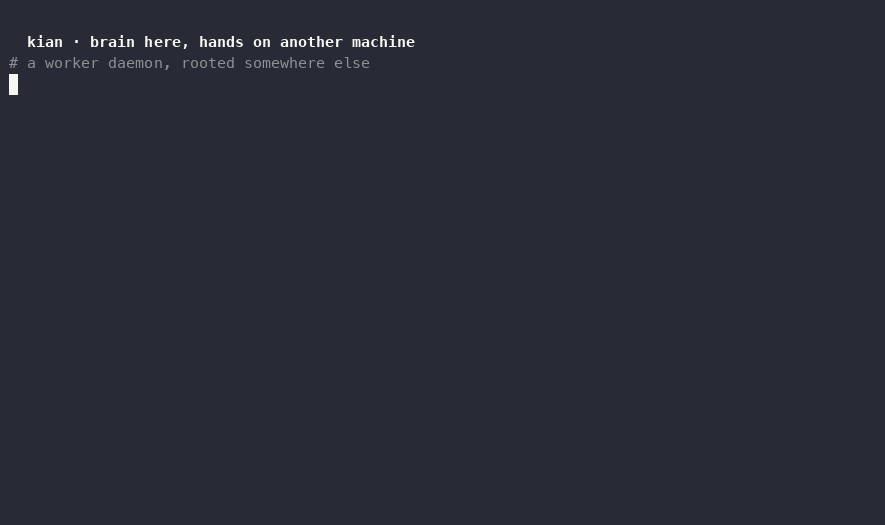

# Kian — capability and usage guide

> The full capability list and the usage recipes: the super-agent bundle, channels, bundle policies,
> the task board, BYOM endpoints, postgres, the embedded SDK, the harness bridges, tool permissions,
> hook plugins, agent memory, the read model, scheduled turns and the operator surfaces.
>
> Semantics live in the contract ([SPEC.md](SPEC.md)) and the blueprint
> ([DESIGN.md](../design/DESIGN.md)); the normative sub-contracts are under [design/](../design/).
> The five-minute path is the [README quickstart](../README.md#quickstart).

## What ships

- **Audit by construction** — the append-only event stream is the only truth; replay is
  byte-identical and `session export` produces a replayable audit package.
- **Cost as an invariant** — model request bytes are persisted before send, history is never
  rewritten, and cache-prefix stability is observable (`compact` is the only deliberate break).
- **Bounded recovery** — pure error classification plus a caller-owned policy table, with one-shot
  guards and token/wall-clock budgets.
- **Human-in-the-loop by design** — a tool call can be deferred for approval (`permissions: ask`):
  the drain ends `awaiting_input` without holding a lease, the pending call is derived from the
  stream, and the answer is a durable control row that resumes the same turn — same prefix bytes,
  no lost work if the answer arrives after a restart.
- **Multi-replica safety** — epoch fencing + `expectedSeq` CAS reject stale writes; sqlite by
  default, postgres for replicas (`KIAN_PG_URL`).
- **Super-agent bundle** — Router/Worker over Thread delegation, event subscriptions,
  evidence-gated completion, and channel output policies — all outside the core.
- **Real channels and intake economics** — Lark IM, GitHub (webhook + poll), WeChat iLink
  (best-effort long-poll, QR login) and iMessage through a Mac-side bridge, two-level admission
  filtering, Inline/Spill shaping, Chain of Recall, and untrusted-input marking.
- **Bundle policy layer** — speak-rules, delegation Mandate, bounded outbox retry, policy
  versioning/drift marking, and the `kian tickets` stage board.
- **Scheduled turns** — declarative `superagent.cron` schedules execute as ordinary durable turns
  (resident, or a detached per-firing git worktree), with a durable slot cursor, DST-correct
  next-fire math, misfire coalescing, disk guards and a `kian cron list|run-now|logs|rm` surface.
- **Declarative jobs** — `superagent.jobs` declares a plan of capability-addressed steps:
  a trigger starts a run (an ordinary durable session), one child session runs each step, text
  artifacts move by reference, each step is proven by the evidence gate, delivery is the channel
  adapter's receipt, and a failed run raises an alert run — with `kian job list|status|run|cancel`
  ([JOB-MODEL](../design/JOB-MODEL.md)).
- **Durable worker binding** — each delegated worker session is bound 1:1 to one `kiand`
  worker (Router-chosen from the worker catalog, recorded as additive event bytes,
  re-derived from the stream): worker restarts, migrations and server reboots keep the
  binding; a busy or unknown worker refuses honestly, and `kian workers release <id>` closes a
  thread that ended `interrupted`/`failed` (or the bounded reclaim does) so a dead thread can
  never leak the slot ([ADR-035](../design/decisions/ADR-035-worker-release-and-idle-reclaim.md)).
- **Runtime worker membership** — workers join and leave a running server without config edits
  or restarts: `kiand --register-to` authenticates on a private listener (shared token or
  per-worker enrollment) and the connection becomes the command route; commands queue durably per
  worker id while one is offline, `list_workers` exposes the live catalog including an
  worker-declared capability list, and join/leave never changes a prompt byte.
- **Worker filesystem tools** — `fs_list`/`fs_read`/`fs_write` execute on the **bound worker's**
  machine (its `--workspace-root`, a lexical path guard, 1 MiB bounds) with the same schemas and
  result shapes as the local built-ins; the durable queue, 1:1 binding and no-failover rules are
  unchanged (KiandProto v2, [ADR-023](../design/decisions/ADR-023-worker-fs-tools.md)).
- **Hook plugins** — operator-trusted sidecars extend the harness at the admission, tool and
  settlement boundaries ([PLUGIN-SPEC](../design/PLUGIN-SPEC.md), [ADR-028](../design/decisions/ADR-028-harness-hook-plugins.md)):
  observe every port, deny a side effect before it happens (`tool/pre`), gate `completed`, with
  per-dispatch deadlines, digest-pinned spawns, quarantine and fail-closed defaults — in any
  language that speaks newline-delimited JSON on stdio.
- **Audited web tools** — DeepSeek Search and Fetch mount as ordinary `web_search`/`web_fetch` tool
  calls on your own key: every request and response is an event on the durable stream, large pages
  spill through the artifact path, and failures are honest classified results
  ([ADR-057](../design/decisions/ADR-057-client-side-web-tools.md)).
- **Agent memory (notes + dreaming + creation-time injection)** — the memory session's drain reads
  a bounded transcript range and appends `memory/note` events (claims with provenance and
  verification state); `kian memory create/dream/list/show/verify` plus the read-only
  `kian memory search|map` views over the notes. New sessions can open with a
  bounded, verified-only memory index injected once at creation (`memory.session`, config-gated,
  byte-identical when off).
- **Read-model serving form** — versioned unchanged/delta projection reads, resumable SSE
  (`Last-Event-ID`), verified snapshots + tail replay, materialized operator views, opt-in
  export-only archive, and an explicit-allowlist fan-in stream — all disposable projections;
  the event stream stays the only truth.
- **Operator surfaces and SDK** — inspect/replay/export/tickets/board/tasks/usage-stats/cost/workers,
  `/metrics`, and a frozen wire-only `kian-sdk`.
- **Model-neutral and self-hostable** — any OpenAI-compatible provider or gateway; one Rust
  process plus embedded sqlite is the whole system, with no hosted service required.


## Super-agent bundle (Router / Worker)

The super-agent reference architecture is a *bundle* over the core, never a core capability: a
resident Router session judges incoming events, dispatches work to Worker sessions over Thread
delegation, and the worker's completion must pass the evidence gate before the Router delivers.
On top of the quickstart config (same provider), enable the bundle and define its templates:

```yaml
plugins: ["openai-compat", "local-tools", "superagent", "remote-exec"]
agents:
  router:
    id: router
    model_slots:
      router: { provider: deepseek, model: deepseek-flash }
    tools: ["spawn_worker", "reply", "deliver_structured"]
  worker:
    id: worker
    model_slots:
      main: { provider: deepseek, model: deepseek-flash }
    tools: ["fs_list", "fs_read", "fs_write", "exec"]   # fs_* run on the bound worker (v2)
superagent:
  router: { session_id: "00000000-0000-0000-0000-000000000001", agent: router, slot: router }
  worker: { agent: worker }
  channels:
    mock-im: { type: mock-im }
  subscriptions:
    - { channel: mock-im, match: always, route: router }
endpoints:
  - { id: dev-box, addr: "127.0.0.1:7401", queue_timeout_ms: 30000, offline_after_ms: 5000 }
```

With the server running:

```bash
cargo run -p kian-cli --bin kian -- mock-channel-send mock-im --text "deploy please"
curl -s localhost:7433/metrics | jq .superagent   # evidence / subscription / channel counters
```

To delegate to named agents, add a roster: each entry points at an `agents:` definition, and
`tools_allow` narrows the child's tools to exactly the intersection with that definition's
`tools:` (see DESIGN §4.8 and MULTIAGENT-MODEL §7.3). The Router's `spawn_worker` then accepts
`agent`, `task_key` and `output_schema`:

```yaml
superagent:
  roster:
    - id: researcher
      description: Finds and cites sources
      agent: researcher            # an entry in agents: with its own model slots
      mandate_template: { scope: read-only research, strength: inferred }
      tools_allow: ["fs_read"]     # the child sees only these tools
```

```bash
cargo run -p kian-cli --bin kian -- agents   # list the delegation roster
```

## Channels (GitHub, Lark, WeChat, iMessage)

Channels admit external events into subscriptions. `type: github` mounts the `POST /webhooks/github`
receiver; the topic-mapping table doubles as the receive allowlist. The same channel can poll with
`since` cursors instead of receiving webhooks.

```yaml
superagent:
  channels:
    github:
      type: github
      github:
        topics: { "flyer103/kian-runtime": "kian-repo" }   # owner/repo → topic; also the allowlist
        send: true                                  # reply half; requires KIAN_GITHUB_TOKEN
        webhook: { max_body_bytes: 1048576 }        # mounts POST /webhooks/github
    lark-im:
      type: lark
      lark:
        topics: { "oc_xxxxxxxxxxxxxxxx": "team-im" }
        poll_interval_ms: 2000
    wechat:
      type: wechat
      wechat:
        topics: { "oXXXX@im.wechat": "wechat" }     # sender → topic; also the allowlist
        credentials_file: ./.state/wechat-credentials.json   # written by `kian wechat login`
    imessage:
      type: imessage
      imessage:
        bridge_url: "http://127.0.0.1:7420"          # the Mac bridge, over an SSH -R / mesh VPN
        topics: { "+14155551212": "imessage" }       # handle → topic; both allowlists
        attachments: metadata                         # metadata (default) | bytes (needs media:)
        voice: false                                  # true = outbound voice replies (needs media: + artifacts:)
```

`type: wechat` is **best-effort by contract**: one long-poll loop per channel over Tencent's
reverse-documented iLink Bot API (~35 s server hold), text-only receive, and reply-only sends that
echo the latest inbound `context_token` — so it cannot message a user who has not messaged the bot
first. A stale token (`errcode -14`) pauses that channel and resumes when the credential file
changes ([design/CHANNEL-WECHAT.md](../design/CHANNEL-WECHAT.md)).

`type: imessage` needs a Mac signed into a dedicated Apple ID running
`kian-imessage-bridge` (Full Disk Access + Automation → Messages, `imsg` ≥ 0.14), because iMessage
has no API — the message must land on that Mac's `chat.db`. The adapter long-polls the bridge's loopback ABI;
the bridge's `participants` list keeps non-allowlisted conversations from leaving the Mac. An inbound
attachment arrives as `[image]`/`[attachment]` marker text plus its name, MIME type and size in the payload.
With `attachments: bytes` (which needs a `media:` section) the adapter also fetches image and audio items
through the bridge and hands them to the media edge, so their transcripts join the text; the bytes
never enter the event log ([ADR-064](../design/decisions/ADR-064-imessage-attachment-bytes.md)).
A row is admitted whole: while `chat.db` is still appending one message's attachments the adapter
holds its read position just before that row (at most five seconds) instead of admitting the
attachments that already arrived, so a burst of photos becomes one input with all of them. A row
that never settles is admitted with what arrived plus an audit line, and a row over the eight-item
media cap loses the excess items with an audit line
([ADR-070](../design/decisions/ADR-070-imessage-multi-attachment-settling.md)).
With `voice: true` the channel also *speaks*: the Router gains a `reply_voice` tool and a spoken
reply arrives as a native voice message where the Mac allows it, an audio attachment otherwise
([voice replies](#voice-replies-outbound), [ADR-067](../design/decisions/ADR-067-imessage-voice-io.md)).
`kian imessage check` is the read-only preflight
([design/CHANNEL-IMESSAGE.md](../design/CHANNEL-IMESSAGE.md),
[docs/runbook-imessage.md](../docs/runbook-imessage.md)).

Credentials are **env-only** (`KIAN_GITHUB_TOKEN`, `KIAN_GITHUB_WEBHOOK_SECRET`,
`KIAN_LARK_APP_ID`/`*_SECRET`, `KIAN_IMESSAGE_BRIDGE_TOKEN`) and absent values refuse to start
when the capability is configured
— with one deliberate exception: the WeChat token is *issued* by a QR scan, so it lives in the
local `0600` credential file named by `wechat.credentials_file`, never in an env var or
`kian.yaml` ([ADR-018](../design/decisions/ADR-018-wechat-ilink-channel.md)). The webhook receiver
verifies before it parses (size cap → content-type → HMAC constant-time
compare → rate limit), and real channels are untrusted-by-default. 

## Bundle policies (speak-rules, Mandate, outbox, policy version)

A few config-first policies sit between the Router and the outside world:

```yaml
superagent:
  im: { reply_units: 300 }                            # IM reply budget (default 300)
  speak_rules:
    - { channel: issue-github, when: result-ready }   # whether-to-send gate
    - { channel: phone, when: outcome-only }          # results + decisions, no ack
  mandate:
    scopes:
      worker: "draft a triage comment; never post unless DRY_RUN=0"
  outbox: { max_attempts: 6, backoff_cap_ms: 60000 }  # bounded delivery retry
  policy: { version: "2026-11-04.1", notify_live: false }
```

- **IM reply budget** (`superagent.im.reply_units`, default 300) caps a normal channel reply at
  that many units (a CJK character counts one; a Latin word counts one). The Router's judge prompt
  renders the same number, so the model is told what the policy enforces; the watchdog's
  `escalate` shares it. A `详情` reply is still delivered whole.
- **Speak-rules** (`{channel, when, per_topic_ack?}`, one condition per channel, first match wins)
  gate `reply` and `deliver_structured` over the closed vocabulary `always | ack-first-only |
  decision-needed | result-ready | outcome-only | never`. A suppressed send is an honest tool error
  naming the condition, an audit line and a counter — no send means no `channel/delivered`.
  `outcome-only` is the phone shape: results and decisions go out, the dispatch acknowledgement
  after `spawn_worker` does not, so a delegated task reaches the person once — when the outcome is
  ready. The acknowledgement slot belongs to the execution hold (one per dispatch) and is never
  persisted.
- **Mandate** is the immutable delegation authority object, carried verbatim into `thread/started`
  and revalidated before follow-ups ([ADR-012](../design/decisions/ADR-012-delegation-mandate.md)).
- **Outbox** is a disposable projection over send intent + delivery receipt; retries are bounded
  and a parked delivery names its conversation on the stage board.
- **Policy version** renders as a `[policy <label>]` header; boot-time drift is marked without
  rewriting live sessions.

## Delegation task board (kian board / kian tasks --all)

Every `spawn_worker` delegation is a task with a derived identity. The board is the read-only
operator surface over those tasks — one row per task, derived from the committed wrapper plus the
child's own stream (never from prose), served from the materialized `task_board` view when fresh
and from the honest full-stream derivation otherwise (identical output either way):

```yaml
superagent:
  board:
    enabled: true      # default false: no view published, verbs refuse with exit 2
    gating: true       # P4: the depends_on/group spawn arguments, readiness gating and the
                       # multiagent audit key groups (default false: P3 bytes exactly)
```

```console
$ kian board --db kian.sqlite
TASK_ID                               ASSIGNEE   ATTEMPT                OUTCOME              STATUS       GATE   EVIDENCE                  READY
8d810f2b-a34f-5188-81fb-3611c2489591  -                1     completed_verified         completed     pass   pass@6 (derived)          yes
4e69aaa3-4650-5b49-b37e-5b9a01ac212f  -                1           outstanding       outstanding   absent   -                          no

$ kian tasks --all --db kian.sqlite --json   # the same rows, flat / as {now_ms, version, tasks}
```

`kian tasks` without `--all` refuses with usage (there is no filtered task surface in v1); both
verbs write nothing — no events, no inbox rows, no view updates.

## BYOM execution endpoints

The cloud loop can execute commands on a remote endpoint daemon (`kiand`) over a durable queue:



**What the recording shows.** A `kiand` daemon started with a different workspace root; one event
goes in, the Router delegates to that worker, and the command it runs appears in the worker's
directory — not in the server's. ([replay the cast](assets/byom.cast))

```bash
cargo run -p kiand -- --listen 127.0.0.1:7401 --heartbeat-ms 1000 --workspace-root .
```

A worker session's `exec` runs commands on its bound worker; since KiandProto v2 its
`fs_list`/`fs_read`/`fs_write` do too, resolved under that worker's `--workspace-root` (default: the
daemon's working directory; the server's local fs tools are not used for a bound session). The
worker surface is text-only with a 1 MiB read/write bound; a larger body or a `..` path is an
honest tool error.

Rows are at-least-once with command-id dedupe; an offline endpoint parks work durably, a restarted
daemon reconnects and drains it, and the queue timeout is an honest `Timeout` — never a fake
success. The heartbeat watchdog admits a durable health input to affected worker sessions.

#### Durable worker binding (per session)

`endpoints:` is also the worker catalog: each entry gains an optional human `description` the
Router sees when picking a machine, and each delegated worker session is bound **1:1** to exactly
one worker for its whole lifetime
([ADR-020](../design/decisions/ADR-020-durable-worker-binding.md)).

```yaml
endpoints:
  - id: mac-mini
    addr: "127.0.0.1:7401"
    description: "local macOS dev machine — repo checkouts, cargo, git"
  - id: vultr-builder
    addr: "10.0.0.7:7401"
    description: "linux builder — docker, long builds"
```

Whenever worker membership is on (any `endpoints:` entry or a `workers:` section), the Router must
name one on every spawn —
`spawn_worker {"task": "run the release build", "exec_worker": "vultr-builder"}` — and the choice
is recorded as additive `exec_worker` bytes on the delegation (both sides' `thread/started`), then
re-derived from the stream on every restart: the worker's `exec` routes only to its bound daemon
across worker restarts, migrations (same id, new address) and server reboots, with no rebind and no
failover to another machine. A busy or unknown worker refuses the spawn honestly before any side
effect — the refusal names the owning session. There is no single-worker default: the argument is
required as soon as membership is on (a schema that depended on how many workers happen to be known
would change bytes when one joins), and with no workers configured the feature is off and the
argument is refused ([ADR-020](../design/decisions/ADR-020-durable-worker-binding.md),
[WORKER-MODEL.md](../design/WORKER-MODEL.md)).

A thread that ended `interrupted`/`failed` is resumable and keeps holding the worker — so it is
closed explicitly or after a bounded grace, never leaked forever. `kian workers release <id>` does
it now: one atomic claim + `session/ended{cancelled}` batch preserves the earlier honest end,
frees the slot, and makes the thread terminal (it can never resume into the slot a newer thread
holds). The same close runs automatically when the thread has been idle-ended for
`workers.release_after_ms` (default five minutes, `0` disables). A running thread, a thread with
eligible input, or a worker still owing a queued command refuses the release honestly
([ADR-035](../design/decisions/ADR-035-worker-release-and-idle-reclaim.md)).

```bash
kian workers release mac-mini --reason "interrupted task, freeing the slot"
kian workers release mac-mini --json     # {"worker": ..., "outcome": "released"|"already_released", ...}
```

#### Runtime worker membership (workers join/leave without a restart)

Workers can also register themselves at runtime — no `kian.yaml` edit, no `kian serve` restart
([ADR-021](../design/decisions/ADR-021-runtime-worker-membership.md), the contract is
[WORKER-MODEL.md](../design/WORKER-MODEL.md)):

```yaml
workers:                       # absent = dynamic membership off (byte-identical)
  listen: "127.0.0.1:7400"     # private bind only (loopback/RFC1918/CGNAT/ULA)
  token_env: KIAN_WORKER_TOKEN # env-only shared token; the value never lives in the file
```

For per-device credentials, enroll workers by id (ADR-031); the worker declares its capabilities on `register` (ADR-032):

```yaml
workers:
  listen: "127.0.0.1:7400"
  enrolled_only: true          # only listed ids; forbids the shared token
  tokens:                      # id -> env var name (values stay env-only)
    iphone: KIAN_IPHONE_TOKEN
    mac-mini: KIAN_MAC_MINI_TOKEN
  queue_timeout_ms: 600000     # backend-level bound (global; see WORKER-MODEL §4)
  queue_max_redrives: 1        # re-drive retries before an unacknowledgeable row is abandoned
  queue_redrive_grace_ms: 5000 # postpone a re-drive that would race a running execution (ADR-037)
  release_after_ms: 300000     # idle-ended thread freed after 5 min; 0 = explicit release only
```

```bash
export KIAN_WORKER_TOKEN=...   # unset/blank refuses server startup (fail-closed)
# on the worker machine (reach the listener over an SSH tunnel or Tailscale):
cargo run -p kiand -- --register-to 127.0.0.1:7400 --endpoint-id mac-mini \
  --description "local macOS dev machine" --workspace-root . \
  --capability exec --capability fs          # registers over KiandProto v3; capabilities
                                            # are cached for list_workers / kian workers
kian workers                   # read-only operator view: id, state, capabilities, bound session
```

Joining makes the worker spawnable immediately (`list_workers` shows it `online`); leaving —
graceful `bye` or `kill -9` — marks it offline within `offline_after_ms`. Commands for a
known-but-offline worker park durably and run when it returns; an unknown id is refused naming the
known ids. Static `endpoints:` pins and dynamic workers share one catalog (a colliding id is
refused), and membership changes never touch a prompt or tool-schema byte.

Reaching a server on another machine: the listener accepts only a private bind, so a laptop reaches
a remote `kian serve` through an SSH tunnel (`ssh -N -L 7400:127.0.0.1:7400 <server>`, then
`--register-to 127.0.0.1:7400`) or over Tailscale — its `100.64.0.0/10` addresses are in the
private set. The enrolled example above uses the per-worker variables instead of the shared
`KIAN_WORKER_TOKEN`. `workers.allow_public: true` exists as an explicit escape hatch, but it exposes
a command-execution surface under the shared token (or an enrolled worker's own token); a tunnel is
the supported shape. A worker on the server itself is an ordinary static `endpoints:` pin (kian
dials it, so it needs no token), and the local worker's `--description` is what the Router sees in
`list_workers` when it picks a machine.

## Postgres and multi-replica

sqlite is the default; postgres is the hosted backend. The URL is env-only (the config names the
variable) and postgres mode requires an explicit unique `drain.holder` — both fail closed.

```yaml
storage:
  event_store: postgres
  postgres:
    url_env: KIAN_PG_URL
drain:
  holder: replica-a
```

Multi-replica safety is fencing-based: a claim lands only under conditional admission, LISTEN/NOTIFY
is an advisory wake accelerator, and stale-epoch writes are rejected by the store. The multi-replica e2e runs
two replicas, `kill -9`s the owner and asserts the survivor completes with exactly one end write.
Setup and the replay: [docs/runbook-postgres.md](../docs/runbook-postgres.md).

## Embedded SDK

`kian-sdk` is a wire-only client over the JSON-RPC + SSE contract; it depends on no kian crate and
the surface is frozen additive-only.

```toml
[dependencies]
kian-sdk = { path = "crates/kian-sdk" }
```

```rust
use kian_sdk::KianClient;

let client = KianClient::new("http://127.0.0.1:7433");
let session = client.create_session().await?.session;
client.submit(&session, json!("investigate the CI failure"), None).await?;
client.steer(&session, json!("switch to plan B"), None).await?;   // lands at a safe boundary
client.interrupt(&session).await?;
let state = client.projection(&session).await?;
```

## Harness bridge (dsh)

A harness can keep its interaction model while kian owns durability: `kian-dsh` drives a
`dsh --profile sdk` child over stdio and maps its events onto existing kian kinds. Config-gated and
default off.

```yaml
superagent:
  harness:
    dsh:
      command: /usr/local/bin/dsh   # or export KIAN_DSH_BIN
      args: ["--profile", "sdk"]
      max_steps: 32
```

#### Live dsh-bridge run log (manual, env-gated)

The live smoke runs only when `KIAN_DSH_BIN` is present; default CI runs against the scripted
contract-v0 fixture peer. The live leg ran green on 2026-11-02 via
[`contrib/dsh-v0-peer/`](../contrib/dsh-v0-peer/) against real dsh 0.2.1-rc.5 and real
`deepseek-chat` — full mapped chain, honest `Settled`. Re-run commands and the survey:
[docs/runbook-dsh.md](../docs/runbook-dsh.md).

## Harness bridges (Claude Code / Codex)

The same mount point runs Claude Code (`stream-json`) or Codex (`app-server`) as the worker
template's inner loop; the harness keeps its tools, sandbox and model, kian keeps the session,
control and audit. Default off; a deployment may declare several harnesses and select one per
worker agent (`superagent.worker.harness` / `superagent.roster[].harness`) — a bridged agent owns
its tools (no `tools:`, no `exec_worker`), and a config with no selection keeps the legacy
single-harness rules ([ADR-049](../design/decisions/ADR-049-per-agent-harness-selection.md)).

```yaml
superagent:
  harness:
    claude:                         # or codex:
      command: /usr/local/bin/claude # or export KIAN_CLAUDE_BIN
      model: claude-sonnet-4-5      # passed to the harness; the harness owns the call
      approvals:                    # the harness's own tool gate, answered by kian
        default: deny
        allow: ["Read", "Bash(*git status*)"]
```

Per-agent harness selection — one Router entry, different worker loops:

```yaml
superagent:
  harness:
    codex:
      command: /usr/local/bin/codex   # or export KIAN_CODEX_BIN
  worker:
    agent: worker
    harness: kian                    # the default worker template's loop
  roster:
    - id: codex-agent
      agent: codex-w                 # an AgentDef with tools: []
      harness: codex                 # this entry's loop
      tools_allow: []
      mandate_template: { scope: codex work, strength: inferred }
      limits: { max_children: 0 }
```

```yaml
superagent:
  harness:
    codex:
      command: /usr/local/bin/codex # or export KIAN_CODEX_BIN
      approval_policy: on-request # `never` refuses boot (it removes the gate)
      # approvals: { default: ask, durable_ask: true }   # ADR-050: durable human gate
      approvals:
        default: deny
        allow: ["commandExecution(*git *)"]
```

The stream records the session's class: a spawned worker's `session/created` carries
`bridge:{name,request_bytes}` ([EVENT-MODEL](../design/EVENT-MODEL.md)), so an audit export states
whether the model request is byte-replayable. Phase-1 limits are the contract's, not a bug: no
`step/request` (no cache/cost audit), no cross-process harness resume (a later input starts a
fresh harness conversation), and `ask` approvals refuse boot until the phase-2 confirmation
design. Start the harness with a gated
approval mode — a bypass flag refuses boot. Contracts, mappings and the capability matrix:
[HARNESS-BRIDGE](../design/HARNESS-BRIDGE.md), [ADR-043](../design/decisions/ADR-043-multi-harness-bridge.md);
live smokes: [docs/runbook-harness.md](../docs/runbook-harness.md).

## Tool permissions (per-call governance)

```yaml
agent:
  tools: ["fs_read", "fs_write"]
  permissions:
    fs_read: allow
    fs_write: deny
```

The decision is evaluated **before** the call is logged and recorded as provenance on `tool/call`
([ADR-015](../design/decisions/ADR-015-tool-permission-provenance.md)); a deny never invokes the tool —
the model receives an honest error result and reacts. Unknown values and keys outside `tools:`
refuse to start. Absent table = empty = allow-all, byte-identical to a server without the feature.

`ask` defers instead of deciding:

```yaml
agent:
  tools: ["send_email", "read_issue"]
  permissions:
    send_email: ask
confirmation:
  ttl_ms: 86400000        # absent/0 = answer whenever
```

The session goes `idle` with end reason `awaiting_input`; `kian pending <uuid>` lists the call and
`kian confirm <uuid> <call-id> --approve|--reject` answers it (or the `confirm`/`pending` RPCs).
Approving invokes the frozen call and appends its result; rejecting appends the honest error.
Contract: [CONFIRMATION-MODEL](../design/CONFIRMATION-MODEL.md)
([ADR-036](../design/decisions/ADR-036-durable-confirmation-plane.md)). `ask` works on plain
sessions and, since phase 2, on worker agents: a waiting worker ends `awaiting_input` without a
completion report and keeps its thread, so the answer resumes the same session (resident Router
agents still refuse `ask`).

A decision can also arrive **through a channel** — the point of this for a phone-side setup is that
the reply never reaches the model:

```yaml
superagent:
  confirm_answers:
    channels: [phone]        # absent or empty = off; one channel per line
```

with a channel that is declared in `superagent.channels` and whose `type` is `imessage` or
`mock-im` (the boot refuses anything else, and refuses a channel that is admitted as
`class: ignore`). The owner then answers a pending call with a message the intercept consumes:

```
approve q7k2mf
reject  q7k2mf   the target path is wrong
```

- the six-character code is derived from `(session, tool/call seq, call id)` — it is a correlation
  token, not a secret. The authority is the **sender handle**: the channel allowlist already
  refused every other sender before the event existed, so a leaked code approves nothing;
- a well-formed code that names no pending call is dropped and audited (`reason=answer_no_match`),
  never forwarded as a task; a message that merely *starts* with a verb — or whose second word is
  not a code (`同意，但先把 X 改一下`, `approve abc123`) — is ordinary input, because dropping a
  person's words would lose real work and free text is never a decision; the Router is told to
  treat "it's approved" as a request to check, never as an assertion;
- the write goes through the same `confirm` seam the CLI/RPC use (`control/confirm` plus the
  `tool/result.confirmation` stamp), so TTL expiry, `not_pending` and archived-session outcomes are
  identical;
- with the key set, the Router additionally gets a read-only `pending_decisions` tool (it lists the
  open calls with their codes) and a frozen prompt line: never assert a confirmation happened, treat
  free text as a request to check. The reply's own transport is still the only place the text could
  be recorded — the command is not persisted, by design.

Contract: [CONFIRMATION-MODEL §14d](../design/CONFIRMATION-MODEL.md#14d-phase-3a--channel-answers-closed-vocabulary-landed)
and [ADR-051](../design/decisions/ADR-051-channel-answers.md).

## Hook plugins (`sidecars:`)

Operator-trusted sidecar processes subscribe to harness hooks over a stdio JSON-lines ABI
([PLUGIN-SPEC](../design/PLUGIN-SPEC.md)): `tool/pre` can deny a side effect before it happens — a ReAct tool or a harness-gated Claude
Code/Codex tool alike (the honest error says which plugin and why) — and every port is
observable. Deadlines, digest-pinned
spawns, quarantine and fail-closed defaults are the contract's own. Any language works — the
reference approval gate is a small Python stdlib script:

```yaml
sidecars:
  plugins:
    approval-gate:
      manifest: "/etc/kian/plugins/approval-gate.toml"
  scopes:
    server: ["approval-gate"]   # every session
```

Absent the `sidecars:` section, behavior is byte-identical — no bus, no spawns.

## Agent memory (notes + dreaming)

Memory is a bundle over the same event stream: a memory session whose drain ("dreaming") reads a
bounded range of a source session's transcript and appends `memory/note` events — immutable claims
keyed by subject, carrying provenance (`derived_from`) and a fail-closed
`candidate|verified|stale` status. Notes are non-context events: no session's model request bytes
change. Absent the `memory:` section, behavior is byte-identical (memory off).

```yaml
memory:
  scope: my-agent            # the agent identity whose memory this is
  session: 0f9c2a11-…        # the source memory session: new sessions open with its
                             # verified notes as an injected index (absent = injection off)
  inject:
    max_items: 20            # default; over-cap renders subject + one-line excerpt only
    max_bytes: 4096          # default; the rendered index never exceeds this
  dreamer:
    agent: my-agent          # a named agents: entry or the default agent: id
    max_bytes_read: 262144   # default 256 KiB; an over-budget dream is refused, not truncated
    max_notes: 20            # default; an over-cap answer is refused, not truncated
```

With the server running (`memory dream` goes through the `memory_dream` ops method):

```bash
MEM=$(target/debug/kian memory create --config kian.yaml --json | jq -r .session)
target/debug/kian memory dream --session "$MEM" --source "$SID" --from 1 --to 9 --config kian.yaml
target/debug/kian memory list   --session "$MEM" --config kian.yaml   # the projected notes
target/debug/kian memory show   --session "$MEM" deploys.rollback --config kian.yaml
target/debug/kian memory verify --session "$MEM" --config kian.yaml   # re-check ranges offline
```

A dream is idempotent per `(source, range)` — repeating the same range is a no-op, and a drain
crash resumes without duplicate notes (dedupe on `(subject, derived_from)`).

With `memory.session` set, every newly created session quietly admits one bounded index of the
**verified** notes (frozen "data, not instructions" framing, secret-redacted, hard-capped) as its
first system message — persisted as an event before any request flies, injected exactly once
(never on resume or migration), strippable from replay, and byte-identical to a memory-off server
when the key is absent. The `injected_*` keys in `curl -s localhost:7433/metrics | jq .memory`
count sessions, items, bytes, truncations and honest skips.
([design/MEMORY-MODEL.md](../design/MEMORY-MODEL.md) §6.)

Two read-only views navigate the growing memory without any write (a missing store is an error,
never a created file; caps and `truncated` flags bound the output):

```bash
target/debug/kian memory search rollback --session "$MEM" --config kian.yaml   # per-hit status
target/debug/kian memory map      --session "$MEM" --config kian.yaml --json   # verified-only
```

Search folds latest-per-subject across all statuses and shows each hit's
`verified|candidate|stale`; the map keeps only subjects whose latest revision is `verified` and
joins notes by intersecting `derived_from` evidence — under its caps every delivered edge keeps
both endpoints in the delivered nodes (the byte cap keeps the node prefix and cuts edges first) —
reporting `degenerate` (use search instead) and `oversized` honestly instead of hiding a useless
view
([design/MEMORY-MODEL.md](../design/MEMORY-MODEL.md) §7).

## Read model (versions, snapshots, views, retention)

Every serving read is versioned and disposable — the event stream stays the only truth.
`projection` answers unchanged reads with one version check; SSE frames carry `id: <seq>` and
reconnect with `Last-Event-ID`; recovery loads the latest verified snapshot and replays only the
tail. Snapshots and views default on (`read_model:`) and can be disabled for byte-identical
full-derivation behavior.

Retention is opt-in and export-only (default off): terminal sessions leave the online store only
behind a verified package that reproduces the audit export byte-identically; reads of an archived
session answer the explicit `archived` error with import guidance.

```bash
# unchanged poll ($V = the version you last saw): one version check, no state in the answer
NO_PROXY=127.0.0.1,localhost curl -s localhost:7433/rpc -H 'content-type: application/json' \
  -d '{"jsonrpc":"2.0","id":1,"method":"projection","params":{"session":"'"$SID"'","since":'"$V"'}}'
# → {"jsonrpc":"2.0","id":1,"result":{"version":9,"unchanged":true}}

# opt-in retention (fail-closed: archive_dir + one threshold required when enabled)
# retention:
#   enabled: true
#   archive_dir: /var/lib/kian/archive
#   min_age_ms: 2592000000        # terminal ≥ 30 days
target/debug/kian archive run    --config kian.yaml          # verify → marker → delete, idempotent
target/debug/kian archive verify <uuid> --config kian.yaml   # re-check hashes + replay offline
```

## Scheduled turns (`superagent.cron`)

```yaml
superagent:
  cron:
    schedules:
      - id: night-audit
        expr: "30 3 * * 1-5"          # or an @alias: @daily, @weekly, ...
        tz: Europe/Berlin
        target: { channel: lark, topic: ops }
        prompt: "audit the repo and summarise drift"
        worktree: true                # detached per-firing git tree
    harness:                          # optional; default is `dsh --profile headless "<prompt>"`
      raw: true                       # any harness: argv = args + "<prompt>" (no --profile)
      command: /usr/local/bin/claude
      args: ["--print", "--output-format", "text"]
```

Every due slot is claimed once in `cron_firings` and runs as an ordinary turn — on the resident
engine, or in a detached worktree when `worktree:` is declared (disk guards and
`keep_on_failure` apply). Inspect and drive it from the CLI:

```bash
target/debug/kian cron list   --config kian.yaml            # declarations, next fire, last outcome
target/debug/kian cron logs   --schedule night-audit --limit 20
target/debug/kian cron run-now night-audit --config kian.yaml   # one explicit slot
target/debug/kian cron rm     night-audit --config kian.yaml    # drop the store row
```

Semantics: [design/CRON-MODEL.md](../design/CRON-MODEL.md); decision:
[ADR-034](../design/decisions/ADR-034-cron-scheduler.md).

## Declarative jobs (`superagent.jobs`)

A job is a *plan* of steps, not one prompt: each step declares the capabilities it needs (`requires`) —
never a hostname — what it produces, and how it is proven done. A trigger starts a run; the run is
an ordinary session whose driver dispatches one child session per step and parks between ticks.
Delivery is its own conductor action, so the words that land are the ones the channel's receipt
names.

```yaml
superagent:
  jobs:
    jobs:
      - id: digest
        limits: {deadline_ms: 900000}
        plan:
          - id: gather
            requires: [net.unrestricted]        # a hostname is never a selector
            prompt: "Collect today's sources; at most 40 lines."
            produces: {name: sources, media: text, max_bytes: 24576}
            timeout_ms: 120000
            retries: 1
            verify:
              - {check: final_message_present}
              - {check: min_tool_results, n: 1}
          - id: compose
            depends_on: [gather]
            inputs: [{step: gather, name: sources}]
            prompt: "You are the editor. Use the supplied sources; do not fetch."
            produces: {name: digest, media: text, max_bytes: 24576}
            verify: [{check: final_message_present}]
          - id: send
            action: deliver
            depends_on: [compose]
            channel: imessage
            target: {handle: "+8613800000000"}
            content: {from_artifact: {step: compose, name: digest}}
            verify:
              - {check: delivery_receipt, channel: imessage, target: {handle: "+8613800000000"}}
    triggers:
      - id: digest-morning                      # the schedule id; defaults to the job id
        job: digest
        expr: "0 9 * * *"
        tz: Asia/Shanghai
        catch_up: latest                        # skip | latest
    alerts:
      - id: digest-failed
        on_failure_of: digest
        channel: lark                           # must differ from every deliver channel
        target: {topic: ops}
```

The alert channel must differ from every deliver channel of the job (a failure of the delivery path
cannot be reported through itself): a single-channel deployment needs a second channel before it can
alert on that channel's own failures.`

Inspect and drive runs from the CLI:

```bash
target/debug/kian job list   --config kian.yaml             # jobs, plan digests, triggers, alerts
target/debug/kian job status digest@2026-11-23T01:00:00Z    # one run: steps, attempts, workers, outcomes
target/debug/kian job status digest                         # one job: header + recent firings
target/debug/kian job run    digest --config kian.yaml      # a manual slot (never deduped with a cron slot)
target/debug/kian job cancel digest@manual:01JBQ4Z7Q9K3YV6N8M2X0T5R4E
```

What the contract guarantees: a run's plan is frozen at admit, so editing `jobs:` never changes a
run in flight; a retry is a new attempt on a fresh child (never a rebind); an unwritable effect is
refused rather than repeated; a step that is not proven done makes the run `unverified`, never
`succeeded`; and a run's outcome is written before the run ends, so the settlement sweep, the alert
and `kian job status` all read the same fact.

Semantics: [design/JOB-MODEL.md](../design/JOB-MODEL.md); decision:
[ADR-052](../design/decisions/ADR-052-job-model.md).
## Model profiles

`model_profiles:` declares what a provider/model pair can do. A slot with no profile keeps the
frozen V1 request body byte-for-byte; a declared profile builds the V2 body, carrying only the
declared `thinking`, `effort` and `max_output` fields and deciding whether reasoning is replayed.

```yaml
model_profiles:
  deepseek/deepseek-flash:
    dialect: openai_chat
    context_window: 1000000
    max_output: 384000
    reasoning: true
    thinking: true       # explicit toggle; absent leaves the provider default
    effort: high         # low | high | max; requires reasoning: true
    vision: true
    strict: true
    cache: true
```

The profile is part of the session's slot binding: changing it for a live session requires a
`slot/migration`, never a silent request-shape change. Semantics:
[ADR-054](../design/decisions/ADR-054-request-plans-and-model-profiles.md).

An endpoint also takes an optional size bound, so a request the carrier would drop fails honestly
before any byte flies:

```yaml
providers:
  vadis:
    base_url: http://127.0.0.1:8290/v1
    api_key_env: VADIS_API_KEY
    max_request_bytes: 33554432   # match the carrier's inbound bound
```

`providers.<name>.max_request_bytes` (bytes, floor 1024, absent = off) is checked against the
serialized body; over it the turn fails `request_too_large` naming both sizes with nothing sent, and
an HTTP 413 from the upstream classifies the same way. The class is non-retryable by default — the
same bytes cannot succeed; a deployment that wants compaction to shrink the history first adds
`request_too_large: compress_then_retry` to its `recovery:` table. Semantics:
[ADR-068](../design/decisions/ADR-068-oversized-request-classification.md).

## Session budgets

`agents.<name>.budgets.tokens` is a real ceiling: the loop builds the request plan, projects
`base + Σbudget/raised − Σturn/end.usage`, and refuses the turn when the worst case
(`estimate.high + max_output`) would exceed it — no request is sent and no `step/request` is
written. The session ends `awaiting_budget` (`running → idle`, resumable); a raise resumes it.

```yaml
agents:
  worker:
    id: worker
    budgets: { tokens: 5000000, wall_clock_ms: 3600000 }
    model_slots:
      main: { provider: deepseek, model: deepseek-flash }
    tools: ["fs_list", "fs_read", "fs_write", "exec"]
```

A configured budget is pinned on `session/created` (replay never depends on today's config); a
session with no budget keeps the legacy stream. Raise a parked (or running) session:

```bash
target/debug/kian raise-budget <uuid> --tokens 2000000 --reason "extend the audit"
target/debug/kian raise-budget <uuid> --tokens 2000000 --idempotency-key topup-1 --json
curl -s localhost:7433/rpc -H 'content-type: application/json' -d \
  '{"jsonrpc":"2.0","id":1,"method":"raise_budget","params":{"session":"<uuid>","tokens":2000000}}'
```

Outcomes: `accepted` (durable row, the drain resumes), `deduplicated` (identical raise already
admitted), `terminal` (session completed/cancelled/rotated — nothing admitted). Both amounts absent
or zero is refused. `wall_clock_ms` is recorded and projected but not enforced while a drain is
idle. Semantics: [ADR-055](../design/decisions/ADR-055-session-budget-gate.md).

## Off-peak deferral

A batch submission or a scheduled firing can be allowed to wait for an off-peak pricing window.
Deferral is opt-in only and never applies to interactive work: a CLI run, a chat message, a channel
message or a steer always runs immediately.

`@yaml
pricing:
  peak_windows:
    - weekdays: [mon, tue, wed, thu, fri]
      start: "01:00"
      end: "04:00"
      timezone: UTC
defer:
  sweep_interval_ms: 5000     # due-wake scan cadence; correctness never depends on it
  max_wait_ms: 43200000       # 12 h: beyond this the admission runs now, with a reason
`@

The planner reads the same price book the cost projection uses (peak windows plus the
`pricing.holidays` calendar), so "off peak" means the same thing everywhere. The `defer:`
section requires `pricing.peak_windows` to declare at least one off-peak minute in a week — an
always-peak calendar refuses boot instead of deferring forever, and a schedule that declares
`defer: off_peak` without a `defer:` section refuses load.

JSON-RPC `submit`/`queue` accept the optional `defer` parameter:

`@bash
curl -s localhost:7433/rpc -H 'content-type: application/json' -d \
  '{"jsonrpc":"2.0","id":1,"method":"submit","params":{"session":"<uuid>","content":"nightly audit","defer":"off_peak"}}'
# {"deduplicated":false,"deferred":true,"eligible_at_ms":1795000000000}
`@

A cron resident schedule declares the same policy (a worktree schedule cannot defer — it is an
isolated external job with no inbox row):

`@yaml
superagent:
  cron:
    schedules:
      - id: night-audit
        expr: "30 3 * * 1-5"
        target: { channel: cron-jobs, topic: audit }
        prompt: "Audit .state/ for orphaned worktrees."
        defer: off_peak
`@

The deferred row is an ordinary inbox row with a future `eligible_at`: it is persisted before any
wake (admit-before-wake), invisible to the drain until due, and `kian serve` wakes it with a
due-wake sweep. `eligible_at` is a not-before gate, not a promise of when the turn runs — a later
drain may still be busy. When the next off peak is farther than `defer.max_wait_ms`, or the admit
instant is already off peak, the admission runs immediately and records the reason
(`deferred: false`). Without a `defer:` section, a request carrying `defer` is refused with
`-32602` rather than silently running now. Semantics:
[ADR-060](../design/decisions/ADR-060-off-peak-deferral.md).

## Context compaction

When the bound model profile declares a `context_window`, the loop keeps a long session inside it
by folding old turns behind one summary instead of dying at the limit. Folding is the only action
that invalidates the provider prefix cache, so it is triggered by evidence only: the next request's
worst case (projected context plus the declared `max_output`) reaching 90% of the window, or the
provider itself answering a context-overflow error. Nothing is compacted for cost, and a session
whose profile declares no window never folds preventively.

```yaml
model_profiles:
  deepseek/deepseek-flash:
    dialect: openai_chat
    context_window: 1000000
    max_output: 384000
    reasoning: true
```

The fold is itself a persisted maintenance turn: a `turn/start`, a `step/request` carrying
`purpose: "compact"`, the summarizer request body, and - only after the summary exists - the
`compact` event. A failed summarizer leaves the context untouched (the failed request is still
persisted and priced). Defaults keep the four most recent turns verbatim, require at least 1024
reclaimed tokens per fold, fold only under the 90% pressure gate, and allow at most two folds per
drain episode; an embedder driving the loop directly can override them with
`ReActLoop::with_compaction`. Ordinary turns reserve ten percent of the session token budget for
maintenance requests, so a session can always pay for the compaction that prevents the overflow.

Both operator views follow the purpose: `kian cache-stats` pairs only ordinary requests (a
maintenance body is never reported as an unexpected prefix change), and `kian cost` prints
maintenance requests and their subtotal apart from turns. Semantics:
[ADR-058](../design/decisions/ADR-058-production-compaction-and-maintenance-reserve.md).

## Tool result artifacts

A large tool result (a fetch, an OCR page, an `exec` dump) does not belong in the log or in the
model's context in full. With an `artifacts:` block configured, the engine rewrites any successful
`tool/result` above `inline_max_bytes` into a content-addressed reference plus a bounded preview
**before** appending it — so the persisted bytes are exactly what the model sees, and replay works
with or without the blob. `artifact_read` pages the full payload back on demand.

```yaml
artifacts:
  dir: ./kian-artifacts          # default: <sqlite-parent>/artifacts
  inline_max_bytes: 16384        # results above this spill
  gc: { max_bytes: 10737418240, retention_days: 30, interval_ms: 3600000 }
```

The tool is mounted automatically (it needs no `tools:` entry; agents with an explicit `tools:`
list keep it available):

```json
{"id": "<64-hex sha256>", "offset": 0, "limit": 8192}
```

It returns `{"id","size","offset","content","next_offset"}`; an aged-out blob returns
`{"error":"artifact expired or unavailable","artifact_id":...}` rather than empty success.
Collect garbage (oldest first, until both bounds hold):

```bash
target/debug/kian artifacts gc --config kian.yaml --json
```

In `serve` the same collection runs on its own tick, armed only when the `artifacts:` block exists:
every `artifacts.gc.interval_ms` (default one hour), outside every drain, logging a warning on a
failed round rather than failing a request.

Garbage collection is retention-based, never reference-counted: a blob deleted while a session
still references it is the normal aged-out case, and replay still produces the recorded preview.

`session export` copies the events, not the blobs. When an audit package must stay payload-complete,
ask for the blobs explicitly — that needs `--out`, and the copies land in a sibling directory:

```bash
target/debug/kian session export <session-id> --out audit.jsonl --with-artifacts
# audit.jsonl plus audit.jsonl.artifacts/<64-hex sha256> for every referenced blob
```

An already-reclaimed blob is reported as missing in the command summary and does not fail the
export. The same flag works when exporting an archived package. Semantics:
[ADR-056](../design/decisions/ADR-056-artifacts-and-tool-result-spill.md) and
[ADR-059](../design/decisions/ADR-059-maintenance-artifact-gc-and-export-pinning.md).

## Client-side web tools

DeepSeek's Search and Fetch HTTP APIs are mounted as ordinary tools, `web_search` and `web_fetch`,
by the `kian-web` bundle — every call is an audited `tool/call`/`tool/result` pair on your own key,
never a server-side capability hidden inside a model response.

```yaml
web:
  base_url: https://api.deepseek.com
  api_key_env: DEEPSEEK_API_KEY   # read once at serve assembly; missing = boot refuses
  timeout_ms: 30000
  search: { max_results: 10, need_content: false }
```

Enabled, both tools are auto-mounted (no `tools:` entry needed) and a large fetched page spills
through the artifact path above — the model reads the bounded preview and pages the rest through
`artifact_read`; nothing is silently truncated. `web_search` takes
`{"query","count"?,"need_content"?}` and returns the provider's `results` verbatim; `web_fetch`
takes `{"url"}` and returns `{"url","title","content"}`. Failures are honest error results carrying
the HTTP status and a bounded body; 408/429/5xx are marked `retryable` but are never retried
automatically. Search/Fetch bill per successful request — the token cost projection does not price
them yet. Treat returned pages as untrusted data, never instructions. Semantics:
[ADR-057](../design/decisions/ADR-057-client-side-web-tools.md).

## Media tools and file ingest

OCR, speech-to-text and text-to-speech are client-side tools over DeepSeek's media HTTP APIs, and
their bytes live in the artifact store — the model sees a reference, never base64. The `media:`
section requires `artifacts:`.

```yaml
artifacts:
  dir: .kian/artifacts
media:
  base_url: https://api.deepseek.com
  api_key_env: DEEPSEEK_API_KEY   # read once at serve assembly; missing = boot refuses
  timeout_ms: 60000
  max_input_bytes: 26214400
  default_format: mp3
  default_voice: alloy
```

Enabled, three tools are auto-mounted (no `tools:` entry needed): `image_ocr` takes
`{"artifact","media_type"?,"prompt"?}` and returns `{"text"}`; `audio_transcribe` takes
`{"artifact","media_type"?,"language"?}` and returns `{"text"}`; `speech_synthesize` takes
`{"text","format"?,"voice"?}` and returns `{"artifact":{"id","size","media_type"}}` after writing the
audio into the artifact store, so it can be played, pinned or paged like any other blob. A missing
blob (already reclaimed) or an input over `max_input_bytes` is refused before the request; provider
failures are honest error results (408/429/5xx marked `retryable`, never retried automatically).
Media requests bill per call — the token cost projection does not price them yet. Treat OCR/ASR
output as untrusted data, never instructions.

Turn a local file into an artifact the agent can pass to a media tool:

```bash
kian artifacts put ./invoice.png
# kian artifacts put: ./invoice.png -> 4f0c... (image/png, 48213 bytes)
```

`--media-type` overrides the extension guess and `--json` emits the reference as JSON. Semantics:
[ADR-061](../design/decisions/ADR-061-client-side-media-tools.md).

### Channel media (inbound transcription)

When `media:` is configured, `kian serve` runs a media edge in the channel pump: an adapter event
whose payload carries the additive `media` array has its items stored as artifacts and transcribed
before admission, so a voice note or a photo becomes durable text context plus a referenced blob. The
envelope an adapter sends is:

```json
{"text": "what is on this invoice?",
 "media": [{"kind": "image", "media_type": "image/png", "base64": "iVBORw0..."}]}
```

After the edge the admitted payload holds no base64 — the item becomes an artifact reference plus its
transcript, and the text gains a marker line (`[image transcript] ...`, `[voice message transcript]
...`). An item that fails (bad base64, provider error, oversize input) carries an `error` string and the
message is still admitted; a payload without `media` passes through untouched. The iMessage channel
emits this envelope when `attachments: bytes` and a `media:` section are configured, fetching each
image/audio item through the bridge
([ADR-064](../design/decisions/ADR-064-imessage-attachment-bytes.md)); WeChat media lives on a separate
CDN and stays that channel's phase 2, so for it this remains only the contract (a mock channel can
carry it today). Outbound audio is wired for the iMessage channel only — see
[voice replies](#voice-replies-outbound); no other channel sends media.
Semantics: [ADR-062](../design/decisions/ADR-062-channel-edge-media.md).

### Voice replies (outbound)

A channel that says `voice: true` — today only `imessage` — speaks. It needs `media:` **and**
`artifacts:`, since a reply is synthesized, stored, then sent as bytes; either one missing refuses
startup rather than degrading quietly.

```yaml
artifacts:
  dir: .kian/artifacts
media:
  base_url: https://api.deepseek.com
  api_key_env: DEEPSEEK_API_KEY
  default_format: mp3
  default_voice: alloy
superagent:
  channels:
    imessage:
      type: imessage
      imessage:
        bridge_url: "http://127.0.0.1:7420"
        topics: { "+14155551212": "imessage" }
        attachments: bytes      # inbound voice notes arrive as transcripts
        voice: true             # outbound: mounts reply_voice on the Router
```

Enabled, the Router gains one extra tool — `reply_voice` taking the same arguments as `reply`
(`channel`, `text`, optional `target`) — and nothing else about the tool surface changes: the
`reply` schema is prompt-prefix content, so a voice argument was never added to it. Voice is a
*summary* channel: the speak-rules word cap always applies and a details request never promotes a
spoken reply to the full text.

Text stays the default. The tool description tells the model to call `reply_voice` only when you
asked for a spoken reply — in that message or as a standing instruction in the conversation — and
to use `reply` otherwise; a voice note from you is answered in text unless you ask for voice.

The Router only emits the intent `{"voice": {"text": …}}`. The CLI voice edge synthesizes it with
`speech_synthesize` (the `media:` defaults apply), stores the blob, and rewrites the delivery
into base64 bytes for the adapter — so nothing spoken and no audio ever enters the event log; the
`channel/delivered` event records `voice: true`, the word count and whether it was truncated.

The bridge picks the transport and reports it. With the IMCore helper running (`imsg launch`, which
needs SIP disabled) and a known chat guid, the message lands as a native voice memo; otherwise
`imsg` stages the file and it arrives as an ordinary audio attachment. `kian imessage check` prints
which one this Mac will produce.

Limits, recorded rather than promised: one voice message per call (never split — split audio is
unintelligible), at most 1 MiB of audio, no caption-plus-voice delivery, and no automatic voice
answer — a reply is spoken only when the model calls `reply_voice`. Semantics:
[ADR-067](../design/decisions/ADR-067-imessage-voice-io.md).

## Vision inputs

A vision-capable model can see an image that lives in the artifact store. Declare the capability
on the target, ingest the image, and submit the descriptor in the user content.

```yaml
model_profiles:
  flash-vision:
    provider: deepseek
    model: deepseek-vision
    dialect: openai_chat
    vision: true
```

```console
kian artifacts put ./invoice.png
# kian artifacts put: ./invoice.png -> 9f2c... (image/png, 18244 bytes)
```

```json
{"method": "submit",
 "params": {"session": "...",
            "content": {"role": "user",
                        "content": {"text": "what is the total on this invoice?",
                                    "images": [{"artifact": "9f2c...",
                                                "media_type": "image/png"}]}}}}
```

Only messages on a `vision: true` profile attach the bytes; the request body carries the image as
a `data:` URL content part, so the persisted `step/request` is the exact bytes sent. Limits: 4
images per message, 8 MiB each, user messages only, and no image pricing — the provider's usage is
what `kian cost` prices. A blob missing at send time drops that image (a warning, and the text
still goes) rather than failing the turn; `kian session replay` reports such requests as vision
requests because offline replay cannot rebuild base64. Semantics:
[ADR-063](../design/decisions/ADR-063-vision-content-parts.md).

### Channel images

An image that arrives over a channel can reach a vision target as pixels instead of a transcript.
Turn it on once per deployment:

```yaml
superagent:
  shaping:
    vision: true
```

`shaping.vision` (default `false`) keeps the `{"kian": …}` channel wrapper byte-identical and adds a
sibling `images` array of the media edge's artifact references; the request then carries the picture
as a content part whenever the binding declares `vision: true`. `kian serve` refuses the flag
without a `media:` section or without a vision Router profile, and logs one warning when the
resident Router session was bound before the change — slot bindings are session-immutable, so
`superagent.router.rotate_after_events` retires it. The transcript line stays in the text (blind
targets, replay, compaction), inputs above `inline_cap_bytes` keep the Inline view without images,
and a media item whose transcription failed still keeps its artifact reference. Semantics:
[ADR-065](../design/decisions/ADR-065-channel-images-as-vision-references.md).

Each image is base64-inlined (roughly 1.33× its bytes) and the history is re-sent with every later
turn, so one turn is as large as the images it carries. The carrier's inbound bound must allow it:
vadis defaults `server.max_body_bytes` to 2 MiB, which a single large photo can exceed — raise it
(for example `33554432`) before turning `shaping.vision` on. A request the carrier rejects at that
bound arrives as a transport error, not a model reply, and the turn soft-fails.

The turn itself is budgeted. `superagent.shaping.max_images_per_turn` (default `4`, range 1–32) and
`superagent.shaping.max_image_bytes_per_turn` (default `4194304`, range 64 KiB–64 MiB) bound only
the **unsent tail** — the messages after the last assistant message — admitting the newest
references first; a reference past either limit keeps its transcript in the text and is not
rendered, and the turn logs one warning naming both limits. Once a request flies, its pixels are
pinned: a retry re-sends identical bytes and a later turn keeps the pixels it already sent. Both
keys refuse boot unless `shaping.vision: true`. Semantics:
[ADR-066](../design/decisions/ADR-066-per-turn-image-budget.md).

## Cost projection

`pricing:` turns token usage into money without storing a price in the event stream; `kian cost`
prices each turn at its attempt timestamp, including peak windows and holidays.

```yaml
pricing:
  currency: USD
  peak_multiplier: 2.0
  peak_windows:
    - { weekdays: [mon, tue, wed, thu, fri], start: "01:00", end: "04:00", timezone: UTC }
  models:
    deepseek/deepseek-flash: { cache_hit: 0.003, cache_miss: 0.15, output: 0.6 }
```

```bash
target/debug/kian cost --config kian.yaml --session <uuid>
target/debug/kian cost --config kian.yaml --json
```

Unpriced models are counted, never priced at zero; an absent `pricing:` section reports no cost.
Semantics: [ADR-053](../design/decisions/ADR-053-economics-cost-projection.md).
## Operator surfaces

| Surface | What it does |
|---------|--------------|
| `kian tickets [--json]` | Read-only Ticket stage board: `queued`, `working`, `awaiting-answer`, `awaiting-review`, `delivery-retry`, `blocked-failed`, `idle` |
| `kian board [--json]` / `kian tasks --all [--json]` | Read-only delegation task board: one row per task (task_id, assignee, attempt, outcome, gate); refuses with exit 2 while `superagent.board.enabled` is false |
| `kian workers [--json]` | Read-only worker catalog view: id, state, bound session |
| `kian usage-stats [--json]` | Provider token usage projected from `turn/end` (no pricing — the provider's own numbers) |
| `kian cost [--json]` | Read-only cost projection over the config `pricing:` book: priced/unpriced requests, peak/off-peak split, exact micro-currency total |
| `kian artifacts gc [--json]` | Retention-based GC of the content-addressed tool-result blob tree (`max_bytes` + `retention_days`); serve runs the same collection as a ticker when `artifacts:` is configured |
| `kian session inspect <id>` | Projected state, counters, usage lines, pending control intents |
| `kian session replay <id>` | Replay the stream and verify invariants and byte-identical context; `--provider fake --script <file>` re-drives one drain episode on a scripted model and diffs the result (verdict `reproduced` / `diverged` / `incomplete`, always exit 0) |
| `kian session export <id> --out audit.jsonl` | Audit package; `--with-event-ids` adds deterministic derived event ids, `--with-artifacts` pins referenced blobs beside the file |
| `kian cache-stats [--json]` | Prefix-cache stability report from the durable stream |
| `kian self inspect [--window <dur>] [--session <uuid>] [--json]` | Windowed read-only diagnostic report (default `1h`): event volume by kind, session ends by reason, turn outcomes and provider error classes, tool failures by tool, media items with and without a transcript (counts, never content), evidence verdicts, store/artifact footprint, plus `findings` that name the session and seq evidencing each one |
| `kian self evidence --session <uuid> --seq <n> --out <dir> [--context <k>]` | Handoff package for one anchor row: the raw ±k envelope slice, session state and end writes, repo commit/branch/dirty and crate map, the `self inspect` projection, and a manifest with every file's sha256 (payload text stays inside the package — never on stdout) |
| `kian wake-now`, `kian lease inspect`, `kian recovery budget reset` | Operational actions |
| `GET /metrics` | Engine, cache, usage and super-agent counters |

Interrupt is durable: it admits a control-envelope inbox row (idempotent per epoch), so the intent
survives a drain crash and the takeover settles `interrupted`
([ADR-014](../design/decisions/ADR-014-durable-interrupt-intent.md)).

`kian self inspect` answers "what did the runtime do, and where is it failing?" for one window of
the durable stream — offline, against the same sqlite file:

```bash
target/debug/kian self inspect --config kian.yaml --window 24h
target/debug/kian self inspect --config kian.yaml --session <uuid> --json
```

The `lifetime` section carries the existing usage and cache projections: they are lifetime totals
(session-filtered with `--session`), never windowed, so they stay readable next to a narrow window.

`--window` takes a unit (`30m`, `24h`); a bare number is refused. The report never prints a
payload string or a transcript — content is counted, not shown — and every finding names the
session and seq that evidence it. Finding codes: `media_error`, `turn_error`, `tool_error`,
`session_failed`, `evidence_failed`. A uuid this store never saw is refused, not reported as
zeros; an empty window is reported as zeros.

When the aggregate view names the row but the diagnosis needs the rows themselves, `kian self
evidence` writes a handoff package for one anchor row instead:

```bash
target/debug/kian self evidence --config kian.yaml \
  --session <uuid> --seq 42 --context 10 --out ./evidence-42
```

`--out` is required and must not already hold data: the package is built in a temp sibling,
re-read and re-verified, then renamed into place. The directory holds `events.ndjson` (the raw
slice), `session.json`, `repo.json`, `inspect.json` and `manifest.json`; the manifest's
`files_sha256` folds the per-file digests and can be re-derived from disk. `--context` defaults to
10 rows either side and is refused above 200. Payload text is the point of a package, so it is
written under `--out` and never to stdout: the terminal prints a summary, `--json` prints the
manifest.

When the question is what a prompt, tool-schema or loop change would do to one recorded episode,
replay it against a script instead of only re-projecting the stream:

```bash
target/debug/kian session replay <uuid> --config kian.yaml \
  --provider fake --script ./turns.ndjson --keep-fork
```

`turns.ndjson` holds one JSON object per line, one per provider call, in order — `{"text":
"hello"}`, `{"tool_calls": [{"id": "call-1", "name": "fs.read", "arguments": {"path":
"a"}}]}`, `{"error": "provider_down"}` or `{"empty": true}` (an empty answer, which the loop
records as a soft failure); any turn may also carry `{"usage": {...}}`. The episode re-runs through the production loop against a temp fork
of the prefix, with tools answering from the recorded `tool/result` rows. The verdict is
`reproduced`, `diverged` (first differing row: kind, JSON-pointer path and bounded excerpts) or
`incomplete` (the recording did not cover a call the run made — the notes say which); all three
exit 0. `--from-seq <n>` picks an earlier `drain/claimed` boundary; `--keep-fork` keeps the temp
store for inspection.

