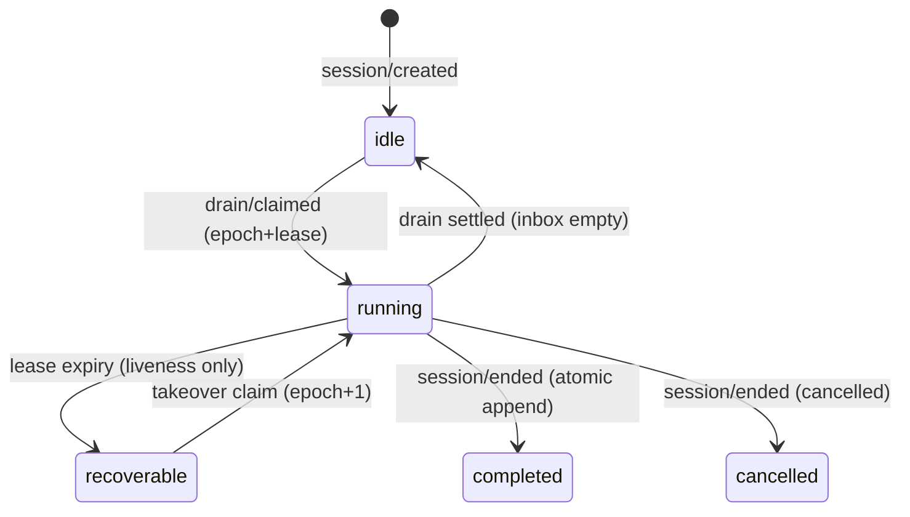
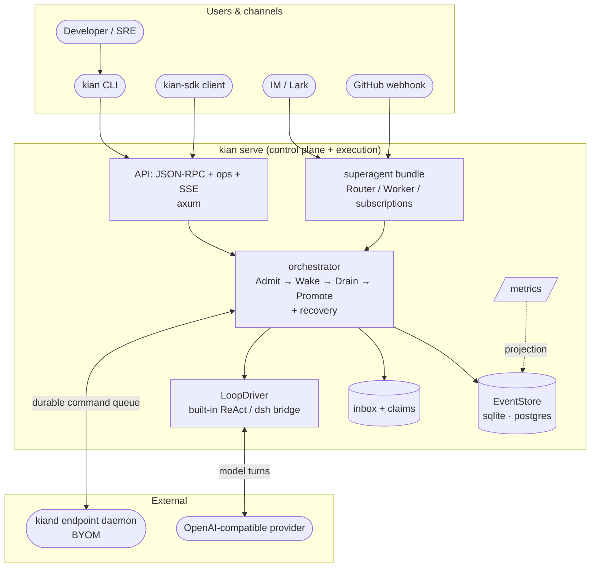

# Kian — Overview

> An external reader's map of Kian: the problem it solves, the execution model, the shape of the
> code, and what has actually been demonstrated. The contract is [SPEC.md](SPEC.md); the blueprint
> is [DESIGN.md](../design/DESIGN.md); the decisions are [design/decisions/](../design/decisions/);
> the changelog is [../CHANGELOG.md](../CHANGELOG.md).

## 1. The problem: a single-session agent does not survive

An agent implemented as one process running one conversation has a single point of failure that is
structural, not incidental:

- **It dies with its process.** A crash, a deploy or an OOM loses the work in flight, and there is
  no record of what was sent to the model, what the model answered, or which tools ran.
- **It cannot be redirected safely.** Steering or interrupting mid-turn has no defined boundary, so
  a new instruction either gets ignored or corrupts the turn it lands in.
- **It cannot be audited.** "The agent said it was done" is not evidence. Without a durable record
  there is nothing to replay, export or diff.
- **It leaks cost silently.** Every rewrite of earlier context invalidates the provider's prefix
  cache; a runtime that reformats history on each turn pays for the same tokens again and again,
  invisibly.
- **It does not scale past one process.** Restart it somewhere else and the state does not travel;
  run two copies and they fight over the same work.

Kian's answer is the durable-execution answer, applied to agent semantics: make the **Session** the
durable entity, make the **event stream** the only source of truth, and make each execution interval
(a **drain**) disposable and restartable.

**One-line claim:** Kian is the Temporal of agents — an open-source, model-neutral, self-hostable
durable execution runtime that makes agent tasks killable, resumable, migratable and auditable.

## 2. The model

Five sentences define the whole system:

1. A **Session** is the one first-class durable entity; everything else (turns, threads, endpoints)
   is derived from or hangs off it.
2. The **event stream** is the sole truth: append-only, never rewritten, and session state is a
   *projection* of it — disposable and rebuildable.
3. An **input** becomes durable (an inbox row) *before* any wake fires; a wake is advisory and may
   fold or be lost, because the inbox is the real queue.
4. A **drain** is the execution hold interval: claim the session (epoch + lease), consume everything
   eligible, promote inputs only at provider-turn safe boundaries, then exit. A drain has no durable
   identity — after a crash a new drain replays the stream and continues.
5. The **agent loop is just a control flow inside a drain** — the core knows how to hold and persist
   execution; the loop (built-in ReAct, or a harness such as dsh behind the `LoopDriver` seam) decides
   what to do with it.

```
Admit  ->  Wake  ->  Drain  ->  Promote
durable    advisory  claim     input rows
row first  signal    lease     become context
```

### Session state machine



Two rules make the machine safe under crashes (both are hard constraints, [DESIGN §2](../design/DESIGN.md)):

- **The end write is one atomic append.** `session/ended` and the state transition commit together,
  so a half-terminated session cannot exist even across a `kill -9`.
- **Safety is fencing, not leases.** A claim issues a monotonic epoch; every drain write carries it;
  the store rejects stale-epoch writes (`expectedSeq` CAS). Leases only *detect* recoverable sessions
  — they never authorize a write.

### Honesty rules that show up in the output

| Rule | What you observe |
|------|------------------|
| interrupted ≠ failed | an interrupted session ends `cancelled`/`interrupted` with the reason in the stream — never `completed` |
| an empty model response is a soft failure | `turn/end` records the soft failure instead of a silent success |
| a stop must pass an evidence gate | the worker bundle's completion claim is checked against the stream before delivery |
| persist-what-you-send | the exact request bytes are a `step/request` event *before* the HTTP call flies; replay is byte-identical |
| compression is the only deliberate prefix invalidation | `compact` is the only counted invalidation cause; anything else is reported as `unexpected_prefix_change` and is a bug |

## 3. Architecture



The **layered iron rule** (constraint 9) is what keeps this clean: the control plane only writes the
inbox and reads projections — it never touches execution; execution only appends events — it never
mutates projections directly. After a crash, replay rebuilds every in-memory structure.

## 4. Crate map

Thirteen crates, one responsibility each. Dependency direction is the crate form of the iron rule:
`kian-orchestrator` depends only on core + store + seam traits, and no provider, channel or harness
implementation ever enters its dependency tree.

| Crate | One line |
|-------|----------|
| `kian-core` | Concept model, the 20 event kinds, session state machine, projection engine, model-context derivation, seam traits |
| `kian-store` | EventStore with `expectedSeq` CAS + epoch fencing, inbox, claims/leases, dual backend (`sqlite` default, `postgres` optional) |
| `kian-orchestrator` | The Admit → Wake → Drain → Promote engine and the three-layer recovery subsystem (pure classification + declarative policy table + budget) |
| `kian-llm` | OpenAI-compatible `ModelProvider`, model slots, and the persist-before-send hook |
| `kian-loop` | `LoopDriver` seam plus the built-in ReAct loop |
| `kian-plugin` | Static plugin system: `Ctx` registry, `Plugin` trait, five-mode dispatch, `Disposer` |
| `kian-endpoint` | KiandProto **endpoint-side** SDK library (embeddable in any process) |
| `kian-exec` | KiandProto **server half**: connection manager, durable command queue with row leases, heartbeat watchdog |
| `kian-superagent` | The super-agent *bundle*: Router/Worker templates, event subscriptions, channels, output policies, recall, watchdog v2 |
| `kian-sdk` | Wire-only embedded client (frozen JSON-RPC + SSE surface, typed errors); depends on no kian crate |
| `kian-dsh` | The S6 bridge: a `LoopDriver` that drives a `dsh` child over stdio and maps its events onto existing kinds; depends on `kian-core` only |
| `kian-cli` | The `kian` binary: `serve` assembly, operator CLI (`inspect`/`replay`/`export`/`wake-now`), the GitHub webhook receiver |
| `kiand` | The endpoint daemon binary (`kian-endpoint` + a thin main) |

## 5. What has been demonstrated (S1–S8)

Scenario definitions live in [SPEC §2.5](SPEC.md); status is recorded here and in the README
acceptance checklists. "Default-green" means it runs in `cargo test --workspace` on any machine with
no credentials and no services.

| # | Scenario | Status | One-line proof |
|---|----------|--------|----------------|
| S1 | Crash recovery: `kill -9` mid-drain, restart, no lost work | **done** — default-green | `crates/kian-cli/tests/chaos_s1.rs`: `chaos_s1_six_kill_points_repeated_runs_all_green` (six kill points — after admit, after claim, mid-provider-turn, mid-tool, before/after the end write — × repeated runs, restart on the same sqlite: no lost work, no half-terminated session, monotone epochs) and `chaos_s1_zombie_old_epoch_writes_all_rejected_across_kill_window` |
| S2 | Steer / interrupt semantics and honesty | **done** — default-green | `crates/kian-cli/tests/s2_steer_interrupt.rs`: `steer_lands_at_next_safe_boundary_with_strippable_synthetic_marker` (no input lands inside an in-flight provider turn), `interrupt_mid_tool_settles_on_abort_and_resumes_honestly` (interrupt ≠ failed), `interrupt_of_idle_and_completed_sessions_is_a_noop` |
| S3 | Cache-byte stability | **done** — default-green | `crates/kian-cli/tests/s3_cache_stability.rs`: `s3_consecutive_requests_share_prefix_and_metrics_expose_it` and `s3_compact_event_bumps_the_invalidation_cause_counter` — only `compact` breaks the prefix, `unexpected_prefix_change` stays zero, exposed on `GET /metrics` and `kian cache-stats` |
| S4 | Super-agent demo: IM request → Router judges → Worker completes → ≤100-word reply + structured delivery | **done** — default-green | `crates/kian-cli/tests/s4_superagent_demo.rs` (8 tests) plus the negative path where a gate-failed worker never reaches delivered |
| S5 | BYOM: cloud loop + `kiand` execution + watchdog detects an offline endpoint | **done** — default-green | `crates/kian-cli/tests/s5_byom_e2e.rs`: exec round-trip through the durable queue, kill -9 while queued → row parks honestly, watchdog health input within the documented detection bound, reconnect drains, timeout is an honest error |
| S6 | Harness integration: dsh interaction unchanged, made durable | **demonstrated — fixture-proven; live leg executed (honest negative), S6-live open** | `crates/kian-dsh/tests/driver_bridge.rs` + `crates/kian-superagent/tests/dsh_conformance.rs` (every mapping row, replay byte parity) + `crates/kian-cli/tests/dsh_bridge.rs` (mounted e2e, kill-9 takeover, child crash → `interrupted`); the live leg (env-gated on `KIAN_DSH_BIN`) ran against real dsh 0.2.1-rc.5 on 2026-11-01 and stopped at an honest `SoftFailed { reason: "peer never sent ready within 30s" }` — the stock dsh SDK app does not meet the ADR-010 contract-v0 bar — so S6-live stays open; details in [runbook-dsh.md](runbook-dsh.md) and the [README run log](../README.md#live-dsh-bridge-run-log-manual-env-gated) |
| S7 | Audit export / replay: a byte-identical replayable package | **demonstrated** — default-green | `kian session export` / re-import round-trips byte-identically (`crates/kian-cli/tests/ops_commands.rs`), and `s4_delegation_audit_export_replays` replays both streams of a delegation |
| S8 | Multi-replica takeover: two replicas over one postgres, `kill -9` the drain owner mid-drain | **demonstrated** — env-gated (`KIAN_PG_URL`) | `crates/kian-cli/tests/postgres_s8.rs::s8_two_replicas_kill9_takeover_no_split_brain`: real `kian serve` children, real `kill -9`, the survivor completes, exactly one end write, and a stale-epoch probe write from the dead replica is rejected |

**Default-green vs env-gated.** Everything except S6's live leg and S8 runs with zero credentials and
zero external services. `KIAN_PG_URL` (postgres), `KIAN_DSH_BIN` (a real dsh install) and the channel
smokes (`KIAN_API_KEY`, `KIAN_LARK_*`, `KIAN_GITHUB_*`) gate the rest: absent, those suites **skip
with a log line and never fail**; present, they run and must pass. The README's environment-contract
table lists every variable.

## 6. Where the design inputs went

Kian was designed against four inputs (frozen snapshots in [references/](references/), synthesis in
[the design notes](the design notes)). Each input contributed something specific and
identifiable in the code:

| Input | What it contributed | Where it lives in Kian |
|-------|--------------------|------------------------|
| **DeepSeek "Super-agent Design Exploration" article** | The four super-agent traits as *composition patterns*: two-layer Router/Worker with Thread delegation, event-driven triggers with two-level admission filtering, subscription passthrough (many-to-many fan-out), Inline/Spill context shaping + Chain of Recall, speculative execution, async `start()`/`stop()` tools, channel-matched output, the watchdog session, and the §7.1 ablation methodology | `kian-superagent` (bundle, not core): Router/Worker profiles, `channels`, `subscriptions`, `classes`, `shaping`, `recall`, `speculation`, `watchdog`, `async_tools`; the ablation benchmark is `crates/kian-superagent/tests/ablation_passthrough.rs` |
| **deepseek-harness (dsh)** | The harness/kernel split: a harness owns interaction and capability; the substrate owns durability. dsh's append-only `SessionEvent` log, its turn/step vocabulary and its "model-visible means logged" rule shaped Kian's event schema and context derivation | `kian-core` event schema + `derive_model_context`; the S6 bridge `kian-dsh` (ADR-010) maps dsh session events onto **existing** kian kinds — zero new kinds |
| **Cordis** | Plugin mechanics: context as a service container (`ctx.<key>`), `inject`-declared dependencies, typed events, and registrations as reversible effects with disposers | `kian-plugin`: `Ctx` registry, `Plugin` trait, five-mode dispatch, `Disposer`; new capability grows config-first → plugin → seam (ADR-004) |
| **Feishu "Kian" design doc + an internal design review** | The durable-execution core itself: Session as the sole first-class entity, event stream as sole truth, drain as the execution hold interval, the P1–P8 problems, the A1–A10 axioms, the six Admit → Wake → Drain → Promote invariants, the epoch-fencing/lease split, and the three-layer recovery model | `kian-core` (state machine, invariants), `kian-store` (CAS + fencing), `kian-orchestrator` (engine + recovery), and the ADR series ([ADR-001](../design/decisions/ADR-001-rust-foundation.md) … [ADR-011](../design/decisions/ADR-011-inbound-webhook-plane.md)) |

The narrow-waist rule (constraint 10) is what keeps the bundles out of the core: the article's
Router/Worker architecture, the channels, the dsh harness and the endpoint daemons are all
*compositions* over core primitives, and the core crates name none of them.

## 7. Read next

| If you want to… | Read |
|-----------------|------|
| see it run in a minute | [README Quickstart](../README.md#quickstart) |
| know what the system promises | [SPEC.md](SPEC.md) (WHAT) |
| know how it is built | [DESIGN.md](../design/DESIGN.md) (HOW) |
| know why a choice was made | [design/decisions/](../design/decisions/) (WHY) |
| see what landed when | [../CHANGELOG.md](../CHANGELOG.md) |
| see the research inputs | [the design notes](the design notes) |
