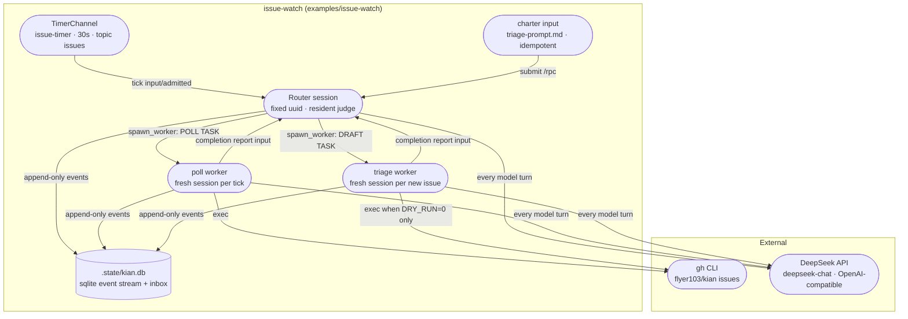

# issue-watch — the kian dogfood example

A long-running agent that watches a GitHub repository for new issues, triages
each one through Router→Worker delegation, drafts a reply, and logs everything
to its durable audit stream — restartable at any moment with zero lost work.

It runs on **real infrastructure only**: a real `TimerChannel` cadence, the real
`gh` CLI against `flyer103/kian`, and a real model round trip through the
DeepSeek API. No mocks, no scripted providers.

## What it proves

| Claim | Where it shows up here |
|-------|------------------------|
| **S1 durability** — kill -9 at any moment, restart, zero lost work | `demo-restart.sh`: the same Router session resumes from the event stream; seq keeps growing, committed timer ticks dedupe, the next tick drives a fresh poll |
| **S4 delegation** — a resident Router judging inputs and dispatching Workers via Thread delegation | every tick: Router → one poll worker (`gh issue list`); every new issue: Router → one triage worker (severity + decision + draft); completion reports flow back as admitted inputs |
| **Channel honesty (S5 discipline)** — the timer is a channel like any other | ticks missed while the server is down simply never happened (the stream honestly shows no poll ran); re-delivered ticks dedupe by `event_id`; the timer's `send` is an honest `Unavailable` |
| **Dry-run by default** | a drafted reply lands in the audit stream; posting a real GitHub comment requires `DRY_RUN=0` in the environment **and** the posting `exec` call is itself a logged `tool/call` + `tool/result` pair |

## Architecture



The flow, once per tick:

1. `TimerChannel` emits `tick-N` on channel `issue-timer`, topic `issues`.
2. The subscription rule routes it to the Router; it admits durably
   (`input/admitted` on the Router stream) **before** the wake fires.
3. The Router's judge turn sees the tick plus its standing charter
   (`triage-prompt.md`, submitted once, idempotently) and dispatches
   **one** poll worker with the verbatim POLL TASK (`thread/started` on
   both streams).
4. The poll worker runs `gh issue list` via the built-in `exec` tool
   (argv-direct, no shell) and finishes with a JSON report of the full
   open-issue list — the derived last-seen state is the previous
   report, i.e. durable `input/admitted` events on the Router's own
   stream (no external state file; zero new event kinds).
5. The report admits to the Router's inbox; the next judge turn diffs
   the latest report against the previous one in its own context and
   spawns one triage worker per new issue with the DRAFT TASK.
6. The triage worker labels severity (`critical|major|minor|trivial`),
   decides `reply|needs-human`, drafts a ≤120-word reply, and — unless
   the environment says `DRY_RUN=0` — never touches `gh`. The draft is
   its final message, i.e. the `thread/completed{summary}` payload:
   the draft **is** in the durable audit stream.

Zero new event kinds: the whole loop rides the existing 20-kind set
(`input/admitted`, `tool/call`, `tool/result`, `thread/started`,
`thread/completed`, …).

## Setup

```bash
cargo build --workspace          # provides ../../target/debug/kian
gh auth status                   # must be logged in (keyring is fine)
grep -c '^DEEPSEEK_API_KEY=' ~/.hermes/.env   # must print 1
```

Requirements: `gh` authenticated for `flyer103/kian`, `DEEPSEEK_API_KEY`
in `~/.hermes/.env` (env-only; the config references the variable name,
never a value), `python3` (charter JSON quoting), `sqlite3` (inspection).

## Run

```bash
cd examples/issue-watch
./run.sh                # DRY_RUN defaults to 1: drafts only, never posts
```

`run.sh` exports `NO_PROXY=127.0.0.1,localhost` (the localhost proxy
gotcha), sources `~/.hermes/.env`, boots `kian serve` on
`127.0.0.1:7460`, submits the charter idempotently, and prints the
inspection commands. To let the watch actually post a comment:
`DRY_RUN=0 ./run.sh` (every posted comment is an audited `exec` call).

While it runs, make it see real work:

```bash
gh issue create -R flyer103/kian -t "example: docs typo in README quickstart" \
  -b "The quickstart says cargo run -p kian-cli but the binary is kian."
```

Then inspect the durable audit (from this directory):

```bash
../../target/debug/kian session inspect 00000000-0000-4000-8000-00000000c060 --db .state/kian.db
../../target/debug/kian session replay   00000000-0000-4000-8000-00000000c060 --db .state/kian.db
../../target/debug/kian session export   00000000-0000-4000-8000-00000000c060 --db .state/kian.db --out audit.json
sqlite3 .state/kian.db 'select distinct session from events order by 1'   # worker sessions
```

## The kill-and-restart demo

```bash
./demo-restart.sh                    # fresh state, boot, kill -9, reboot, proof
CREATE_ISSUE=1 ./demo-restart.sh     # also files + closes a throwaway issue
```

The script boots the watch, waits for at least one tick/poll, records the
Router stream length, `kill -9`s the server (a true crash — no signal
handling), reboots on the **same** sqlite event store, resubmits the
charter (which must dedupe against the committed row), waits for the next
tick, and prints the proof: the same session id, a strictly larger seq,
the deduped tick rows, and `kian session inspect` on the resumed session.

What the restart honestly shows (and does not show): ticks that would
have fired while the server was down never happened — no fake catch-up
poll; the per-process tick counter re-emits `tick-1..k` on boot and the
admission path dedupes them against committed rows; only genuinely new
ticks drive new polls.

## The wire contract (fixed in core by kian-61)

The provider slot points **directly** at `https://api.deepseek.com` — no
adapter. The first live attempt (C60, [RUNLOG.md](RUNLOG.md) §0) found
two incompatibilities between kian's then-frozen C8 request dialect and
strict OpenAI-compatible endpoints: dotted built-in tool names
(`fs.read` — HTTP 400, names must match `^[a-zA-Z0-9_-]+$`) and tool
results without a wire-level `tool_call_id` (HTTP 422 on the first turn
after any tool round trip). The C60 run worked around it with a
temporary example-scoped request adapter; kian-61 fixed it in core
(wire dialect v2 — dotless built-in names, assistant `tool_calls` in
the strict wire shape, `tool_call_id` on tool results, and the agent
`tools:` list now filters each loop's mounted surface). The adapter is
deleted; the RUNLOG records a green direct run under the new dialect.

## Design notes

- **Why sync `exec` instead of the async `start`/`stop` pair (C37)**: the
  async pair routes through the remote-exec endpoint plane (a `kiand`
  daemon + durable queue). The example would then need a second managed
  process for zero narrative gain — a poll that takes ~2s does not need
  its drain unblocked. The sync `exec` tool is the same audited
  `tool/call`/`tool/result` path; the config keeps `superagent.async_tools`
  off (its default).
- **Why a charter input instead of a system prompt**: kian agents are
  declarative versioned config without prompt fields; standing policy
  enters a session the same way everything else does — a durable input,
  idempotently admitted (`issue-watch:charter`). It survives restarts
  because it is an inbox row, not memory.
- **Why `flyer103/kian` itself**: a private repo the operator owns —
  zero external noise, zero risk of triaging a stranger's issue.
- **Derived state (last-seen issue ids)**: not a file — each poll
  reports the full open-issue list, and the Router's diff baseline is
  the previous report in its own context: both are durable
  `input/admitted` events, so the state is event-persisted and survives
  restarts by replay. A fresh demo (`rm -rf .state`) re-runs the
  baseline pass (no drafts for pre-existing issues).
- **Zero-credential discipline**: nothing in this directory runs at
  `cargo test` time; the default gates never see it. All network access
  (model + gh) happens inside `run.sh`/`demo-restart.sh` with the env
  present, and secrets are env-only by the C13 rule.

## Files

| File | Role |
|------|------|
| `config.yaml` | the `kian serve` config: sqlite store, DeepSeek provider slot, Router/`triager` agent templates, `issue-timer` TimerChannel (30s), subscription → Router |
| `triage-prompt.md` | the charter submitted to the Router: standing policy + the verbatim POLL/DRAFT task templates workers receive |
| `run.sh` | boot `kian serve` (direct DeepSeek, no adapter), idempotent charter submit, inspection cheat sheet |
| `demo-restart.sh` | the kill -9 / reboot / resume demo with printed proof |
| `RUNLOG.md` | the recorded live run: real event counts, triage decision, draft, restart result |

The live-run evidence itself: [RUNLOG.md](RUNLOG.md).
