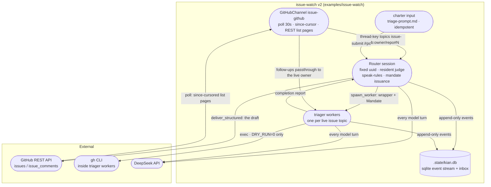

# issue-watch — the kian dogfood example (v2: multi-Ticket fan-out)

A long-running agent that watches a GitHub repository by **polling the
REST list endpoints** (`issues` + `issue_comments`, `since`-cursored),
routes every issue thread under its own canonical topic
(`issue-github:flyer103/kian#<N>`), and fans work out as **one Ticket
per live issue**: the resident Router judges each new issue, accepts it
with a **Mandate**, spawns one triager worker per issue topic; follow-up
comments go to the live triager with **zero Router judge turns**; when a
triager ends, its topic releases to fresh evaluation; the triage draft
delivers exactly once under **speak-rules**, retrying through the
**outbox**; everything lands in durable event streams — restartable at
any moment with zero lost work (`kian tickets` shows the live stage
board).

It runs on **real infrastructure only**: the real github poll channel,
the real `gh` CLI inside workers, and a real model round trip through
the DeepSeek API. No mocks, no scripted providers — those live in the
CI fixture suites (`crates/kian-superagent/tests/github_channel.rs`,
`tests/issue_watch_fanout.rs`); the live-run evidence is RUNLOG §7, executed
2026-11-04: [RUNLOG.md](RUNLOG.md).

The timer-driven v1 shape (one-shot ticks → poll worker → diff → draft
worker) is kept verbatim as `config-timer.yaml` — run `kian serve
--config config-timer.yaml` for the regression demo; `RUNLOG.md`'s
history is append-only.

## What it proves

| Claim | Where it shows up here |
|-------|------------------------|
| ** multi-Ticket fan-out** — one source, many Tickets | two live issues at once: two `thread/started` delegations under distinct topics `issue-github:flyer103/kian#101/#102`, two workers, two drafts — one github channel |
| **Thread keys (ADR-013)** — one canonical correlation unit per issue | every polled event of issue N (opening, comments, edits) carries topic `issue-github:flyer103/kian#N`; the boot resume cursor derives from the last admitted event's `updated_at` — a restart never replays |
| **Follow-up ownership ** | a comment on a live issue admits to that issue's worker; the Router session gets no row and spends no judge turn on it; after the worker ends, the topic releases to fresh Eval |
| **Mandate (ADR-012)** | every delegation wrapper carries `{strength, scope, granted_by, source, policy_version}`; a human-filed issue's poll event carries the adapter-declared `explicit` signal → strength `explicit`; the scope bounds the worker ("never post unless DRY_RUN=0") |
| **Attention economics ** | the Router's `reply` (ack/echo) is suppressed by the `result-ready` speak rule — an honest tool error, no `channel/delivered`; the structured triage draft is the one Result that speaks |
| **Outbox** | the draft delivery retries 2s→…→cap under per-(ticket, conversation) ordering and parks with the visible `delivery-retry` stage if the API stays down |
| ** durability** | `demo-restart.sh`: kill -9 mid-ticket; the reboot rebuilds registry/outbox/speak-tracker from streams and re-derives the poll cursor; seq keeps growing, no duplicate admits |
| **Dry-run by default** | a drafted reply lands in the audit stream; posting a real comment requires `DRY_RUN=0` **and** the posting `exec` call is itself a logged `tool/call` + `tool/result` pair |

## Architecture (v2)



The flow:

1. The github channel polls
 `GET /repos/flyer103/kian/{issues,issues/comments}?…&since=<cursor>`
 every 30s. Each updated item maps through the mapping into a
 `ChannelEvent` whose **delivery id is deterministic**
 (`poll:<kind>:<repo>#<item>:<updated_at>` — an unchanged item
 re-polled dedupes; an updated one is new) and whose **topic is the
 derived thread key** (`issue-github:flyer103/kian#<N>`). A
 human-filed issue carries the adapter-declared `explicit` signal;
 bot/CI senders are dropped by the classes table; the first poll
 is bounded by a 24h backfill window.
2. One passthrough subscription rule correlates by topic. An unbound
 topic falls back to the Router: the judge turn accepts the new
 issue, dispatches one triager via `spawn_worker` with the channel
 wrapper verbatim — the wrapper's explicit signal makes the issued
 Mandate `strength: explicit` — and the worker registers as the
 topic's live owner.
3. A follow-up comment on that issue admits **straight to the live
 triager** (no Router row, no judge turn). When the triager ends, the
 topic releases to fresh Eval at the Router.
4. The triager works under its Mandate (severity, decision, ≤120-word
 draft; `gh` only when `DRY_RUN=0`) and finishes with a JSON report;
 the report admits back to the Router, whose next judge turn
 `deliver_structured`s the draft onto the issue once (the
 `result-ready` speak rule admits exactly that; acks are honest tool
 errors), retrying through the outbox on API failures.

Zero new event kinds: the whole loop rides the existing 20-kind set.

## Setup

```bash
cargo build --workspace # provides../../target/debug/kian
gh auth status # must be logged in (keyring is fine)
grep -c '^DEEPSEEK_API_KEY=' ~/.hermes/.env # must print 1
```

Requirements: `gh` authenticated for `flyer103/kian`, `DEEPSEEK_API_KEY`
in `~/.hermes/.env` (env-only; the config references the variable name,
never a value), `python3` (charter JSON quoting), `sqlite3`
(inspection). `KIAN_GITHUB_TOKEN` comes from the environment or `gh
auth token` (run.sh resolves it; it is never written to any file).

## Run

```bash
cd examples/issue-watch
./run.sh # DRY_RUN defaults to 1: drafts only, never posts
```

`run.sh` exports `NO_PROXY=127.0.0.1,localhost` (the localhost proxy
gotcha), sources `~/.hermes/.env`, resolves `KIAN_GITHUB_TOKEN`, boots
`kian serve` on `127.0.0.1:7460`, submits the charter idempotently, and
prints the inspection commands (including `kian tickets` — the live
stage board). To let the watch actually post a comment: `DRY_RUN=0
./run.sh` (every posted comment is an audited `exec` call plus a
`channel/delivered`).

While it runs, make it see real work:

```bash
gh issue create -R flyer103/kian -t "example: docs typo in README quickstart" \
 -b "The quickstart says cargo run -p kian-cli but the binary is kian."
```

Then inspect the durable audit (from this directory):

```bash
../../target/debug/kian tickets --db.state/kian.db
../../target/debug/kian session inspect 00000000-0000-4000-8000-00000000c060 --db.state/kian.db
../../target/debug/kian session replay 00000000-0000-4000-8000-00000000c060 --db.state/kian.db
sqlite3.state/kian.db 'select distinct session from events order by 1' # worker sessions
```

## The kill-and-restart demo

```bash
./demo-restart.sh # fresh state, boot, kill -9, reboot, proof
CREATE_ISSUE=1./demo-restart.sh # also files + closes a throwaway issue
```

The script boots the watch, waits for at least one poll, records the
Router stream length, `kill -9`s the server (a true crash — no signal
handling), reboots on the **same** sqlite event store, resubmits the
charter (which must dedupe against the committed row), waits for the
next poll, and prints the proof: the same session id, a strictly larger
seq, the `kian tickets` stage board, and the deduped event rows.

What the restart honestly shows: the poll cursor is re-derived at boot
from the last admitted event's `updated_at` and every admit is
idempotent by `event_id`, so the source never re-delivers what the
previous incarnation already admitted.

## The v2 config surface (config.yaml)

| Section | Role |
|---------|------|
| `channels.issue-github.github.poll` | `{repo, interval_ms, kinds: [issues, issue_comments], since_field: updated_at, backfill_ms}` — the poll-receive mode, beside the webhook surface (`webhook_receive: false` here: no receiver route, no webhook secret) |
| `intake.thread_keys` | `[{channel: issue-github, key: [group, issue.number]}]` — the config-owned canonical derivation (the same rule the poll mapper applies; keys are config-owned — a config change is a new key, old streams keep their topics) |
| `classes` | the table: known bot senders `ignore`; everything else `candidate` (sender matching is exact JSON equality — extend per bot as observed) |
| `subscriptions` | one passthrough rule correlated by topic (unbound → Router fresh Eval; live → the owning worker; all-ended → fresh Eval) |
| `speak_rules` | `result-ready` on the channel: the draft (a Result) speaks; acks (Decisions) are refused. `ack-first-only` + `per_topic_ack: true` is the alternative spelling — the closed vocabulary binds one condition per channel, so pick the trade-off explicitly |
| `mandate.scopes.triager` | the authority scope stamped on every triager delegation |
| `outbox: {}` | the defaults: 6 attempts, 2s backoff doubling to 60s, per-conversation ordering, park with a visible stage |

## The wire contract (fixed in core)

The provider slot points **directly** at `https://api.deepseek.com` — no
adapter. The first live attempt ([RUNLOG.md](RUNLOG.md) §0) found
two incompatibilities between kian's then-frozen request dialect and
strict OpenAI-compatible endpoints: dotted built-in tool names
(`fs.read` — HTTP 400, names must match `^[a-zA-Z0-9_-]+$`) and tool
results without a wire-level `tool_call_id` (HTTP 422 on the first turn
after any tool round trip). It was fixed in core (wire dialect v2 —
dotless built-in names, assistant `tool_calls` in the strict wire
shape, `tool_call_id` on tool results, and the agent `tools:` list now
filters each loop's mounted surface). The example-scoped adapter the
 Run needed is deleted; the RUNLOG records a green direct run under
the new dialect.

## Design notes

- **Why poll, not webhooks**: the watch must run anywhere (no public
 ingress, no webhook secret to provision) and the SPEC's names the
 poll shape. Poll mode is *beside* the webhook surface: the same
 channel type can receive webhooks too (`webhook_receive: true` +
 `KIAN_GITHUB_WEBHOOK_SECRET`); here it simply doesn't. Both feeds
 share the mapping and the `event_id` dedupe, so running both
 cannot double-admit.
- **Read position without a table** (ADR-013): the `since` cursor is
 derived at boot from the last admitted event's payload; between
 restarts it lives in the adapter's memory. The durable backstop is
 admission's `event_id` idempotency — a re-poll can never double-admit.
- **Why a charter input instead of a system prompt**: kian agents are
 declarative versioned config without prompt fields; standing policy
 enters a session the same way everything else does — a durable input,
 idempotently admitted (`issue-watch:charter`). It survives restarts
 because it is an inbox row, not memory.
- **Why `flyer103/kian` itself**: a repo the operator owns — zero
 external noise, zero risk of triaging a stranger's issue.
- **Zero-credential discipline**: nothing in this directory runs at
 `cargo test` time; the default gates never see it. All network access
 happens inside `run.sh`/`demo-restart.sh` with the env present, and
 secrets are env-only by the rule.
- **Exec blast radius is the operator's machine **: the
 `exec` tool is argv-direct, but argv[0] can be a shell — a worker
 that runs `bash -c "ls ~; find ~ …"` enumerates the operator's home
 exactly as the live run showed, and a worker that runs `env`
 reads the server environment. The mandate's scope text bounds what
 the model *should* do; the harness bounds what it *can*: every
 secret `kian.yaml` itself names (provider keys, `KIAN_GITHUB_TOKEN`,
 the webhook/lark secrets, the postgres URL env) plus
 `tools.exec_redact.env_names` extras is redacted from exec
 stdout/stderr before anything persists (default on), and
 `tools.exec_env.mode: allowlist` stops unlisted variables — secrets
 included — from ever reaching the child (opt-in; `inherit` stays the
 default for compatibility). Blast radius beyond that (filesystem
 reach of the exec user) is a deployment concern, not a harness one.
- **Known fixture-observed gap (confirmed by the live run)**: the stage
 table's arm 5 reads `queued` whenever the consuming drain appends
 `input/admitted` after its own `drain/claimed` — on real engine
 streams that is every consumed input, so an ended ticket can project
 `queued` instead of `idle`. The fixture suite asserts the honest
 projection; the live run records what `kian tickets` shows.

## Files

| File | Role |
|------|------|
| `config.yaml` | the v2 `kian serve` config: github poll channel, thread keys, classes, passthrough rule, speak-rules, mandate, outbox |
| `config-timer.yaml` | the v1 timer-driven config, verbatim (regression demo) |
| `triage-prompt.md` | the v2 charter submitted to the Router: standing policy + the triager contract |
| `run.sh` | boot `kian serve`, resolve the github token, idempotent charter submit, inspection cheat sheet |
| `demo-restart.sh` | the kill -9 / reboot / resume demo with printed proof |
| `flaky-proxy.py` | the fault-injecting proxy: kills the Nth router-judge stream (`KILL_ON`) and/or fails the first `FAIL_N` `FAIL_METHOD` requests matching `FAIL_PATH` with 502 (`FAIL_PATH=/comments FAIL_N=2` reproduces the step-6 delivery-leg retry; a high `FAIL_N` the park arm) — |
| `RUNLOG.md` | the recorded live runs (append-only; v2 evidence: §7) |

The live-run evidence itself: [RUNLOG.md](RUNLOG.md).
