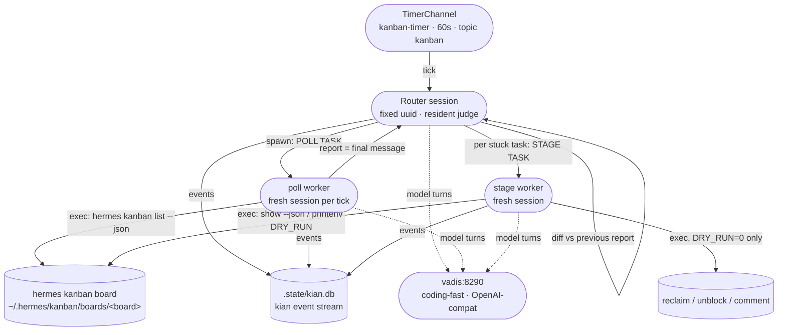

# kanban-watch — the second kian dogfood example

A long-running kian agent that watches a **local Hermes Kanban board** for
stalled work and pushes it forward — "监听本地 hermes kanban 的执行状态，对
于阻塞的任务推送执行", eating kian's own dogfood to run kian's development
board.

It is structurally the issue-watch example with the watched system swapped:

| issue-watch | kanban-watch |
|---|---|
| `gh issue list --json` poll | `hermes kanban --board <board> list --json` poll (a one-shot `show --json` per candidate) |
| diff → new issues | diff → status changes + stuck conditions |
| triage worker (severity + draft reply) | stage worker (classify stage → self-fix or needs-human) |
| `DRY_RUN=0` gates `gh issue comment` | `DRY_RUN=0` gates `hermes kanban reclaim / unblock / comment` |

Zero new event kinds, zero new crates: the loop rides the existing 20-kind
set through `TimerChannel`, the resident Router and fresh worker sessions.

## What it proves

| Claim | Where it shows up |
|-------|-------------------|
| ** durability** — kill -9 anywhere, restart, zero lost work | `run.sh` is idempotent: re-running resumes the same Router session from `.state/kian.db`; the poll history is the Router's own `input/admitted` events |
| ** delegation** — resident Router, fresh workers per tick/task | every tick: Router → one poll worker; every stuck task: Router → one stage worker |
| **Channel honesty** | ticks missed while the server is down never happened; re-delivered ticks dedupe by `event_id` |
| **Dry-run by default** | stage classifications and drafted comments land in the audit stream; any write to the board requires `DRY_RUN=0` and is a logged `tool/call` + `tool/result` pair |
| **Reason vocabularies (§4.7)** | every stage classification carries exactly one closed-vocabulary `reason=` code |

## The stage vocabulary (closed)

A task is worth acting on only when it matches one of these (first match
wins, mirroring `stage.rs`'s own first-match table):

| Stage | Condition | Stuck when |
|-------|-----------|------------|
| `stalled-running` | status=running AND last heartbeat older than `STALLED_HEARTBEAT_S` (default 600s) | always actionable |
| `blocked-needs-input` | status=blocked | actionable only if the blocking reason is resolvable without a human (e.g. an expired lease) |
| `review-idle` | status=review AND no reviewer response for `REVIEW_IDLE_S` (default 48h) | needs-human (nudge comment only) |
| `failure-loop` | consecutive timeouts/crashes with `last_failure_error` repeating | needs-human |

Statuses `todo/ready/scheduled/running(healthy)/done/archived` are healthy —
never reported.

## The push semantics (what "推送执行" means here)

- `stalled-running` → (live mode) `hermes kanban reclaim <id> --reason
  "kian kanban-watch: heartbeat stalled..."` so the dispatcher re-spawns it;
  (dry-run) the drafted reclaim is the audit trail.
- `blocked-needs-input` → (live) `hermes kanban unblock <id> --reason...`
  only when the block is mechanical (expired lease / stale claim); otherwise
  needs-human.
- `review-idle` / `failure-loop` → needs-human: a drafted `hermes kanban
  comment` nudging the reviewer/owner (posted only in live mode).
- The watch **never** touches tasks it created itself (marker: the
  `kanban-watch:` prefix in its own comment text), closing the self-watch
  loop.

## Architecture



## Setup

```bash
cargo build --workspace # provides../../target/debug/kian
hermes kanban boards # pick the board to watch; default "kian"
# vadis must be up (OpenAI-compatible on 127.0.0.1:8290) — no API key needed
# (any bearer is accepted; one is sent to satisfy the wire shape)
```

## Run

```bash
KANBAN_BOARD=kian./run.sh # dry-run (default): classify + draft only
DRY_RUN=0 KANBAN_BOARD=kian./run.sh # live: allowed to reclaim/unblock/comment
```

`run.sh` boots `kian serve` on 127.0.0.1:7461 (issue-watch uses 7460),
submits the charter once (idempotent), then follows the serve log.

## Inspect the audit

```bash
../../target/debug/kian session inspect $ROUTER --db.state/kian.db
sqlite3.state/kian.db 'select distinct session from events order by 1'
tail -f.state/serve.log
```

## Anti-loop rules (why this cannot runaway)

1. It only writes via `hermes kanban` CLI subcommands — never the sqlite file.
2. Every write it makes is a comment/reclaim/unblock carrying the
   `kanban-watch:` marker; stage workers skip tasks whose latest comment
   already carries the marker.
3. `stalled-running` reclaim is capped at one attempt per task per watch
   lifetime (Router remembers dispatched stage tasks in its own stream).
4. Write commands are additionally guarded by `DRY_RUN`.
